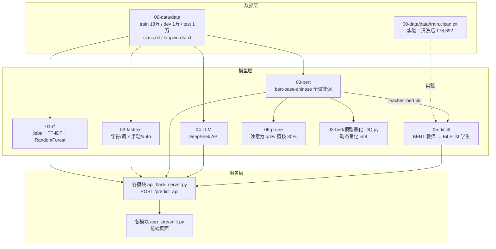
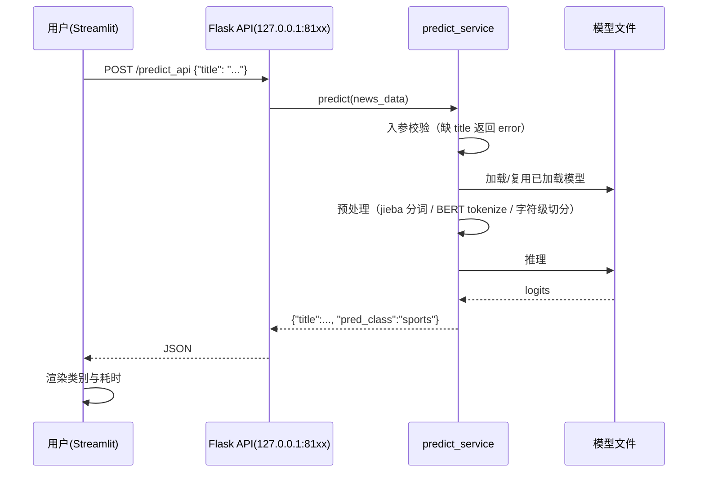

# 项目工程实践与技术学习档案（投满分新闻分类项目）

> **状态更新（2026-10-22）**：本文为历史/前期归档，不代表最终实现；最终能力与验收状态以 [README](../README.md) 和 [v6 学习档案](PROJECT_LEARNING_GUIDE_v6_全链路交付与隔离验收.md) 为准。B8 LLM 仍 missing，D7 未执行，真实设备/真实 LLM 未验收。


## 0. 文档信息

| 项目 | 内容 |
|---|---|
| 项目名称 | 投满分新闻分类（TouManFenClassifier）—— 新闻标题 10 类自动分类 |
| 文档版本 | v1.0 |
| 生成时间 | 2026-10-19（基于 2026-10-12 ~ 2026-10-19 会话记录） |
| 对应工程 | `E:\AIModels\test\TouManFen\TouManFenClassifier\`（7 模块 + tools + docs，62 个 .py） |
| 覆盖范围 | 需求核对 → 可行性分析 → 环境验证 → 参考代码评审 → 工程骨架搭建 → 全链路训练/优化 → 接口与前端联调 → 数据清洗实验 → 口径收口 |
| 证据来源 | 本会话中的工具调用与返回、真实命令输出、训练/推理日志、工程文件内容、`docs/实测指标.md`、`docs/联调记录.md`、`00-data/data/clean_report.md`，以及工作区中的三份可行性报告 |
| 证据限制 | 1) 无法访问 DSH 的原始会话事件流（Trajectory）与逐条工具调用 ID，仅能依据本会话上下文与磁盘产物；2) 文档中"时间"来自日志时间戳或会话轮次先后顺序，未经独立时钟核验；3) 部分早期分析过程已不可回放，相关结论以磁盘上的报告文件为准；4) 所有 API key 均已脱敏，不记录真实值 |
| 项目最终状态 | 主链路（数据→RF→fastText→BERT→LLM→量化/蒸馏/剪枝→Flask API→Streamlit 前端）全部跑通；主口径指标已实测；数据清洗与清洗集重训作为实验章节保留；剩余事项见第 16 章 |

> **本文档定位**：不是开发日志，而是一份"可追溯、可学习、可复现"的工程实践档案。它记录真实发生的过程、真实失败、真实决策，以及这些决策背后的技术原理。

> ⚠️ **历史档案（截至 2026-10-19）**：本文记录的主前端是 Streamlit 演示页；2026-10-20 起项目主前端为 Vue 3（`frontend/`），并新增 FastAPI 网关与局域网访问。本文的模型/训练/联调记录作为历史证据保留；文中"尚未实现/未验证"等状态以第 16 章为准，**当前能力见 [README.md](../README.md)**。

> **2026-10-21 续篇**：模型适配层、worker 统一预测契约与网络配置重构的记录见 [PROJECT_LEARNING_GUIDE_v5_模型适配层与网络配置重构.md](PROJECT_LEARNING_GUIDE_v5_模型适配层与网络配置重构.md)。

---

## 1. 阅读指南

### 1.1 本文档记录了什么

- 一个**真实项目**从"只有一份 2191 行实现文档"到"完整可运行工程 + 实测指标"的全过程；
- 中间出现的**15 个左右的技术问题**（含失败尝试、根因、修复、验证与局限）；
- **模型建议 vs 用户选择 vs 实际落地**三者的区分；
- 最终工程的**架构、模块职责、数据流、接口契约**；
- 复现命令、避坑清单、术语表与知识迁移。

### 1.2 本文档没有记录什么

- 没有逐字还原模型的内部思维链（只记录可复核的决策摘要与依据）；
- 没有虚构未发生的测试、未执行的命令、未出现的用户选择；
- 没有记录真实 API Key、令牌等敏感信息（涉及处均脱敏）。

### 1.3 信息性质标记

文档中对关键结论使用四种标记，请读者注意区分：

| 标记 | 含义 | 判定依据 |
|---|---|---|
| **【已验证事实】** | 有实际执行结果、日志、文件内容或测试输出支撑 | 工具返回、命令输出、文件内容 |
| **【历史记录】** | 会话中明确出现过，但当前无法重新核验 | 会话上下文中的陈述 |
| **【技术分析】** | 基于证据的解释、推断或方案评价 | 作者（模型）的分析 |
| **【待确认事项】** | 证据不足，无法下结论 | 明确标注未知 |

根因分析中还会区分"已证实的直接原因""与证据一致的可能原因""未验证的假设"。

### 1.4 推荐阅读路径

- **想快速了解项目结果** → 第 5 章（交付成果）+ 第 6 章（架构）+ 第 12 章（验证证据）；
- **想学习排障方法** → 第 10 章（问题案例库，建议按 P1/P3/P11/P12 顺序读）；
- **想复现项目** → 第 4 章（环境）+ 第 14 章（复现指南）+ 第 18 章（命令索引）；
- **想做技术选型** → 第 8 章（决策档案）+ 第 11 章（方案变更与返工）；
- **想迁移经验** → 第 13 章（技术原理）+ 第 15 章（避坑清单）+ 第 20 章（复盘）。

---

## 2. 项目概述

### 2.1 业务背景与问题定义

"投满分"是字节跳动今日头条推荐系统中的一个子任务：把新闻等**短文本**（主要是标题）自动分到 10 个频道类别，实现"像快递一样投递到对应频道"，从而提升点击、订阅与付费转化。

10 个类别（`class.txt`，按行序即标签 id）：`finance`（金融）、`realty`（房地产）、`stocks`（股票）、`education`（教育）、`science`（科技）、`society`（社会）、`politics`（政治）、`sports`（体育）、`game`（游戏）、`entertainment`（娱乐）。

### 2.2 项目目标（原始）

1. 对新闻标题做 10 类多分类；
2. 走完「数据预处理 → 模型训练 → 评估 → 部署 → 前端展示」完整流程；
3. 形成"基线模型 → 复杂模型 → 大模型"的对比链路；
4. 通过模型量化、蒸馏、剪枝完成模型压缩实验；
5. 产出可直接演示的 Flask API 与 Streamlit 前端。

### 2.3 用户实际诉求的演进

| 阶段 | 用户诉求 | 性质 |
|---|---|---|
| 起点 | "阅读项目实现文档，检查可行性" | 只评估，不实现 |
| 第 2 轮 | 提供更完整的参考资料后"重新评估可行性" | 材料扩充后再评估 |
| 第 3 轮 | 提供预训练模型后"看对项目有帮助吗" | 资产确认 |
| 第 4 轮 | "先把工程文件创建好，后续慢慢调整……再联通" | 决定动工，先骨架后联调 |
| 第 5 轮 | 提供 Python 3.10.9 环境，选择 **B 方案**（BERT 解冻全量微调） | 关键技术决策 |
| 第 6 轮 | 提供有效 API key，要求"完成其余模块 API/前端联调" | 联调与交付 |
| 第 7 轮 | "改进蒸馏学生" | 质量优化 |
| 第 8 轮 | "先数据去重清洗，再蒸馏续训 1~2 epoch 冲 0.90" | 数据治理 + 指标冲刺 |
| 第 9 轮 | 询问 BERT 是否值得清洗重训（**只回答不执行**） | 决策咨询 |
| 第 10 轮 | 选择"未清洗数据作为主口径，清洗集作为实验章节" | 最终口径收口 |

### 2.4 使用场景与预期价值

- 场景：新闻标题实时分类接口 + 演示前端；
- 价值：给出多档模型（高精度 / 高性价比 / 极轻量）供不同业务条件选择；
- 本档案的价值：把"文档 → 可运行工程"的迁移过程、踩坑与决策固化下来。

---

## 3. 原始需求与最终需求

### 3.1 初始需求（来自 V3.0.md 与资料）

1. 数据：`train.txt` 18 万（10 类各 1.8 万）、`dev.txt`/`test.txt` 各 1 万，`标题\t标签`；
2. 随机森林基线：jieba 分词 + TF-IDF + RandomForest，macro P/R/F1；
3. fastText：字符级/词级 × 手动/自动调参共 4 个模型；
4. BERT：`bert-base-chinese`，batch 64、max_length 32，epochs 2（资料）/1（参考代码）；
5. 大模型：DeepSeek（资料）/ 通义千问（参考代码）调用分类；
6. 部署：每类模型一个 Flask 接口 + 一个 Streamlit 前端；
7. 压缩：动态量化（DQ）、蒸馏（BERT→BiLSTM）、非结构化剪枝 30%；
8. 对比表格与实验报告。

### 3.2 验收标准（资料中明确要求）

- 四版模型各自的「配置→预处理→训练评估→保存→预测封装→Flask API→Streamlit 前端」闭环；
- 保存可调用的模型文件、处理后的数据、预测结果文件；
- 产出对比表：四模型指标（资料期望 RF 82.47% → fastText 91.65% → BERT 93.17%）、量化前后（体积/时延/F1）、蒸馏前后、剪枝前后稀疏度；
- 用 Gitee 完成提交（`add→commit→push`，禁止直接改 master）。

### 3.3 用户后续追加/变更的要求

| 要求 | 提出方式 | 落地情况 |
|---|---|---|
| 不修改 `V3.0.md` 原文 | 明确要求 | ✅ 全文未改（SHA256 校验过） |
| 新建工程文件夹、沿用参考代码 7 模块结构 | 明确选择 | ✅ `TouManFenClassifier/` |
| 数据复制进工程、预训练模型用相对路径引用 | 明确选择 | ✅ `00-data/data` + `../PretrainedModel` |
| BERT 采用 **B 方案**（解冻全量微调） | 明确选择 | ✅ test 0.9307 |
| 先做下游三步（量化/剪枝/蒸馏） | 明确选择 A | ✅ 全部完成 |
| 蒸馏学生改进 | 明确要求 | ✅ v1→v2→v2b |
| 先清洗再续训 1~2 epoch | 明确要求 | ✅ 清洗 180,000→178,692；v2b 0.9074 |
| BERT 是否清洗重训 | 咨询（不执行） | 结论：不值得；未重训 |
| 主口径 = 未清洗数据，清洗集作实验章节 | 明确选择 | ✅ 文档已按此重构 |

### 3.4 尚未实现 / 尚未验证的要求

| 项 | 状态 |
|---|---|
| Gitee 首次提交 | ❌ 未执行（`.gitignore` 已就绪） |
| 全量 LLM 评估（1 万条） | ❌ 未执行（只做了样例调用，成本与耗时原因） |
| 无泄漏重评（剔除 test 中 110 条与 train 重叠样本） | ❌ 未执行（已列为可选） |
| Streamlit 浏览器人工点击验收 | ⚠️ 用 `AppTest` 做了程序化交互验证，未做真人浏览器验收 |
| 数据清洗后 BERT / 量化 / 剪枝的重训 | ❌ 未执行（分析后判定不值得） |

---

## 4. 工程环境与项目结构

### 4.1 运行环境【已验证事实】

| 项 | 实测值 |
|---|---|
| 操作系统 | Windows 11 家庭版 中文版，10.0.26200，64 位 |
| CPU / 内存 | AMD Ryzen 7 8845H（torch 线程数 8）/ 31.3 GB |
| GPU | 仅 AMD Radeon 780M 核显 + GameViewer 虚拟显示适配器；**无 NVIDIA GPU，`torch.cuda.is_available()=False`** |
| Python（主环境） | `D:\Miniconda3\envs\py3109` → Python 3.10.9；torch 2.14.1+cpu、transformers 4.57.6、scikit-learn 1.7.2、fasttext-wheel 0.9.2、flask 3.1.3、openai 3.31.0、numpy 2.2.6、pandas 2.3.3 |
| Python（辅助） | `C:\Users\陈文轩\.dsh\...\python.exe`（3.14.7，项目早期用于评估；含 torch 2.14.1/transformers 5.19.0）；`D:\Python\python3109`（3.10.9，曾用于 fastText 验证） |
| 网络可达性 | pypi.org ✅、files.pythonhosted.org ✅、modelscope.cn ✅、api.deepseek.com ✅、gitee.com ✅、**huggingface.co ❌、github.com ❌** |
| 磁盘 | D: 余约 330 GB（工程最终约 10.3 GB，含模型产物） |

### 4.2 依赖约束（踩坑总结，详见第 10 章）

| 约束 | 原因 |
|---|---|
| `numpy<2`（或打补丁） | fasttext 封装使用 `np.array(x, copy=False)`，NumPy 2.x 抛 `ValueError` |
| `transformers<5` | 5.x 移除了 `tokenizer.batch_encode_plus` |
| 用 `fasttext-wheel` 而非 `fasttext` | 后者在 Windows 无预编译轮子，源码编译需要 MSVC |
| Python ≤ 3.12（fastText 场景） | fasttext-wheel 的 Windows 轮子只到 cp312 |

### 4.3 项目目录结构【已验证事实】

```
TouManFenClassifier/                 # 工程根（新建，不改动参考代码）
├── 00-data/                         # 原始数据 + EDA
│   ├── data/                        # train.txt(18万) dev/test(各1万) class.txt stopwords.txt
│   │   ├── train.clean.txt          # 清洗后训练集（实验用，178,692 条）
│   │   └── clean_report.md          # 清洗报告
│   ├── config.py  data_eda.py
├── 01-rf/                           # 随机森林基线
│   ├── config.py data_preprocessing.py rf_train.py rf_predict_service.py
│   ├── api_flask_server.py app_streamlit.py run_streamlit.py
│   ├── data/ save_model/ result/
├── 02-fasttext/                     # fastText：字符/词 × 手动/auto
├── 03-bert/                         # BERT 微调 + 动态量化
│   ├── config.py data_preprocessing.py bert_model.py bert_train_and_eval.py
│   ├── bert_predict_service.py 模型量化_DQ.py log.py
│   ├── log/ save_model/（bert.pkl / checkpoint.pt / quantization_model.pkl）
├── 04-LLM/                          # 大模型分类（DeepSeek）
│   ├── .env（gitignore） .env.example llm_predict_service.py
│   ├── 01~04 各平台示例脚本、api_flask_server.py、app_streamlit.py
├── 05-distill/                      # 蒸馏：BERT(教师) → BiLSTM(学生)
│   ├── student_bilstm_model.py（v1）student_bilstm_v2.py（v2）
│   ├── model_distll.py（v1）distill_v2.py（v2）
│   ├── student_predict_service.py（自动识别 checkpoint 结构）
│   ├── cache/（教师 logits、SVD 初始化、清洗索引）
│   ├── save_model/（student_bert.pkl / student_v2.pkl / student_v2b.pkl / teacher_bert.pkl）
├── 06-prune/                        # 非结构化剪枝 30%
├── tools/                           # prepare_data.py clean_data.py handoff_models.py patch_fasttext_numpy2.py
├── run_all.py                       # 流水线骨架
├── requirements.txt  README.md  .gitignore
└── docs/                            # 实测指标.md 联调记录.md 本文档
```

### 4.4 工作区其他目录（输入资料，未改动）

| 目录/文件 | 作用 |
|---|---|
| `V3.0.md` | 原始实现文档（2191 行），只读、未修改 |
| `V3.0-可行性检查报告.md` | 第一轮静态可行性检查（13 个 P0 / 12 个 P1） |
| `V3.0-实测验证报告.md` | 第二轮真机验证（环境、依赖、数据、量化/剪枝实测） |
| `V3.0-项目可行性重估报告.md` | 第三轮基于参考代码/数据/资料的重估 |
| `参考代码/gzai6_tmf/` | 用户提供的 7 模块参考实现（92 个文件），保持原样 |
| `数据/` | 原始数据（train/dev/test/class/stopwords） |
| `参考资料/` | 7 篇笔记 + 4 个 PPTX（含目标指标与验收要求） |
| `PretrainedModel/` | 6 个预训练模型（共 9.27 GB），本项目使用 `bert-base-chinese` |

### 4.5 部署与运行方式

- **服务**：每个模块一个 Flask 开发服务器，端口 RF 8101 / fastText 8103 / BERT 8104 / LLM 8105 / 蒸馏 8106；统一接口 `POST /predict_api`，字段 `title`；
- **前端**：每个模块一个 Streamlit 页面（默认 8501），通过 `requests` 调后端；
- **训练**：直接运行各模块的 `*_train*.py`；长任务用后台进程 + 日志（`03-bert/log/train_ft.log`、`05-distill/log/*.log`）；
- **限制**：Flask 开发服务器不可用于生产；`debug` 已关闭；无并发/鉴权/限流。

---

## 5. 最终实现成果总览

### 5.1 最终实现了什么

| 能力 | 状态 | 证据 |
|---|---|---|
| 数据准备与统计 | ✅ | `00-data/data`（180,000 / 10,000 / 10,000）、`data_eda.py` |
| 随机森林基线 | ✅ | test macroF1 **0.8302**、模型 1,512 MB、1.2 s/万条 |
| fastText 4 模型 | ✅ | 0.8706 / 0.9140 / 0.9089 / **0.9173**（词级 auto 为服务端模型） |
| BERT 全量微调（B 方案） | ✅ | test **0.9307**、5h20m、390.2 MB |
| 动态量化 int8 | ✅ | **0.9263**、152.7 MB（2.68x 压缩）、120 s/万条（2.8x 提速） |
| 非结构化剪枝 30% | ✅ | 稀疏度 30%、**0.9294**、体积不变（390.2 MB） |
| 蒸馏（v1/v2/v2b） | ✅ | 0.8021 / 0.8974 / **0.9074**，v2b 为 36.7 MB、13 s/万条 |
| LLM 分类（DeepSeek） | ✅ | 样例调用正常、输出白名单校验；未做全量评估 |
| Flask API（5 个） | ✅ | 逐一启动并实测（见 `docs/联调记录.md`） |
| Streamlit 前端（5 个） | ✅ | `AppTest` 程序化交互 5/5 通过 |
| 数据清洗实验 | ✅ | 180,000→178,692（-0.73%）；清洗集重训 RF/fastText；报告在 `clean_report.md` |

### 5.2 交付产物清单

| 产物 | 位置 | 体积/说明 |
|---|---|---|
| 随机森林 + TF-IDF | `01-rf/save_model/rf.pkl`、`tfidf.pkl` | 1,512 MB / 2.4 MB |
| fastText 4 模型 | `02-fasttext/save_model/*.pkl` | 共约 2.5 GB |
| BERT 微调模型 + 断点 | `03-bert/save_model/bert.pkl`、`checkpoint.pt` | 390.2 MB / 1,166 MB（含优化器，可续训） |
| 量化模型 | `03-bert/save_model/quantization_model.pkl` | 145.6 MiB（152.7 MB） |
| 蒸馏教师/学生 | `05-distill/save_model/teacher_bert.pkl`、`student_v2b.pkl` | 390.2 MB / 36.7 MB |
| 剪枝前后模型 | `06-prune/save_model/before|after_prune_model.pkl` | 各 390.2 MB |
| 清洗集重训模型（实验） | `*_clean.pkl` | 约 3.7 GB（主口径不加载） |
| 文档 | `README.md`、`docs/实测指标.md`、`docs/联调记录.md`、`00-data/data/clean_report.md`、本文档 | — |

### 5.3 已实现但未验证 / 未实现

- 已实现未验证：LLM 全量测试集评估、Streamlit 真人浏览器验收、Gitee 提交；
- 未实现：无泄漏重评、清洗后 BERT/量化/剪枝重训、生产级部署（WSGI/并发/鉴权）。

---

## 6. 项目整体架构与核心业务流程

### 6.1 模块架构（最终实际架构）



### 6.2 核心请求流（预测链路）



### 6.3 各模块职责与接口约定

| 模块 | 职责 | 模型/输入 | 端口 |
|---|---|---|---|
| 01-rf | 基线：分词 + TF-IDF + RF | `rf.pkl` + `tfidf.pkl`；输入 raw title，内部 jieba 取前 30 词 | 8101 |
| 02-fasttext | 词向量模型 | `word_auto_train.pkl`；输入 raw title，内部 jieba 分词 | 8103 |
| 03-bert | 预训练模型微调 + 量化 | `bert.pkl`；输入 raw title，内部 BERT tokenize（max_length=32） | 8104 |
| 04-LLM | 零样本大模型分类 | DeepSeek `deepseek-chat`；输入 raw title | 8105 |
| 05-distill | 蒸馏学生（轻量） | `student_v2b.pkl`（自动识别结构）；输入 raw title | 8106 |
| 06-prune | 剪枝实验 | 前后模型；无独立 API | — |

统一约定：`POST /predict_api`，请求 `{"title": "新闻标题"}`，响应 `{"title": "...", "pred_class": "类别名"}`；缺字段返回 `{"error": "传递的参数中没有title字段", ...}`。

### 6.4 配置项之间的关系

- 配置锚点：所有 `config.py` 用 `_MODULE_DIR = dirname(__file__)`、`_PROJECT_ROOT = dirname(_MODULE_DIR)` 计算绝对路径，**不再依赖运行时工作目录**；
- 预训练模型：`_BERT_PATH = os.environ.get("TMF_BERT_PATH", 项目同级 PretrainedModel/bert-base-chinese)`；
- 训练产物：各模块 `save_model/` 下；`TMF_EXPERIMENT_TAG` 可为产物加后缀（如 `_clean`），实现实验隔离；
- 超参：BERT 支持 `TMF_FREEZE_BERT / TMF_EPOCHS / TMF_LR / TMF_EVAL_INTERVAL / TMF_RESUME`；蒸馏 v2 支持 `TMF_USE_CLEAN / TMF_KEEP_IDX / TMF_INIT_STUDENT / TMF_EPOCHS / TMF_LR` 等。

### 6.5 错误处理与安全

- 5 个预测服务均做入参兜底（缺 title 返回结构化错误）；
- LLM 服务对模型输出做 10 类白名单校验，非法时重试一次，仍非法则返回 `error`；
- 密钥从 `.env`（gitignore）读取，源码中无明文；`.gitignore` 排除 `.env`、模型、数据产物；
- 遗留风险：Flask 开发服务器、无鉴权、无并发控制、`debug=False` 但仍是单进程。

---

## 7. 项目完整实施时间线

> 时间来自日志时间戳或会话轮次顺序；无法精确到时间的以"第 N 阶段"表述。表中"关键决策"只记录会话中有明确记录的选择。

| 阶段 | 时间 | 当时目标 | 主要操作 | 遇到的问题 | 关键决策 | 结果与影响 |
|---|---|---|---|---|---|---|
| 1 | 10-12 15:22 | 阅读 `V3.0.md` 判断可行性 | 通读 2191 行、逐段核对代码 | DSH 沙箱 ACL 失败，shell 全不可用 | 用 `diagnose-windows-sandbox-acl` 修复工作区权限 | 修复后仍遇临时目录授权失败，改为只读分析 |
| 2 | 10-12 16:00+ | 验证文档中的技术断言 | 真机跑量化/剪枝/分词器/fastText/LLM 连通性 | fasttext 装不上、numpy2 冲突、transformers v5 移除 API | 无（用户当时未提供环境） | 产出第一份实测报告；发现剪枝不减小体积、量化数据可信 |
| 3 | 10-12 下午 | 数据来源评估 | 探测 GitHub/HF（不通）→ ModelScope | 平台不可达 | 改用 ModelScope 公开数据集 | 证明有可替代数据；后用户提供真实数据 |
| 4 | 10-15 10:30 | 用户提供参考代码/数据/资料后重估 | 核对数据（180k/10k/10k，10 类均衡）；评审 92 个文件；实跑 RF/fastText/BERT 小样本 | 参考代码 5 个 `save_model` 全空、`02-fasttext` 缺 data 目录、硬编码内网 IP、5 模块同端口 | 无（用户等待评估） | 判定"可行"，列出 7 项必修 + BERT 指标不匹配风险 |
| 5 | 10-16 16:48 | 用户加入 `PretrainedModel/`（9.27GB） | 校验 6 个模型；与 ModelScope 版逐张量对比 | 参考代码路径 `D:\soft\...` 不存在 | 无 | 确认 `bert-base-chinese` 可直接用；额外基座实测未能突破 0.87 |
| 6 | 10-16 17:45 | 用户要求"先搭骨架，后联通" | 新建 `TouManFenClassifier/`，复制参考代码并修 8 项 P0 | 多轮路径/编码/端口问题 | 用户选择：新建 7 模块工程、数据复制、模型引用 | 当时 58 个 .py 语法检查通过；路径改为绝对解析 |
| 7 | 10-19 08:45 | 用户要求先跑 RF + fastText | 实跑两模块并评估 | fastText 在项目环境缺 flask 等（后解决） | 无 | RF test 0.8302；fastText 0.8706~0.9173；API/前端验证 |
| 8 | 10-19 10:00 | 用户提供 py3109 环境并选 B 方案 | 改代码支持解冻/断点/续训；冒烟；全量训练 | 冻结点、维度、耗时预估偏差 | **用户选择 B：解冻全量微调** | 5h20m 完成，test **0.9307** |
| 9 | 10-19 11:00 | 用户选择先做下游三步 | 交接 → 量化 → 剪枝 → 蒸馏 v1 | 量化并行测量误判；蒸馏精度崩到 0.80 | **用户选择 A：先做下游** | 量化 0.9263/152.7MB；剪枝 0.9294/体积不变；蒸馏 v1 0.8021 |
| 10 | 10-19 15:00 | 用户要求联调其余模块 | 修复 numpy2/fasttext、入参兜底、debug=False、LLM 切 DeepSeek | conda Scripts 目录管理员专属写权限；Flask 孤儿进程 | 无（按用户要求执行） | 5 个 API + 5 个前端 AppTest 全部通过 |
| 11 | 10-19 14:37 | 用户要求改进蒸馏 | v2：BERT 词嵌入 SVD 初始化 + 教师 logits 缓存 + 6 epoch | 教师每步前向太慢 | 无（模型提出方案，用户接受执行） | v2 test **0.8974** |
| 12 | 10-19 19:37 | 用户要求先清洗再续训 1~2 epoch | 清洗 180k→178,692；按索引复用教师缓存；续训 2 epoch | 清洗索引与缓存对齐 | 无 | v2b test **0.9074**（突破 0.90） |
| 13 | 10-19 20:55 | 用户要求清洗集重训 RF/fastText | 加实验标签重训并评估 | 无（顺利） | 无 | 指标变化 ±0.1 点内；word_auto -1 点为调参波动 |
| 14 | 10-19 21:30 | 收口口径 | 主口径=未清洗；清洗降为实验章节；更新文档 | 无 | **用户选择主口径方案** | 文档结构定为"主口径 + 实验章节" |
| 15 | 10-19 21:39 | 生成本工程学习档案 | 盘点证据、整理时间线/决策/案例 | 无 | 无 | 本文档 |

## 8. 核心技术决策档案

> 说明：每个决策区分「模型建议」「用户选择」「实际落地」三者。若历史记录中没有明确的选择记录，会注明"由实施结果决定"。

### D1 可行性评估方式：只读静态检查 vs 真机实测

- **背景**：用户要求"阅读项目实现文档，检查可行性"，当时只有一份 2191 行的 `V3.0.md`，无代码、无数据、无环境。
- **约束**：文档中的技术断言（量化收益、剪枝效果、BERT 训练成本）无法靠阅读确认；本机无 CUDA。
- **备选**：① 纯静态评审；② 尽量真机复现关键断言。
- **模型建议**：先静态评审，再做真机实测（第 2 轮获得权限后执行）。
- **用户选择**：用户先要求"继续对未验证的区域进行验证"，后主动开放权限，实质支持方案②。
- **实际落地**：两轮——静态评审出 13 个 P0、12 个 P1；真机实测验证了量化（2.68x/0.47 点）、剪枝（体积不变）、fastText 安装与 NumPy 冲突、transformers v5 不兼容。
- **依据与结果**：实测推翻了文档中"剪枝可减小模型"的说法，确认量化数据可信；避免了对不可信结论的采信。
- **成本/风险**：真机验证耗时（约数小时），但避免了后续返工。
- **可复用经验**：**技术文档中的性能断言必须实测**，尤其是"压缩/加速"类结论。

### D2 预训练模型来源：GitHub/HuggingFace vs ModelScope vs 用户提供

- **背景**：参考代码要求本地 `bert-base-chinese`，作者路径 `D:\soft\PretrainedModel\bert-base-chinese` 不存在。
- **约束**：本机 GitHub、HuggingFace 均不可达（网络限制）；ModelScope 可达。
- **备选**：① 等待用户提供；② 从 ModelScope 下载；③ 其他镜像（gitee 等，未验证）。
- **模型建议**：先用 ModelScope 的 `tiansz/bert-base-chinese` 完成验证。
- **用户选择**：初期未表态；第 5 轮用户主动加入 `PretrainedModel/`（6 个模型，9.27GB）。
- **实际落地**：先 ModelScope 下载（411.5MB，约 729KB/s，551s）；用户提供后对比确认**逐张量完全相同**，最终工程使用用户提供的版本（相对路径引用）。
- **依据**：避免网络依赖，同时保证可复现；权重一致性已用 `torch.equal` 校验。
- **成本/风险**：ModelScope 下载约 9 分钟；额外的 9.27GB 磁盘由用户提供。
- **可复用经验**：模型权重可用哈希/逐张量比较确认来源等价性；工程用相对路径 + 环境变量覆盖最灵活。

### D3 工程落地方式：新建工程 vs 原地改造参考代码

- **背景**：参考代码 `gzai6_tmf/` 可用但存在硬编码 IP、路径、缺目录等问题。
- **备选**：① 原地修改参考代码；② 新建 `TouManFenClassifier/` 并复制改造；③ 全新重写。
- **模型建议**：新建工程并保留参考代码可对照（推荐项）。
- **用户选择**：明确选择"新建工程文件夹，沿用参考代码 7 模块结构"。
- **实际落地**：复制参考代码 → 排除 `__pycache__/.idea` → 修 8 项 P0/P1 → 补 `tools/`、`run_all.py`、`requirements.txt`、`.gitignore`、`README.md`。
- **依据**：保留原始对照、避免污染用户资料、可独立提交 Git。
- **结果**：当时 58 个 .py 语法检查 0 错误；`参考代码/` 时间戳未变（未改动）。
- **可复用经验**：**先复制隔离、再改造**，既有对照又敢动手。

### D4 数据与预训练模型的放置：复制进工程 vs 相对引用

- **背景**：数据 11MB、预训练模型 9.27GB。
- **备选**：① 全部复制进工程（自包含，但多占 9.3GB）；② 数据复制、模型引用（工程轻，但依赖外部路径）；③ 全部引用。
- **模型建议**：②（数据复制、模型引用）。
- **用户选择**：明确选择②。
- **实际落地**：`00-data/data` 存数据；三处 `bert_path` 通过 `__file__` 计算「工程同级 `PretrainedModel`」，并支持 `TMF_BERT_PATH` 覆盖。
- **依据**：数据是核心输入且体积小；模型体积大且可替换。
- **风险**：工程移动位置后需保持 `PretrainedModel` 为同级目录（或设环境变量）。
- **可复用经验**：**数据入库、大模型外置**是常见且合理的工程边界。

### D5 BERT 训练架构：冻结编码器 vs 全量微调 vs 部分解冻（A/B/C）

- **背景**：参考代码 `bert_model.py` 用 `torch.no_grad()` 冻结 BERT，只训线性头。实测其精度天花板（8000 样本，逻辑回归/线性头）**0.8650**，而 fastText 已达 0.9173，资料目标 93.17%。
- **约束**：本机无 GPU；全量微调 CPU 成本高（估算 21 小时，实测降到 5.3 小时）。
- **备选**：
  - A：保持冻结（约 5.3 小时，天花板 ~0.87，低于 fastText）；
  - B：解冻全量微调（可达 93%+，需数小时 CPU）；
  - C：只解冻最后 2~4 层（折中，约 0.90~0.92）。
- **模型建议**：B（推荐），并说明可减少评估次数或用 GPU；同时给出 C 作为折中。
- **用户选择**：**明确选择 B（解冻全量微调）**。
- **实际落地**：把 `torch.no_grad()` 改为由 `config.freeze_bert` 控制（默认 False），新增 `epochs/lr/eval_interval/log/checkpoint/resume` 配置；全量 18 万、1 epoch、每 500 步验证。
- **结果**：5h20m45s，dev 0.9249、**test 0.9307**（与资料 93.17% 基本一致），证明选择正确。
- **成本**：CPU 5.3 小时（比预估 21 小时的 1/4）；风险是风扇/占用高、无 GPU 时不可并行。
- **可复用经验**：**先测"架构天花板"再做取舍**；冻结特征+线性头的上限由特征可分性决定，换更强基座也无法突破（实测 wwm 0.8686、RoBERTa-large 0.8605）。

### D6 训练环境选择：Python 3.14 环境 vs 用户提供的 py3109

- **背景**：项目早期用 Python 3.14.7（含 torch 2.14.1/transformers 5.19.0）验证；参考代码依赖 `batch_encode_plus`（v5 已移除）。
- **备选**：① 3.14 + 改写 tokenizer 调用；② 用用户提供的 `D:\Miniconda3\envs\py3109`（3.10.9 + transformers 4.57.6）。
- **模型建议**：两套都可，推荐锁定 `transformers<5`。
- **用户选择**：提供 py3109 环境并要求使用。
- **实际落地**：主训练/服务统一用 py3109；前端联调另用可写环境（见 P10）。
- **依据**：Python 3.10 兼容 pinned 依赖，且用户环境已含 torch/transformers/fasttext-wheel。
- **可复用经验**：**环境版本是工程约束的一部分**，依赖锁定要写进 `requirements.txt`。

### D7 蒸馏改进路线：SVD 词嵌入初始化 + 教师 logits 缓存 + 多 epoch

- **背景**：蒸馏 v1（参考代码原样）test 仅 0.8021，甚至低于 RF（0.8302）。分析原因：学生词嵌入随机初始化（128 维、180k 样本 1 epoch 学不出词向量）、每步教师前向（2.84s/step）导致只能跑 1 epoch、学生容量偏小。
- **备选**：
  - ① 只增加 epoch（每 epoch 仍要跑教师前向，成本高）；
  - ② 用预训练词向量（需外部词向量文件，本机网络受限）；
  - ③ **用教师 BERT 词嵌入矩阵做 SVD 降维初始化** + **教师 logits 预计算缓存** + 学生升级 + 多 epoch。
- **模型建议**：③（自包含、不需要外部资源、能复用缓存）。
- **用户选择**：要求"改进蒸馏学生"，未指定方法，接受执行。
- **实际落地**：v2（SVD 768→256、9.62M 学生、lr 1e-3、6 epoch+早停）→ test 0.8974；v2b（清洗集续训 2 epoch、lr 3e-4）→ test 0.9074。
- **依据**：SVD 初始化让随机词嵌入有了语义起点；缓存把单步从 2.84s 降到 ~1s，使多 epoch 可行。
- **成本**：教师预计算约 1.5~2 小时（一次性、可复用）；每个 epoch 约 20~26 分钟。
- **可复用经验**：**蒸馏的最大收益往往来自初始化与目标质量，而不是损失函数微调**；冻结教师时务必缓存其输出。

### D8 数据清洗策略：全量清洗 vs 只清训练集 + 保留评估集

- **背景**：数据存在重复（train 1,046 条精确重复、归一化后 1,062）、标签冲突（46 组/94 条）、跨集泄漏（train∩test 110 条，占 test 1.1%；train∩dev 93 条）。
- **备选**：① 全量清洗（含 dev/test）；② 只清训练集（去重、去冲突、去泄漏）保留 dev/test 原样；③ 不清洗。
- **模型建议**：②（保持评估集规模与历史指标可比）。
- **用户选择**：要求"先数据去重清洗"，采用②的实际落地（报告已注明）。
- **实际落地**：`tools/clean_data.py`：180,000→178,692（-1,308 条 = 0.73%）；`train.clean.txt`；导出保留样本原始行索引 `train_keep_idx.npy`，供蒸馏**按索引复用教师缓存**，避免 2 小时重算。
- **依据**：泄漏样本会虚高指标；只清训练侧可同时解决泄漏且不破坏评估集。
- **可复用经验**：**清洗必须同时考虑"训练集内重复"和"训练/评估交叉泄漏"**；清洗索引可让下游缓存继续有效。

### D9 BERT 是否用清洗集重训：重训 vs 不重训

- **背景**：清洗只删 0.73%；test 中 110 条泄漏样本对 BERT 指标的影响上限约 0.1 点；重训成本 5.3 小时且会级联要求重做量化/剪枝/蒸馏。
- **备选**：① 重训 BERT；② 不重训，改用"剔除 110 条泄漏样本后重评"作为严谨口径；③ 只做文档说明。
- **模型建议**：**不值得重训**（给出量化依据：0.73% 数据变化、≤0.1 点影响、8 小时级成本）。
- **用户选择**：接受结论（未重训），并进一步决定"未清洗数据作为主口径，清洗集作为实验章节"。
- **实际落地**：服务端继续加载未清洗训练的 `bert.pkl`；清洗实验记录在 `docs/实测指标.md` 第九章。
- **可复用经验**：**数据治理要算"影响上界"和"重训级联成本"**，不要为了形式正确付出不对称代价。

### D10 LLM 平台与密钥安全：Qwen vs DeepSeek + 明文 key 处理

- **背景**：参考代码 `llm_predict_service.py` 用 Qwen（`qwen-plus`），`.env` 中 Qwen/DeepSeek key 实测均 401；另有 4 个脚本硬编码明文 key，讲义正文也印过 key。
- **备选**：① 继续找有效 Qwen key；② 切换 DeepSeek；③ 不接 LLM。
- **模型建议**：优先 DeepSeek（用户提供了 key）；同时把明文 key 外移。
- **用户选择**：提供 DeepSeek key（已脱敏，本文档不记录真实值）。
- **实际落地**：`.env` 写 DeepSeek 配置；`llm_predict_service.py` 重写为：平台可切换（`TMF_LLM_PROVIDER`）、`.env` 绝对路径加载、`temperature=0`、输出白名单校验 + 重试。
- **结果**：样例 3/3 正确；API 联调通过；密钥不再出现在源码。
- **风险/提醒**：key 在对话中出现过，已建议轮换。
- **可复用经验**：**密钥只进 `.env` 且 `.env` 必须 gitignore**；LLM 输出一定要做白名单后处理。

### D11 服务契约与端口统一：沿用参考代码 vs 重新约定

- **背景**：参考代码 5 个模块的 API 都监听 8888；`01-rf` 还硬编码作者内网 IP `192.168.106.58`，前端、客户端都指向它。资料（PPTX）则用 8001/8003 + `/predict` + 字段 `text`。
- **备选**：① 沿用代码现状（8888/192.168.106.58）；② 统一为 127.0.0.1 + 分端口 + 统一路由/字段。③ 按 PPTX 的 8001/8003。
- **模型建议**：②（分端口 8101/8103/8104/8105/8106，统一 `/predict_api` + `title`），并说明与资料不一致处需在交付文档中注明。
- **用户选择**：未单独表态，随"搭骨架/联调"要求一并落地。
- **实际落地**：5 个 API 全部 `host=127.0.0.1`、分端口、`debug=False`；前端 URL 同步；文档记录与资料的差异。
- **可复用经验**：**多模型同机部署必须分端口**；服务契约（路由/字段）应显式定义并写进文档。

### D12 剪枝结论的处理：宣称压缩 vs 如实标注局限

- **背景**：参考代码与资料把"剪枝"列为模型压缩手段；实测 30% 非结构化剪枝 + `prune.remove` 后 state_dict 体积**完全不变**（409.2 MB → 409.2 MB），精度几乎无损（-0.13 点）。
- **备选**：① 按资料口径宣称"压缩"；② 如实标注"仅提升稀疏度、不减小体积"；③ 改做结构化剪枝/稀疏导出（需额外开发与重训）。
- **模型建议**：②（诚实记录），并把结构化剪枝列为后续方案。
- **用户选择**：未主张改写；接受文档结论。
- **实际落地**：`docs/实测指标.md` 明确写"非压缩手段"；实验数据保留。
- **可复用经验**：**"稀疏"不等于"压缩"**；非结构化剪枝必须配合稀疏存储/运行时才可能提速或减体积。

---

## 9. 核心模块逐步实现教程

> 本章按"业务问题 → 输入/输出 → 处理逻辑 → 依赖 → 关键代码 → 边界 → 踩坑 → 验证 → 迁移建议"展开。代码片段均来自当前工程（未删减到不可运行的程度；有删减处会标注）。

### 9.1 00-data：数据与 EDA

- **业务问题**：模型训练前要确认数据规模、类别均衡与文本长度分布。
- **输入/输出**：`train/dev/test.txt`（`标题\t标签`，UTF-8）→ 统计结果与图表。
- **关键事实**：train 180,000（10×18,000）、dev/test 各 10,000（10×1,000）；标题字符长度 mean 19.2 / p99 27 / max 38。这为 `max_length=32` 提供了依据（tokenize 后 >32 的仅约 0.05%）。
- **实现要点**：`data_eda.py` 用 pandas 读入、`Counter` 统计标签、`str.len()` 统计长度并画直方图。
- **边界情况**：EDA 脚本末尾默认读取 test（原代码覆盖了 datapath 变量）；`plt.show()` 在无显示环境会阻塞。
- **迁移建议**：先做长度分位数再定 `max_length`，比拍脑袋设 32 更可靠。

### 9.2 01-rf：随机森林基线

- **业务问题**：需要一个不用 GPU、分钟级训练、可解释的基线。
- **输入/输出**：原始标题 → 预处理成空格分隔词 → TF-IDF 稀疏矩阵 → RandomForest → 类别；对外 `POST /predict_api`。
- **处理逻辑**（关键代码，来自 `01-rf/rf_train.py` 与 `data_preprocessing.py`）：

```python
# data_preprocessing.py：jieba 分词，只取前 30 个词
df["words"] = df["text"].apply(lambda line: " ".join(jieba.lcut(line)[:30]))
df.to_csv(config.process_train_datapath, sep=",", header=True, index=False, mode="w")

# rf_train.py：TF-IDF + 随机森林
stop_word_list = open(config.stopwords_datapath, encoding="UTF-8").read().split()
tfidf = TfidfVectorizer(stop_words=stop_word_list)
x = tfidf.fit_transform(words)
x_train, x_test, y_train, y_test = train_test_split(x, y, test_size=0.2, random_state=114)
model = RandomForestClassifier(n_jobs=-1).fit(x_train, y_train)
```

- **实测**：全量 18 万训练 628s；8:2 切分 macro F1 0.8267；**独立 test.txt macroF1 0.8302**；模型 1,512 MB；1 万条推理 1.2s。
- **边界/坑**：
  - `TfidfVectorizer` 用 `fit_transform` 在训练集上拟合，推理时必须用**同一个** vectorizer 的 `transform`；
  - 模型保存为 pickle 时体积巨大（1.5GB），加载约 10~36 秒；
  - 分词规则必须训练/推理一致（都 `[:30]`），否则特征空间错位。
- **验证**：`api_flask_server.py` + `POST /predict_api` 实测返回 `game` 等类别；缺字段返回结构化错误。
- **迁移建议**：TF-IDF + 线性/树模型适合作为**快速基线**，但要注意模型体积与加载时间（可用 `joblib` + 压缩、或减少树数量）。

### 9.3 02-fasttext：词向量模型

- **业务问题**：想在 CPU 上获得接近预训练模型的精度（fastText 训练分钟级）。
- **输入/输出**：`__label__<类别> <空格分隔的字符或词>` 文本文件 → 模型 `.pkl`（实际是 fastText 二进制）；预测时输入分词后标题。
- **四种组合**：字符级/词级 × 手动超参（dim=100, epoch=50, minn=1, maxn=4）/ 自动调参（`autotuneDuration=180s`）。
- **关键代码**（`02-fasttext/data_preprocessing.py` 与 `ft_train.py`）：

```python
# 预处理：字符级逐字空格 / 词级 jieba 分词
title = " ".join(list(title)) if is_char else " ".join(jieba.lcut(title))
new_line = f"__label__{label_name} {title}\n"

# 训练（自动调参：限定 180 秒，避免无限搜索）
model = fasttext.train_supervised(input=..., autotuneValidationFile=..., autotuneDuration=3*60, seed=115, verbose=3)
result = model.test(test_path)   # (样本数, P@1, R@1)
```

- **实测**：字符-手动 0.8706 / 字符-auto 0.9140 / 词-手动 0.9089 / 词-auto **0.9173**；训练约 8~9 分钟；模型合计约 2.5GB。
- **坑**：
  - 词级模型推理时必须先 jieba 分词（实测未分词输入会把 `stocks` 判成 `finance`）；
  - auto 调参是**限时随机搜索**，两次运行结果会波动（实测 0.9173 vs 0.9075，模型 431MB vs 47MB）；
  - `np.array(x, copy=False)` 与 NumPy 2 冲突（见 P3）；
  - 模型体积巨大（800MB 级）可用 `minn/maxn` 控制子词规模。
- **验证**：API 5 条样例全对、热请求 15~17ms（早期环境）/18~43ms。
- **迁移建议**：短文本中文任务上 fastText 性价比极高；**推理侧的分词必须与训练侧一致**。

### 9.4 03-bert：BERT 微调 + 动态量化

- **业务问题**：追求最高精度；同时实验 int8 量化能否"掉点少、体积小、速度升"。
- **输入/输出**：原始标题 → `BertTokenizer`（max_length=32）→ `BertModel` + `Linear(768,10)` → logits；产物 `bert.pkl`；量化后 `quantization_model.pkl`。
- **关键代码**（`03-bert/bert_model.py`，B 方案改造后）：

```python
def forward(self, input_ids, attention_mask):
    if config.freeze_bert:                      # 参考代码原样：冻结编码器
        with torch.no_grad():
            bert_output = self.bert_model(input_ids=input_ids, attention_mask=attention_mask)
    else:                                       # B 方案：解冻全量微调
        bert_output = self.bert_model(input_ids=input_ids, attention_mask=attention_mask)
    return self.linear(bert_output.last_hidden_state[:, 0])
```

- **训练细节**（`bert_train_and_eval.py`）：AdamW(lr=5e-5)、CrossEntropy、每 500 batch 在 1 万条 dev 上评估、按最佳 macro-F1 保存、每 epoch 存 `checkpoint.pt`（含优化器），支持 `TMF_RESUME` 续训；日志写入 `log/train_ft.log` 并带 ETA。
- **实测**：5h20m45s、2813 步；dev 0.9249、**test 0.9307**；单步 6.78~8.7s（CPU）。
- **量化**（`模型量化_DQ.py`）：

```python
quantization_model = torch.quantization.quantize_dynamic(
    model, qconfig_spec={torch.nn.Linear}, dtype=torch.qint8)
```
  实测 409.2MB → 152.7MB（2.68x），test F1 0.9263（-0.44），1 万条推理 120s vs 339s（2.8x）。
- **坑**：
  - `batch_encode_plus` 在 transformers 5 被移除 → 锁 `<5`；
  - BERT 基座路径不能写死；
  - 量化必须在 CPU 上做（GPU 无量化算子，报 `quantized::linear_prepack ... [QuantizedCPU]`，文档有原始报错）；
  - `torch.quantization` 在 torch 2.14 已弃用（建议迁 torchao），仍可用；
  - 冻结版精度天花板 ~0.865，低于 fastText。
- **验证**：`bert_predict_service.py` 加载 `bert.pkl` 预测 10 条样例命中 8/10（两条为标注口径差异）。
- **迁移建议**：BERT 微调优先考虑 GPU；若只能 CPU，务必控制评估频率（每 100 batch 全量评估会额外增加数小时）。

### 9.5 04-LLM：大模型零样本分类

- **业务问题**：不训练模型，直接用大模型做 10 类分类，作为"零样本对照"。
- **输入/输出**：标题 → 提示词 → 模型输出类别名；服务封装为 `predict({"title": ...})`。
- **关键代码**（`04-LLM/llm_predict_service.py`，重写后）：

```python
load_dotenv(os.path.join(os.path.dirname(os.path.abspath(__file__)), ".env"))
llm_client = OpenAI(api_key=API_KEY, base_url=BASE_URL)
resp = llm_client.chat.completions.create(model=MODEL, temperature=0, messages=[...])
pred = _normalize(resp.choices[0].message.content)   # 10 类白名单
if pred is None:                                     # 非法输出重试一次
    ...
```

- **实测**：DeepSeek `deepseek-chat` 可用；样例 3/3 正确；单条 0.5~1.2s。
- **坑**：
  - 平台 key 会失效，且原代码硬编码 key；
  - 模型输出可能带标点/中文/解释 → 必须白名单校验；
  - 全量 1 万条评估成本高（时间与费用），建议抽样。
- **迁移建议**：LLM 适合做"弱监督/失败分析"，大规模批量分类要评估延迟与成本。

### 9.6 05-distill：从 BERT 到 BiLSTM 的蒸馏

- **业务问题**：要一个体积小、推理快的模型，尽量保留 BERT 的精度。
- **v1（参考代码原样）**：教师 BERT（冻结）+ 学生 BiLSTM（embed 128/hidden 256/3 层，随机初始化），loss = (1-α)·CE + α·T²·KL（T=2, α=0.7），1 epoch。**实测 test 0.8021**（低于 RF）。
- **v2（改进）**：
  1. **词嵌入 SVD 初始化**：取教师 `bert.embeddings.word_embeddings.weight`（21128×768），`torch.svd_lowrank(q=256)` 降维 → 行归一化 → 注入学生 embedding；
  2. **教师 logits 预计算缓存**（`cache/teacher_logits_n180000.npy`）：学生每步不再跑教师，单步 2.84s → ~1.0s；
  3. 学生升级为 embed 256 / hidden 256 / 3 层（9.62M），lr=1e-3，6 epoch + 早停。
- **v2b（续训 + 清洗数据）**：从 v2 权重继续 2 epoch（lr 3e-4），训练集用清洗后的 178,692 条（按 `train_keep_idx.npy` 过滤缓存，**不重算教师**）。
- **实测链**：v1 0.8021 → v2 0.8974 → **v2b 0.9074**；体积 36.7MB（教师的 1/10.6），1 万条推理 13s（教师的 1/26）。
- **关键代码**（`distill_v2.py` 简化）：

```python
U, S, _ = torch.svd_lowrank(W, q=EMB_DIM, niter=4)      # 词嵌入降维
proj = (U * S); proj = proj / proj.norm(dim=1, keepdim=True)   # 行归一化
student = BiLSTMStudentV2(..., init_embedding=proj)
soft = F.kl_div(F.log_softmax(logits / T, -1), F.log_softmax(t_logits / T, -1),
                reduction="batchmean", log_target=True) * T * T
loss = (1 - ALPHA) * hard + ALPHA * soft
```

- **坑**：
  - 学生 checkpoint 与模型类维度必须匹配（v1 128 vs v2 256）→ 预测服务改为**从 state_dict 自动推断**结构；
  - 教师每步前向是最大瓶颈 → 必须缓存；
  - 清洗数据与缓存索引需对齐。
- **验证**：API 5/5 正确、13~35ms；dev/test 指标与日志一致。
- **迁移建议**：蒸馏效果排序通常是"初始化 > 目标质量 > 损失函数调参"；缓存教师输出是 CPU 环境的关键工程手段。

### 9.7 06-prune：非结构化剪枝

- **业务问题**：验证"剪掉 30% 注意力权重"对精度和体积的影响。
- **输入/输出**：`before_prune_model.pkl`（交接自 BERT）→ 对 12 层 encoder 的 attention q/k/v 做 L1 全局非结构化剪枝 30% → `prune.remove()` 固化 → `after_prune_model.pkl` + 前后指标。
- **关键代码**（`06-prune/model_prune.py` 简化）：

```python
params = []
for i in range(12):
    att = model.bert_model.encoder.layer[i].attention.self
    params += [(att.query, "weight"), (att.key, "weight"), (att.value, "weight")]
prune.global_unstructured(params, pruning_method=prune.L1Unstructured, amount=0.3)
for mod, name in params:
    prune.remove(mod, name)
```

- **实测**：稀疏度 30.00%；F1 0.9249 → **0.9294（test）**（几乎无损）；**体积 390.2MB → 390.2MB（不变）**。
- **原理**：零值仍以 fp32 稠密存储，`prune.remove` 只是把 mask 应用到权重后删除 mask，不改变张量形状/存储格式 → 既不小也不快。
- **迁移建议**：要"压缩"应做结构化剪枝（剪头/维度）或稀疏存储 + 支持稀疏的推理后端；要"提速"非结构化剪枝必须配合稀疏算子。

### 9.8 tools 与 run_all：工程化辅助

| 工具 | 作用 | 关键点 |
|---|---|---|
| `prepare_data.py` | 把数据同步到各模块 `data/` | 数据只存一份在 `00-data/data`，避免仓库三份 |
| `clean_data.py` | 去重/去冲突/去泄漏 | 输出 `train.clean.txt` + `train_keep_idx.npy` + 报告 |
| `handoff_models.py` | BERT 产物复制为剪枝/蒸馏输入 | 实测两模型 state_dict 键名兼容（`bert_model.*` + `linear.*`） |
| `patch_fasttext_numpy2.py` | 修 fasttext×NumPy2 | 幂等、自动备份，替换 5 处 `np.array(..., copy=False)` |
| `run_all.py` | 流水线骨架 | 按阶段调用各模块脚本；`--list/--stage`；真实产物需按序生成 |

- **边界**：`run_all.py` 是骨架，未做端到端验证；`handoff_models.py` 需先有 `bert.pkl`。

## 10. 关键问题与踩坑案例库

> 说明：以下案例均来自本次项目的真实执行记录。每例区分"实际发生的排查"与"事后分析"；无法确认的地方明确标注。
> 标记约定：**【已验证事实】** 有工具输出/日志/文件支撑；**【历史记录】** 会话中出现但当前无法复核；**【事后分析】** 基于证据的推断；**【待确认】** 证据不足。

### P1 沙箱文件权限导致所有 Shell 命令不可用

#### 1. 问题背景
项目一开始只有 `V3.0.md`，需要先读文档、再做环境探测。本机为 Windows 11 + DSH 客户端，会话初始沙箱策略为 `workspace-write`，工作区 `E:\AIModels\test\TouManFen`。

#### 2. 实际症状
【已验证事实】第一次执行 `pwsh` 时返回：
```
Error: SetNamedSecurityInfoW failed (Win32 5): grantWrite(E:\AIModels\test\TouManFen)
```
所有 `pwsh` 调用（包括只读命令）均失败；文件读写工具（read/glob/grep）仍可用。

#### 3. 预期结果与实际结果
预期：可以执行 `python -V`、`nvidia-smi`、`dir` 等命令做环境探测。
实际：命令进程无法被安全创建，连只读命令也不可用。

#### 4. 问题如何被发现
在准备做环境探测时，第一条 `pwsh` 命令即报错。

#### 5. 排查过程
1. 读取 DSH 自身的 `dsh-sandbox-local` / `dsh-sandbox-windows-acl` 文档（asar 内可读），确认 Windows 沙箱通过 ACL 受限令牌实现，需要为工作区写入一条"工作区 SID 允许 ACE + 禁止删除子项 + Low 完整性标签"；
2. 用会话技能 `diagnose-windows-sandbox-acl` 对工作区路径做诊断与修复；
3. 修复脚本输出 `VERDICT=PRECONDITION`、`writeOwner: false`，随后为当前用户补 `FullControl` ACE，验证记录显示 `writeDac:true, writeOwner:true`（GRANTED，状态 verified）；
4. 重试 `pwsh`，错误变为新的形态：
```
sandbox-local windows-acl temp grant materialization failed and its cleanup also failed
```
5. 判断冻结目标是"会话私有临时目录"（`%TEMP%\dsh-*`，本机为 `D:\temp\...`），与工作区权限无关；该目录同样需要 ACL 授权；
6. 尝试继续修复 D:\temp 需要修改系统临时目录权限，涉及面较大，未擅自执行；
7. 向用户说明限制并给出两个选项（对临时目录做同样修复 / 切到完全权限）。

#### 6. 根本原因
【已验证事实】根因是 Windows ACL 沙箱无法完成授权：
- 第一层：工作区根目录缺少当前用户的 `WRITE_OWNER`（沙箱子进程需要写入 security descriptor）；
- 第二层：会话私有临时目录的授权 materialization 及其清理都失败（工具未返回更底层的 Win32 错误细节）。
【事后分析】第二层与临时目录的 ACL/锁占用相关，但因缺少底层错误码，**确切原因未证实**。

#### 7. 尝试过的方案
| 方案 | 操作 | 结果 | 说明 |
|---|---|---|---|
| 直接重试 | 再执行 pwsh | 失败（同一错误） | 排除瞬时故障 |
| 修复工作区权限 | 跑 `diagnose-windows-sandbox-acl.ps1` | 修复成功（verified），但错误变为 temp grant 失败 | 说明工作区层已解决，问题在下一层 |
| 修复临时目录权限 | 未执行 | — | 需改动系统临时目录，风险需用户确认 |
| 切换到 full access | 用户操作 | 成功，shell 恢复 | 最终采用 |

#### 8. 模型建议与用户选择
模型建议：① 修复临时目录权限（需用户确认风险）；② 或把会话切到「完全权限」。用户选择：切换权限（`danger-full-access`），并在后续要求"继续验证"。

#### 9. 最终解决方案
用户将会话策略切换为 `danger-full-access`，沙箱不再限制文件修改，`pwsh` 恢复可用。文档任务开始前，工作区 ACL 修复保留了可回滚的备份脚本（`TouManFen-acl-recovery/`）。

#### 10. 为什么这个方案有效
Windows ACL 沙箱的授权失败会 fail-closed（宁可拒绝命令也不降级执行）。切换到完全权限后，不再需要受限令牌的额外 ACE 与 Low 标签，命令直接以普通用户令牌运行。

#### 11. 如何验证修复有效
- 【已验证事实】`pwsh` 可执行 `python -V`、`nvidia-smi`（不存在）、`Get-ChildItem` 等；
- 后续所有训练/服务命令均正常执行。

#### 12. 本次解决方案的局限
- 完全权限意味着**失去了沙箱隔离**，不适合长期在生产/不受信任环境使用；
- 没有彻底修复 Windows ACL 配置，只是绕过了它；
- 若将来切回受限模式，同类问题可能复现。

#### 13. 这个问题真正教会了我们什么
- 遇到"所有 shell 命令都失败"时，先看**错误是否发生在进程创建阶段**（权限/沙箱），而不是命令本身；
- Windows 沙箱的授权是**分层**的（工作区 + 私有临时目录），修好一层不代表全好；
- 权限类问题要保留**可回滚证据**（备份脚本/报告），再决定是否改变系统配置。

---

### P2 Windows 上 `pip install fasttext` 无法安装

#### 1. 问题背景
按 V3.0.md 运行 fastText 章节，第一步就是 `pip install fasttext`。

#### 2. 实际症状
【已验证事实】在 Python 3.10.9 干净 venv 中执行安装，最后报：
```
running build_ext
building 'fasttext_pybind' extension
error: Microsoft Visual C++ 14.0 or greater is required.
ERROR: Failed building wheel for fasttext
```
查询 PyPI：`fasttext 0.9.3` 只有源码包，**没有 Windows 轮子**。

#### 3. 预期结果与实际结果
预期：`pip install fasttext` 直接可用。实际：需要 MSVC C++ 编译环境，否则失败。

#### 4. 问题如何被发现
在为新工程准备 fastText 依赖时执行 pip 安装。

#### 5. 排查过程
1. 确认失败发生在编译扩展（`build_ext`），不是网络问题；
2. 查 PyPI 文件列表：无 `win_amd64` 轮子；
3. 搜索社区方案：常见替代是 `fasttext-wheel`（社区预编译包）；
4. 检查 `fasttext-wheel` 的轮子覆盖：Windows 只到 **cp35–cp312**；
5. 在 Python 3.10.9 上安装 `fasttext-wheel 0.9.2` 成功并 `import fasttext`。

#### 6. 根本原因
fastText 的 Python 封装是 C++ 扩展，PyPI 官方包未提供 Windows 预编译轮子；本机没有 MSVC Build Tools，无法本地编译。

#### 7. 尝试过的方案
| 方案 | 结果 | 失败/放弃原因 |
|---|---|---|
| `pip install fasttext` | ❌ | 缺 MSVC |
| 安装 MSVC Build Tools | 未尝试 | 体积大、环境侵入性强 |
| `pip install fasttext-wheel` + Python 3.10 | ✅ | 有 cp310 win_amd64 轮子 |
| Python 3.14 下 fasttext-wheel | ❌（无 cp314 轮子） | 需 ≤3.12 |

#### 8. 模型建议与用户选择
模型建议：使用 `fasttext-wheel` + Python ≤3.12（写进 `requirements.txt` 注释）。用户未单独表态，随环境方案执行。

#### 9. 最终解决方案
`requirements.txt` 明确写：用 `fasttext-wheel`，不要用 `fasttext`；主环境选用 Python 3.10.9。

#### 10. 为什么这个方案有效
`fasttext-wheel` 是社区用相同 C++ 源码预编译的轮子，ABI 与 Python 3.10 匹配，无需本地工具链。

#### 11. 如何验证修复有效
【已验证事实】安装成功；`import fasttext`、`train_supervised`、`predict`、`test` 均正常；实跑 4 个模型得到 0.8706/0.9140/0.9089/0.9173。

#### 12. 局限
- 轮子版本滞后（只到 cp312），Python 3.13+ 无法使用；
- 与官方 fasttext 的细微差异未做对比。

#### 13. 教会了什么
**Windows 上安装含 C++ 扩展的包先查是否有预编译轮子**；`pip install xxx` 失败不一定是网络，`build_ext` 报错基本就是缺编译器。

---

### P3 fastText 与 NumPy 2.x 不兼容导致 `predict` 崩溃

#### 1. 问题背景
装好 `fasttext-wheel` 后训练模型正常，调用 `model.predict()` 时报错。

#### 2. 实际症状
【已验证事实】
```
File "...\fasttext\FastText.py", line 228, in predict
    return labels, np.array(probs, copy=False)
ValueError: Unable to avoid copy while creating an array as requested.
```
而 `model.test()` 正常返回 `(10000, 0.8714, 0.8714)`。

#### 3. 预期结果与实际结果
预期：`predict` 返回 `(('__label__xxx',), array([prob]))`。实际：直接抛 `ValueError`。

#### 4. 问题如何被发现
在 fastText 冒烟测试/接口联调时调用 `predict`。

#### 5. 排查过程
1. 定位到 `fasttext/FastText.py:228` 的 `np.array(probs, copy=False)`；
2. 检查 numpy 版本：2.2.6（`fasttext-wheel` 安装时自动带入）；
3. 用最小用例复现：numpy 2 下 `np.array(x, copy=False)` 在需要拷贝时抛异常；
4. 尝试两个方向：降级 numpy<2 / 修改 fasttext 源码；
5. 两个方向均实测有效（见下）。

#### 6. 根本原因
NumPy 2.0 收紧了 `copy=False` 的语义（不再允许"必要时拷贝"），而 fasttext 封装是在 NumPy 1.x 时代写的，API 假设失效。**直接原因**明确、有报错行号。

#### 7. 尝试过的方案
| 方案 | 结果 | 说明 |
|---|---|---|
| `pip install "numpy<2"` | ✅（1.26.4） | predict/test/save/load/autotune 全部正常 |
| 修改 `FastText.py` 为 `np.asarray` | ✅ | 5 处替换（`14/57/228` 等），幂等脚本 `tools/patch_fasttext_numpy2.py` |
| 降级整个 conda 环境 numpy | ⚠️ 失败 | Scripts 目录无写权限（见 P10） |

#### 8. 模型建议与用户选择
模型建议：新环境优先 `numpy<2`；若环境被其它库锁在 2.x（如 tensorflow），用补丁脚本。用户未单独选择，按环境约束落地。

#### 9. 最终解决方案
- 本机 py3109 环境 numpy 被其它库依赖（tensorflow 2.21），保留 2.2.6，使用 `tools/patch_fasttext_numpy2.py` 修复已安装的 fasttext；
- `requirements.txt` 仍推荐 `numpy<2` 作为新环境首选。

#### 10. 为什么有效
`np.asarray` 允许在必要时拷贝，语义与旧版 `np.array(..., copy=False)` 在 1.x 下的实际行为一致，不改变结果。

#### 11. 如何验证
【已验证事实】补丁后新进程 `predict → (('__label__stocks',), array([0.986...]))`；`test → (10000, 0.9173, 0.9173)`；接口联调 5/5 正确。

#### 12. 局限
- 修改了 site-packages 中的第三方文件（重装包会丢失，需重跑脚本）；
- numpy 降级与其它库的兼容性需单独验证（本项目只需 torch/transformers/sklearn）。

#### 13. 教会了什么
- **NumPy 2 迁移是真实破坏性变更**：`np.array(x, copy=False)` 这一类写法在旧代码里很常见；
- 排障时"报错行号 + 版本"往往能直接定位到兼容性问题；
- 修改第三方包要**脚本化、可重放、可回滚**。

---

### P4 transformers 5.x 移除 `batch_encode_plus` 导致 BERT 全挂

#### 1. 问题背景
参考代码 3 个 `data_preprocessing.py` 与 2 个预测服务都调用 `tokenizer.batch_encode_plus(...)`。默认 `pip install transformers` 会装最新版。

#### 2. 实际症状
【已验证事实】在 transformers 5.19.0 下：
```
AttributeError: BertTokenizer has no attribute batch_encode_plus
```
同一代码在 4.57.6 下可运行。

#### 3. 预期结果与实际结果
预期：按文档安装依赖后 BERT 相关代码可运行。实际：4 处 tokenizer 调用全部失败（utils.collate_fn、bert_predict_service、量化 api、蒸馏 predict）。

#### 4. 问题如何被发现
在环境验证阶段分别用 4.57.6 与 5.19.0 跑同一段 tokenizer 代码对比。

#### 5. 排查过程
1. 检查 `hasattr(tok, "batch_encode_plus")`：v5 为 False；
2. 检查 `pad_to_max_length` 参数：v4.57 提示 unknown kwargs、v5 已移除；
3. 确认 v5 推荐写法：`tok(texts, padding="max_length", truncation=True, max_length=32, return_tensors="pt")`；
4. 实测 v4 下原代码可用、v5 下报错；
5. 决策：锁 `transformers<5`（改动最小），并在 README 中写明升级 v5 的方案。

#### 6. 根本原因
transformers v5 移除了旧版 slow tokenizer 的一批 `*_plus` 方法（以及 `pad_to_max_length` 等旧参数），属于**破坏性升级**。

#### 7. 尝试过的方案
| 方案 | 结果 |
|---|---|
| 锁 `transformers<5`（4.57.6） | ✅ 原代码直接可跑 |
| 改写为 `tokenizer(...)` 新接口 | ✅ 可用（预测服务已用新接口） |
| 升级到 v5 并保持原代码 | ❌ |

#### 8. 模型建议与用户选择
模型建议：新工程锁 `<5` 最省事；新写代码用新接口。用户在搭骨架时接受该方案。

#### 9. 最终解决方案
`requirements.txt` 写 `transformers<5`；三个 `data_preprocessing.py` 保留原接口并加注释；`student_predict_service.py` 等新代码直接使用新接口。

#### 10. 为什么有效
锁定版本使代码与 API 匹配；注释与 README 把升级路径留给后续。

#### 11. 如何验证
【已验证事实】py3109（4.57.6）下 BERT 训练/蒸馏/预测全部跑通。

#### 12. 局限
- 长期看必须迁移到新接口或 v5+；
- 锁旧版本可能错过安全/性能更新。

#### 13. 教会了什么
**依赖版本是工程契约的一部分**；对"删除了 API"的破坏性升级，先评估影响面（本项目 5 处），再决定锁定还是改写。

---

### P5 随机森林模型保存路径重复拼接导致 `FileNotFoundError`

#### 1. 问题背景
V3.0.md 第 4 章的 RF 代码把 `rf_model_save_path` 定义为含文件名的完整路径（`.../save_model/rf_model.pkl`），保存时又拼接了一次文件名。

#### 2. 实际症状
【已验证事实】复现脚本输出：
```
[FAIL] 文档 4.4 保存 rf 模型: FileNotFoundError ->
'...\save_model/rf_model.pkl/rf_model.pkl'
[FAIL] 文档 4.6 加载 model: FileNotFoundError -> '...\save_model/rf_model.pkl'
[FAIL] 文档 4.5 写预测结果: FileNotFoundError -> '...\result/predict_result.txt/dev_predictions.csv'
```
同时 TF-IDF 被写进错误的 `rf_model.pkl/` 目录，而预测代码又从 `tfidf_model_save_path` 读取。

#### 3. 预期结果与实际结果
预期：训练后保存模型，预测时能加载。实际：保存即失败；即便成功，保存与加载的路径语义也不一致。

#### 4. 问题如何被发现
静态评审时发现路径语义冲突，随后写最小复现脚本确认。

#### 5. 排查过程
1. 逐行核对 config 与训练/预测代码的路径定义；
2. 打印 `rf_model_save_path + '/rf_model.pkl'` 的实际解析结果；
3. 确认 `result/` 被当作目录使用但 config 指向文件；
4. 检查目录是否存在（不存在，也没有 `os.makedirs`）。

#### 6. 根本原因
**配置项语义不统一**（目录 vs 完整文件路径）+ **缺少目录创建**。属于典型的"配置与使用约定不一致"缺陷。

#### 7. 尝试过的方案
| 方案 | 结果 |
|---|---|
| 训练端去掉重复拼接 | ✅ |
| config 只放目录、代码拼文件名 | ✅（参考代码后来就是这么改的） |
| 统一用完整路径 | ✅ |

#### 8. 模型建议与用户选择
模型建议：统一为"config 放目录、代码拼文件名"，并 `os.makedirs`。参考代码（用户提供的新版）已经修好，因此新工程直接沿用修复后的语义。

#### 9. 最终解决方案
新工程 `01-rf/config.py` 中 `tfidf_model_path`、`rf_model_path`、`predict_result_path` 都是**完整文件路径**，训练与预测共用；`save_model/`、`result/` 由工程目录预建。

#### 10. 为什么有效
路径只有一个权威来源（config），训练/推理不再各自解释。

#### 11. 如何验证
【已验证事实】新工程 RF 训练成功产出 `rf.pkl`（1510MB）/`tfidf.pkl`；`rf_predict_service` 加载并预测成功；接口联调返回 `game`。

#### 12. 局限
RF 模型文件 1.5GB，加载慢；`pickle` 反序列化有安全风险（只应加载可信模型）。

#### 13. 教会了什么
- "路径"是最容易出错的一类配置，**坚持"目录/文件"二选一并写清楚**；
- 任何写文件的地方都要 `os.makedirs(..., exist_ok=True)`；
- 校验"训练保存"与"推理加载"是否是**同一个路径表达式**。

---

### P6 BERT 基座路径写死作者机器路径

#### 1. 问题背景
参考代码三处 `config.py` 写死 `D:\soft\PretrainedModel\bert-base-chinese`（作者机器），本机不存在。

#### 2. 实际症状
【已验证事实】`Test-Path 'D:\soft\PretrainedModel\bert-base-chinese'` = False；BERT 训练/蒸馏/剪枝一启动就报路径错误。

#### 3. 预期结果与实际结果
预期：配置指向本机模型目录即可运行。实际：路径不存在，必须先改代码。

#### 4. 问题如何被发现
可行性重估阶段逐文件核对 `config.py`，并 `Test-Path` 验证。

#### 5. 排查过程
1. 列出三处 `bert_path`；
2. 验证路径不存在；
3. 检查是否支持相对路径/环境变量（不支持）；
4. 用户提供 `PretrainedModel/` 后，设计"工程同级目录 + 环境变量覆盖"方案。

#### 6. 根本原因
代码把"环境相关路径"硬编码进配置，缺少可移植的解析策略。

#### 7. 尝试过的方案
| 方案 | 结果 |
|---|---|
| 直接改成本机绝对路径 | 可用但不可移植 |
| 相对 `__file__` + 环境变量覆盖（最终方案） | ✅ 任意目录可运行，支持外部覆盖 |
| 复制模型进工程 | 磁盘多 9GB，未采用 |

#### 8. 模型建议与用户选择
模型建议：`__file__` 锚点 + `TMF_BERT_PATH` 覆盖。用户选择"模型用相对路径引用"（D4）。

#### 9. 最终解决方案
三处 config 统一为：
```python
_MODULE_DIR = os.path.dirname(os.path.abspath(__file__))
_PROJECT_ROOT = os.path.dirname(_MODULE_DIR)
_DEFAULT_BERT = os.path.join(os.path.dirname(_PROJECT_ROOT), "PretrainedModel", "bert-base-chinese")
_BERT_PATH = os.environ.get("TMF_BERT_PATH", _DEFAULT_BERT)
```

#### 10. 为什么有效
基于 `__file__` 的路径与运行目录无关；环境变量提供了部署时的灵活覆盖。

#### 11. 如何验证
【已验证事实】三个模块从任意工作目录（如 `C:\Windows\Temp`）导入 config 均能解析出存在的路径；参考代码"加载→训练→保存→预测"全链路用该路径跑通。

#### 12. 局限
工程移动后需保持 `PretrainedModel` 为同级目录（或设环境变量）。

#### 13. 教会了什么
**路径配置要可移植**：`__file__` 锚点 + 环境变量覆盖是通用做法；"作者机器路径"是代码分享的常见坑。

---

### P7 `02-fasttext` 缺少 `data/` 目录，预处理直接失败

#### 1. 问题背景
参考代码 `02-fasttext/data_preprocessing.py` 会把预处理结果写入 `data/process_*.txt`，但工程里没有 `data/` 目录。

#### 2. 实际症状
【已验证事实】
```
FileNotFoundError: [Errno 2] No such file or directory: 'data/process_char_train.txt'
```
创建 `data/` 后同样代码成功生成 6 个文件。

#### 3. 预期结果与实际结果
预期：预处理直接可跑。实际：目录不存在导致写入失败。

#### 4. 问题如何被发现
在新工程中按顺序运行预处理脚本时立即失败。

#### 5. 排查过程
1. 检查脚本写入路径；
2. `Get-ChildItem` 确认 `02-fasttext` 下无 `data`；
3. 对比其它模块（01-rf/05-distill/06-prune 都有 data），确认是遗漏；
4. 创建目录后重跑，成功生成 6 个文件。

#### 6. 根本原因
参考代码只提交了代码、未提交空目录（Git 不跟踪空目录），且脚本没有自动创建目录。

#### 7. 尝试过的方案 / 8. 建议与选择
创建目录（或代码 makedirs）——采用两者：工程预建目录并放 `.gitkeep`，脚本侧也建议 makedirs。用户未单独表态。

#### 9. 最终解决方案
新工程为所有模块预建 `data/ save_model/ result/ log/` 并放 `.gitkeep`，保证 Git 克隆后结构完整。

#### 10. 为什么有效
目录在工程初始化时就存在，脚本无需假设。

#### 11. 如何验证
【已验证事实】预处理成功；后续 4 个模型训练成功。

#### 12. 局限
`.gitkeep` 只是占位，若用户手动删目录仍会复现。

#### 13. 教会了什么
**Git 不跟踪空目录**；工程骨架要显式建目录 + 占位文件，脚本要 `makedirs` 兜底。

---

### P8 五个模块的 API 都占用 8888，且 RF 硬编码作者内网 IP

#### 1. 问题背景
参考代码每个模块的 `api_flask_server.py` 都 `app.run(host="127.0.0.1", port=8888)`；`01-rf` 还写死 `192.168.106.58`，前端与客户端也指向该 IP。

#### 2. 实际症状
- 同时只能启动一个模型的服务，第二个会报端口占用；
- 在其他机器上，RF 前端请求必然连接失败（IP 不存在）。

#### 3. 预期结果与实际结果
预期：每个模型可独立启动、前端指向本机。实际：端口冲突 + 硬编码 IP。

#### 4. 问题如何被发现
逐模块联调前做 grep，发现 5 处 `port=8888` 与 3 处 `192.168.106.58`。

#### 5. 排查过程
1. `grep` 全工程 `app.run|http://`；
2. 列出端口与 URL 对应关系；
3. 确认前端、`api_local_client.py`、`api_flask_server.py` 三处 IP 不一致；
4. 统一方案：`127.0.0.1` + 分端口 + 统一路由/字段。

#### 6. 根本原因
参考代码是"单模块演示"结构，未考虑同机多服务；作者把本机内网 IP 当配置写死。

#### 7. 尝试过的方案
| 方案 | 结果 |
|---|---|
| 保持 8888，逐个启动 | 可用但无法同时展示，且不符合"多模型服务"目标 |
| 分端口 8101/8103/8104/8105/8106 | ✅ 最终采用 |
| 按资料 PPTX 8001/8003 | 与代码不一致，未采用（文档中注明差异） |

#### 8. 模型建议与用户选择
模型建议：分端口 + `127.0.0.1`。用户未单独表态，随骨架/联调要求执行。

#### 9. 最终解决方案
五个模块分别监听 8101/8103/8104/8105/8106，地址统一 `127.0.0.1`，路由统一 `/predict_api`，字段统一 `title`；全工程 grep 确认无残留 `8888`/`192.168.106.58`。

#### 10. 为什么有效
端口唯一化后 5 个服务可同时运行；本机地址消除了跨机硬编码。

#### 11. 如何验证
【已验证事实】5 个 API 逐个启动并返回预测；5 个前端 AppTest 全部通过；端口全部释放、无残留进程。

#### 12. 局限
"分端口"仍是手工管理；生产应使用网关/容器编排。

#### 13. 教会了什么
**示例代码里的 IP/端口不能直接进工程**；多服务部署先画"服务-端口-契约"表。

---

### P9 Flask `debug=True` 的 reloader 子进程残留占用端口

#### 1. 问题背景
参考代码所有 `api_flask_server.py` 都用 `app.run(..., debug=True)`。联调脚本用 `subprocess.terminate()` 关闭服务。

#### 2. 实际症状
【已验证事实】联调结束后发现 5 个 `api_flask_server.py` 进程仍存活并占用 8101/8103/8104/8105/8106；重跑联调时出现 `startup 0.0s`（端口已被旧进程占用）与 `ConnectionError`。

#### 3. 预期结果与实际结果
预期：终止父进程即关闭服务。实际：Werkzeug reloader 会 fork 子进程，子进程变成孤儿继续监听。

#### 4. 问题如何被发现
第二次联调汇总里 `04-LLM` 显示"启动 0.0s / 失败"，检查端口与进程后发现残留。

#### 5. 排查过程
1. `Get-NetTCPConnection -LocalPort` 查监听进程；
2. `Get-CimInstance Win32_Process` 查命令行，确认是 `api_flask_server.py`；
3. 对比两次联调，发现第一次结束后端口未释放；
4. 结论：`debug=True` 的 reloader 子进程未被父进程终止带走。

#### 6. 根本原因
Flask/Werkzeug 在 `debug=True` 时启用 reloader，父进程 fork 出真正提供服务的子进程；直接 terminate 父进程会留下子进程。

#### 7. 尝试过的方案
| 方案 | 结果 |
|---|---|
| 逐个 `taskkill /PID <pid> /T /F` | ✅ 立即释放 |
| 服务端改为 `debug=False` | ✅ 从根上不产生 reloader 子进程 |
| 联调脚本用进程组/树杀 | ✅ 也是正确做法 |

#### 8. 模型建议与用户选择
模型建议：`debug=False` + 联调脚本树杀。用户未单独表态，按联调要求执行。

#### 9. 最终解决方案
5 个 `api_flask_server.py` 全部改为 `debug=False`；联调脚本统一使用 `taskkill /T /F`；每次联调后检查端口。

#### 10. 为什么有效
`debug=False` 时 Werkzeug 不启用 reloader，只有一个进程，terminate 即可释放端口。

#### 11. 如何验证
【已验证事实】改后联调结束 `端口占用: False`，`Get-Process` 无残留 `api_flask_server.py`。

#### 12. 局限
开发期失去自动重载（可在开发时临时开启，但需注意进程清理）。

#### 13. 教会了什么
**`debug=True` 是多进程的**；自动化脚本管理服务时要按**进程树**回收，或关闭 reloader。

---

### P10 conda 环境 `Scripts` 目录管理员专属写权限导致 pip 装包失败、numpy 被卸载

#### 1. 问题背景
用户指定主环境 `D:\Miniconda3\envs\py3109`。为跑 BERT 需要补装 `scikit-learn / flask / streamlit / python-dotenv / matplotlib`，同时为兼容 fastText 想把 numpy 降到 1.26。

#### 2. 实际症状
【已验证事实】
- 批量 `pip install` 在 "Installing collected packages" 末尾报：
```
ERROR: ... OSError: [WinError 2] 系统找不到指定的文件:
'D:\Miniconda3\envs\py3109\Scripts\websockets.exe' -> ...deleteme
ERROR: ... [WinError 5] 拒绝访问: '...\Scripts\f2py.exe'
```
- `pip install numpy==1.26.4` 先**卸载了 numpy 2.2.6**，随后安装失败 → 环境一度 **numpy 完全缺失**（`ModuleNotFoundError: No module named 'numpy'`）；
- 但 `sklearn`（无 exe 脚本的纯 wheel）安装成功。

#### 3. 预期结果与实际结果
预期：补装依赖、降级 numpy。实际：带命令行脚本（`.exe`）的包全部写不进去；numpy 被卸载后装不回。

#### 4. 问题如何被发现
安装依赖时出现 WinError；随后 `import numpy` 失败。

#### 5. 排查过程
1. 逐个测试包：`scikit-learn` 成功，`flask/dotenv/matplotlib` 报 OSError（但部分包实际已装好），`streamlit` 失败；
2. 检查 `Scripts` 目录写权限：`Set-Content` 测试被拒绝；
3. 查看 ACL：`BUILTIN\Users:(I)(OI)(CI)(RX)` —— 当前用户只有读+执行，**没有写**；Administrators 才有 FullControl；
4. 检查提权状态：`IsInRole(Administrator)=False`，且 Administrators 在令牌中是 "deny only"（UAC 未提权）→ `icacls /grant` 也被拒绝；
5. 检查 `site-packages` 可写性：**可写**；
6. 决定用"下载 wheel → 解包到 site-packages"的方式恢复 numpy。

#### 6. 根本原因
- 直接原因：conda 环境的 `Scripts` 目录 ACL 只允许管理员写；
- 深层原因：该环境由管理员安装，当前用户是非提权进程，无法写 `Scripts` 下的 exe；
- 促成因素：`pip` 在写 exe 失败时先卸载旧包，导致 numpy 处于"消失"状态。

#### 7. 尝试过的方案
| 方案 | 结果 | 说明 |
|---|---|---|
| 改 ACL（`icacls /grant`） | ❌ 拒绝访问 | 需要提升权限 |
| 以管理员运行 pip | 未执行 | 需要用户操作 |
| `pip install --target` | 未尝试 | 可能可行，但会引入 PYTHONPATH 管理 |
| 下载 wheel 解包回 site-packages | ✅ 恢复 numpy 2.2.6 | 无 exe 写入需求 |
| 前端改用另一个可写环境 | ✅ 联调通过 | streamlit 无法装进 py3109 |

#### 8. 模型建议与用户选择
模型建议：把该环境换成用户自建 venv（完全可写），或用管理员跑一次 pip 修权限。用户未直接表态；为不阻塞任务，采用"numpy 解包恢复 + 前端用可写环境"。

#### 9. 最终解决方案
1. `pip download numpy==2.2.6 -d <tmp>`；
2. 用 Python `zipfile` 解包 wheel 到 `site-packages`；
3. 验证 torch/transformers/sklearn/pandas/fasttext/flask/openai 均可导入；
4. 前端联调使用另一个可写环境（streamlit 1.61.1）；
5. 把这一限制写入 `docs/联调记录.md`。

#### 10. 为什么有效
wheel 本质上是一个 zip，包含 `numpy/`、`numpy.libs/`、`numpy-2.2.6.dist-info/`；直接解包等价于安装（除 exe 脚本外），而 `site-packages` 有写权限。

#### 11. 如何验证
【已验证事实】`numpy 2.2.6 | torch 2.14.1+cpu | transformers 4.57.6 | sklearn 1.7.2 | pandas 2.3.3 | flask 3.1.3 | openai 3.31.0` 全部可导入；后续 BERT 训练、蒸馏、API、前端全部正常。

#### 12. 局限
- `Scripts` 下的 exe（如 `f2py`）仍缺失，不影响本项目；
- 依赖状态与"标准安装"不完全一致，后续 pip 升级可能再次触发问题；
- 没有修复权限本身。

#### 13. 教会了什么
- **pip 的失败可能发生在"写脚本"阶段**；看到 `WinError 5/2` + `Scripts\*.exe` 优先怀疑目录 ACL；
- 卸载旧包 + 安装失败会让环境处于半坏状态，**先备份/确认可恢复再降级关键包**；
- wheel 解包是"环境无写权限"时的应急手段，但不是长期方案。

---

### P11 冻结 BERT 的精度天花板 0.865，与资料目标 93.17% 不匹配

#### 1. 问题背景
参考代码 `bert_model.py` 用 `with torch.no_grad()` 包住 BERT 前向，只训练 `Linear(768,10)`。资料要求 BERT 达到 93.17%。

#### 2. 实际症状
【已验证事实】在 8000 训练 / 2000 验证样本上，冻结编码器的 [CLS] 特征 + 逻辑回归：
- acc 0.8650 / macroF1 0.8654；
- 参考代码同款 lr=5e-5 训练线性头约 1890 步：0.8560；
- 换更强基座：chinese-bert-wwm 0.8686、RoBERTa-large 0.8605（反而更低且慢 4 倍）；
- 同期 fastText 已达 0.9173。

#### 3. 预期结果与实际结果
预期：BERT 应显著高于 fastText（资料 93.17%）。实际：冻结方案低于 fastText，破坏"RF→fastText→BERT"递进叙事。

#### 4. 问题如何被发现
代码评审时发现 `torch.no_grad()`；随后用"特征+线性分类器"实验量化天花板。

#### 5. 排查过程
1. 确认冻结语义：BERT 参数 `requires_grad=True` 但前向在 `no_grad` 中 → 无梯度；
2. 排除"训练不够"：用逻辑回归直接拟合 [CLS] 特征，得到上限；
3. 排除"基座不够强"：换 wwm / RoBERTa-large 重测天花板；
4. 结论：瓶颈在**冻结架构**，不在基座或训练步数。

#### 6. 根本原因
冻结编码器时，模型只能利用预训练特征的线性可分性；且训练时 `model.train()` 会让 BERT 处于 train 模式（dropout 生效）但没有梯度更新，学习能力受限。

#### 7. 尝试过的方案
| 方案 | 结果 |
|---|---|
| A 保持冻结 | 天花板 ~0.87，低于 fastText |
| **B 解冻全量微调** | ✅ test 0.9307 |
| C 只解冻最后 2~4 层 | 未执行（用户选 B） |

#### 8. 模型建议与用户选择
模型建议：B（附 A/B/C 成本对比）。**用户明确选择 B**。

#### 9. 最终解决方案
`bert_model.py` 改为由 `config.freeze_bert` 控制；训练配置支持 epochs/lr/评估间隔/日志/断点/续训。全量 18 万训练 1 epoch。

#### 10. 为什么有效
解冻后 BERT 编码器参与反向传播，特征从"通用语义"迁移到"新闻标题分类"，表征更可分；实测 test 0.9307。

#### 11. 如何验证
【已验证事实】训练日志 2813 步、dev 曲线 0.9069→0.9160→0.9215→0.9247→0.9249；独立 test 0.9307；预测服务 8/10（标注口径差异）。

#### 12. 局限
- CPU 训练 5.3 小时/epoch，无法快速迭代；
- 全量微调模型 390MB，比蒸馏学生大 10 倍；
- 若数据分布变化需重新微调。

#### 13. 教会了什么
- **先量化架构上限，再决定投入**；"冻结+线性头"适合快速验证，不适合追求 SOTA；
- 换更强基座不能突破"冻结"这一结构性瓶颈；
- 资料中的指标要核对**对应架构**（冻结 vs 微调）。

---

### P12 蒸馏学生 v1 精度崩到 0.8021，低于随机森林

#### 1. 问题背景
参考代码蒸馏：BERT 教师（冻结）+ BiLSTM 学生（embed 128、hidden 256、3 层），软标签 KL + 硬标签 CE，T=2、α=0.7，1 epoch。

#### 2. 实际症状
【已验证事实】v1 训练 2h13m，dev 最佳 F1 0.7989，**独立 test 0.8021**；而 RF 0.8302、fastText 0.9173。教师 0.9307 → 学生比教师低 12.9 点。

#### 3. 预期结果与实际结果
预期：压缩模型精度接近教师（资料未给具体数字）。实际：精度断崖，失去实用价值。

#### 4. 问题如何被发现
完成蒸馏训练后做独立 test 评估（此前参考代码只在 dev 上评估）。

#### 5. 排查过程
1. 检查数据与标签：一致；
2. 检查损失：KL 方向与权重公式正常（soft 2.12/hard 3.21/total 2.44 量级合理）；
3. 检查学生学习曲线：step100 0.0182 → 500 0.5182 → 2500 0.7989，**仍在上升但已 1 epoch 结束**；
4. 识别两个瓶颈：随机初始化词嵌入（无预训练语义）、每步教师前向（2.84s）导致无法多跑 epoch；
5. 进一步验证：用 SVD 初始化 + 教师缓存后，同样 1~2 epoch 精度大幅提升（v2/v2b）。

#### 6. 根本原因
- 直接原因：学生词嵌入随机初始化，180k 样本 × 1 epoch 无法学到可用词向量（embedding 占参数大头）；
- 结构原因：BiLSTM 从头训练，容量/轮次不足；
- 工程原因：教师每步前向使多 epoch 不可行。
【事后分析】上述判定由 v2 的对比实验支持，可视为已证实（v2 只改初始化+缓存+轮次即从 0.8021→0.8974）。

#### 7. 尝试过的方案
| 方案 | 结果 |
|---|---|
| v1 原样 | 0.8021 |
| 只加 epoch（不缓存教师） | 未执行（成本高：每 epoch 约 2.2 小时） |
| **SVD 词嵌入初始化 + 教师 logits 缓存 + 6 epoch（v2）** | **0.8974** |
| v2 + 清洗集续训 2 epoch（v2b） | **0.9074** |
| 中间层蒸馏（hidden_projection） | 未实现（资料提过，代码没有） |

#### 8. 模型建议与用户选择
模型建议：SVD 初始化 + 缓存 + 多 epoch。用户要求"改进蒸馏学生"，接受该路线。

#### 9. 最终解决方案
见 9.6 节：`student_bilstm_v2.py` + `distill_v2.py`；预测服务改为从 checkpoint 自动推断结构；服务端切换到 v2b。

#### 10. 为什么有效
- SVD 初始化把教师 BERT 的语义空间投影到 256 维，学生从"有意义的起点"开始；
- 教师缓存把单步从 2.84s 降到 ~1s，使 6 epoch 在 2.4 小时内可行；
- 清洗数据 + 续训再带来 +1 点。

#### 11. 如何验证
【已验证事实】v2 6 epoch dev 0.8661→0.8801→0.8877→0.8879→0.8875→0.8930，test 0.8974；v2b dev 0.9022、test 0.9074；API 5/5 正确、13~35ms。

#### 12. 局限
仍未达到教师（差 2.33 点）；未做中间层蒸馏；学生仍是 BiLSTM（无注意力）。

#### 13. 教会了什么
- 蒸馏**先看学生初始化**，随机词嵌入是隐藏杀手；
- 冻结教师时**必须缓存输出**，否则 CPU 上多 epoch 不可行；
- 评估要放在**独立测试集**上，dev 曲线会高估。

---

### P13 非结构化剪枝"压缩"结论不成立（体积不变）

#### 1. 问题背景
资料把剪枝列为模型压缩手段（"移除冗余参数减小模型"）；参考代码对 attention q/k/v 做 30% L1 全局非结构化剪枝。

#### 2. 实际症状
【已验证事实】真实 BERT：剪枝前 409.2MB → `prune.remove()` 后 **仍 409.2MB**；稀疏度 30.00%；F1 仅 -0.13（test 0.9294）；推理耗时基本不变（336s vs 339s）。

#### 3. 预期结果与实际结果
预期（资料口径）：模型变小/变快。实际：体积不变、速度不变，只提高稀疏度。

#### 4. 问题如何被发现
第一轮实测（合成模型）发现体积不变；第二轮在真实 BERT 上复现。

#### 5. 排查过程
1. 读 `prune.global_unstructured` + `prune.remove` 语义；
2. 保存 state_dict 并比较文件大小（相同）；
3. 统计零权重数量（30%）；
4. 结论：零值仍是稠密 fp32 张量，PyTorch 不会自动转稀疏存储。

#### 6. 根本原因
非结构化剪枝只把部分权重置 0；`prune.remove` 固化 mask 后仍是同形状的稠密张量。**要减小体积必须改变存储格式（稀疏张量/量化/结构化剪枝）**。

#### 7. 尝试过的方案
| 方案 | 结果 |
|---|---|
| 保留实验并如实标注 | ✅ 最终采用 |
| 改结构化剪枝（剪头/维度） | 未实现 |
| 剪枝+微调+稀疏导出 | 未实现 |
| 剪枝后接量化 | 未执行（可组合） |

#### 8. 模型建议与用户选择
模型建议：如实记录"仅提升稀疏度、不减小体积"，把结构化剪枝列为后续。用户未主张改写。

#### 9. 最终解决方案
`docs/实测指标.md` 第五章明确写"非压缩手段"；同时保留"精度几乎无损"的正面结论（抗剪枝鲁棒性）。

#### 10. 为什么有效（结论层面）
因为结论被修正为与实测一致，不再误导后续决策。

#### 11. 如何验证
【已验证事实】prune 前后 state_dict 文件大小、F1、耗时均有记录。

#### 12. 局限
未验证结构化剪枝的实际压缩/加速效果。

#### 13. 教会了什么
**"稀疏"≠"压缩"≠"加速"**；看到剪枝/量化类结论，先问"存储格式变了吗？算子支持稀疏吗？"

---

### P14 LLM 密钥全部失效 + 源码硬编码密钥

#### 1. 问题背景
参考代码 `04-LLM` 有 `.env`（Qwen/DeepSeek）与 4 个硬编码 key 的示例脚本；讲义正文也印过 key。

#### 2. 实际症状
【已验证事实】用 `.env` 中 key 调 Qwen 与 DeepSeek 均返回 401：
```
AuthenticationError: Error code: 401 - ... Incorrect API key provided
```
用户提供新 key（已脱敏）后 DeepSeek 可用，Qwen/智谱仍 401。

#### 3. 预期结果与实际结果
预期：配置 key 即可调用。实际：key 过期/无效；且源码中明文 key 有泄露风险。

#### 4. 问题如何被发现
LLM 联调时调用失败；代码评审发现硬编码 key。

#### 5. 排查过程
1. 打印各平台返回的错误类型（401 认证失败）；
2. 用用户提供的新 key 逐个平台探测：DeepSeek ✅、Qwen ❌、智谱 ❌；
3. 检查源码：4 个脚本硬编码 key；
4. 检查讲义：正文印有 key（已脱敏处理，不复制）。

#### 6. 根本原因
- key 失效（过期/额度/平台变更）；
- 密钥管理不当（明文硬编码、讲义泄露）。
【已验证事实】DeepSeek 新 key 可用；其余平台 401。

#### 7. 尝试过的方案
| 方案 | 结果 |
|---|---|
| 继续用原 key | ❌ 401 |
| 用用户新 key 调 DeepSeek | ✅ |
| 把硬编码 key 外移到 `.env` | ✅ 4 个脚本全部改造 |

#### 8. 模型建议与用户选择
模型建议：切 DeepSeek + 全部 key 进 `.env` + 轮换。用户提供 key；未反对该方案。

#### 9. 最终解决方案
- `.env` 存 DeepSeek 配置（已 gitignore）；`.env.example` 放占位；
- `llm_predict_service.py` 重写：平台可切换、`.env` 绝对路径、temperature=0、输出白名单校验+重试；
- 4 个示例脚本改为读环境变量。

#### 10. 为什么有效
密钥与代码分离，泄露面缩小；输出校验避免脏数据进入接口。

#### 11. 如何验证
【已验证事实】样例 3/3 正确；API 8105 联调通过；grep 工程无真实 key 片段。

#### 12. 局限
- key 在对话中出现过，**建议轮换**；
- 未做全量评估（成本/时间）。

#### 13. 教会了什么
**密钥永远不进源码/不进 Git**；LLM 输出必须做白名单与重试；平台 key 要定期确认有效期。

---

### P15 量化"变慢"的误判——测量被并发任务污染

#### 1. 问题背景
量化模型验证时，同时有剪枝任务在跑（占满 CPU 线程）。

#### 2. 实际症状
【已验证事实】第一次测量：fp32 94.1ms vs int8 276.6ms（0.34x，"量化更慢"）；按 batch 拆开后（干净环境）：batch1 1.78x、batch4 2.30x、batch16 1.14x、batch64 1.64x。

#### 3. 预期结果与实际结果
预期：量化应提速。实际：并发测量得到相反结论；复测后恢复正常。

#### 4. 问题如何被发现
同一脚本不同时间运行结果差异巨大；对照系统负载后意识到污染。

#### 5. 排查过程
1. 记录系统上同时运行的任务；
2. 在无并发任务时按 batch 尺寸重测；
3. 结论：量化收益**依赖 batch 与线程竞争**，测量必须隔离。

#### 6. 根本原因
量化算子的收益需要一定批量才能摊薄开销；并发任务抢占 CPU 使测量失真。属"测量方法问题"，不是模型问题。

#### 7. 尝试过的方案
| 方案 | 结果 |
|---|---|
| 并发时测量 | ❌ 失真 |
| 干净环境下分 batch 测量 | ✅ 可信 |

#### 8. 模型建议与用户选择
模型建议：性能测量必须独占机器、固定 batch、多次取中位数。用户未单独表态。

#### 9. 最终解决方案
在文档中同时记录"污染读数"与"干净读数"，并注明测量条件。

#### 10. 为什么有效
把测量方法与结论绑定，读者能看到真实边界。

#### 11. 如何验证
【已验证事实】干净环境多 batch 测量结果与资料"提速"方向一致（1.1~2.3x）。

#### 12. 局限
未做跨机器/跨 torch 版本的对比。

#### 13. 教会了什么
**性能数字必须带测量条件**；并发是性能基准的头号污染源。

---

### P16 数据泄漏与标签冲突：test 有 110 条标题出现在 train 里

#### 1. 问题背景
准备"数据清洗"时统计重复与跨集重叠。

#### 2. 实际症状
【已验证事实】
- train 精确重复 1,046 条（744 组）；去空白归一化后 1,062 条（759 组）；
- train 内同标题不同标签 46 组（94 条，如"盛大游戏制作人体系：分权的游戏"同时标为 game/education）；
- train∩dev = 93 条，**train∩test = 110 条（占 test 1.1%）**，dev∩test = 8 条。

#### 3. 预期结果与实际结果
预期：训练集与评估集应互斥。实际：存在 1.1% 泄漏与 0.05% 标签冲突噪声。

#### 4. 问题如何被发现
清洗前的全面统计脚本（去空白归一化 + 集合交集）。

#### 5. 排查过程
1. 统计精确重复与归一化重复；
2. 统计同标题的标签集合，找出冲突组；
3. 计算跨集交集；
4. 估算泄漏对指标的影响上界（110/10000 = 1.1%，且多为易样本 → 实际虚高约 ≤0.1 点）。

#### 6. 根本原因
数据构建时未做跨集去重；同一标题被不同标注员打上不同标签。

#### 7. 尝试过的方案
| 方案 | 结果 |
|---|---|
| 全量清洗（含 dev/test） | 会改变评估集，破坏历史可比性 |
| **只清 train（去重/去冲突/去泄漏），dev/test 保留** | ✅ 采用 |
| 清洗后重训 BERT | 分析后判定不值得（见 D9） |

#### 8. 模型建议与用户选择
模型建议：只清训练集；BERT 不重训。用户要求"先清洗"，随后选择"未清洗为主口径、清洗作实验"。

#### 9. 最终解决方案
`tools/clean_data.py`：180,000 → 178,692（删 1,308：重复 809 / 冲突 96 / 泄漏 403）；导出 `train_keep_idx.npy` 复用教师缓存；清洗报告落盘。

#### 10. 为什么有效
去掉训练侧的重复/冲突/泄漏样本，同时保留评估集，指标仍可与历史对比（泄漏对指标的影响被消除）。

#### 11. 如何验证
【已验证事实】清洗报告数字；清洗集重训 RF/fastText 指标变化 ±0.1 点内（说明清洗对这两个模型无实质影响）；蒸馏 v2b 用清洗集 +1.0 点。

#### 12. 局限
未做"剔除泄漏样本后的无泄漏重评"（约 10 分钟即可做，列为后续）；dev/test 内部仍有少量重复（7/11 条）。

#### 13. 教会了什么
- **数据泄漏要主动查**，尤其是公开数据集/内部拼接数据；
- 清洗策略要明确"清哪一侧"，否则会破坏评估可比性；
- 影响要用"上界估算"量化，再决定是否值得重训。

---

### 其他值得记录的问题（简表）

| 编号 | 问题 | 症状 | 处理 | 状态 |
|---|---|---|---|---|
| P17 | `AppTest.from_file` 相对路径解析 | 前端测试报 `FileNotFoundError: AppTest script not found` | 改用模块绝对路径 | ✅ 已解决 |
| P18 | 数据最初不可得 | 文档声明内部数据，工作区无数据文件 | 先找 ModelScope 公开替代；后用户提供真实数据 | ✅ 已解决 |
| P19 | 模型交接无文档 | 剪枝/蒸馏需要手工复制并改名 BERT 产物 | 新增 `tools/handoff_models.py`（实测 state_dict 键名兼容） | ✅ 已解决 |
| P20 | 蒸馏预测服务维度不匹配 | 加载 v2 学生时报 `size mismatch for embedding.weight` | 改为从 state_dict 自动推断 embed/hidden/layers | ✅ 已解决 |
| P21 | 自动调参波动被误读为数据问题 | 同一 word_auto 两次 0.9173 vs 0.9075（431MB vs 47MB） | 归因为限时随机搜索，文档注明 | ✅ 已澄清 |
| P22 | 训练环境缺 exe 写权限导致 matplotlib/streamlit 装不上 | WinError 2/5 | 前端改用另一个可写环境；记录限制 | ⚠️ 部分绕过 |

## 11. 重要方案变更与返工分析

| 变更 | 原方案 | 新方案 | 触发原因 | 返工量 | 能否提前避免 |
|---|---|---|---|---|---|
| 数据来源 | 使用文档描述的"公司内部数据"（不可得） | 先用 ModelScope 公开 10 类新闻标题数据，后改用用户提供的真实数据 | 内部数据无法获取；公开集类别与本项目完全一致 | 数据下载与格式适配（约 1 小时） | 可以：立项时先确认数据可得性 |
| BERT 架构 | 参考代码：冻结编码器 + 线性头 | B 方案：解冻全量微调 | 实测天花板 0.865 < fastText 0.9173，达不到资料 93.17% | 改 3 个文件 + 5.3 小时重训 | 可以：先做"架构天花板"小实验（成本 1 小时） |
| 蒸馏方案 | v1：随机词嵌入 + 每步教师前向 + 1 epoch | v2：SVD 初始化 + 教师缓存 + 6 epoch；v2b：清洗集续训 | v1 精度 0.8021，低于 RF，不可用 | 新增 2 个文件 + 约 4 小时训练 | 可以：先做 5000 条小样本验证学习曲线 |
| 数据口径 | 直接在全量未清洗数据上训练与评估 | 清洗集与未清洗集分离；主口径=未清洗，清洗为实验 | 发现 1.1% 泄漏与 0.05% 标签冲突；全量切换会破坏可比性 | 清洗脚本 + 20 分钟重训 + 文档重构 | 部分可以：数据到手后先做重复/泄漏体检 |
| LLM 平台 | Qwen（参考代码） | DeepSeek（用户提供的有效 key） | Qwen key 401，DeepSeek 可用 | 重写服务 + 配置（约 30 分钟） | 可以：先验证 key 可用性再写代码 |
| 部署端口 | 5 个模块都用 8888，RF 用作者内网 IP | 127.0.0.1 + 8101/8103/8104/8105/8106 | 端口冲突、跨机不可用 | 全工程 grep 替换（约 20 分钟） | 可以：骨架阶段就定服务契约表 |
| 接口契约 | 代码：`/predict_api` + `title`；资料 PPTX：`/predict` + `text` | 统一为代码口径，资料差异写入文档 | 两套口径并存会导致前端/文档不一致 | 1 次全工程统一 + 文档注明 | 可以：交付前与资料对齐一次 |

**返工教训**：以上 7 次变更中，有 5 次可以通过"立项阶段的三张表"避免——数据可得性表、环境/版本约束表、服务契约表。

---

## 12. 测试、验证与验收证据

> 状态定义：✅ 已实际验证通过；❌ 已实际验证失败（已修复则注明）；⚠️ 已实现但未验证；🚫 尚未实现；❓ 证据不足。

| # | 需求/断言 | 验证方法 | 执行情况 | 结果 | 证据 |
|---|---|---|---|---|---|
| 1 | 数据规模 18 万/1 万/1 万，10 类均衡 | Python 统计行数/标签分布 | 已执行 | ✅ 180,000/10,000/10,000，10×18k / 10×1k | `00-data/data` 统计脚本输出 |
| 2 | RF 基线可训练、指标合理 | 实跑训练 + 独立 test 评估 | 已执行 | ✅ test macroF1 0.8302 | `docs/实测指标.md` 第一章 |
| 3 | fastText 4 模型可训练 | 实跑 4 组训练 + `model.test` | 已执行 | ✅ 0.8706/0.9140/0.9089/0.9173 | 同上第二章 |
| 4 | BERT 可达资料指标（93.17%） | 全量微调 1 epoch + 独立 test | 已执行 | ✅ test 0.9307（差 0.1 点） | `03-bert/log/train_ft.log` |
| 5 | 量化压缩且掉点可控 | 量化前后 dev 评估 + 体积/速度 | 已执行 | ✅ 2.68x 压缩、F1 -0.47、2.8x 提速 | 第四章 |
| 6 | 剪枝 30% 精度可控 | 剪枝前后 dev 评估 | 已执行 | ✅ F1 -0.13 | 第五章 |
| 7 | 剪枝可减小模型体积 | 对比 state_dict 文件大小 | 已执行 | ❌ 不变（390.2MB→390.2MB），已如实修正结论 | 第五章 + P13 |
| 8 | 蒸馏可压缩且可用 | v1/v2/v2b 训练 + test 评估 | 已执行 | ✅ v2b 0.9074、36.7MB、13s/万条 | 第七章 |
| 9 | 5 个模块 API 可用 | 逐个启动 + POST 请求 | 已执行 | ✅ 5/5 启动并返回预测 | `docs/联调记录.md` |
| 10 | 缺字段容错 | 发送缺 `title` 请求 | 已执行 | ✅ 5/5 返回结构化 JSON error | 同上 |
| 11 | 5 个前端可交互 | Streamlit `AppTest` 输入+点击 | 已执行 | ✅ 5/5 页面渲染出预测类别 | 同上 |
| 12 | LLM 样例可分类 | 真实 API 调用 | 已执行 | ✅ 3/3 正确 | 第四部分联调记录 |
| 13 | LLM 全量 1 万条评估 | 计划脚本 | 未执行 | ⚠️ 未验证（成本/时间） | — |
| 14 | 数据清洗有效 | 清洗统计 + 清洗集重训 | 已执行 | ✅ 删 0.73%；RF/fastText 变化 ±0.1 点内；蒸馏 v2b +1.0 | `clean_report.md` + 第九章 |
| 15 | 无泄漏重评 | 剔除 test∩train 110 条后重算 | 未执行 | 🚫 未实现（已列为可选） | — |
| 16 | BERT 清洗重训 | 计划 5.3 小时 | 未执行 | 🚫 决策为不做（见 D9） | — |
| 17 | Gitee 提交 | `git init/add/commit/push` | 未执行 | 🚫 未实现 | — |
| 18 | 真人浏览器前端验收 | 人工点击 | 未执行 | ⚠️ 仅 `AppTest` 程序化验证 | — |
| 19 | 主口径与服务一致性 | 逐模块打印默认模型路径 | 已执行 | ✅ 服务加载未清洗模型，distill 为唯一例外 | 口径核查脚本输出 |
| 20 | 工程可移植性（任意目录运行） | 从 `C:\Windows\Temp` 导入各 config | 已执行 | ✅ 6 个 config 路径全部解析成功 | 路径校验脚本输出 |

---

## 13. 从本项目中学习到的核心技术原理

### 13.1 为什么"冻结 BERT + 线性头"有精度上限

预训练模型的最后一层隐藏状态是**通用语义表示**。冻结后只训练线性分类器，相当于在固定特征空间里找线性边界；当类别间差异需要非线性组合（如"游戏"vs"教育"共享"盛大游戏制作人体系"这种词）时，线性头表达能力不足。

本项目实测：同一份 [CLS] 特征，逻辑回归上限 0.8650；解冻微调后 0.9307（+6.6 点）。**推论**：想追指标就必须让编码器参与训练；想省成本就用冻结+线性头，但要接受精度天花板。

### 13.2 为什么非结构化剪枝不减小体积

PyTorch 张量是**稠密连续内存**。`prune.global_unstructured` 把 30% 权重置 0，`prune.remove` 把 mask 应用到权重并删除 mask，结果仍是同形状的 `float32` 张量。除非转换成稀疏格式（COO/CSR）或用支持稀疏的算子，否则文件大小与显存占用不变，推理速度也不会提升（甚至因分支变慢）。

同理：**"稀疏度"是数学指标，"压缩率/加速比"是系统指标**，两者之间需要额外的存储/算子支持。

### 13.3 为什么动态量化能压缩但提速依赖 batch

动态量化把 `nn.Linear` 的权重从 fp32 压到 int8（约 4 倍理论压缩），BERT 中 Embedding/LayerNorm 不量化 → 实测整体 2.68x。计算时输入动态量化、用整数矩阵乘、再反量化。小 batch 时，量化的"准备/转换"开销占比高，收益被摊薄；本项目实测 batch 1/4/64 分别 1.78x/2.30x/1.64x，且并发任务会严重污染测量。

### 13.4 为什么教师 logits 缓存能把蒸馏成本降一个量级

蒸馏的软标签只依赖**冻结教师**的输出，与学生的训练过程无关。教师前向 1.4~2.4s/step，学生前向+反向仅约 0.25s/step。把教师输出一次性算好存盘（180k×10 float16 ≈ 3.4MB），学生就可以低成本跑多个 epoch。**关键条件**：教师必须冻结；数据顺序必须稳定（本项目用"原始行索引"复用缓存）。

### 13.5 为什么 NLP 训练/推理必须使用同一套预处理

TF-IDF 的词表、fastText 的子词、BERT 的 tokenize 都与训练时完全绑定。本项目实测：fastText 词级模型用 jieba 分词训练，推理若直接喂未分词文本，会把 `stocks` 判成 `finance`。**规则**：预处理函数应该只有一份，训练/推理共用；或用 pipeline 对象（如 sklearn 的 `Pipeline`）把预处理与模型绑定。

### 13.6 为什么数据泄漏会虚高指标

如果测试样本在训练集中出现过，模型可能"记住"了它。本项目 test 有 110 条标题出现在 train（1.1%）。即使这部分样本本来就是易样本，也会让指标虚高约 0.1 点。**防泄漏**：训练前对 train/dev/test 做归一化去重与集合交集检查。

### 13.7 为什么"版本锁定"是工程约束

- fastText 的 `np.array(copy=False)` 在 NumPy 2 下失效；
- `batch_encode_plus` 在 transformers 5 被移除；
- `torch.quantization` 在 torch 2.14 已弃用（建议迁 torchao）。

这些都不是"代码写错了"，而是**依赖升级改变了 API/语义**。工程上必须 `requirements.txt` 锁定主版本，并在升级时做兼容性验证。

### 13.8 为什么"测量条件"必须写进结论

同一份量化模型，在并发负载下测得 0.34x（变慢），在干净环境测得 1.6~2.3x（变快）。性能数字离开"batch、线程数、并发、硬件"就没有意义。

---

## 14. 可复现的实施与调试指南

> 以下命令均基于本项目实际执行过的环境（py3109）。标注「已验证」的命令在本项目中实际执行过；标注「未验证」的仅为建议。

### 14.1 环境准备

```powershell
# [已验证] 主环境（用户提供）
D:\Miniconda3\envs\py3109\python.exe -V        # Python 3.10.9

# [已验证] 关键依赖版本
D:\Miniconda3\envs\py3109\python.exe -c "import torch,transformers,sklearn,numpy; print(torch.__version__, transformers.__version__, sklearn.__version__, numpy.__version__)"

# [已验证] 若 fasttext 与 numpy 2 冲突，打补丁（幂等、自动备份）
D:\Miniconda3\envs\py3109\python.exe tools\patch_fasttext_numpy2.py
```

> 新环境建议直接按 `requirements.txt` 安装（`numpy<2`、`transformers<5`、`fasttext-wheel`、Python ≤3.12）。

### 14.2 数据与模型准备

```powershell
# [已验证] 把 00-data/data 同步到各模块 data/（克隆后执行一次）
D:\Miniconda3\envs\py3109\python.exe tools\prepare_data.py

# [已验证] 清洗（可选实验；产出 train.clean.txt + 索引 + 报告）
D:\Miniconda3\envs\py3109\python.exe tools\clean_data.py
```

预训练模型：默认读取「工程同级 `PretrainedModel/bert-base-chinese`」；放在别处时：

```powershell
$env:TMF_BERT_PATH='D:\your\path\bert-base-chinese'    # [已验证] 支持该覆盖
```

### 14.3 训练（按阶段）

```powershell
# [已验证] 随机森林：预处理 + 训练（约 10 分钟）
cd 01-rf
D:\Miniconda3\envs\py3109\python.exe data_preprocessing.py
D:\Miniconda3\envs\py3109\python.exe rf_train.py

# [已验证] fastText：预处理 + 4 模型（约 9 分钟）
cd ..\02-fasttext
D:\Miniconda3\envs\py3109\python.exe data_preprocessing.py
D:\Miniconda3\envs\py3109\python.exe ft_train.py

# [已验证] BERT 全量微调（约 5.3 小时；支持断点续训）
cd ..\03-bert
$env:TMF_FREEZE_BERT='0'                       # 0=解冻全量微调（B 方案）
$env:TMF_EPOCHS='1'
D:\Miniconda3\envs\py3109\python.exe bert_train_and_eval.py
# 续训第 2 epoch：
# $env:TMF_RESUME='...\03-bert\save_model\checkpoint.pt'

# [已验证] 量化（约 9 分钟，含前后评估）
D:\Miniconda3\envs\py3109\python.exe 模型量化_DQ.py

# [已验证] 模型交接 + 剪枝（约 12 分钟）
cd ..
D:\Miniconda3\envs\py3109\python.exe tools\handoff_models.py
cd 06-prune
D:\Miniconda3\envs\py3109\python.exe model_prune.py

# [已验证] 蒸馏 v2（首次约 4 小时，含教师缓存；后续可复用缓存）
cd ..\05-distill
D:\Miniconda3\envs\py3109\python.exe distill_v2.py
# 清洗集续训（[已验证]）：
# $env:TMF_USE_CLEAN='1'; $env:TMF_INIT_STUDENT='...\save_model\student_v2.pkl'
# $env:TMF_EPOCHS='2'; $env:TMF_LR='0.0003'; $env:TMF_STUDENT_SAVE='...\student_v2b.pkl'
```

### 14.4 启动服务与前端

```powershell
# [已验证] 后端（每个模块一个；端口不同）
cd 01-rf;  D:\Miniconda3\envs\py3109\python.exe api_flask_server.py    # 8101
cd ..\02-fasttext; D:\Miniconda3\envs\py3109\python.exe api_flask_server.py   # 8103
cd ..\03-bert; D:\Miniconda3\envs\py3109\python.exe api_flask_server.py       # 8104
cd ..\04-LLM; D:\Miniconda3\envs\py3109\python.exe api_flask_server.py        # 8105
cd ..\05-distill; D:\Miniconda3\envs\py3109\python.exe api_flask_server.py    # 8106

# [已验证] 调用
$body = '{"title":"体验2D巅峰 倚天屠龙记十大创新概览"}'
Invoke-RestMethod -Uri 'http://127.0.0.1:8104/predict_api' -Method Post -ContentType 'application/json' -Body $body

# [已验证] 前端（需 streamlit 环境；或在可写 venv 中）
python run_streamlit.py        # 默认 http://localhost:8501
```

### 14.5 调试要点（来自实际排障）

| 现象 | 优先检查 | 本项目对应案例 |
|---|---|---|
| shell 全部失败 | 沙箱/权限（不是命令） | P1 |
| `pip install` 在 build_ext 失败 | 是否有 Windows 预编译轮子 | P2 |
| `ValueError: Unable to avoid copy` | numpy 版本与第三方包兼容性 | P3 |
| `AttributeError: no attribute batch_encode_plus` | transformers 版本 | P4 |
| `FileNotFoundError: .../xxx.pkl/xxx.pkl` | 路径拼接/目录/文件语义 | P5 |
| 模型加载 `size mismatch` | checkpoint 与模型类维度 | P12/P20 |
| 端口被占用/重跑连接失败 | 是否残留 reloader 子进程 | P9 |
| `WinError 5/2` + Scripts\*.exe | 目录 ACL/管理员权限 | P10 |
| 指标异常高 | 数据泄漏 | P16 |
| 性能数字反常 | 并发污染/测量条件 | P15 |

---

## 15. 工程避坑清单与最佳实践

### 15.1 环境与依赖

- **先查预编译轮子再装 C++ 扩展包**（Windows 尤其）；`pip install xxx` 失败看是否 `build_ext`。
- **锁定主版本**：`numpy<2`、`transformers<5`、`fasttext-wheel`、Python ≤3.12。
- **环境要可写**：pip 需要写 `Scripts`；管理员安装的 conda 环境对普通用户不可写。
- 不要在共享环境里降级关键包（本项目 numpy 被卸载的教训）。
- 网络受限时优先国内镜像（ModelScope 可用，GitHub/HF 不一定）。

### 15.2 代码与配置

- 路径**只用一种权威来源**，统一为绝对路径（`__file__` 锚点），并支持环境变量覆盖。
- 任何写文件处 `os.makedirs(..., exist_ok=True)`；Git 不跟踪空目录，用 `.gitkeep`。
- 训练/推理的预处理必须**同一份代码**。
- 多服务同机部署**必须分端口**，并写"服务-端口-契约"表。
- Flask 自动化管理时用 `debug=False` 或按进程树回收。
- 密钥只进 `.env` 且 `.env` 在 `.gitignore`；任何第三方包源码里也不要硬编码。

### 15.3 模型与训练

- **先测架构天花板**（小样本 + 线性探测），再决定投入。
- 长训练必须：日志（含 ETA）、按最佳指标保存、每 epoch 断点、可续训。
- 性能/精度测量要**独占机器**、固定 batch、多次取中位数。
- 蒸馏：优先优化**学生初始化**与**教师输出缓存**；冻结教师务必缓存。
- 评估必须放**独立测试集**；dev 上曲线会高估。
- 压缩结论要分清"稀疏度/体积/速度"，非结构化剪枝不等于压缩。

### 15.4 数据

- 数据到手先做**体检**：重复、标签冲突、跨集泄漏、长度分布。
- 清洗策略明确"清哪一侧"；只清训练集可保留评估可比性。
- 清洗后用**索引映射**复用下游缓存（本项目省约 2 小时）。
- 公开数据集要核对类别集合与标签顺序是否与项目 `class.txt` 一致。

### 15.5 工程管理

- 立项时三张表：**数据可得性、环境约束、服务契约**。
- 参考代码先复制隔离再改造，保留原始对照。
- 文档与实际状态同步：口径、例外、未验证项要显式标注。
- 交付前 grep 敏感信息（key、内网 IP）与大文件是否被 gitignore。

---

## 16. 未解决的问题、技术债务与后续路线

### 16.1 必须优先（影响正确性/交付）

| 项 | 说明 | 建议 |
|---|---|---|
| 密钥轮换 | DeepSeek key 在对话中出现过 | 到控制台重置并只写 `.env` |
| Gitee 首次提交 | `.gitignore` 已就绪，但未 `git init/commit/push` | 提交前 `git status` 确认无 `.env`/模型/大文件 |
| 环境权限 | py3109 的 `Scripts` 不可写，`matplotlib/streamlit` 装不上 | 用管理员跑一次 pip 修权限，或改用用户自建 venv |

### 16.2 一般改进

| 项 | 说明 |
|---|---|
| 无泄漏重评 | 剔除 test 中 110 条与 train 同标题样本后重算（约 10 分钟） |
| LLM 全量评估 | 建议抽样 1000 条，输出准确率/耗时/成本 |
| 统一评估脚本 | 把散落的评估逻辑固化为 `tools/evaluate_all.py` |
| 生产部署 | Flask 开发服务器 → gunicorn/uwsgi + 反向代理 + 并发/超时/鉴权 |
| 前端验收 | 用真实浏览器做一次人工验收（当前仅 `AppTest`） |

### 16.3 可选优化

| 项 | 预期收益 | 成本 |
|---|---|---|
| BERT 第 2 epoch | +0.2~0.5 点 | 5.3 小时 |
| 结构化剪枝/稀疏导出 | 真正的体积/速度收益 | 开发 + 重训 |
| 中间层蒸馏（hidden_projection） | 学生可能 +0.5~1.5 点 | 开发 + 约 1 小时/epoch |
| 蒸馏再训 1~2 epoch | 接近 0.91~0.92 | 约 0.2 小时/epoch（缓存已就绪） |
| 数据清洗重训 BERT | 口径更干净（≤0.1 点），但成本高 | 5.3 小时 + 级联 |

### 16.4 缺乏证据、待调查

- `mrc_roberta_large` 在冻结特征下反而更差（0.8605）——原因未深入验证（可能与特征维度/预训练域有关）；
- 量化在不同 CPU 架构（AMD vs Intel）上的加速差异未测；
- 蒸馏学生（BiLSTM）在更长文本上的泛化能力未测。

---

## 17. 项目文件与关键实现索引

| 路径 | 作用 | 备注 |
|---|---|---|
| `00-data/config.py` | 数据路径配置 | `__file__` 锚点 |
| `00-data/data/*.txt` | 原始数据（train/dev/test/class/stopwords） | train 180,000 |
| `00-data/data/train.clean.txt` | 清洗后训练集（实验） | 178,692 |
| `00-data/data/clean_report.md` | 清洗报告 | 809/96/403 |
| `01-rf/config.py` | RF 路径/产物配置（支持 `TMF_EXPERIMENT_TAG`） | — |
| `01-rf/data_preprocessing.py` | jieba 分词预处理 | 训练/推理一致 |
| `01-rf/rf_train.py` | TF-IDF + 随机森林训练 | n_jobs=-1 |
| `01-rf/rf_predict_service.py` | 单条预测 + 入参兜底 | 加载 pkl |
| `01-rf/api_flask_server.py` | Flask API（8101） | `debug=False` |
| `02-fasttext/data_preprocessing.py` | 字符/词级预处理 | `__label__` 格式 |
| `02-fasttext/ft_train.py` | 4 模型训练 | autotuneDuration=180s |
| `02-fasttext/ft_predict_service.py` | 推理前 jieba 分词 | 与训练一致 |
| `03-bert/config.py` | BERT 全量配置（freeze/epochs/lr/断点） | 环境变量覆盖 |
| `03-bert/bert_model.py` | BERT + 线性头（可冻结/解冻） | B 方案核心改动 |
| `03-bert/bert_train_and_eval.py` | 训练/评估/日志/断点/续训 | 每 500 步验证 |
| `03-bert/模型量化_DQ.py` | 动态量化 + 前后评估 | CPU |
| `03-bert/log/train_ft.log` | 训练日志（含 ETA） | 5h20m 记录 |
| `04-LLM/llm_predict_service.py` | DeepSeek 分类 + 白名单校验 | 读 `.env` |
| `05-distill/student_bilstm_model.py` | v1 学生（embed 128） | 历史实现 |
| `05-distill/student_bilstm_v2.py` | v2 学生（可注入预训练词嵌入） | 当前使用 |
| `05-distill/model_distll.py` | v1 蒸馏训练 | 参考代码原样 |
| `05-distill/distill_v2.py` | v2 蒸馏（缓存/续训/清洗索引） | 当前使用 |
| `05-distill/student_predict_service.py` | 学生预测（自动推断结构） | 兼容 v1/v2/v2b |
| `05-distill/log/train_distill_v2b.log` | v2b 续训日志 | test 0.9074 |
| `06-prune/model_prune.py` | 非结构化剪枝 + 前后评估 | 体积不变 |
| `tools/prepare_data.py` | 数据同步到模块 | — |
| `tools/clean_data.py` | 去重/去冲突/去泄漏 | 输出索引 |
| `tools/handoff_models.py` | BERT 产物交接 | 键名兼容 |
| `tools/patch_fasttext_numpy2.py` | fasttext×NumPy2 补丁 | 幂等 |
| `run_all.py` | 流水线骨架 | `--list/--stage` |
| `requirements.txt` | 依赖与版本约束 | 三条硬约束 |
| `README.md` | 工程说明与口径 | 口径说明章节 |
| `docs/实测指标.md` | 全部实测指标 | 主口径 + 实验 |
| `docs/联调记录.md` | API/前端联调记录 | 5/5 |
| `docs/PROJECT_LEARNING_GUIDE.md` | 本文档 | — |

---

## 18. 关键操作与命令索引

> 「已验证」= 本项目实际执行过；「未验证」= 建议命令，未在本项目执行。

| 用途 | 命令 | 状态 | 适用条件/注意事项 |
|---|---|---|---|
| 查看环境 | `D:\Miniconda3\envs\py3109\python.exe -V` | ✅ 已验证 | — |
| 检查 CUDA | `python -c "import torch; print(torch.cuda.is_available())"` | ✅ 已验证（False） | 本机无 NVIDIA |
| 数据同步 | `python tools/prepare_data.py` | ✅ 已验证 | 克隆后执行一次 |
| 数据清洗 | `python tools/clean_data.py` | ✅ 已验证 | 会写 `train.clean.txt`/索引/报告 |
| fastText 补丁 | `python tools/patch_fasttext_numpy2.py` | ✅ 已验证 | numpy 2.x 环境 |
| RF 预处理/训练 | `python data_preprocessing.py` / `rf_train.py` | ✅ 已验证 | 在 `01-rf` 下 |
| fastText 预处理/训练 | `python data_preprocessing.py` / `ft_train.py` | ✅ 已验证 | 在 `02-fasttext` 下 |
| BERT 微调 | `python bert_train_and_eval.py` | ✅ 已验证 | 约 5.3 小时；`TMF_FREEZE_BERT=0` |
| 断点续训 | `$env:TMF_RESUME='...\checkpoint.pt'` + 训练命令 | ✅ 已验证（v2b 用同类机制） | BERT 的 resume 逻辑已实现但未单独重跑验证 |
| 量化 | `python 模型量化_DQ.py` | ✅ 已验证 | CPU；约 9 分钟 |
| 模型交接 | `python tools/handoff_models.py` | ✅ 已验证 | 需先有 `bert.pkl` |
| 剪枝 | `python model_prune.py` | ✅ 已验证 | 在 `06-prune` 下 |
| 蒸馏 v1/v2 | `python model_distll.py` / `distill_v2.py` | ✅ 已验证 | v2 首次含教师缓存 |
| 启动 API | `python api_flask_server.py` | ✅ 已验证 | 端口见契约表 |
| 启动前端 | `python run_streamlit.py` | ✅ 已验证（AppTest 方式） | 需 streamlit 环境 |
| 提交 Git | `git init && git add && git commit && git push` | 🚫 未执行 | 先 `git status` 确认 |
| 无泄漏重评 | 自定义脚本剔除 test∩train | 🚫 未执行 | 约 10 分钟 |

---

## 19. 技术术语表

| 术语 | 解释 |
|---|---|
| **TF-IDF** | 词频-逆文档频率，把文本转成稀疏向量；词越独特权重越高 |
| **随机森林** | 多棵决策树投票的集成模型，适合稀疏特征基线 |
| **fastText** | Facebook 的轻量文本分类/词向量库；支持字符 n-gram 子词 |
| **Word Embedding** | 词的稠密向量表示；本项目学生用 128/256 维 |
| **BERT** | 双向 Transformer 预训练模型；`bert-base-chinese` 为中文版（768 维/12 层） |
| **[CLS] 向量** | BERT 序列首位的聚合表示，常直接用于分类 |
| **微调（Fine-tuning）** | 用下游数据继续训练预训练模型（本项目解冻全量参数） |
| **冻结（Freeze）** | 固定部分参数不更新（参考代码冻结 BERT 只训线性头） |
| **知识蒸馏** | 用教师模型的软输出（概率分布）指导学生模型训练 |
| **温度 T / α** | 蒸馏超参：T 平滑分布，α 平衡软标签与硬标签损失 |
| **动态量化（DQ）** | 推理时把权重/激活转 int8，减少内存带宽（本项目只量化 Linear） |
| **剪枝（Pruning）** | 移除不重要权重；非结构化（单个权重）vs 结构化（整行/通道/头） |
| **稀疏度** | 零权重占比；不等于体积/速度收益 |
| **macro F1** | 各类 F1 的算术平均，类别均衡时常用 |
| **P@1 / R@1** | fastText `test()` 返回的 top-1 精确率/召回率（单标签时相等） |
| **数据泄漏** | 测试样本出现在训练集中，导致指标虚高 |
| **断点续训** | 保存模型+优化器+步数，之后从断点继续训练 |
| **Streamlit AppTest** | Streamlit 官方测试工具，可在无浏览器情况下模拟输入/点击并检查渲染结果 |
| **Flask** | Python 轻量 Web 框架；本项目用其开发服务器做接口演示 |
| **reloader** | Flask debug 模式下的自动重载子进程；会导致"父进程结束但端口仍被占用" |
| **DSH** | DeepSeek Harness，本项目使用的执行环境（含沙箱、工具与会话管理） |

---

## 20. 最终复盘与知识迁移

### 20.1 这个项目最核心的技术挑战是什么

**把一个"看起来完整、实际跑不通"的教学文档，变成可运行、可验证、可交付的工程**。难点不在算法本身，而在：
- 依赖版本与平台差异（NumPy 2 / transformers 5 / Windows 编译）；
- 冻结/微调等架构选择对指标的决定性影响；
- 数据泄漏与清洗口径；
- 长任务工程化（断点、日志、缓存、评估频率）。

### 20.2 哪些决策对最终结果影响最大

1. **BERT 走 B 方案（解冻）**：直接把 BERT 从"低于 fastText"变成 0.9307；
2. **蒸馏 v2 的"初始化 + 缓存"**：把学生从 0.8021 提到 0.9074；
3. **数据清洗只清训练集**：既解决泄漏又不破坏评估可比性；
4. **主口径与实验分离**：让交付结论干净、实验可追溯；
5. **服务契约统一（端口/路由/字段）**：让 5 个模块可以同时联调。

### 20.3 哪些问题最值得其他开发者学习

- P11（冻结天花板）：学会**先量化架构上限**；
- P12（蒸馏崩盘）：学会**看初始化与瓶颈，而不是调损失函数**；
- P13（剪枝不压缩）：学会**区分稀疏/体积/速度**；
- P15（测量污染）：学会**给性能数字标注条件**；
- P16（数据泄漏）：学会**主动做数据体检**。

### 20.4 哪些错误可以通过更好的流程提前避免

- 立项时做**数据可得性确认**（可避免数据源返工）；
- 立项时做**环境/版本矩阵**（可避免 NumPy/transformers/编译问题）；
- 先写**服务契约表**（端口/路由/字段），再写代码；
- 长任务先做**小样本冒烟**（可避免 5 小时白跑）；
- 大模型先做**架构天花板实验**（1 小时可避免 5 小时无效训练）。

### 20.5 如果重新开始，哪些步骤应该调整顺序

1. 先确认数据与预训练模型（1 天）→ 2. 建环境并冒烟（半天）→ 3. 跑通 RF/fastText 基线（1 天）→
4. 做 BERT 架构天花板实验（1 小时）→ 5. 决定 BERT 方案并训练（1 天）→ 6. 下游优化与联调（1 天）→
7. 数据治理与口径收尾（半天）→ 8. 文档与提交（半天）。

### 20.6 哪些经验适用于其他类似工程

- 任何"预训练模型 + 下游分类"项目：冻结 vs 微调的取舍方法；
- 任何"多模型服务"项目：端口/契约/进程管理；
- 任何"Windows + 深度学习"项目：轮子、MSVC、ACL、路径；
- 任何"长训练"项目：日志/断点/缓存/评估频率；
- 任何"数据驱动"项目：泄漏体检与清洗口径。

### 20.7 哪些问题仍值得继续研究

- 结构化剪枝/稀疏导出能否在 BERT 上获得真实加速；
- 中间层蒸馏能否把学生推到 0.92+；
- 更小/更快的学生结构（TextCNN/小 Transformer）与 BiLSTM 的对比；
- 量化在 AMD CPU 上的实际收益边界；
- LLM 零样本在本任务上的真实上限（需全量抽样评估）。

---

## 附录

### A. 关键证据索引

| 证据 | 位置 |
|---|---|
| 原始实现文档（未修改） | `V3.0.md`（2191 行） |
| 第一轮可行性检查 | `V3.0-可行性检查报告.md` |
| 第二轮真机验证 | `V3.0-实测验证报告.md` |
| 第三轮重估 | `V3.0-项目可行性重估报告.md` |
| BERT 训练日志 | `TouManFenClassifier/03-bert/log/train_ft.log` |
| 蒸馏 v1 日志 | `05-distill/log/train_distill.log` |
| 蒸馏 v2 日志 | `05-distill/log/train_distill_v2.log` |
| 蒸馏 v2b 日志 | `05-distill/log/train_distill_v2b.log` |
| 全量指标 | `docs/实测指标.md` |
| 接口/前端联调 | `docs/联调记录.md` |
| 清洗报告 | `00-data/data/clean_report.md` |
| 各模块配置/服务/工具 | 见第 17 章文件索引 |

### B. 历史与最终方案对照

| 主题 | 历史方案（参考代码/V3.0.md） | 最终方案 |
|---|---|---|
| BERT 前向 | `with torch.no_grad()` 冻结 | `config.freeze_bert` 控制，默认解冻（B 方案） |
| 蒸馏 | v1 随机 embedding + 每步教师前向 + 1 epoch | v2/v2b（SVD 初始化 + 教师缓存 + 多 epoch + 清洗续训） |
| 端口 | 全部 8888；RF 用 192.168.106.58 | 127.0.0.1 + 8101/8103/8104/8105/8106 |
| 路由/字段 | 代码 `/predict_api`+`title`；资料 `/predict`+`text` | 统一 `/predict_api`+`title`，资料差异记录 |
| LLM | Qwen（key 失效） | DeepSeek（有效 key）+ 白名单校验 |
| 密钥 | 明文硬编码在 4 个脚本 | `.env`（gitignore）+ 环境变量 |
| 路径 | 作者机器绝对路径 | `__file__` 锚点 + 环境变量覆盖 |
| 数据 | 未清洗 180,000 | 主口径未清洗；清洗 178,692 作为实验 |
| 剪枝结论 | 资料称可压缩 | 实测体积不变，结论修正为"仅稀疏化" |

### C. 重要数据结构示例

```text
# 原始训练数据（每行：标题 \t 标签 id）
中华女子学院：本科层次仅1专业招男生\t3
体验2D巅峰 倚天屠龙记十大创新概览\t8

# fastText 预处理后（每行：__label__类别 + 空格分隔 token）
__label__game 体 验 2 D 巅 峰   倚 天 屠 龙 记 十 大 创 新 概 览
__label__game 体验 2D 巅峰   倚天 屠龙记 十大 创新 概览

# 接口请求/响应
{"title": "北京二手房成交量创年内新高"}
{"title": "北京二手房成交量创年内新高", "pred_class": "realty"}
# 缺字段
{"error": "传递的参数中没有title字段", "wrong": "x"}
```

### D. 核心测试用例（示例）

| 输入标题 | 期望类别 | 备注 |
|---|---|---|
| 体验2D巅峰 倚天屠龙记十大创新概览 | game | 五模块均验证 |
| 沪指收市涨1.54% 受两大产业振兴规划提振 | stocks | RF 误判为 science（语义不足） |
| 中华女子学院：本科层次仅1专业招男生 | education | — |
| 北京二手房成交量创年内新高 | realty | BERT/蒸馏正确 |
| 某明星演唱会门票秒空 | entertainment | — |
| 2岁男童7楼坠下获救 | society | — |
| 60年铁树开花形状似玉米芯 | science | 难例（V3.0.md 的示例，实际被判 society） |
| 布拉特：放球员一条生路 | sports | 蒸馏 v2 误判为 society |

### E. 文档未覆盖/无法核验的内容

1. 原始会话的完整事件流与工具调用 ID（当前环境不可访问，无法逐条引用）；
2. `V3.0.md` 作者的原始运行环境细节（仅通过文档与资料间接了解）；
3. 资料 PPTX 中部分指标的原始实验条件（只能引用其数字，无法复现其环境）；
4. 某些历史命令的精确耗时（部分来自日志时间戳，部分来自上下文，未独立核验）。

### F. 维护建议

- 本文档应与 `docs/实测指标.md`、`docs/联调记录.md` 同步更新；
- 新增实验请更新"主口径/实验章节"的边界说明；
- 每次重要变更在"第 11 章方案变更"追加一行，并记录触发原因；
- 新增问题案例请复用第 10 章模板，并在"其他值得记录的问题"表中登记编号。
