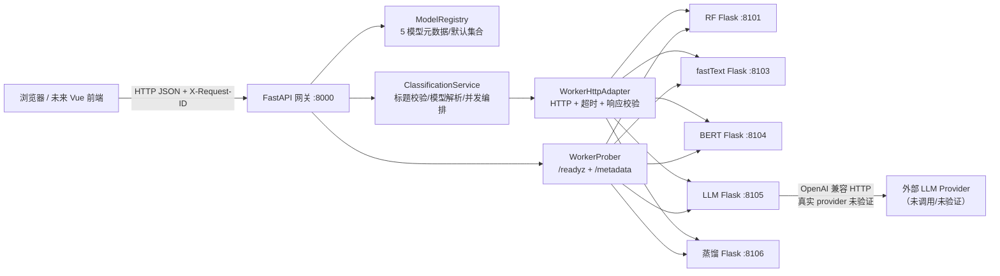
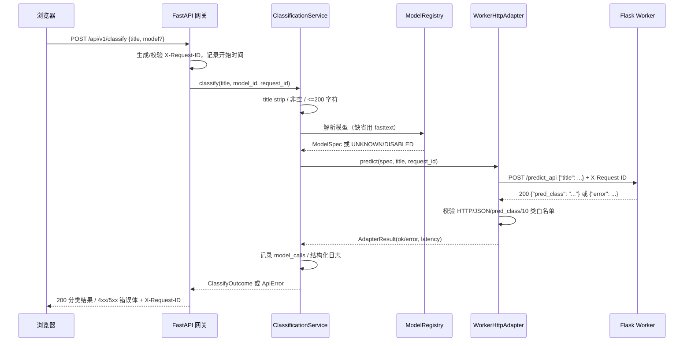
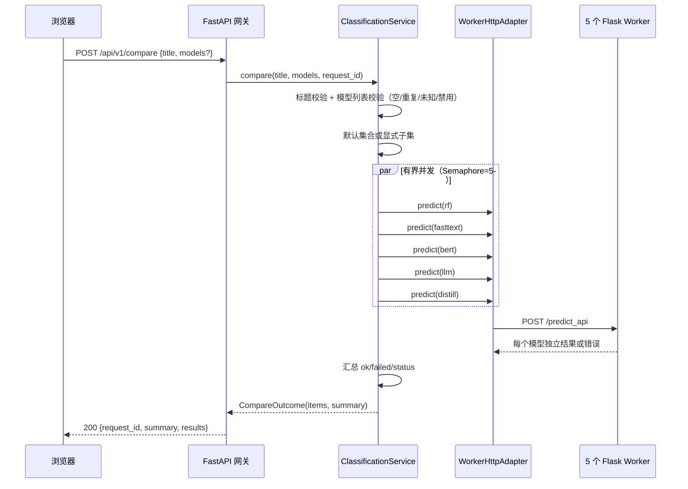
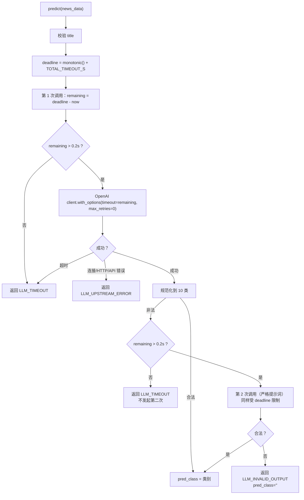

# 项目工程实践与技术学习档案（v2：后端工程化改造与集成验证）

> **状态更新（2026-10-25）**：本文为历史归档，不代表最终实现；最新能力、验收边界与启动方式以 [README](../README.md) 与 [v7 学习档案](PROJECT_LEARNING_GUIDE_v7_访问控制与阶段4-5D工程复盘.md) 为准。截至 2026-10-25，`main` 已提交 `afd3ff2`（批量分类/前端文件导入/LLM 每 IP 配额/访问名额控制等已交付并隔离验证）；B8 LLM 仍 missing，D7 未执行，真实 LAN/手机/真实 LLM 未验收。


> 本文件是 `docs/PROJECT_LEARNING_GUIDE.md`（v1.0，2026-10-19，127 KB）的**续篇**，不是覆盖版本。
> v1 记录“从实现文档到可运行模型训练/API/Streamlit 工程”的过程；v2 记录其后发生的**后端工程化改造、阶段 0～4A、五模型网关集成与前端对接准备**。
> 阅读 v2 时，涉及模型训练、数据清洗、历史指标的内容仍应以 v1 和 `docs/实测指标.md` 为准；v2 不重复展开训练细节。

> ⚠️ **状态补记（2026-10-20 晚，2026-10-21 更新链接）**：本文写作时（当日下午）Vue 前端尚未开始，故"未覆盖"列写有"Vue/前端实际开发"，状态表写有"前端未实现"。**当日晚间 Vue 3 前端已实现并构建**（`frontend/`），该结论仅代表写作时状态；当前能力见 [README.md](../README.md) 与 [前端归档](PROJECT_LEARNING_GUIDE_v3_前端开发全过程技术归档.md)。文中"真实 LLM provider 未验证"仅指**验证脚本**未验证真实 provider；当晚 16:22–18:06 网关→真实 8105 另有 16 次 `model_call=ok` 日志（0.5–4.0 s），但未做准确性/费用/稳定性系统评估。2026-10-21 已完成适配层/worker 契约/网络配置重构，见 [README.md](../README.md) 与 [v5 档案](PROJECT_LEARNING_GUIDE_v5_模型适配层与网络配置重构.md)。文中"无 Git"均为本文写作时状态；2026-10-21 已初始化 Git 仓库并推送（见 [v4 档案](PROJECT_LEARNING_GUIDE_v4_Git与GitHub工程归档.md)），截至 2026-10-25 已随 afd3ff2 提交，工作区干净。

---

## 0. 文档信息

| 项目 | 内容 |
|---|---|
| 项目名称 | 投满分新闻标题分类（TouManFenClassifier） |
| 文档版本 | v2.0（工程化改造与集成验证续篇） |
| 生成时间 | 2026-10-20（Asia/Shanghai） |
| 对应工程状态 | 当前工作区 `E:\AIModels\test\TouManFen\TouManFenClassifier`；无 Git 元数据；所有本轮服务已停止 |
| 覆盖阶段 | 升级评估与阶段 0 基线 → 阶段 1 契约/模块边界 → 阶段 2 网关与观测 → 阶段 3 分类服务 → 阶段 4A LLM 上游超时 → 集成验证/CORS/前端对接文档 |
| 未覆盖 | 模型训练与数据清洗的完整重述、热搜模块、Vue/前端实际开发、生产部署、真实 LLM provider 验证 |
| 直接证据 | 当前源代码、配置、启停脚本、验证脚本、`docs/阶段0-工程基线报告.md`、`docs/前端对接说明.md`、`docs/PROJECT_LEARNING_GUIDE.md`（v1）、`docs/实测指标.md`、`docs/联调记录.md`、`serving/logs/` 中的运行日志、本会话实际命令输出 |
| 证据限制 | 1) 项目没有 Git，无法用提交记录复现逐文件变更；2) 阶段 2/3/4A 的报告主要以会话输出存在，未像阶段 0 那样全部落成独立文件；3) 部分早期命令输出已被上下文压缩，本文只引用仍可核验的摘要或当前文件；4) 未读取 `.env` 内容，也未调用真实 LLM provider；5) 实时模型指标未在本轮重测，历史指标均标注为 v1/实测指标文档记录 |
| 项目最终状态 | 5 个 Flask worker（4 个本地模型 + LLM）、FastAPI 网关、6 个 API（4 个只读 + 2 个分类）、CORS 开发配置、阶段验证脚本、前端对接文档全部存在；真实 LLM 能力仍未验证；热搜/生产化未实现；**Vue 前端在本文写作后（2026-10-20 晚）已实现**，见上方状态补记 |

### 0.1 与 v1 的关系

v1 的核心价值是：

- 还原从 2191 行实现文档到 RF/fastText/BERT/LLM/蒸馏/剪枝/量化工程的训练与验证过程；
- 记录模型指标、数据处理、Flask/Streamlit 联调、资源体积等；
- 总结模型侧的问题与决策。

v2 的核心价值是：

- 还原“为什么要把 5 个模型改成独立 worker + 统一网关”；
- 记录阶段 0～4A 的边界、决策、失败、验证；
- 把一个**模型工程**推进为**可被前端调用的服务工程**；
- 记录真实发生的工程故障：系统代理、SDK 默认超时、Windows 连接语义、CORS、验证脚本回归等。

v1 与 v2 不冲突：v1 回答“模型怎么训出来、指标如何”，v2 回答“模型如何被稳定调用、服务如何被约束与验证”。

### 0.2 证据标记

本文使用以下标记：

- **【已验证事实】**：有当前文件、日志、实际命令输出或本轮集成测试支持。
- **【历史记录】**：会话或既有报告中明确出现，但当前未重新执行/无法完全复核。
- **【技术分析】**：基于证据的解释、推断或方案评价，不是原始记录。
- **【待确认事项】**：证据不足，不能下确定结论。

根因分析中会进一步区分“已证实的直接原因”“与证据一致的可能原因”“未验证假设”。本文不会把历史报告中的 PASS 直接当作本轮 PASS；本轮重新执行过的验证会单独标注。

---

## 1. 阅读指南

### 1.1 这份文档记录了什么

1. 用户从“评估后端升级可行性”到“分阶段实施网关/分类/LLM 超时/集成验证”的完整需求演进；
2. 每个阶段的目标、边界、验收标准和停止条件；
3. 关键技术决策的备选方案、取舍、用户明确选择与实际落地差异；
4. 实际遇到的错误、失败尝试、排查路径、根因和修复；
5. 最终系统架构、模块职责、接口契约、数据流和错误语义；
6. 可复现的启动、验证、排障命令，以及哪些命令是本轮实际执行、哪些只是建议；
7. 尚未解决的问题、技术债和下一步路线。

### 1.2 这份文档没有记录什么

- 没有逐字还原模型的内部思维链；只记录可复核的决策摘要、依据和结果。
- 没有把未执行的测试写成通过；没有把建议命令写成已执行命令。
- 没有真实 API Key、`.env` 内容、Authorization 头或供应商原始响应。
- 没有把阶段报告中的历史结论冒充成本轮实测；所有本轮重新执行的验证都在第 12 章单独列出。
- 没有重写 v1 的训练过程；训练细节请回到 v1。

### 1.3 推荐阅读路径

- **想快速了解最终系统**：第 5 章（成果）+ 第 6 章（架构）+ 第 12 章（验证）。
- **想学习排障**：第 10 章（问题案例），推荐顺序 P3（代理）→ P4（连接超时分类）→ P5（SDK 超时/重试）→ P9（错误信息泄露）→ P8（CORS）。
- **想做架构选型**：第 8 章（决策）+ 第 11 章（方案变更）。
- **想复现**：第 4 章（环境）+ 第 14 章（复现指南）+ 第 18 章（命令索引）。
- **想迁移经验**：第 13 章（原理）+ 第 15 章（避坑清单）+ 第 20 章（复盘）。

### 1.4 阅读时最需要避免的误解

- “5 个模型都能被网关调用”不等于“5 个模型都验证了真实能力”：LLM 在多数验证中使用 mock，真实 provider 未验证。
- “网关返回 200”不等于“所有模型成功”：`/compare` 合法请求即使全部失败也返回 200，需看 `summary.status` 和逐模型 `status`。
- “worker `/readyz` 通过”不等于“外部供应商可用”：LLM 的 ready 只表示本地服务与客户端初始化完成。
- “历史报告 PASS”不等于“当前代码仍 PASS”：本轮对阶段 2/3/4A 脚本做了重新执行，见第 12 章。

---

## 2. 项目概述

### 2.1 业务背景

“投满分”是新闻推荐场景中的短文本分类任务：把新闻标题分到 10 个频道类别，使内容能够进入正确的分发通道。类别定义来自 `00-data/data/class.txt`，顺序即标签 ID：

| ID | 类别 | 中文 |
|---|---|---|
| 0 | finance | 金融 |
| 1 | realty | 房地产 |
| 2 | stocks | 股票/证券 |
| 3 | education | 教育 |
| 4 | science | 科技 |
| 5 | society | 社会 |
| 6 | politics | 政治 |
| 7 | sports | 体育 |
| 8 | game | 游戏 |
| 9 | entertainment | 娱乐 |

v1 阶段已经完成数据预处理、RF/fastText/BERT/LLM/蒸馏模型、量化/剪枝实验、Flask API 与 Streamlit 演示。模型侧指标与训练细节见 v1 与 `docs/实测指标.md`；本文件不重新测模型准确率。

### 2.2 本次工程化改造要解决的实际问题

改造前，5 个模型服务更像“课程演示”：

- 各模型是独立 Flask 脚本，接口和错误格式不完全统一；
- 没有一个统一入口让前端只面对一个地址；
- 缺少 request ID、统一日志、健康/就绪探测、逐模型超时与失败隔离；
- LLM 直接使用 SDK 默认超时/重试，存在长时间挂起风险；
- 没有浏览器跨域配置，前端无法直接联调；
- 模型产物、依赖和运行环境缺少可复现的启动/停止/验证流程。

本阶段目标不是重新训练模型，而是：

> 在**不改变模型预测逻辑、不重训、不升级依赖、不调用真实 LLM**的前提下，把现有 5 个 Flask 模型服务组织成一个可被前端调用、可观测、可验证、可安全停止的后端。

### 2.3 使用场景

- 前端开发者：调用 `/models` 获取模型列表，调用 `/classify` 做单模型分类，调用 `/compare` 做多模型对比。
- 后端/算法工程师：通过 `/readyz`、`/stats`、日志和验证脚本确认服务状态。
- 项目评审者：用本地 mock 验证 LLM 参与的五模型比较，而不产生真实 provider 费用。
- 后续维护者：根据文档复现启动、停止、验证和排障过程。

### 2.4 项目边界

**已实现并验证：**

- 5 个 Flask worker 的 `/predict_api` 保持原契约；
- 5 个 worker 的只读 `/healthz`、`/readyz`、`/metadata`；
- FastAPI 网关的 `/healthz`、`/readyz`、`/models`、`/stats`、`/classify`、`/compare`；
- request ID、结构化日志、进程内统计；
- 模型白名单校验、worker HTTP 适配、逐模型错误隔离；
- LLM worker 总预算/有限重试/安全错误映射；
- 本地开发 CORS；
- 阶段 2、3、4A 验证脚本和前端对接文档。

**明确未实现：**

- 热搜采集/热搜 API；
- 置信度/概率、批量分类、缓存、single-flight、级联；
- 数据库、队列、鉴权、Docker/CI/CD、生产发布；
- Vue/React 前端；
- 真实 LLM provider 能力验证、密钥有效性验证、真实网络延迟/额度验证。

---

## 3. 原始需求与最终需求

### 3.1 项目最初的目标（v1 背景）

v1 记录的原始目标包括：

1. 对新闻标题做 10 类分类；
2. 走完数据预处理 → 模型训练 → 评估 → 部署 → 前端展示；
3. 形成“基线 → 复杂模型 → 大模型”的对比链路；
4. 通过量化、蒸馏、剪枝完成模型压缩实验；
5. 产出可演示的 Flask API 与 Streamlit 前端。

这些目标在 v1 中已经基本完成；v2 不重训、不重测。

### 3.2 本次会话的起点需求

本次会话的第一项请求不是继续训练，而是：

> **只读检查项目**，评估把后端升级为 **Vue 3 + TypeScript + FastAPI + Python 模型适配层**的可行性，并分析架构改进；当时明确不修改文件。

随后需求被拆成阶段门（stage gate），每阶段完成报告后必须停止，等待用户审阅：

| 阶段 | 范围 | 用户明确边界 |
|---|---|---|
| 阶段 0 | 工程基线调查 | 只读，不改代码/模型/依赖/密钥 |
| 阶段 1 | 契约与模块边界设计 | 不实现代码 |
| 阶段 2 | 网关 + 观测 | 只做骨架/健康/状态/日志，不做分类 |
| 阶段 3 | 分类服务 + 模型适配 | 只做 CLS-001/2/3；LLM 只用 mock |
| 阶段 4A | LLM 上游超时/重试边界 | 只改 04-LLM；不调用真实 provider |
| 集成阶段 | 组合验证 + CORS + 前端对接 | 不开发前端；不扩大后端功能 |

### 3.3 阶段 3 的关键需求（用户明确确认）

1. 网关通过 HTTP 调用 worker，**不导入**模型代码/`config.py`/torch/transformers/训练模块；
2. 原 `/predict_api` 路径/请求/响应不变；
3. 在线集合固定为 `rf`、`fasttext`、`bert`、`llm`、`distill`，量化 BERT 不计入；
4. `/classify` 省略模型时使用配置默认模型；
5. `/compare` 默认比较 5 个启用模型，也允许显式子集；
6. `/compare` 合法请求始终 HTTP 200；逐模型 `ok/error`；全部失败 `summary.status="all_failed"`；非法模型列表用 4xx；
7. request ID 沿用阶段 2 约定；网关生成/回显，不新增请求体字段；
8. 标题 trim 后非空，最多 200 个 Python Unicode 字符；
9. 复用阶段 2 的 `/healthz`、`/readyz`、`/models` 语义；
10. 不实现置信度、批量、缓存、single-flight、级联、数据库、队列、热搜、鉴权、Vue、Docker、CI；
11. 不调用真实 LLM，不验证 key；LLM 只通过 mock/本地模拟；
12. 不训练、不改模型/数据/依赖。

### 3.4 阶段 4A 的关键需求（用户明确确认）

1. 只处理 LLM worker 对外部 provider 的超时、有限重试、安全错误映射；
2. 不调用真实 DeepSeek/Qwen/智谱，不验证密钥，不触发计费；
3. 动态验证只用本地 mock/transport；
4. 不换供应商、不换模型、不改提示词策略/类别；
5. 保留 Provider 选择机制和 `/predict_api` 兼容性；
6. 不升级/安装/卸载依赖，不改 `py3109`、`venv-gateway`；
7. 保留代理行为；阶段 3 对本地 worker 的 `trust_env=False` 不应被不加区分地用于外部 LLM；
8. 输出非法时不得编造类别或静默降级；
9. 不做 Provider 重构、熔断、成本追踪、fallback、置信度、缓存、批处理、级联、数据库；
10. 不改变网关 `/compare` 契约/部分失败语义；
11. 不读取/打印/复制真实 key。

### 3.5 集成阶段的需求（本轮）

1. 重跑阶段 2/3/4A 验证；
2. 4 个本地 worker + LLM mock 做一次五模型端到端比较；
3. 验证阶段 4A 的 LLM 超时与网关错误处理兼容；
4. 检查并最小添加开发环境 CORS；
5. 提供前端 API 契约/错误说明/运行地址/启动说明；
6. 发现直接相关的小问题可最小修复并复验；
7. 完成后停止，不开始前端/热搜。

### 3.6 最终需求状态

| 需求 | 状态 |
|---|---|
| 5 个 worker + 统一网关 | 已实现并验证 |
| 单模型/五模型比较 | 已实现；4 本地模型实际验证，LLM 用 mock 验证 |
| request ID/日志/统计 | 已实现并验证 |
| LLM 上游总预算 | 已实现并离线验证；真实 provider 未验证 |
| 开发 CORS | 已实现并实测 |
| 前端对接文档 | 已新增 |
| 真实 LLM 能力/密钥/网络 | **未验证** |
| 热搜/前端/生产化 | **未实现** |

---

## 4. 工程环境与项目结构

### 4.1 操作系统与运行方式

| 项 | 当前事实 |
|---|---|
| 操作系统 | Windows 11（本机验证环境） |
| 运行形态 | CPU 推理；5 个 Flask worker 独立进程 + 1 个 FastAPI 网关进程 |
| 进程管理 | `serving/scripts/stage2.ps1`（Windows PowerShell 5.1；执行策略需 `-ExecutionPolicy Bypass`） |
| 版本控制 | **无 Git 元数据**（项目根和工程目录均无 `.git`）；未初始化 Git |
| 端口 | 网关 8000；RF 8101；fastText 8103；BERT 8104；LLM 8105；蒸馏 8106 |
| 系统代理 | 存在系统 HTTP 代理 `127.0.0.1:7890`（通过 Windows 注册表/系统设置生效，非本项目设置）；本地 worker 调用必须避免被代理转发 |

### 4.2 Python 环境与关键版本

**模型/worker 环境：`D:\Miniconda3\envs\py3109\python.exe`（Python 3.10.9）**

| 组件 | 版本（当前静态确认） |
|---|---|
| torch | 2.14.1+cpu |
| transformers | 4.57.6 |
| numpy | 2.2.6 |
| scikit-learn | 1.7.2 |
| fasttext-wheel | 0.9.2 |
| Flask | 3.1.3 |
| openai | 3.31.0 |
| pydantic | 2.14.1 |

**网关独立环境：`E:\AIModels\test\TouManFen\venv-gateway`（Python 3.10.9）**

| 组件 | 版本（当前静态确认） |
|---|---|
| FastAPI | 0.150.0 |
| Uvicorn | 0.54.0 |
| HTTPX | 0.28.1 |
| PyYAML | 6.0.3 |
| Starlette | 1.7.0 |
| pydantic | 2.14.1 |

> 未在本轮安装、升级或卸载任何依赖；`py3109` 与 `venv-gateway` 保持现状。

### 4.3 项目目录（与本阶段相关的部分）

```text
TouManFen/
├─ 工程实施工作清单.md
└─ TouManFenClassifier/
   ├─ 00-data/data/class.txt              # 10 类唯一来源
   ├─ 01-rf/ 02-fasttext/ 03-bert/
   ├─ 04-LLM/
   │  ├─ api_flask_server.py              # /predict_api + 健康/就绪/元数据
   │  ├─ llm_predict_service.py           # Provider 调用 + 阶段 4A 预算/重试
   │  ├─ verify_llm_timeout.py            # 阶段 4A 离线验证
   │  └─ .env.example                     # 配置样例（无真实 key）
   ├─ 05-distill/
   ├─ serving/
   │  ├─ config/workers.yaml              # worker 地址/路径/超时
   │  ├─ config/models.yaml               # 5 模型/默认模型/类别来源/标题上限
   │  ├─ config/processes.yaml            # 启停清单
   │  ├─ gateway/
   │  │  ├─ main.py                       # FastAPI 应用、middleware、CORS
   │  │  ├─ settings.py                   # YAML + 类目校验
   │  │  ├─ errors.py                     # 错误码/ApiError
   │  │  ├─ schemas.py                    # Pydantic 请求/响应
   │  │  ├─ probes.py                     # /readyz worker 探测 + 缓存
   │  │  ├─ stats.py / logging_utils.py
   │  │  └─ routers/health.py models.py stats.py classify.py
   │  ├─ models/registry.py
   │  ├─ models/http_adapter.py
   │  ├─ services/classification.py
   │  ├─ scripts/stage2.ps1
   │  ├─ scripts/validate_config.py
   │  ├─ scripts/verify_stage2.py
   │  ├─ scripts/verify_stage3.py
   │  ├─ scripts/mock_worker.py
   │  └─ logs/ run/
   └─ docs/
      ├─ PROJECT_LEARNING_GUIDE.md        # v1，训练/模型工程档案（未修改）
      ├─ PROJECT_LEARNING_GUIDE_v2_工程化改造与集成验证.md  # 本文
      ├─ 阶段0-工程基线报告.md
      ├─ 实测指标.md
      ├─ 联调记录.md
      └─ 前端对接说明.md
```

### 4.4 关键配置

`serving/config/workers.yaml`：

- 5 个 worker 的 `base_url`、`predict_path`、`health_path`、`ready_path`、`metadata_path`；
- `timeout_ms`：RF/fastText/BERT/蒸馏 10000 ms；**LLM 15000 ms**；
- `enabled`、`probe: http_ready`；
- 探测超时 1000 ms、状态缓存 2000 ms。

`serving/config/models.yaml`：

- `default_model: fasttext`；
- `api.max_title_chars: 200`；
- `classes.file: 00-data/data/class.txt`，`expected_count: 10`；
- 5 个模型均 `compare_by_default: true`；
- `model_version: null`（不伪造版本）。

### 4.5 已知环境限制

- 无 Git，无法做提交级回滚/差异审计；
- 系统代理会干扰 `127.0.0.1` 请求，必须对本地 worker 显式 `trust_env=False`；
- Windows 上“连接已关闭端口”在 OpenAI SDK 中可能表现为 `APITimeoutError`（见 P10）；
- `05-distill` 启动日志仍打印绝对模型路径（见第 10 章简表）；
- 模型产物约 10.86 GB（阶段 0 实测），RF 模型文件较大，启动较慢；
- LLM 真实 provider 未验证，`.env` 仅确认存在，未读取内容。

---

## 5. 最终实现成果总览

### 5.1 已交付产物

| 产物 | 位置 | 当前状态 |
|---|---|---|
| 5 个 Flask worker | `01-rf`/`02-fasttext`/`03-bert`/`04-LLM`/`05-distill` | 启动脚本可管理；4 本地模型动态验证；LLM 仅 mock 验证 |
| 只读状态端点 | 每个 worker `/healthz`、`/readyz`、`/metadata` | 已实现；阶段 2/集成验证通过 |
| FastAPI 网关 | `serving/gateway/main.py` | 已实现 6 个 API 路径 |
| 模型注册表/适配器/分类服务 | `serving/models/`、`serving/services/` | 已实现 |
| 启停脚本 | `serving/scripts/stage2.ps1` | 启动/停止/状态；按 PID/归属清理 |
| 阶段验证脚本 | `verify_stage2.py`、`verify_stage3.py`、`verify_llm_timeout.py` | 本轮均重新执行并通过 |
| 本地 LLM mock | `serving/scripts/mock_worker.py` | 成功/错误/非法输出/慢响应/HTTP 500 |
| 开发 CORS | `serving/gateway/main.py` | 仅 5173 两来源；本轮 preflight/实际请求验证 |
| 前端对接文档 | `docs/前端对接说明.md` | 已新增 |
| 阶段 0 报告 | `docs/阶段0-工程基线报告.md` | 既有，未修改 |
| v1 学习档案 | `docs/PROJECT_LEARNING_GUIDE.md` | 既有，未修改 |

### 5.2 最终 API 路径

OpenAPI/路由静态确认当前只有：

- `GET /api/v1/healthz`
- `GET /api/v1/readyz`
- `GET /api/v1/models`
- `GET /api/v1/stats`
- `POST /api/v1/classify`
- `POST /api/v1/compare`

`POST /api/v1/classify/batch` 未注册，返回 404。

### 5.3 已验证的成果（本轮）

- 4 个本地模型经网关实际推理：RF/fastText/BERT/蒸馏均返回 `realty`（样例标题），延迟约 10～64 ms；
- LLM mock 经网关返回 `sports`（mock 固定输出），约 13 ms；
- 默认五模型 `/compare`：`total=5, ok=5, status=ok`；
- 部分失败：4 成功 + 1 失败，`status=partial`，失败项无 `pred_class`；
- 全部失败：`status=all_failed`，失败项无 `pred_class`；
- LLM mock 慢响应：`/classify` 返回 504 `WORKER_TIMEOUT`（约 15.03 s）；`/compare` 返回 200 `all_failed`，逐模型 `WORKER_TIMEOUT`；
- CORS：允许的 5173 来源 preflight 200、实际请求 ACAO 正确；禁止来源 preflight 400/无 ACAO；
- 阶段 2/3/4A 脚本均重新执行通过；真实 LLM 调用 0 次。

### 5.4 历史成果（v1，本轮未重测）

- RF/fastText/BERT/LLM/蒸馏的训练、评估、量化/剪枝实验；
- 模型主口径指标、推理延迟、模型体积；
- Flask/Streamlit 联调。

以上数值请查 v1 与 `docs/实测指标.md`；本文不把历史指标当成本轮实测。

### 5.5 尚未实现/未验证

- 真实 DeepSeek/Qwen/智谱调用、真实 key 有效性、真实网络延迟/限流/额度；
- 热搜采集/热搜 API；
- 置信度、批量、缓存、single-flight、级联；
- Vue/前端页面；
- 鉴权、HTTPS、生产发布、CI/CD；
- 量化 BERT 接入在线服务；
- Git 版本管理、可回滚的制品/配置版本。

---

## 6. 项目整体架构与核心业务流程

### 6.1 最终实际架构



关键事实：

- 网关是**独立进程/独立 venv**，只通过 HTTP 调用 worker，不 import torch/transformers/模型代码；
- 5 个 worker 都是**独立 Flask 进程**，保留原 `/predict_api`；
- 网关的 `/readyz` 通过 HTTP 探测每个 worker 的 `/readyz` 和 `/metadata`，不触发预测；
- LLM worker 内部再调用外部 provider；该外部链路未真实验证；
- 浏览器到网关之间新增了开发 CORS。

### 6.2 单模型分类流程



### 6.3 五模型比较流程



关键语义：

- 合法请求总是 200；单个模型失败不取消其他模型；
- `summary.status` 只可能是 `ok` / `partial` / `all_failed`；
- 失败项不返回 `pred_class`；
- 非法模型列表在调用任何 worker 之前就返回 4xx；
- 默认比较集合的顺序来自配置顺序，显式列表按请求顺序。

### 6.4 网关请求经过的中间件/处理层

1. **CORS 中间件**：处理浏览器 preflight；允许来源/方法/请求头；不启用 credentials。
2. **request ID 中间件**：
   - 读取 `X-Request-ID`；不存在则生成 UUID；
   - 用正则 `^[A-Za-z0-9._-]{1,64}$` 校验；非法返回 400；
   - 把 request ID 放入 `request.state`，并在响应头回写。
3. **路由**：`/healthz`、`/readyz`、`/models`、`/stats`、`/classify`、`/compare`。
4. **异常处理**：`ApiError`、`RequestValidationError`、Starlette HTTPException、未捕获异常；统一错误体。
5. **日志/统计**：
   - 请求日志：method/path/status/duration/request_id；
   - 模型调用日志：model_id/model_status/duration/error_code；
   - 统计为进程内内存，重启清零。

### 6.5 LLM worker 的上游调用链（阶段 4A）



- SDK 自动重试被 `max_retries=0` 禁用；
- 应用层格式重试最多一次；
- 所有尝试共享一个 `time.monotonic()` deadline；
- 服务端日志只记录 provider/model/错误码/尝试次数/耗时，不记录标题/key。

### 6.6 错误传播关系

| 层 | 失败表现 | 网关处理 |
|---|---|---|
| 请求参数 | FastAPI/Pydantic 422；业务校验 ApiError 400 | 统一错误体 |
| 模型解析 | 未知/禁用 | 404/400，不调用 worker |
| worker 连接/超时 | 连接失败/超时 | 502 `WORKER_UNAVAILABLE` / 504 `WORKER_TIMEOUT` |
| worker HTTP | 非 200 | 502 `WORKER_HTTP_ERROR` |
| worker 响应 | 非 JSON/缺 pred_class/未知类别 | 502 `WORKER_BAD_RESPONSE` / `INVALID_MODEL_OUTPUT` |
| worker 业务失败 | 200 + `error` | 502 `MODEL_ERROR` |
| 网关内部 | 未预期异常 | 500 `INTERNAL_ERROR` |
| compare | 单模型失败 | 200 + 该模型 error + `partial/all_failed` |

### 6.7 架构选择的核心权衡

- **为什么不是一个大 FastAPI 进程直接 import 5 个模型？**
  - 5 个模型各自的全局配置、tokenizer、模型对象和依赖会互相污染；
  - import 阶段可能加载数 GB 模型，网关启动慢、任一模型失败拖垮整个网关；
  - 原 Flask worker 已经验证可用，重写会引入训练/推理回归风险；
  - 独立进程可以单独重启/限流/排障，符合“模型适配层”边界。
- **代价**：进程多、端口多、需要启停脚本、HTTP 序列化开销、需要统一错误/超时适配。
- **为什么保留 Flask worker？** 这是已有资产，且阶段 3 明确不重写模型预测逻辑。
- **为什么用 HTTP 而不是消息队列？** 当前是本地单机、低复杂度、同步请求场景；队列/数据库/级联均被明确排除。

---

## 7. 项目完整实施时间线

> 时间来自会话阶段顺序与工具输出；v1 生成于 2026-10-19，v2 工作发生在 2026-10-20。没有 Git 时间线，以下不伪造提交号。

| 序号 | 阶段 | 当时目标 | 实际操作 | 遇到的问题 | 关键决策 | 执行结果 | 对后续的影响 |
|---|---|---|---|---|---|---|---|
| 1 | 需求起点 | 只读评估升级可行性 | 检查项目、模型、依赖、服务；输出分析，不改文件 | 模型/服务/环境信息分散；无 Git | 先做工程基线，不直接重写 | 明确“先阶段 0 再决定” | 后续所有阶段都按门控推进 |
| 2 | 阶段 0 | 工程基线调查 | 只读检查 5 服务、依赖、模型产物、配置、日志、权限 | 4/5 动态验证；LLM 按边界跳过；量化产物加载风险；模型体积 10.86 GB | 不调用真实 LLM；不安装/升级；不初始化 Git | 阶段 0 报告 `docs/阶段0-工程基线报告.md` | 确定阶段 1 契约与风险 |
| 3 | 阶段 1 | 契约/模块边界设计 | 设计统一 API、错误语义、worker 适配、观测、阶段计划 | 课程验收标准与生产工程目标冲突；5 模型是否固定 | 固定 5 模型；HTTP 适配；不 import 模型；阶段门 | 设计被用户确认 | 阶段 2/3 按契约实现 |
| 4 | 阶段 2 | 网关骨架 + 观测 | 建 `venv-gateway`、FastAPI、配置、worker 状态端点、启停脚本、验证脚本 | pip 安装卡住；代理干扰本地请求；ConnectTimeout 分类错误 | 独立 venv；HTTP 探测；`trust_env=False`；PID 归属启停 | 阶段 2 验证 PASS；5/5 就绪 | 为阶段 3 分类提供运行时基础 |
| 5 | 阶段 3 | 分类服务/模型适配 | 实现 registry、HTTP adapter、classification service、classify/compare、mock LLM、验证脚本 | 相对 import 错误；代理 502；ConnectTimeout；旧 404 断言；错误信息泄露 | `/compare` 200 + partial；失败项无 pred_class；类别白名单；固定 5 模型 | 4 本地真实验证 + LLM mock；阶段 3 PASS | 形成前端可用的分类 API |
| 6 | 阶段 4A | LLM 上游超时/重试 | 调查 openai 3.31.0；实现总预算、SDK 重试关闭、格式重试 deadline、安全错误 | SDK 默认 read=600s/retries=2；异常继承；Windows 连接语义；代理保留 | 12 s 总预算 < 网关 15 s；max_retries=0；最多 2 次尝试 | 31 项离线验证 PASS；真实调用 0 | 解决 LLM 挂起/费用/错误泄露风险 |
| 7 | 集成阶段 | 组合验证 + CORS + 前端文档 | 启动 4 本地 + LLM mock + 网关；重跑阶段脚本；五模型 compare；CORS；文档 | CORS 缺失；mock 慢响应 15 s；代理测试隔离 | 仅本地开发 CORS；mock-only；不开发前端 | 阶段 2/3/4A PASS；五模型 compare PASS；CORS PASS；文档完成 | 前端可开始联调准备 |
| 8 | 收尾 | 清理/报告 | 停止 mock/网关/4 worker；检查端口、进程、状态、日志 | 历史日志有旧 Traceback/绝对路径 | 只停自有 PID；不删历史日志 | 0 端口/0 进程；报告完成 | 等待审阅，不进入下一阶段 |

### 7.1 时间线中的关键转折

1. **从“升级 Vue/后端”转为“先做可验证的后端契约”**：用户没有直接授权大规模重写，而是用阶段门逐步验证。
2. **从“单进程直接加载模型”转为“5 个 worker + 网关”**：避免模型/依赖冲突，也避免重写已有 Flask 服务。
3. **从“LLM 真实调用”转为“LLM mock-only”**：真实 key/费用/合规未确认，先验证契约和失败路径。
4. **从“阶段 2 的 404 预期”转为“阶段 3 的新路由”**：验证脚本需要随契约更新，否则会误报。
5. **从“LLM 默认 SDK 行为”转为“显式总预算 + 禁用隐式重试”**：这是阶段 4A 的核心转折。

---

## 8. 核心技术决策档案

> 说明：本节区分“模型建议”“用户明确选择”“最终落地”。没有记录用户明确表态的，不写成“用户选择了”；只写实际采用与可核验结果。

### D1：采用阶段门（stage gate），每阶段报告后停止

- **背景**：项目已有大量模型资产，直接大规模重写风险高；用户希望控制变更范围。
- **备选**：一次性完成全部后端改造；或分阶段验证。
- **模型建议**：先阶段 0 基线，再阶段 1 契约，阶段 2 网关，阶段 3 分类，阶段 4A LLM 超时，最后集成。
- **用户选择**：明确要求“阶段 0 完成提交报告并停止”“不得自行开始下一阶段”。
- **实际落地**：每个阶段都有明确授权边界、报告和停止条件。
- **理由**：把不可逆的大改拆成可审阅的小步；每步都有可验证产物，出错时影响面小。
- **代价/风险**：阶段间存在等待；部分设计要等下一阶段才能闭环；报告/上下文成本高。
- **结果**：阶段 0/1/2/3/4A/集成均按序完成，没有出现越界重构。
- **可复用经验**：高风险改造应先定义“本阶段不做什么”，并让每阶段有独立验收标准。

### D2：网关独立 venv + HTTP 调用 worker，不 import 模型代码

- **背景**：5 个模型服务各自有 Flask、torch/transformers、配置、tokenizer 和模型对象；直接在一个 FastAPI 进程 import 会带来依赖/全局状态冲突。
- **备选**：
  1. 单 FastAPI 进程 import 5 个模型；
  2. 重写 5 个服务为统一推理类；
  3. 保留 5 个 Flask 进程，新增 HTTP 网关。
- **模型建议**：方案 3。原因：保留已验证的预测逻辑；进程隔离；可单独重启；符合“模型适配层”边界。
- **用户选择**：阶段 3 明确“网关通过 HTTP 调用 worker，绝不 import 模型代码/config.py/torch/transformers/训练模块”。
- **实际落地**：`WorkerHttpAdapter` 只发 `POST /predict_api`；网关 venv 不安装 torch/transformers。
- **理由**：避免 import 阶段的副作用；避免一个模型异常拖垮整个网关；便于独立观测。
- **代价**：多进程、多端口、HTTP 序列化、需要启停脚本、需要统一超时/错误映射。
- **风险**：HTTP 层可能引入代理、超时、JSON 契约问题（后来确实遇到，见 P3/P4）。
- **结果**：5 个 worker 独立运行，网关可分别探测；4 个本地模型真实推理成功，LLM 用 mock 验证。
- **可复用经验**：当模型依赖重、启动慢、全局状态多时，进程隔离往往比“统一框架重写”更稳。

### D3：在线模型固定为 5 个，量化 BERT 不进入在线集合

- **背景**：项目有量化/剪枝/蒸馏产物，但量化 BERT 没有独立在线服务；阶段 0 发现 5 个服务不含量化。
- **备选**：把量化 BERT 作为第 6 个模型；或固定 5 个。
- **模型建议**：固定 5 个，量化作为可选后续档。
- **用户选择**：阶段 3 明确在线集合 `rf、fasttext、bert、llm、distill`，量化 BERT 排除。
- **实际落地**：`models.yaml` 只有 5 个模型；`/models` 返回 5 个。
- **理由**：没有对应的在线服务/契约；强行加入会扩大本阶段范围。
- **结果**：契约简单，前端模型列表稳定。
- **可复用经验**：在线集合应只包含“有独立服务、有明确契约、已验证”的模型。

### D4：`/compare` 合法请求统一 200，逐模型 ok/error，`summary.status` 表达整体

- **背景**：五模型比较中 LLM 可能失败；如果整体返回 5xx，会丢失其他模型结果。
- **备选**：
  1. 任一失败 → 整体 5xx；
  2. 全部成功才 200；
  3. 合法请求 200 + 逐模型状态 + summary。
- **模型建议**：方案 3。
- **用户选择**：阶段 3 明确“合法请求总是 200；全部失败 `all_failed`；非法列表 4xx/5xx”。
- **实际落地**：`CompareOutcome` 汇总；失败项无 `pred_class`；前端看 `summary.status`。
- **理由**：部分失败是业务常态；保留成功模型结果对用户有价值；错误边界清晰。
- **代价**：前端必须检查逐模型状态，不能只看 HTTP 200。
- **结果**：本轮 `partial`（4 成功 + 1 失败）和 `all_failed` 均验证。
- **可复用经验**：批量/聚合接口应把“请求是否合法”和“每个子任务是否成功”分开表达。

### D5：request ID 作为跨网关/worker 的关联键

- **背景**：多进程/多模型调用需要串联日志；浏览器/前端也需要定位一次请求。
- **备选**：不传；只在网关生成；要求所有 worker 支持。
- **实际落地**：网关读取/校验/生成 `X-Request-ID`，响应头回写；请求体不新增字段；worker 可接收但不要求支持。
- **理由**：兼容旧 worker；不改变 API 请求格式；网关日志/统计可用同一 ID。
- **结果**：自定义 ID 回显、非法 ID 400、默认 UUID 均验证。
- **可复用经验**：跨服务追踪应先统一 ID 的生成/校验/传递规则，再要求下游实现。

### D6：标题 200 字符、默认 fasttext、不实现 confidence/批量

- **背景**：前端需要明确输入边界；阶段 3 要避免范围膨胀。
- **用户选择**：标题 trim 后非空、最多 200 Unicode 字符；省略模型用默认；不实现置信度/批量/缓存。
- **实际落地**：`max_title_chars: 200`；默认 `fasttext`；响应没有 `confidence`；`/classify/batch` 404。
- **理由**：现有模型没有可靠概率；LLM 更无校准概率；批量/缓存不是当前瓶颈。
- **结果**：边界错误 400/422 均验证；前端文档明确“不展示置信度”。
- **可复用经验**：不要为了 UI 好看而伪造概率；没有校准的 confidence 会误导用户。

### D7：类别白名单单一来源 `class.txt`

- **背景**：网关、适配器、前端都需要 10 类；多处硬编码容易漂移。
- **备选**：每个模块各自维护列表；或单一配置文件。
- **实际落地**：`models.yaml` 指向 `00-data/data/class.txt`；settings 启动校验 10 个非空且唯一；适配器用同一集合校验 worker 输出。
- **理由**：类别 ID 顺序来自数据，不能靠代码复制；启动时失败比运行中静默错误好。
- **结果**：阶段 3 单元检查验证单一来源、10 类、非法类别文件拒绝。
- **可复用经验**：标签体系必须有唯一来源，并在服务启动时校验数量/唯一性。

### D8：本地 worker 调用 `trust_env=False`，但不全局关闭外部 LLM 代理

- **背景**：系统代理 `127.0.0.1:7890` 会拦截本地 worker 请求；阶段 3 曾出现 502。
- **备选**：
  1. 修改系统代理；
  2. 所有 HTTP 客户端都 `trust_env=False`；
  3. 只对本地 worker 客户端关闭代理，外部 LLM 保留代理。
- **实际落地**：网关 HTTP 客户端/探测器/验证脚本对本地 worker 使用 `trust_env=False`；阶段 4A 的 LLM 客户端**没有**被强制关闭代理。
- **理由**：本地回环地址不应经过系统代理；但真实 provider 可能依赖公司代理，不能一刀切。
- **结果**：本地 worker 请求恢复正常；外部 LLM 代理行为保持现状（未真实验证）。
- **可复用经验**：代理是环境策略，不应在代码里无差别关闭；按“目标地址/调用类型”决定。

### D9：LLM 上游总预算 12 s + SDK 重试 0 + 格式重试最多一次

- **背景**：OpenAI SDK 默认 `read=600 s`、`max_retries=2`；LLM worker 可能长时间挂起，并在网关超时后继续占用资源。
- **备选**：
  1. 依赖 SDK 默认；
  2. 只设置单次 timeout；
  3. 用单调时钟总 deadline，每次请求传剩余预算，禁用 SDK 重试，应用层格式重试最多一次。
- **模型建议/调查**：SDK 3.31.0 构造器支持 `timeout`/`max_retries`；`create` 支持 `timeout` 但不支持 per-request `max_retries`；`with_options` 可用。
- **用户选择**：阶段 4A 明确总时限、有限重试、安全错误、不换 provider。
- **实际落地**：`TMF_LLM_TOTAL_TIMEOUT_S` 默认 12 s（范围 0.5～14 s）；客户端 `max_retries=0`；每次请求剩余 timeout；格式重试检查剩余 >0.2 s。
- **理由**：12 s < 网关 15 s，给序列化/错误响应留余量；所有尝试共享预算，避免两次长超时叠加。
- **代价**：12 s 不是 SLA，只是安全边界；真实 provider 延迟未测。
- **结果**：31 项离线验证 PASS；HTTP 500 仅 1 次调用；慢上游在预算内结束；真实调用 0。
- **可复用经验**：多重重试叠加是常见事故源；要在“总预算”层面设计，而不是只设置单次 timeout。

### D10：LLM 只用 mock 验证，不调用真实 provider

- **背景**：真实 key/费用/合规/网络未确认；但五模型 compare 需要 LLM 参与。
- **备选**：真实调用 1 次；跳过 LLM；本地 mock。
- **用户选择**：阶段 3/4A/集成均明确“不得调用真实 LLM；LLM 只通过 mock”。
- **实际落地**：`mock_worker.py` 模拟成功/错误/缺类别/非法类别/空类别/非法 JSON/HTTP 500/慢响应；阶段 4A 另用本地 mock OpenAI 服务验证 worker 内部。
- **理由**：可以验证契约/超时/错误隔离，不产生费用与外部依赖。
- **代价**：真实 provider 延迟、限流、鉴权、返回格式差异仍未验证。
- **结果**：五模型 compare 可完整验证；真实 LLM 调用计数 0。
- **可复用经验**：外部依赖未获授权时，mock 应覆盖“成功 + 业务错误 + 传输错误 + 慢响应 + 非法输出”，而不只是 happy path。

### D11：开发 CORS 只允许两个 5173 来源

- **背景**：浏览器前端需要跨域调用；初始网关无 CORS。
- **备选**：`*`；只放行 localhost；通过反向代理同源。
- **用户要求**：允许 `http://localhost:5173`、`http://127.0.0.1:5173`；方法 GET/POST/OPTIONS；头 Content-Type/X-Request-ID；不启用 credentials；不使用 `*`。
- **实际落地**：FastAPI `CORSMiddleware` + 默认来源；`TMF_CORS_ORIGINS` 可追加明确来源；`expose_headers=["X-Request-ID"]`。
- **理由**：开发期最小权限；显式来源避免任意站点调用；无 credentials 降低风险。
- **结果**：preflight 200/400、实际请求 ACAO、无 `*`、无 credentials 均验证。
- **可复用经验**：CORS 不是“加个 `*`”；要明确来源/方法/头/是否带 cookie，并测试拒绝路径。

### D12：不做 Provider 重构、热搜、缓存、批处理、级联、数据库、鉴权

- **背景**：模型/服务改造容易演变成大平台工程。
- **用户选择**：阶段 3/4A/集成均明确排除这些能力。
- **实际落地**：没有新增 provider 抽象、缓存、队列、数据库、鉴权、热搜路由。
- **理由**：当前问题是“统一调用 + 可验证”，不是“平台化”。
- **结果**：改动范围可控；技术债明确记录。
- **可复用经验**：先解决当前最痛的链路问题，把平台化留给有明确需求的阶段。

### D13：启停脚本按 PID/命令行归属管理，不做宽泛 `taskkill`

- **背景**：Windows 多进程环境中，宽泛杀进程会误伤其他 Python 任务。
- **实际落地**：`stage2.ps1` 记录 PID、端口、命令行标记；停止前校验归属；只停止自己启动的进程；状态文件 `serving/run/stage2-state.json`。
- **理由**：安全；可审计；避免“端口被未知进程占用”时误杀。
- **结果**：本轮停止 5 worker + 网关 + mock，未误伤其他进程；最终 0 端口/0 Python 进程。
- **可复用经验**：进程管理要有 ownership 证据，不能只看端口/进程名。

### D14：不初始化 Git、不改依赖、文档先检查再写新版本

- **背景**：项目无 `.git`；用户明确不初始化 Git、不升级依赖；已有 v1 学习档案。
- **实际落地**：没有 `git init`；没有安装/升级包；v2 新文件而不是覆盖 v1；CORS 改动局限在 `main.py`。
- **理由**：避免不可控变更；保留历史资料。
- **结果**：v1 127 KB 原文保留；v2 独立；依赖版本未变。
- **可复用经验**：没有版本控制时，至少用“新文件/报告/时间戳”保护历史；文档也应版本化。

---

## 9. 核心模块逐步实现教程

> 本节按“业务问题 → 输入 → 处理 → 输出 → 依赖 → 为什么这样写 → 边界 → 验证”的方式讲解。代码片段来自当前工程，均为示意性摘录；完整实现以文件为准。

### 9.1 Worker 只读状态端点（阶段 2）

**业务问题**：网关需要知道每个模型进程是否存活、本地客户端是否初始化，但不能通过“发一条预测”来探测，否则会触发真实推理/LLM 计费。

**实现**：5 个 Flask worker 增加：

- `GET /healthz`：仅表示进程存活；
- `GET /readyz`：本地服务/客户端初始化完成，不代表供应商 key 有效；
- `GET /metadata`：稳定 `model_id`/展示名；版本暂无可靠来源时返回 `null`。

**关键边界**：

- `/readyz` 不调用模型、不访问外部 provider；
- `/metadata` 不伪造版本；`model_version: null` 是诚实表达；
- 原 `POST /predict_api` 不变。

**为什么重要**：健康检查如果触发真实推理，会带来成本、延迟和副作用；就绪检查应尽量是“本地状态 + 轻量 I/O”。

**验证**：阶段 2/集成脚本检查 5 个 worker 的 healthz/readyz/metadata；本轮全部 `up`。

### 9.2 配置与类别白名单（`settings.py` + `models.yaml`）

**业务问题**：5 个模型、worker 地址、超时、默认模型、类别来源必须一致，不能散落在代码里。

**输入**：`serving/config/workers.yaml`、`models.yaml`、`00-data/data/class.txt`。

**处理**：

- 读取 YAML，校验 worker 引用存在；
- 读取 class.txt，校验 10 个非空且唯一类别；
- 读取 `default_model`，校验存在且启用；
- 读取 `max_title_chars`；
- 任何不一致在启动阶段失败，而不是运行中静默。

**输出**：`Settings` 对象，供 registry/prober/adapter/classifier 使用。

**为什么这样写**：

- 类别顺序来自数据文件，硬编码会造成训练/服务标签错位；
- 启动失败比“请求时才发现类别不对”更安全；
- 配置文件不含密钥；密钥只在 worker 自身环境。

**边界**：`expected_count` 固定 10；如果未来类别变化，需要同步改配置/模型/前端，不是自动适配。

**验证**：阶段 3 单元检查（class.txt 单一来源、10 类唯一、非法类别文件拒绝、禁用模型拒绝）；本轮阶段 3 脚本 PASS。

### 9.3 模型注册表 `ModelRegistry`

**职责**：把配置中的 5 个模型转换为 `ModelSpec`，提供默认模型、全部模型、启用模型、默认比较集合。

关键代码（`serving/models/registry.py`）：

```python
def compare_default_model_ids(self) -> list[str]:
    return [
        model_id
        for model_id in self._order
        if self._models[model_id].enabled
        and self._models[model_id].compare_by_default
    ]
```

**设计要点**：

- 顺序来自 `settings.models` 的插入顺序（YAML 顺序），所以默认 compare 是 `rf, fasttext, bert, llm, distill`；
- 不发起 HTTP、不做类别校验，保持纯元数据职责；
- `model_version` 来自配置，当前为 `null`，不伪造。

**常见错误**：把“模型是否启用”“worker 是否 up”“模型版本是否存在”混在一个字段。当前实现把它们分开：`enabled` 是配置，`status` 是探测结果，`model_version` 是制品信息。

**验证**：`/models` 返回 5 个模型；默认 `fasttext`；compare 默认集合 5 个。

### 9.4 HTTP 适配器 `WorkerHttpAdapter`

**业务问题**：网关需要把 5 个不同 Flask worker 的响应统一成 `ok/error`，同时不把内部错误文本暴露给前端。

**输入**：`ModelSpec`、`title`、`request_id`。

**处理**：

1. 拼接 `base_url + predict_path`；
2. 使用 worker 配置的超时：`httpx.Timeout(seconds, connect=min(0.5, seconds))`；
3. 只发送 `{"title": title}` + `X-Request-ID`；
4. 捕获 `ConnectTimeout` → `WORKER_UNAVAILABLE`；其他 `TimeoutException` → `WORKER_TIMEOUT`；HTTP 错误 → `WORKER_UNAVAILABLE`；
5. 非 200 → `WORKER_HTTP_ERROR`；
6. JSON 非法/非 dict/缺 `pred_class`/空字符串 → `WORKER_BAD_RESPONSE`；
7. JSON 含 `error` → `MODEL_ERROR`；
8. `pred_class` 不在 10 类白名单 → `INVALID_MODEL_OUTPUT`；
9. **无重试**，每次调用只发一次。

关键代码（`serving/models/http_adapter.py`）：

```python
except httpx.ConnectTimeout:
    # 连接阶段超时 = 不可达，而不是“模型处理超时”
    return AdapterResult(..., error_code=ERROR_WORKER_UNAVAILABLE, ...)
except httpx.TimeoutException:
    return AdapterResult(..., error_code=ERROR_WORKER_TIMEOUT, ...)
```

**为什么 ConnectTimeout 要单独捕获**：`httpx.ConnectTimeout` 是 `TimeoutException` 的子类；如果先捕获父类，会把“端口没开/服务没起”误报成“模型处理超时”，前端/运维会排查错方向。这个顺序是本项目实际踩过的坑（P4）。

**边界**：

- 不重试：模型推理不是幂等成本为零的操作，重试可能放大延迟/费用；
- 不解析 worker 的原始错误文本；只保留稳定错误码/通用消息；
- 父进程持有共享 `httpx.AsyncClient`，避免每次请求新建连接池；客户端 `trust_env=False`（见 D8）。

**验证**：RF 关闭时 `/classify rf` → 502 `WORKER_UNAVAILABLE`；compare 部分失败 200；LLM mock 错误 → `MODEL_ERROR`。

### 9.5 分类服务 `ClassificationService`

**职责**：

- 标题规范化/长度校验；
- 单模型/多模型解析与启用校验；
- 调用适配器；
- 逐模型记录日志/统计；
- 汇总 compare 的 `ok/partial/all_failed`。

**标题校验**：

```python
trimmed = title.strip()
if not trimmed:
    raise ApiError(400, ERROR_INVALID_TITLE, "title 不能为空")
if len(trimmed) > self._max_title_chars:
    raise ApiError(400, ERROR_TITLE_TOO_LONG, ...)
```

**模型解析**：

- `model_id=None` → 默认 `fasttext`；
- 未知 → 404 `UNKNOWN_MODEL`；
- 禁用 → 400 `MODEL_DISABLED`；
- compare 的 `models=None` → 默认集合；空/重复 → 400；未知/禁用 → 4xx；**在调用 worker 前完成**。

**compare 并发与隔离**：

```python
semaphore = asyncio.Semaphore(MAX_COMPARE_CONCURRENCY)
async def run_one(spec):
    async with semaphore:
        return await self._adapter.predict(spec, clean_title, request_id)

raw_results = await asyncio.gather(*(run_one(spec) for spec in specs),
                                   return_exceptions=True)
```

- `Semaphore(5)` 与模型数量一致，避免无限并发；
- `return_exceptions=True` 保证单个协程异常不会取消其他结果；
- 汇总：

```python
if ok == total: status = "ok"
elif ok == 0: status = "all_failed"
else: status = "partial"
```

**为什么失败项不写 `pred_class`**：失败时返回空字符串容易被误当成合法类别；`CompareItem` 对失败项不设置 `pred_class`，前端/JSON 中该字段缺失，语义更清晰。

**验证**：本轮默认五模型 `ok`；`MOCK_ERROR` 部分失败 4/1；`MOCK_SLOW` 全失败；失败项无 `pred_class`。

### 9.6 网关应用、request ID、日志、统计与 CORS

**入口**：`serving/gateway/main.py` 的 `create_app()`。

**request ID 中间件**：

- 读取 `X-Request-ID`；
- 校验 `^[A-Za-z0-9._-]{1,64}$`；
- 没有则生成 UUID；
- 放入 `request.state.request_id`，响应头写回；
- 日志/错误体使用同一 ID。

**日志**：

- 请求日志：`event=request`, `method/path/route/status/duration_ms/request_id`；
- 模型调用日志：`event=model_call`, `model_id/model_status/duration_ms/error_code`；
- 不记录标题、请求体、Authorization、密钥、完整堆栈。

**统计**：

- 进程内内存；重启清零；
- HTTP 状态码计数/路由耗时；
- 按模型 `ok/error` 计数；
- 明确不统计准确率/LLM 成本。

**CORS**：

```python
DEFAULT_CORS_ORIGINS = ("http://localhost:5173", "http://127.0.0.1:5173")

app.add_middleware(
    CORSMiddleware,
    allow_origins=_cors_origins(),
    allow_methods=["GET", "POST", "OPTIONS"],
    allow_headers=["Content-Type", "X-Request-ID"],
    expose_headers=["X-Request-ID"],
    allow_credentials=False,
    max_age=600,
)
```

**为什么最后添加 CORS**：Starlette 的 `add_middleware` 采用“后添加者在更外层”的堆叠方式；在路由注册完之后添加，能让 CORS 在预检阶段尽早响应，避免请求 ID 中间件/路由先处理 OPTIONS。实际 preflight 测试已验证 200/400。

**边界**：

- CORS 默认只给本地开发；生产鉴权/HTTPS 不在范围；
- 预检响应会包含 `Accept`/`Accept-Language`/`Content-Language`，这是 Starlette 自动加入的 CORS 安全列表头，不属于额外开放配置；
- `TMF_CORS_ORIGINS` 只能追加明确 `http(s)` 来源，拒绝 `*`。

**验证**：本轮 allowed preflight 200、disallowed preflight 400、allowed actual GET/POST ACAO 正确、disallowed actual 无 ACAO、无 credentials、无通配符。

### 9.7 LLM worker：总预算、SDK 重试、格式重试与安全错误（阶段 4A）

**业务问题**：LLM 调用可能长时间挂起；SDK 默认长超时/自动重试会让 worker 在网关超时后继续等待；错误信息可能泄露原始响应/异常。

**实现要点**（`04-LLM/llm_predict_service.py`）：

1. 配置 `TMF_LLM_TOTAL_TIMEOUT_S`，默认 12 s，范围 0.5～14 s；非法值 import 失败；
2. `OpenAI(..., timeout=TOTAL_TIMEOUT_S, max_retries=0)`；
3. 每次调用 `llm_client.with_options(timeout=remaining, max_retries=0)`，并显式传 `create(timeout=remaining)`；
4. `deadline = time.monotonic() + TOTAL_TIMEOUT_S`；
5. `remaining <= 0.2 s` 不发起请求；
6. 第一次输出非法 → 检查剩余预算；不足则 `LLM_TIMEOUT`，足够才发起第二次（严格提示词）；
7. 第二次仍非法 → `LLM_INVALID_OUTPUT`，`pred_class=""`；
8. `APITimeoutError` → `LLM_TIMEOUT`；其他 `APIError`/异常 → `LLM_UPSTREAM_ERROR`；
9. 错误字符串只含稳定错误码 + 通用中文，不含 raw exception/response/URL/title；
10. 日志只记录 provider/model/code/attempt/elapsed。

关键代码：

```python
remaining = deadline - time.monotonic()
if remaining <= MIN_ATTEMPT_SECONDS:
    raise _LLMTimeout("总时间预算不足")
response = _call_llm(user_content, system_prompt, remaining)
```

**为什么用 monotonic**：系统时间可能被 NTP/手动调整；`time.monotonic()` 适合测“经过时间/预算”，不会因墙钟回拨而失真。

**为什么禁用 SDK retries**：SDK 默认会重试 2 次；如果每次又用长 timeout，单条请求可能远超预期。应用层格式重试与 SDK 传输重试叠加会让尝试次数不可预测。当前设计：传输错误不重试；只有“输出格式非法”允许一次应用层重试。

**验证**：31 项离线验证 PASS（成功、HTTP 500 1 次调用、慢响应预算内、格式重试 2 次、预算耗尽 1 次、缺 key 安全失败、日志/响应无敏感信息）。

### 9.8 启停脚本 `stage2.ps1`

**业务问题**：Windows 上 5 个 worker + 网关 + mock 手工启动/停止容易漏进程或误杀。

**实现**：

- `start|stop|status|restart`；
- 读取 `serving/config/processes.yaml`；
- 记录状态文件 `serving/run/stage2-state.json`（PID、端口、命令行标记、日志）；
- 停止时校验 PID/命令行归属，只停自己启动的进程；
- 端口被未知进程占用时拒绝，不宽泛杀进程；
- UTF-8 BOM，兼容 Windows PowerShell 5.1 中文解析。

**为什么不用 `taskkill /IM python.exe`**：会杀掉用户其他 Python 任务/IDE/训练进程；本项目多次强调“只停止本轮启动且归属明确的进程”。

**验证**：本轮 start/stop 成功；停止后 0 端口、0 Python 进程、状态文件清理。

### 9.9 验证脚本与 mock 的设计

**阶段 2 `verify_stage2.py`**：

- 检查 healthz/readyz/models/stats、5 worker 状态端点、4 个本地旧 `/predict_api`；
- 阶段 3 后移除了“classify/compare 必须 404”的旧断言，否则会误报。

**阶段 3 `verify_stage3.py`**：

- 离线单元检查：类别来源/数量/非法类别/禁用模型；
- 4 个本地模型真实分类；
- 标题/模型/compare 边界；
- `--llm-mode mock`：检测 mock、成功/错误/缺类别/非法类别/空类别/非法 JSON/HTTP 500/慢响应、默认五模型、partial/all_failed/timeout；
- `--llm-mode skip`：不碰 8105。

**阶段 4A `verify_llm_timeout.py`**：

- 本地 mock OpenAI 兼容服务；
- 服务代码复制到**无 `.env`** 的临时目录，避免读取真实 key；
- 配置默认/非法值、缺少 key；
- SDK 重试计数、格式重试、预算耗尽、慢响应、连接失败、provider 切换；
- `/predict_api` Flask test client 兼容；
- 日志/响应敏感信息扫描。

**为什么这些验证脚本有价值**：

- 把“契约”变成可重复执行的行为检查；
- mock 覆盖失败路径，不依赖外部 provider；
- 本轮重跑脚本是集成验证的证据，而不是只引用历史报告。

---

## 10. 关键问题与踩坑案例库

> 本节优先保留真实失败和排查过程。能确认根因的标“已证实”，不能确认的标“根因尚未证实”。历史记录与当前代码核验分开标注。

### 案例 P1：阶段 2 网关依赖安装长时间卡住

#### 1. 问题背景

阶段 2 需要为网关建立独立 `venv-gateway`，安装 FastAPI、Uvicorn、HTTPX、PyYAML。项目要求**不升级 `py3109`**，因此依赖只能装到新 venv。

#### 2. 实际症状

【历史记录】在 `venv-gateway` 内执行 pip 安装后，命令长时间无进展，未在合理时间内结束；没有看到明确成功输出。该现象发生在旧版 pip（约 22.3.1）环境中。

#### 3. 预期结果与实际结果

- 预期：数分钟内安装完成并输出版本。
- 实际：安装过程挂起，阶段 2 环境准备被阻塞。

#### 4. 问题如何被发现

在执行网关 venv 安装命令、等待输出时发现；不是代码运行错误。

#### 5. 排查过程

【历史记录】实际处理顺序：

1. 确认不是项目代码问题，而是 venv 内 pip 安装问题；
2. 终止**自己启动的** pip 进程，避免继续占用；
3. 将 venv 内 pip 升级到较新版本（26.2.1）；
4. 使用 `--only-binary=:all:` 优先安装 wheel，避免源码构建/解析器长时间回溯；
5. 重新安装并验证 `import fastapi, uvicorn, httpx, yaml, pydantic`。

#### 6. 根本原因

【根因尚未完全证实】可能原因：

- 旧版 pip 依赖解析器在该组合/网络环境下回溯时间长；
- 源码包构建或下载超时；
- 网络/索引访问慢。

已确认的是：升级 pip + 二进制 wheel 后安装完成；不能把“旧 pip 一定是唯一根因”写成已证实事实。

#### 7. 尝试过的方案

- 原命令直接安装：挂起；
- 终止自己的 pip 进程：解除阻塞；
- 升级 pip：改善解析器；
- `--only-binary=:all:`：避免源码构建；
- 最终安装成功并验证 import。

#### 8. 模型建议与用户选择

这是执行层问题，没有用户方案选择记录。用户边界是“不升级 py3109”，模型在网关 venv 内处理，符合边界。

#### 9. 最终解决方案

在 `venv-gateway` 内升级 pip，并用 binary-only 安装；不修改 `py3109`。后续 `requirements-gateway.txt` 记录版本。

#### 10. 为什么这个方案有效

- venv 隔离避免污染模型环境；
- 新 pip 的解析/下载行为更稳；
- wheel 安装避免本地编译和源码依赖；
- 安装后立即 import 验证，确保不是“表面成功”。

#### 11. 如何验证修复有效

【历史记录】`import fastapi, uvicorn, httpx, yaml, pydantic` 成功并输出版本；阶段 2 网关后续可启动、验证脚本通过。

#### 12. 本次解决方案的局限

- 没有保存完整 pip 日志，无法做精确根因证明；
- 网络/镜像差异可能导致其他环境不同；
- `--only-binary` 可能不适用于所有包。

#### 13. 这个问题真正教会了我们什么

- 环境准备要有超时和“只杀自己的进程”策略；
- 依赖安装失败先分离“网络/解析器/源码构建”，不要直接改项目依赖；
- 新 venv 安装后必须做 import 验证；
- 生产/离线环境应锁定 wheel/哈希，而不是依赖实时解析。

---

### 案例 P2：网关启动时 `ModuleNotFoundError: serving.gateway.models`

#### 1. 问题背景

阶段 3 新增 `serving/models/`、`serving/services/`，并在 `gateway/main.py` 中导入注册表/适配器/分类服务。

#### 2. 实际症状

【历史记录】启动/导入网关时报：

```text
ModuleNotFoundError: No module named 'serving.gateway.models'
```

#### 3. 预期结果与实际结果

- 预期：`from .models...` 能找到 `serving/models`。
- 实际：Python 把 `.models` 解释为 `serving.gateway.models`（当前包 `serving.gateway` 下），但真实目录是 `serving/models`。

#### 4. 问题如何被发现

启动网关/导入 `main.py` 时立即失败。

#### 5. 排查过程

1. 看 traceback 的模块名：`serving.gateway.models`；
2. 对照目录：模型层在 `serving/models`，不在 `serving/gateway/models`；
3. 检查 `main.py` 的相对导入：使用了 `.models`/`.services`；
4. 改为 `..models`/`..services`（向上一级包）；
5. 重新导入验证。

#### 6. 根本原因

【已证实】相对导入层级写错。`main.py` 位于 `serving.gateway` 包内，`..` 才指向 `serving`，`.models` 指向 `serving.gateway.models`。

#### 7. 尝试过的方案

- 误用 `.models`：失败；
- 改为 `..models`/`..services`：成功；
- 未采用“把模型层移动到 gateway 下”的方案，因为那会破坏阶段 1 的模块边界。

#### 8. 模型建议与用户选择

模型实现层修复；用户没有参与这个语法问题。修复未改变模块边界。

#### 9. 最终解决方案

`main.py` 使用：

```python
from ..models.http_adapter import WorkerHttpAdapter
from ..models.registry import ModelRegistry
from ..services.classification import ClassificationService
```

#### 10. 为什么这个方案有效

Python 包相对导入的 `.` 表示当前包，`..` 表示父包；`serving.gateway.main` 的父包是 `serving`，因此 `..models` 正确指向 `serving.models`。

#### 11. 如何验证修复有效

【历史记录】重新导入/启动网关成功；阶段 3 验证脚本通过。

#### 12. 本次解决方案的局限

没有自动化 import 检查进入 CI（当前无 CI）；后续新增模块仍可能犯同类错误。

#### 13. 这个问题真正教会了我们什么

- 相对导入错误先看“当前模块的包路径”，不要凭目录名猜；
- 分层目录（gateway/models/services）要配正确的相对层级；
- 启动即导入检查应成为最小回归测试。

---

### 案例 P3：系统代理拦截本地 worker 请求，导致 502

#### 1. 问题背景

阶段 2/3 网关通过 HTTP 调用 `127.0.0.1:8101/8103/...` 的 Flask worker。本机存在系统代理 `127.0.0.1:7890`。

#### 2. 实际症状

【历史记录】worker 实际已启动、`/readyz` 可访问，但网关调用 `/classify` 返回 502，错误码类似 `WORKER_HTTP_ERROR`/不可达；请求没有到达预期 worker。

#### 3. 预期结果与实际结果

- 预期：本地回环请求直接到 worker。
- 实际：HTTP 客户端按环境设置把请求发给系统代理，代理返回错误/无法转发。

#### 4. 问题如何被发现

在阶段 3 首次联调 `/classify` 时发现；直接访问 worker 正常，经网关失败，说明问题在网关的 HTTP 客户端/环境，不在模型。

#### 5. 排查过程

1. 确认 worker 端口和 `/readyz` 正常；
2. 检查 httpx 默认 `trust_env=True`，会读取系统代理设置；
3. 检查系统代理发现 `127.0.0.1:7890`；
4. 在网关的共享 `AsyncClient`、`WorkerProber`、验证脚本中显式设置 `trust_env=False`；
5. 重新调用 `/classify`，恢复 200；
6. 阶段 4A 明确：只对本地 worker 关闭代理，不对外部 LLM 一刀切。

#### 6. 根本原因

【已证实】httpx 默认信任环境代理；本地回环请求被发往系统代理，代理无法/拒绝正确转发，导致 502。直接访问 worker 绕过网关的 httpx 客户端，所以正常。

#### 7. 尝试过的方案

- 修改系统代理：被拒绝/不在边界；
- 所有客户端 `trust_env=False`：会破坏真实 provider 可能的代理依赖，阶段 4A 明确避免；
- 只对本地 worker 客户端/探测器/验证脚本关闭：采用。

#### 8. 模型建议与用户选择

模型定位并建议按调用类型区分；用户阶段 4A 明确“保留现有代理行为，不要不加区分地关闭 LLM 客户端代理”。最终落地与用户边界一致。

#### 9. 最终解决方案

```python
app.state.http_client = httpx.AsyncClient(trust_env=False)
```

`WorkerProber`、`verify_stage2.py`、`verify_stage3.py` 的本地请求也使用 `trust_env=False`；阶段 4A 的 `OpenAI` 客户端没有设置 `trust_env=False`。

#### 10. 为什么这个方案有效

`trust_env=False` 让 httpx 忽略 `HTTP_PROXY/HTTPS_PROXY/NO_PROXY` 等环境代理配置，直接连接 `127.0.0.1`；这是回环地址的正确行为。对外部 provider 保留环境代理，避免破坏企业网络。

#### 11. 如何验证修复有效

- 阶段 3 `/classify` 4 个本地模型 200；
- 阶段 3/集成验证 5 worker `/readyz` up；
- 本轮 4 本地模型实际推理成功；
- worker 停止时仍能正确返回 `WORKER_UNAVAILABLE`，说明不是“盲目成功”。

#### 12. 本次解决方案的局限

- 若未来 worker 不在本机/需要经代理，需重新设计；
- 验证脚本对本地 mock 设置 `NO_PROXY`，生产代码未修改系统代理；
- 外部 LLM 的代理行为仍未真实验证。

#### 13. 这个问题真正教会了我们什么

- “服务正常但网关失败”先对比直连 vs 经网关；
- 代理是常见隐形中间层，回环地址应 bypass；
- 不要用全局 `trust_env=False` 解决所有问题，要按调用目标区分；
- 验证脚本也必须与生产客户端保持同样的代理策略，否则测试会误判。

---

### 案例 P4：连接超时被误报为模型处理超时

#### 1. 问题背景

阶段 3 适配器使用 `httpx.TimeoutException` 捕获所有超时；worker 未启动/端口未监听时，连接阶段会先失败。

#### 2. 实际症状

【历史记录】RF worker 停止后，`/classify model=rf` 返回 `WORKER_TIMEOUT`，而不是“服务不可达”；`/compare` 中该模型也显示超时。运维会误以为模型处理慢，而不是进程没起。

#### 3. 预期结果与实际结果

- 预期：连接失败 → `WORKER_UNAVAILABLE`（502）。
- 实际：连接超时被父类 `TimeoutException` 捕获 → `WORKER_TIMEOUT`（504）。

#### 4. 问题如何被发现

故障注入测试：停止 RF worker，调用 `/classify rf`，观察错误码；结合 httpx 异常继承关系定位。

#### 5. 排查过程

1. 停止 RF，确认端口无监听；
2. 调用网关，得到 `WORKER_TIMEOUT`；
3. 检查 `http_adapter.py` 的 `except` 顺序：先捕获 `httpx.TimeoutException`；
4. 查 httpx 继承：`ConnectTimeout` 是 `TimeoutException` 子类；
5. 调整为先捕获 `ConnectTimeout`，映射 `WORKER_UNAVAILABLE`；其他 `TimeoutException` 才是 `WORKER_TIMEOUT`；
6. 重新做 RF 停止/恢复测试。

#### 6. 根本原因

【已证实】异常捕获顺序错误；父类捕获覆盖了子类语义。`ConnectTimeout` 表示连接阶段失败，`ReadTimeout` 才更接近“已连接但模型处理慢”。

#### 7. 尝试过的方案

- 保留父类捕获：错误码不准确；
- 按异常子类细分：采用；
- 不做重试：保持，因为连接失败重试也不应由网关无限重试。

#### 8. 模型建议与用户选择

模型实现层修复；用户没有参与。修复不改变 API 契约，只改变错误码语义。

#### 9. 最终解决方案

```python
except httpx.ConnectTimeout:
    return AdapterResult(..., error_code=ERROR_WORKER_UNAVAILABLE, ...)
except httpx.TimeoutException:
    return AdapterResult(..., error_code=ERROR_WORKER_TIMEOUT, ...)
```

#### 10. 为什么这个方案有效

异常匹配按 `except` 顺序进行；先匹配更具体的子类，才能保留“连接失败”和“读取超时”的不同语义。前端/运维可以据此判断是“没启动”还是“模型太慢”。

#### 11. 如何验证修复有效

- RF 停止 → `/classify rf` 502 `WORKER_UNAVAILABLE`；
- `/compare ["rf","fasttext"]` → 200，rf 失败、fasttext 成功，`partial`；
- 重启 RF → `/readyz` 全部 up；
- 阶段 3 验证脚本 PASS。

#### 12. 本次解决方案的局限

- 连接超时与读取超时的边界仍受底层网络影响；
- 没有对“连接成功但服务无响应”做更细的区分；
- 错误码是网关层语义，不暴露底层异常。

#### 13. 这个问题真正教会了我们什么

- 捕获异常要从具体到一般；
- 错误码是契约的一部分，不能只求“有错误”；
- 故障注入（停一个 worker）是发现语义错误的高效方法；
- 超时/不可达的区分能显著降低排障成本。

---

### 案例 P5：OpenAI SDK 默认 600 秒超时 + 2 次重试，LLM 可能长时间挂起

#### 1. 问题背景

阶段 0 静态检查发现 LLM worker 直接 `OpenAI(api_key, base_url)`，没有设置 timeout/retries。阶段 4A 需要给 LLM 上游调用明确边界。

#### 2. 实际症状

【已验证事实】openai 3.31.0 的默认值：

- `DEFAULT_TIMEOUT = Timeout(connect=5.0, read=600, write=600, pool=600)`；
- `DEFAULT_MAX_RETRIES = 2`。

这意味着单次请求可能等待 600 秒，并且 SDK 可能自动重试 2 次；再叠加应用层“输出非法重试一次”，尝试次数和总时长不可预测。网关 LLM timeout 只有 15 秒，worker 可能在网关超时后继续挂起。

#### 3. 预期结果与实际结果

- 预期：单条 LLM 请求有明确总预算，网关超时前 worker 应结束上游等待。
- 实际（改造前）：SDK 默认长超时/重试，worker 无总 deadline；存在资源占用和费用风险。

#### 4. 问题如何被发现

阶段 0 代码静态检查 + 阶段 4A 对 SDK 签名/默认值的离线 inspect；不是通过真实调用发现。

#### 5. 排查过程

1. 查 `openai.__version__` = 3.31.0；
2. 查 `DEFAULT_TIMEOUT`/`DEFAULT_MAX_RETRIES`；
3. 查 `OpenAI.__init__` 是否支持 `timeout`/`max_retries`：支持；
4. 查 `chat.completions.create` 是否支持 per-request `max_retries`：不支持；支持 `timeout`；
5. 查 `with_options`：存在，可设置两者；
6. 设计“总 deadline + 每次剩余预算 timeout + 客户端 max_retries=0”；
7. 用本地 mock 验证 HTTP 500 只请求 1 次、慢响应在预算内结束。

#### 6. 根本原因

【已证实】SDK 默认值不适合“网关 15 秒”的调用方；应用层没有覆盖默认值。SDK 自动重试与应用层格式重试叠加，导致尝试次数不可控。

#### 7. 尝试过的方案

- 只设置 `timeout=10`，保留 SDK 重试：重试仍可能叠加，且 per-request max_retries 不支持；
- 设置 `max_retries=0` 但仍用 SDK 默认 timeout：仍可能 600 秒；
- 总 deadline + 每次剩余 timeout + 客户端/请求 max_retries=0：采用；
- 升级 SDK：被禁止（不改依赖）。

#### 8. 模型建议与用户选择

模型调查并建议总预算方案；用户阶段 4A 明确要求总时限、有限重试、安全错误、不换 provider、不升级依赖。最终落地与用户要求一致。

#### 9. 最终解决方案

```python
DEFAULT_TOTAL_TIMEOUT_S = 12.0
TOTAL_TIMEOUT_S = _read_total_timeout()
llm_client = OpenAI(..., timeout=TOTAL_TIMEOUT_S, max_retries=0)

remaining = deadline - time.monotonic()
client = llm_client.with_options(timeout=remaining, max_retries=0)
client.chat.completions.create(..., timeout=remaining)
```

- 12 s < 网关 15 s；
- 范围 0.5～14 s；非法配置拒绝；
- 格式重试前检查剩余 >0.2 s；
- 传输错误不重试。

#### 10. 为什么这个方案有效

- 总 deadline 把所有尝试放在同一预算内，避免“每次 12 秒 × 2 次”；
- 每次传入剩余 timeouts，SDK 不会用 600 秒默认值；
- `max_retries=0` 禁掉传输层自动重试，尝试次数可预测；
- 12 s 给网关序列化/错误响应留约 3 s 余量。

#### 11. 如何验证修复有效

- 31 项离线验证 PASS；
- HTTP 500 仅 1 次上游调用（SDK 重试关闭）；
- 慢响应在 2 s 测试预算内结束（<4 s 断言）；
- 格式重试 2 次；预算耗尽 1 次、不发起第二次；
- 缺 key 安全失败；
- 真实 LLM 调用 0 次。

#### 12. 本次解决方案的局限

- 12 s 不是 SLA；真实 provider 延迟未验证；
- Windows 上“连接已关闭端口”可能表现为 `APITimeoutError`（见 P10）；
- 代理行为保留，未验证真实 provider 的代理链路；
- 没有实现熔断/成本追踪/多 provider 重构（明确排除）。

#### 13. 这个问题真正教会了我们什么

- 不要相信 SDK 默认值适合你的调用方；
- 重试必须从“总预算/最大尝试次数”设计，不能只设单次 timeout；
- 传输错误重试和输出格式重试是两类问题，不能无限叠加；
- 外部依赖的超时要用单调时钟和剩余预算，不要用墙钟做减法；
- 没有真实调用时，mock 仍可验证超时/重试/错误映射的关键行为。

---

### 案例 P6：HTTP 200 但业务失败——worker 返回 `{"error": ...}` 的契约处理

#### 1. 问题背景

旧 Flask worker 的失败约定是 HTTP 200 + JSON 中带 `error`（LLM 还常带 `pred_class=""`），而不是 HTTP 5xx。网关如果只看 HTTP 状态码，会把这些失败当成功。

#### 2. 实际症状

【代码静态检查/历史记录】LLM worker 在 key/上游/输出异常时返回类似：

```json
{"title": "...", "pred_class": "", "error": "..."}
```

若适配器只看 `response.status_code == 200` 并读取 `pred_class`，空字符串/原始输出会被当成结果；`/compare` 会把失败模型计入 `ok`。

#### 3. 预期结果与实际结果

- 预期：失败模型在网关层显示 `status=error`，不返回 `pred_class`。
- 实际（若未处理）：失败可能被计入成功，前端无法区分。

#### 4. 问题如何被发现

阶段 3 设计适配器时，对照旧 worker 的 `/predict_api` 契约发现；mock 的 `MOCK_ERROR`/`MOCK_MISSING_CLASS` 用例进一步验证。

#### 5. 排查过程

1. 读旧 worker `predict()` 返回分支：缺 title、异常、输出非法都写 `error`，HTTP 仍 200；
2. 检查适配器逻辑：不能只依赖 HTTP 状态；
3. 增加分支：`"error" in data` → `MODEL_ERROR`；
4. 再校验 `pred_class` 非空字符串、属于 10 类；
5. compare 失败项不写 `pred_class`；
6. 用 mock 错误/缺类别/非法类别/HTTP 500 验证。

#### 6. 根本原因

【已证实】旧接口把“传输成功”和“业务成功”混在 HTTP 200 中；网关必须解析 JSON 业务字段。直接复用旧服务时，不能假设 HTTP 200 = 成功。

#### 7. 尝试过的方案

- 改旧 worker 为 5xx：会改变兼容契约，放弃；
- 网关只检查 `pred_class` 是否为空：会漏掉“有 error 但有非空 pred”的情况；
- 同时检查 `error` + `pred_class` 白名单：采用。

#### 8. 模型建议与用户选择

模型在适配器层处理；用户要求保留旧 `/predict_api` 兼容性，未要求改 worker 状态码。方案符合边界。

#### 9. 最终解决方案

```python
if "error" in data:
    return AdapterResult(..., error_code=ERROR_MODEL_ERROR, ...)
pred_class = data.get("pred_class")
if not isinstance(pred_class, str) or not pred_class:
    return AdapterResult(..., error_code=ERROR_WORKER_BAD_RESPONSE, ...)
if pred_class not in self._classes:
    return AdapterResult(..., error_code=ERROR_INVALID_MODEL_OUTPUT, ...)
```

#### 10. 为什么这个方案有效

把“业务错误”显式映射到统一错误码，同时保留旧 worker 的 HTTP 200 行为；compare 用逐模型结果表达失败，不丢其他模型结果。

#### 11. 如何验证修复有效

- LLM mock `MOCK_ERROR` → 502 `MODEL_ERROR`，无原始错误文本；
- `MOCK_MISSING_CLASS`/`MOCK_INVALID_CLASS` → 502 对应错误；
- compare `MOCK_ERROR` → `partial`，失败项无 `pred_class`；
- 本轮集成验证通过。

#### 12. 本次解决方案的局限

- 旧 worker 仍可能返回 200+error；这是兼容契约，不是统一 REST 语义；
- 如果未来 worker 改为 4xx/5xx，适配器需同步扩展；
- 错误详情只进日志，前端看到通用消息。

#### 13. 这个问题真正教会了我们什么

- HTTP 状态码不是业务成功的充分条件；
- 适配旧服务时，先读它的真实失败分支，不要按理想 REST 假设；
- 聚合接口的“失败隔离”要靠逐项结果，而不是整体状态码；
- 兼容性要求会限制“把旧接口改规范”的冲动。

---

### 案例 P7：阶段 2 验证脚本的“404 断言”在阶段 3 变成误报

#### 1. 问题背景

阶段 2 网关只实现只读端点，`verify_stage2.py` 曾断言 `/api/v1/classify` 和 `/api/v1/compare` 必须 404（因为阶段 3 才实现）。

#### 2. 实际症状

【历史记录】阶段 3 注册 classify/compare 后，如果继续跑旧断言，脚本会把 200 当成失败；阶段 2 的“预期”与阶段 3 的新契约冲突。

#### 3. 预期结果与实际结果

- 阶段 2 预期：未实现路由 404。
- 阶段 3 实际：路由已实现，200。
- 同一脚本不能同时满足两个阶段。

#### 4. 问题如何被发现

阶段 3 实现后重跑阶段 2 验证时发现；属于测试维护问题，不是业务代码故障。

#### 5. 排查过程

1. 检查失败断言：`classify/compare must be 404`；
2. 对照当前路由表/OpenAPI：路由已存在；
3. 删除阶段 2 的旧 404 断言；
4. 把 classify/compare 的正向/边界验证放到 `verify_stage3.py`；
5. 重跑阶段 2，保留 health/models/stats/worker/old predict 检查。

#### 6. 根本原因

【已证实】测试契约随实现阶段变化，但旧断言没有同步更新；把“阶段性未实现”写成了永久断言。

#### 7. 尝试过的方案

- 保留旧断言：阶段 3 必然失败；
- 删除整个阶段 2 脚本：丢失回归价值；
- 只删除过时断言、保留其余：采用。

#### 8. 模型建议与用户选择

模型维护测试；用户要求阶段 2 兼容性不能破坏，未要求保留 404 断言。

#### 9. 最终解决方案

`verify_stage2.py` 移除 classify/compare 404 断言；`verify_stage3.py` 覆盖新接口。阶段 2 仍验证只读端点/worker/旧 predict。

#### 10. 为什么这个方案有效

测试职责按阶段拆分：阶段 2 验证“骨架/兼容”，阶段 3 验证“分类契约”。删除过时断言不等于降低覆盖，而是把覆盖放到正确脚本。

#### 11. 如何验证修复有效

- 本轮 `verify_stage2.py` RESULT PASS（exit 0）；
- 本轮 `verify_stage3.py --llm-mode mock` RESULT PASS（exit 0）；
- 两者同时存在、互不冲突。

#### 12. 本次解决方案的局限

没有 CI 自动跑两个脚本；未来契约变化仍可能让测试过时。

#### 13. 这个问题真正教会了我们什么

- “当前阶段未实现”不应写成永久回归断言；
- 验证脚本要随契约演进而维护；
- 阶段验收测试应按职责拆分，避免一个脚本承担互斥预期；
- 删除过时断言时要用新脚本补上覆盖，不能只是“让测试变绿”。

---

### 案例 P8：网关缺少 CORS，浏览器预检失败

#### 1. 问题背景

前端将运行在 `http://localhost:5173` 或 `http://127.0.0.1:5173`，需要跨域调用 `http://127.0.0.1:8000`。初始网关没有 CORS 中间件。

#### 2. 实际症状

【已验证事实】修复前代码扫描不到 `CORSMiddleware`/`allow_origins`；浏览器场景下预检 OPTIONS 不会得到允许来源/方法/头的响应，实际跨域请求无法读取响应。

#### 3. 预期结果与实际结果

- 预期：允许的本地来源 preflight 200；实际请求带 `Access-Control-Allow-Origin`。
- 实际：无 CORS 配置，浏览器会拦截。

#### 4. 问题如何被发现

集成阶段检查“前端浏览器调用所需 CORS”时，代码扫描 + 预检测试发现缺失。

#### 5. 排查过程

1. 搜索 `CORSMiddleware`/`allow_origins`：无；
2. 构造 OPTIONS 预检请求：无 ACAO；
3. 确认用户要求的最小范围：两个 5173 来源、GET/POST/OPTIONS、Content-Type/X-Request-ID、无 credentials、无 `*`；
4. 添加 FastAPI `CORSMiddleware`；
5. 测试允许/拒绝来源、实际 GET/POST、暴露 `X-Request-ID`。

#### 6. 根本原因

【已证实】网关未注册 CORS 中间件；FastAPI 默认不自动允许跨域。

#### 7. 尝试过的方案

- `allow_origins=["*"]`：用户明确禁止；
- 反向代理同源：当前没有代理/生产环境，超出范围；
- 显式两个来源 + 方法/头限制：采用。

#### 8. 模型建议与用户选择

用户明确给出 CORS 来源/方法/头/credentials 边界；模型按边界实现，没有扩大。

#### 9. 最终解决方案

```python
DEFAULT_CORS_ORIGINS = ("http://localhost:5173", "http://127.0.0.1:5173")

app.add_middleware(
    CORSMiddleware,
    allow_origins=_cors_origins(),
    allow_methods=["GET", "POST", "OPTIONS"],
    allow_headers=["Content-Type", "X-Request-ID"],
    expose_headers=["X-Request-ID"],
    allow_credentials=False,
    max_age=600,
)
```

#### 10. 为什么这个方案有效

浏览器预检由 CORS 中间件在最外层响应；显式来源列表避免任意站点；暴露 `X-Request-ID` 让前端能读取追踪 ID；不启用 credentials 降低 CSRF/隐私风险。

#### 11. 如何验证修复有效

- 允许来源 preflight 200，ACAO 精确匹配，方法/头正确；
- 禁止来源 preflight 400/无 ACAO；
- 允许来源实际 GET/POST 带 ACAO，`X-Request-ID` 可读；
- 禁止来源实际请求无 ACAO；
- 无 `*`、无 credentials。

#### 12. 本次解决方案的局限

- 仅开发环境；生产鉴权/HTTPS/CSRF 未做；
- 预检响应包含 Starlette 自动加入的 safelisted headers（Accept 等）；
- `TMF_CORS_ORIGINS` 追加来源未做动态覆盖测试；
- 浏览器行为用 HTTP 头模拟，未启动真实浏览器。

#### 13. 这个问题真正教会了我们什么

- CORS 是浏览器安全机制，不是后端鉴权；
- 明确来源/方法/头比 `*` 更安全；
- 预检和实际请求都要测；
- 允许来源的精确匹配、credentials、暴露头容易漏配；
- 开发 CORS 不能直接照搬到生产。

---

### 案例 P9：LLM 错误响应曾包含原始输出/异常文本

#### 1. 问题背景

阶段 3/4A 之前的 `predict()` 在输出非法时写：

```python
news_data["error"] = f"模型输出无法解析: {raw!r}"
news_data["pred_class"] = (raw or "").strip()
```

异常分支还会写 `f"{type(e).__name__}: {str(e)[:200]}"`。

#### 2. 实际症状

【历史记录/代码静态检查】错误响应可能包含：

- 模型原始输出（可能是任意文本/提示注入内容）；
- SDK/网络异常的前 200 字符（可能含 URL/内部信息）；
- `pred_class` 被设置为非法原始文本，违反“只返回 10 类之一”。

#### 3. 预期结果与实际结果

- 预期：失败只返回稳定错误码/通用说明，`pred_class=""`。
- 实际（旧实现）：诊断信息混入客户端响应。

#### 4. 问题如何被发现

阶段 4A 设计安全错误映射时，对照旧代码发现；不是通过真实 provider 报错发现。

#### 5. 排查过程

1. 读旧 `predict()` 的两个失败分支；
2. 确认 `raw`/`str(e)` 会进入响应；
3. 确认 `pred_class` 被赋值为原始文本，可能导致非法类别；
4. 设计 `_fail()`：code + 通用消息 + `pred_class=""`；
5. 详细诊断只写服务端日志（provider/model/code/attempt/elapsed），不写 raw；
6. 用 mock 验证错误响应不含 raw/异常。

#### 6. 根本原因

【已证实】把“排障信息”直接放进面向客户端的错误字段；没有区分“内部诊断”和“稳定错误契约”。

#### 7. 尝试过的方案

- 保留 raw 方便排障：泄露风险；
- 完全丢弃异常：排障困难；
- 响应通用错误 + 服务端结构化日志：采用。

#### 8. 模型建议与用户选择

用户阶段 4A 明确“错误响应简洁稳定，详细诊断只写服务端日志；不返回 key/授权头/完整 URL/堆栈”。方案符合。

#### 9. 最终解决方案

```python
def _fail(news_data, code, message):
    news_data["error"] = f"{code}: {message}"
    news_data["pred_class"] = ""
    return news_data
```

- `LLM_TIMEOUT` / `LLM_UPSTREAM_ERROR` / `LLM_INVALID_OUTPUT`；
- 日志记录 `code/attempt/elapsed/provider/model`；
- 不记录 title/raw response/key。

#### 10. 为什么这个方案有效

客户端只依赖稳定错误码；内部日志保留足够定位信息；`pred_class=""` 明确表示失败，不会被误认为合法类别。

#### 11. 如何验证修复有效

- 31 项离线验证：错误响应不含测试 key/`bogus`/Traceback/Authorization；
- gateway 错误响应不含原始 mock 文本；
- 日志扫描无标题/key/Authorization/Traceback；
- 阶段 3 mock 错误测试通过。

#### 12. 本次解决方案的局限

- 响应缺少 request ID 关联的详细原因，需要查日志；
- 服务端日志仍可能包含 provider/model 名称（非密钥）；
- 旧 Flask worker（非 LLM）仍可能有自己的错误格式，网关负责统一。

#### 13. 这个问题真正教会了我们什么

- 错误响应是安全边界，不是调试面板；
- 原始模型输出可能包含敏感/不可控内容；
- 错误码 + 通用消息 + 服务端日志是更好的分层；
- 失败时不要返回非法类别或空字符串冒充类别，应该明确缺失。

---

### 案例 P10：Windows 上连接“已关闭端口”被 OpenAI SDK 归类为超时

#### 1. 问题背景

阶段 4A 需要验证“上游连接失败”映射到安全错误。验证脚本最初把 base_url 指向本机一个已关闭端口，期望 `APIConnectionError` → `LLM_UPSTREAM_ERROR`。

#### 2. 实际症状

【本轮实测】连接 `127.0.0.1:1` 或刚释放的本地端口时，OpenAI SDK 在约 2 秒后抛 `APITimeoutError`，服务返回 `LLM_TIMEOUT`，不是 `LLM_UPSTREAM_ERROR`。而“接受连接后立即断开”的端口会快速抛 `APIConnectionError`。

#### 3. 预期结果与实际结果

- 预期：连接失败 → 上游错误。
- 实际：关闭端口 → 超时；连接被断开 → 上游错误。

#### 4. 问题如何被发现

阶段 4A 离线验证中，连接失败用例失败；打印异常类型/耗时后定位。

#### 5. 排查过程

1. 用 `OpenAI(... timeout=2, max_retries=0)` 分别请求端口 1、动态空闲端口、accept-close 服务器；
2. 观察：前两者 `APITimeoutError` ~2 s；accept-close 立即 `APIConnectionError`；
3. 确认不是服务代码异常捕获问题，而是底层连接行为/SDK 分类；
4. 验证脚本改用“接受后立即关闭”的连接失败场景；
5. 服务保持：`APITimeoutError` → `LLM_TIMEOUT`；`APIConnectionError`/APIError → `LLM_UPSTREAM_ERROR`。

#### 6. 根本原因

【根因尚未完全证实】Windows 回环关闭端口的连接失败可能被底层栈表现为连接超时（而非立即拒绝），SDK 据此抛 `APITimeoutError`。这是 OS/网络栈/SDK 交互问题，不是项目代码的 bug；具体触发条件未完全证明。

#### 7. 尝试过的方案

- 端口 1：超时；
- 动态空闲端口：超时；
- accept-close 服务器：`APIConnectionError`；
- 采用 accept-close 做“连接失败”验证，同时承认关闭端口可能表现为超时。

#### 8. 模型建议与用户选择

模型调整验证方法，没有改用户契约；用户要求“连接失败/超时/供应商错误有清晰分类”，方案仍满足安全错误映射。

#### 9. 最终解决方案

- 验证脚本使用本地 accept-close 服务模拟连接失败；
- 生产代码按异常类型映射：超时 → `LLM_TIMEOUT`；其他 API 错误 → `LLM_UPSTREAM_ERROR`；
- 不把“关闭端口”强制定性为某一种错误，避免过度拟合 OS 行为。

#### 10. 为什么这个方案有效

accept-close 能稳定触发 `APIConnectionError`，验证了上游连接失败映射；关闭端口的 `APITimeoutError` 也是安全错误，不会挂起/泄露信息。

#### 11. 如何验证修复有效

- 连接失败用例 PASS（`LLM_UPSTREAM_ERROR`）；
- 慢响应用例 PASS（`LLM_TIMEOUT`）；
- HTTP 500 用例 PASS（`LLM_UPSTREAM_ERROR`，1 次调用）；
- 所有错误响应无 raw/key/stack。

#### 12. 本次解决方案的局限

- Windows 特定行为，Linux/macOS 可能不同；
- 没有对 `ConnectTimeout`/`ReadTimeout` 的 `__cause__` 做更细区分；
- 真实 provider 的网络失败未验证。

#### 13. 这个问题真正教会了我们什么

- 测试环境本身会产生“假故障语义”，要用多种方式交叉验证；
- 不要把 OS/网络栈行为写死成业务契约；
- 超时和连接失败都属于安全失败，但错误码要尽量稳定；
- 复现故障时要区分“连接拒绝/连接超时/连接后断开”。

---

### 10.1 其他次要问题简表

| 编号 | 问题 | 证据/状态 | 本轮处理/局限 | 可迁移教训 |
|---|---|---|---|---|
| P11 | 量化 BERT 产物为完整模块 pickle，`torch.load(weights_only=True)` 无法安全加载 | 阶段 0 报告【代码静态检查】；未在阶段 2–4A 修复 | 不进在线集合；后续需保存 state_dict/safetensors 或允许安全 globals | 模型交付格式应优先 state_dict/safetensors，避免完整对象 pickle |
| P12 | RF 模型约 1.5 GB，加载约 27 s，启动慢/内存高 | 阶段 0 报告【历史记录】 | 未修改模型/训练；启动脚本等待就绪；未做性能优化 | 大模型服务要有启动预算/健康检查，不要假定秒级启动 |
| P13 | `05-distill` 启动打印绝对模型路径到日志 | 当前 `distill.out.log` 第 1 行仍存在【已验证事实】 | 未修改预测服务（用户边界）；作为已知日志泄露限制记录 | 启动日志不要打印本地绝对路径/密钥；日志脱敏要覆盖 worker |
| P14 | mock LLM 慢响应超时后，测试服务器写已关闭连接产生 BrokenPipe traceback | 阶段 3 mock 日志【历史记录】；测试工具，不是生产网关 | 测试脚本抑制 BrokenPipe；未改生产日志 | 超时测试要处理客户端断开；traceback 不应出现在业务响应 |
| P15 | `stage2-script.log` 仍有 1 条早期无效配置测试的 Traceback | 当前日志扫描【已验证事实】 | 历史日志未删除；新网关结构化日志无 Traceback | 诊断改进前的日志要保留但不要误判为当前错误 |
| P16 | CORS 预检响应包含 Accept/Accept-Language/Content-Language | 本轮实测【已验证事实】 | Starlette 自动加入的 safelisted headers；不是额外开放配置 | 读 CORS 响应要看规范，不要只数 header 个数 |
| P17 | 真实 LLM provider/密钥/网络/额度未验证 | 阶段 0/3/4A/集成均【未验证】 | 全部用 mock；明确标记未验证 | mock 通过不等于真实供应商可用；上线前必须单独授权验证 |

---

## 11. 重要方案变更与返工分析

### 11.1 从“单 FastAPI 进程 import 5 个模型”改为“5 个 Flask worker + HTTP 网关”

- **触发原因**：5 个模型服务依赖重、全局状态多、启动慢；直接 import 容易冲突/拖垮网关。
- **变更性质**：架构级变更，发生在阶段 1/2 设计阶段，非代码返工。
- **是否用户选择**：用户阶段 3 明确“网关只通过 HTTP 调用 worker，不 import 模型代码”；属于用户确认的边界。
- **收益**：进程隔离、可单独重启、保留已训练模型服务；**成本**：多进程/端口/启停/HTTP 适配。
- **如何减少类似返工**：在写代码前先画清“谁拥有模型、谁拥有契约、谁负责观测”。

### 11.2 阶段 2 验证脚本的 404 断言在阶段 3 被移除

- **触发原因**：阶段 2 只读网关没有 classify/compare，测试断言它们 404；阶段 3 实现后断言必然失败。
- **变更性质**：测试契约变更，不是业务代码返工（详见 P7）。
- **影响**：阶段 2 验证仍保留只读/worker/旧 predict 检查；阶段 3 新增分类验证。
- **经验**：测试要按“稳定契约”和“阶段预期”分开；不要把临时未实现状态写成永久断言。

### 11.3 LLM 调用从“SDK 默认”改为“总预算 + 禁用隐式重试”

- **触发原因**：SDK 默认 600 s/2 次重试；网关 15 s；存在挂起和费用风险（P5）。
- **变更性质**：实现策略变更，阶段 4A 的核心工作。
- **用户选择**：明确总时限、有限重试、安全错误、不换 provider/依赖。
- **收益**：尝试次数可预测、超时可控；**成本**：需要自己实现 deadline/剩余预算/格式重试边界，复杂度上升。
- **验证**：31 项离线 mock；真实 provider 未验证。

### 11.4 CORS 从“无配置”到“最小开发来源”

- **触发原因**：浏览器跨域预检失败；前端需要 5173 来源（P8）。
- **变更性质**：网关横切配置新增，不改变分类业务逻辑。
- **影响**：只影响浏览器跨域；不改变 API 契约/worker。
- **收益**：前端可联调；**风险**：开发 CORS 不能直接用于生产；无 credentials/鉴权。
- **验证**：preflight/实际请求/拒绝路径均测。

### 11.5 错误响应从“原始诊断”改为“稳定错误码 + 服务端日志”

- **触发原因**：旧 LLM 实现把 raw output/exception 放进响应，可能泄露/污染类别（P9）。
- **变更性质**：安全/契约修复。
- **影响**：错误响应更简洁；排障需查日志；`pred_class=""` 表示失败。
- **验证**：日志/响应敏感信息扫描通过。

### 11.6 从“完整 Vue/后端升级”收敛为“分阶段后端工程化 + 前端对接准备”

- **触发原因**：用户没有直接授权大规模前端/后端重写；先验证契约和运行链路。
- **变更性质**：范围收敛，不是失败返工。
- **结果**：前端尚未开发；但 API/CORS/文档已准备；热搜明确暂缓。
- **经验**：范围收敛不是“没做完”，而是把高风险工作拆成可验收的步骤。

### 11.7 量化 BERT/制品版本化被后置

- **触发原因**：量化产物是完整 pickle，安全加载有问题（P11）；在线集合固定 5 个；阶段 3 不做制品重构。
- **变更性质**：范围后置，不是修复。
- **风险**：未来接入量化模型需要重新设计制品格式/加载安全/版本字段。
- **经验**：模型交付格式和在线服务契约要一起设计；只保存“能训练出来的对象”不够。

### 11.8 返工/变更的总体评价

本项目没有出现“大规模推翻重写”；主要变更是：

- 架构选择在编码前确定；
- 测试预期随阶段更新；
- LLM 超时/错误处理在阶段 4A 加固；
- CORS 在集成阶段补齐。

这说明阶段门 + 契约先行的流程有效。代价是阶段间等待和文档成本，但显著降低了误改模型/依赖的风险。

---

## 12. 测试、验证与验收证据

> 原则：历史报告的 PASS 不算本轮 PASS；本节把“本轮重新执行”和“历史证据/未验证”分开。

### 12.1 阶段 0（历史 + 当前文件）

| 项 | 结果 | 性质 |
|---|---|---|
| 5 个服务静态检查 | 5/5 完成 | 【历史记录】阶段 0 报告 |
| 动态验证 | 4/5；LLM 按边界跳过 | 【历史记录】阶段 0 报告 |
| RF/fastText/BERT/蒸馏启动与接口 | 成功 | 【历史记录】阶段 0 报告 |
| LLM 动态调用 | 未执行 | 【未验证】按用户边界 |
| 模型产物体积 | 约 10.86 GB | 【历史记录】阶段 0 报告 |
| 量化 BERT 加载风险 | 完整 pickle/weights_only 问题 | 【代码静态检查/历史记录】 |

本轮没有重跑阶段 0 的 5 服务基线；本轮只重跑阶段 2/3/4A 验证脚本与集成链路。

### 12.2 阶段 1（设计）

阶段 1 是契约/模块边界设计，没有运行时验收；没有可执行的“阶段 1 PASS 脚本”。本文不把设计文档写成测试通过。

### 12.3 阶段 2（本轮重跑）

| 检查 | 本轮结果 |
|---|---|
| `verify_stage2.py` | **RESULT PASS，exit 0** |
| 5 个 worker `/healthz`/`/readyz`/`/metadata` | 通过 |
| `/models` 5 个模型、默认 fasttext | 通过 |
| 4 个本地 worker 旧 `/predict_api` | 通过 |
| 启停脚本 start/stop | 本轮实际启动/停止成功 |
| 代理绕过 | 本地请求正常 |

历史阶段 2 还做过 RF 故障注入（停止 RF → 502/partial → 重启），本轮集成验证也覆盖了超时/错误隔离。

### 12.4 阶段 3（本轮重跑）

| 检查 | 本轮结果 |
|---|---|
| `verify_stage3.py --llm-mode mock` | **RESULT PASS，exit 0** |
| 4 个本地模型经网关实际分类 | 4/4 返回合法类别 |
| 标题 trim/空/超长/缺字段/非字符串 | 通过 |
| 未知/空模型、默认模型 | 通过 |
| request ID 自定义/非法/默认 | 通过 |
| compare 显式顺序/空/重复/未知 | 通过 |
| 默认五模型成功 | 通过 |
| partial/all_failed/LLM 超时 | 通过 |
| 无 confidence/批量接口 404 | 通过 |

### 12.5 阶段 4A（本轮重跑）

| 检查 | 本轮结果 |
|---|---|
| `verify_llm_timeout.py` | **RESULT PASS，exit 0** |
| 默认总预算 12 s < 网关 15 s | 通过 |
| `max_retries=0` | 通过（HTTP 500 仅 1 次调用） |
| 格式重试最多一次 | 通过（2 次调用） |
| 预算耗尽不发起第二次 | 通过（1 次调用，`LLM_TIMEOUT`） |
| 慢上游预算内结束 | 通过 |
| 缺 key 安全失败 | 通过 |
| 连接失败/HTTP 错误/非法输出映射 | 通过 |
| 日志/响应无 key/title/Traceback | 通过 |
| 真实 provider 调用 | **0 次** |

### 12.6 集成阶段（本轮实测）

| 检查 | 结果 |
|---|---|
| 4 本地模型 + LLM mock 启动、网关 ready | 5/5 up |
| 4 本地 `/classify` | 200，均 realty；约 10～64 ms |
| LLM mock `/classify` | 200，sports；约 13 ms |
| 默认五模型 `/compare`（真实标题） | 200；`total=5, ok=5, status=ok` |
| 部分失败 `/compare`（MOCK_ERROR） | 200；`total=5, ok=4, failed=1, status=partial`；llm 无 pred_class |
| 全部失败（`models=["llm"]` + MOCK_ERROR） | 200；`total=1, ok=0, failed=1, status=all_failed` |
| LLM slow `/classify` | 504 `WORKER_TIMEOUT`，约 15.03 s |
| LLM slow `/compare` | 200 `all_failed`，逐模型 `WORKER_TIMEOUT`，约 15.05 s |
| 错误响应无 mock 原始文本 | 通过 |
| request ID 回显 | 通过（自定义 `stage-int-rid-001`） |
| CORS allowed preflight | 200，ACAO/方法/头正确 |
| CORS disallowed preflight | 400，无 ACAO |
| CORS allowed actual GET/POST | ACAO 正确，`X-Request-ID` 可读 |
| CORS disallowed actual | 无 ACAO |
| 真实 LLM predict 调用 | 0 |
| 清理 | 0 端口、0 Python 进程、无状态文件 |

### 12.7 失败/部分/未验证清单

- **失败**：本轮没有“最终仍失败”的核心验收项；开发中出现过依赖安装卡住、导入错误、代理 502、超时分类错误等，均已修复。
- **部分完成**：LLM 只完成 mock 验证；真实 provider 未验证。前端只完成对接文档，未开发。
- **未验证**：真实密钥、真实网络延迟、供应商限流/额度、真实代理链路、完整 4A worker + 慢上游 + 网关链路。
- **未实现**：热搜、置信度、批量、缓存、级联、数据库/队列、鉴权、Docker/CI。

### 12.8 当前最终状态

【本轮实测】本轮集成验证结束后：

- 8000/8101/8103/8104/8105/8106 无监听；
- Python 进程 0；
- `serving/run/stage2-state.json` 不存在；
- 临时 mock 文件已删除；
- 历史日志未被删除。

---

## 13. 从本项目中学习到的核心技术原理

### 13.1 WSGI/ASGI 与进程边界

- 5 个模型服务是 **Flask/WSGI** 同步服务；网关是 **FastAPI/ASGI**（Uvicorn）。
- WSGI 适合传统同步模型推理；ASGI 适合异步 I/O 编排。网关用异步 HTTP 客户端并发调用多个同步 worker。
- 进程边界让模型故障隔离；代价是 HTTP 序列化与多进程管理。
- **迁移经验**：不要为了“技术栈统一”把重模型塞进 ASGI 进程；边界清晰比框架统一更重要。

### 13.2 HTTP 适配器与契约测试

- 适配器把“不同 worker 的 HTTP/JSON 差异”收敛为统一的 `AdapterResult`；
- 只信任契约字段，不信任 HTTP 200；
- 错误码是前端/运维的语义接口；
- mock 服务是验证外部依赖契约的低成本方式。
- **迁移经验**：跨服务集成先定义“成功/业务失败/传输失败/非法响应”四类结果，再写代码。

### 13.3 Request ID 与可观测性

- `X-Request-ID` 是跨进程关联键；
- middleware 生成/校验/回写；
- 日志按 request_id/model_id/status/error_code 结构化；
- 统计是进程内内存，重启清零，不能当持久指标。
- **迁移经验**：先有 request ID，再谈日志聚合；不要把标题/密钥写日志。

### 13.4 CORS 预检与浏览器安全

- 浏览器跨域先发 OPTIONS 预检（非简单请求）；
- 服务端必须返回匹配的 `Access-Control-Allow-Origin/Methods/Headers`；
- `credentials` 与 `*` 不能随意组合；
- `X-Request-ID` 需要 `expose_headers` 才能被 JS 读取；
- safelisted headers（Accept/Accept-Language/Content-Language）会被 Starlette 自动列出。
- **迁移经验**：CORS 是浏览器策略，不是鉴权；开发/生产来源要分开。

### 13.5 pickle、state_dict 与安全加载

- PyTorch 的 `.pt` 可以是 `state_dict`（权重字典），也可以是完整 Python 对象 pickle；
- `weights_only=True` 限制反序列化可执行对象，提升安全，但无法加载完整模块 pickle；
- 量化 BERT 产物是完整模块 pickle，阶段 0 发现安全加载问题；
- 推荐交付 `state_dict`/safetensors + 明确模型类/配置，而不是完整对象。
- **迁移经验**：模型交付格式是服务契约的一部分；不要只考虑“训练时能保存”。

### 13.6 超时、deadline、重试与重试叠加

- 单次 timeout 不能限制“总时长”；多次重试会叠加；
- 用 `time.monotonic()` 做 deadline，剩余预算传给每次请求；
- SDK 自动重试要显式关闭/限制；
- 传输错误重试与输出格式重试是不同问题；
- 无剩余预算时不要发起下一次请求。
- **迁移经验**：设计“总预算/最大尝试次数/每次剩余 timeout”三件套，而不是只设一个 timeout。

### 13.7 部分失败与聚合语义

- 聚合接口要区分“请求合法”与“子任务成功”；
- 逐项结果 + summary 比整体 5xx 更有信息；
- 失败项不要伪造类别/空字符串；
- 有界并发（Semaphore）避免同时打爆 5 个 worker。
- **迁移经验**：批量/聚合 API 先定义部分失败语义，再定义 HTTP 状态码。

### 13.8 代理、trust_env 与本地回环

- httpx 默认 `trust_env=True`，会读取系统代理；
- 本地回环请求应绕过代理；
- 但真实外部 provider 可能依赖代理，不能一刀切关闭；
- 按“目标地址/调用类型”设置客户端。
- **迁移经验**：代理是环境策略，代码要显式、可解释地处理。

### 13.9 Windows 进程管理与 PID 归属

- Windows 没有 Unix fork 语义；启动脚本通过 `Start-Process`/PID/命令行标记管理；
- 只停止自己启动的进程；
- 不要 `taskkill /IM python.exe`；
- 状态文件记录 PID/端口/日志，停止前校验。
- **迁移经验**：本地多进程开发要有“启动账本”，否则容易残留/误杀。

### 13.10 验证脚本与 mock 的分层

- 阶段 2/3/4A 脚本分别验证不同契约；
- mock 要覆盖成功、业务错误、传输错误、慢响应、非法输出；
- 验证脚本要能离线执行、可重复、返回明确 PASS/FAIL；
- 测试数据不要写标题到日志。
- **迁移经验**：外部依赖未授权时，mock 是唯一能安全覆盖失败路径的手段。

---

## 14. 可复现的实施与调试指南

> 以下命令中，标注“【本轮执行】”的是本次集成验证实际运行过的；标注“【建议/未验证】”的是基于代码/文档给出的参考，不在本轮执行。

### 14.1 环境检查（只读）

```powershell
# 工程根目录
cd E:\AIModels\test\TouManFen\TouManFenClassifier

# 模型环境
D:\Miniconda3\envs\py3109\python.exe -V

# 网关环境
E:\AIModels\test\TouManFen\venv-gateway\Scripts\python.exe -V
```

【本轮执行】已验证 Python 3.10.9；依赖版本见第 4 章。不要在本阶段安装/升级依赖。

### 14.2 启动/停止后端

```powershell
powershell -NoProfile -ExecutionPolicy Bypass -File serving\scripts\stage2.ps1 -Action start
powershell -NoProfile -ExecutionPolicy Bypass -File serving\scripts\stage2.ps1 -Action status
powershell -NoProfile -ExecutionPolicy Bypass -File serving\scripts\stage2.ps1 -Action stop
```

【本轮执行】start/stop 成功；最终 0 端口/0 进程。启动脚本会启动 5 个 worker + 网关；若要进行安全 LLM mock 联调，需要额外用 `mock_worker.py` 替换 8105（见 14.5）。

### 14.3 阶段 2/3/4A 验证

```powershell
E:\AIModels\test\TouManFen\venv-gateway\Scripts\python.exe serving\scripts\verify_stage2.py
E:\AIModels\test\TouManFen\venv-gateway\Scripts\python.exe serving\scripts\verify_stage3.py --llm-mode mock
D:\Miniconda3\envs\py3109\python.exe 04-LLM\verify_llm_timeout.py
```

【本轮执行】三条命令均 exit 0 / RESULT PASS。`verify_stage3.py --llm-mode skip` 可在不碰 8105 时只验证本地模型。

### 14.4 最小 API 调用（httpx，本地）

```python
import httpx
c = httpx.Client(timeout=30, trust_env=False)
base = "http://127.0.0.1:8000/api/v1"

print(c.get(base + "/models").json())
print(c.post(base + "/classify", json={"title": "北京二手房成交量创年内新高", "model": "fasttext"}).json())
print(c.post(base + "/compare", json={"title": "北京二手房成交量创年内新高"}).json())
```

【本轮执行】等价调用已用于集成验证；注意 `trust_env=False` 避免系统代理。

### 14.5 LLM mock 联调流程（安全）

1. 启动后端（stage2.ps1）；
2. 通过状态文件找到真实 LLM worker PID，确认命令行归属后停止；
3. 在 8105 启动 mock：
   ```powershell
   E:\AIModels\test\TouManFen\venv-gateway\Scripts\python.exe serving\scripts\mock_worker.py --port 8105
   ```
4. 等 `/readyz`；调用 `/compare` 默认五模型；
5. 停止 mock，再按需恢复真实 LLM worker/停止全部服务。

【本轮执行】该流程用于五模型 compare；**未调用真实 provider**。不要用端口覆盖/强制杀进程绕过归属检查。

### 14.6 CORS 预检检查

```python
import httpx
c = httpx.Client(trust_env=False)
h = {"Origin": "http://localhost:5173",
     "Access-Control-Request-Method": "POST",
     "Access-Control-Request-Headers": "content-type,x-request-id"}
r = c.options("http://127.0.0.1:8000/api/v1/classify", headers=h)
print(r.status_code, r.headers.get("access-control-allow-origin"))
```

【本轮执行】允许来源 200；禁止来源 `http://evil.example` 400；实际 POST 带 ACAO。

### 14.7 真实 LLM 调用（禁止/未验证）

```text
不要在本项目当前阶段执行真实 provider 调用。
需要时：由用户明确授权 -> 只发 1 条最小请求 -> 记录费用/延迟/脱敏日志。
```

【未验证】真实 key、网络、限流、额度、供应商返回格式差异。

### 14.8 调试顺序建议

1. 先看进程/端口/`/healthz`；
2. 再看 `/readyz`（worker 本地就绪）；
3. 直连 worker `/predict_api` vs 经网关（区分代理/适配器问题）；
4. 看网关日志 `request_id/model_id/status/error_code`；
5. 看 worker 日志（注意历史绝对路径/旧 traceback）；
6. LLM 问题先用本地 mock 复现，再查 worker 预算/异常类型；
7. 最后才考虑模型/数据问题。

---

## 15. 工程避坑清单与最佳实践

> 每条都尽量对应本项目的真实案例，而不是泛泛而谈。

### 15.1 环境与依赖

1. **先隔离环境，再谈安装**
   - 适用：新网关/新工具。
   - 风险信号：安装污染模型环境、pip 解析长时间无输出。
   - 推荐：独立 venv；升级 pip；优先 wheel；安装后 import 验证。
   - 不推荐：直接在 `py3109` 里装网关依赖；长时间无输出还继续等。
   - 关联：P1。

2. **不要用“升级依赖”解决架构问题**
   - 本项目明确禁止升级依赖；LLM 超时通过代码/配置解决，而不是换 SDK 版本。
   - 关联：阶段 4A。

3. **没有 Git 时，用新文件/报告/时间戳保护历史**
   - 本项目无 Git；v1 学习档案保留，v2 另建文件，不覆盖。
   - 关联：D14、本文档。

### 15.2 架构与契约

4. **为重模型保留进程边界**
   - 适用：多模型/重依赖。
   - 推荐：worker 独立进程 + HTTP；不要单进程 import 5 个模型。
   - 关联：D2。

5. **HTTP 200 不是业务成功**
   - 旧 Flask worker 用 200+`error`；适配器必须解析业务字段。
   - 关联：P6。

6. **聚合接口先定义部分失败语义**
   - 推荐：合法请求 200 + 逐项状态 + summary；失败项不伪造类别。
   - 关联：D4、P6。

7. **类别白名单单一来源 + 启动校验**
   - 关联：D7。

8. **配置错误尽早失败**
   - 启动时校验类别/worker/默认模型，不要等到请求时。
   - 关联：9.2。

### 15.3 超时、重试与外部依赖

9. **不要相信 SDK 默认超时/重试**
   - openai 3.31.0 默认 read 600 s、retries 2。
   - 推荐：总 deadline + 剩余预算 + max_retries=0。
   - 关联：P5、D9。

10. **重试要有总预算和最大次数**
    - 不要“单次 timeout × 多次重试”；不要传输错误无限重试。
    - 关联：D9。

11. **区分连接失败/读取超时/业务错误/非法输出**
    - 捕获异常从具体到一般；错误码是契约。
    - 关联：P4、P10。

12. **外部依赖未授权时用 mock 覆盖失败路径**
    - mock 至少覆盖成功、业务错误、HTTP 错误、慢响应、非法输出。
    - 关联：D10、P5。

### 15.4 代理与网络

13. **本地回环请求绕过系统代理**
    - 风险信号：直连 worker 正常，经网关 502。
    - 推荐：本地 worker 客户端 `trust_env=False`；外部 provider 保留代理。
    - 关联：P3、D8。

14. **测试环境也要隔离代理**
    - 验证脚本对本地 mock 设置 `NO_PROXY`；不要因此修改系统代理。
    - 关联：P3、阶段 4A 验证。

### 15.5 安全与日志

15. **错误响应不是调试面板**
    - 不返回 raw output/异常/URL/key/stack；详细诊断进日志。
    - 关联：P9。

16. **日志不记录标题/密钥/Authorization**
    - 网关/LLM worker 日志只记录 ID/模型/状态/耗时/错误码。
    - 关联：阶段 3/4A。

17. **失败时不要返回非法类别或空字符串冒充类别**
    - 失败项应缺少 `pred_class` 或明确 `""`+error；不要 `pred_class=raw`。
    - 关联：P9。

18. **CORS 显式来源/方法/头，不用 `*`**
    - 开发来源与生产安全分开；无 credentials。
    - 关联：P8、D11。

### 15.6 进程与运维

19. **只停止自己启动的进程**
    - 推荐：PID/命令行/端口/状态文件归属校验；不要 `taskkill /IM python.exe`。
    - 关联：D13。

20. **启动/停止/状态要可重复**
    - 脚本要有 start/stop/status；日志/状态文件；停止后检查端口/进程。
    - 关联：9.8、14.2。

### 15.7 测试与文档

21. **验证脚本随契约演进**
    - 不要把“当前未实现”写成永久 404 断言。
    - 关联：P7。

22. **区分历史 PASS 与本轮 PASS**
    - 本轮重新执行阶段 2/3/4A；报告不把旧 PASS 当新证据。
    - 关联：第 12 章。

23. **文档要版本化，不覆盖历史**
    - v1 保留；v2 记录工程化改造；路径/覆盖范围/证据限制明确。
    - 关联：D14、本文档。

24. **已知限制要显式记录**
    - 真实 LLM 未验证、distill 绝对路径日志、量化产物加载风险、无 Git。
    - 关联：第 16 章。

---

## 16. 未解决的问题、技术债务与后续路线

### 16.1 必须优先解决（P0）

1. **真实 LLM provider 的最小授权验证**
   - 现状：密钥/网络/供应商返回格式/限流均未验证；所有验证使用 mock。
   - 风险：上线后才发现鉴权/格式/延迟问题。
   - 建议：用户明确授权 1 条最小请求，记录费用/延迟/脱敏日志；先确认 provider/模型/预算。

2. **完整“4A worker + 慢上游 + 网关”链路验证**
   - 现状：worker 层离线验证 + 网关 mock 超时验证是分层做的；没有把真实 LLM worker（带本地慢 mock 上游）放到网关后跑完整链路。
   - 风险：层间超时/错误码转换仍可能有差异。
   - 建议：用本地 mock OpenAI 服务 + 真实 LLM worker + 网关，验证 worker 在 12 s 返回错误、网关在 15 s 前收到。

3. **热搜需求确认**
   - 现状：明确暂缓；未开发采集/API。
   - 建议：先确认数据源、频率、存储、合规，再设计；不要复用分类服务的临时 mock。

### 16.2 一般改进（P1）

4. **CORS 生产化**：当前仅开发来源；生产需要明确域名、HTTPS、鉴权、CSRF 策略。
5. **前端联调**：API/CORS/文档已准备；Vue/前端未开发。
6. **模型版本字段**：当前 `model_version=null`；需要制品 manifest/版本来源。
7. **量化 BERT 制品格式**：完整 pickle 不适合安全加载；建议 state_dict/safetensors + 模型类/配置。
8. **RF 模型体积/启动**：约 1.5 GB、加载约 27 s；需要启动预算/内存监控/可选量化。
9. **distill 启动日志绝对路径**：已知泄露；修改预测服务启动打印需要单独授权。
10. **Git/版本管理**：当前无 Git；建议后续建立基线，至少对 serving/config/scripts 做版本化。
11. **阶段报告文件化**：阶段 2/3/4A 目前主要靠会话记录；建议落成 docs 文件，便于审计。
12. **跨平台启停**：stage2.ps1 是 Windows 专用；Linux/容器化未做。
13. **测试自动化**：verify 脚本目前手动执行；无 CI；可后续做成任务，但不在当前范围。

### 16.3 可选优化（P2）

- 置信度/校准（需要模型概率与跨模型校准，不能伪造）；
- 批量分类/缓存/single-flight/级联（需求未确认）；
- 更完善的指标（Prometheus/持久化）——当前是进程内内存；
- provider 抽象/熔断/成本追踪（阶段 4A 明确排除）；
- 前端性能/交互优化。

### 16.4 未验证/待确认清单

- 真实 DeepSeek/Qwen/智谱：调用、密钥、延迟、限流、额度、错误格式；
- 真实代理链路（外部 provider 经系统代理）；
- 生产环境 CORS/鉴权/HTTPS；
- 量化 BERT 的实际在线性能/正确性；
- 热点数据源的合规/可用性；
- 浏览器真实预检（本轮用 HTTP 头模拟，未启动浏览器）；
- `TMF_CORS_ORIGINS` 追加来源的运行时验证（代码已实现，本轮未动态覆盖默认来源）。

---

## 17. 项目文件与关键实现索引

### 17.1 文档

| 路径 | 作用 | 状态 |
|---|---|---|
| `docs/PROJECT_LEARNING_GUIDE.md` | v1 学习档案（训练/模型工程） | 既有，未修改 |
| `docs/PROJECT_LEARNING_GUIDE_v2_工程化改造与集成验证.md` | 本文，阶段 0～4A + 集成 | 新增 |
| `docs/阶段0-工程基线报告.md` | 阶段 0 环境/服务/风险基线 | 既有，未修改 |
| `docs/前端对接说明.md` | 前端 API/CORS/启动/LLM 边界 | 新增 |
| `docs/实测指标.md` | 模型指标历史记录 | 既有 |
| `docs/联调记录.md` | 早期联调记录 | 既有 |
| `工程实施工作清单.md` | 阶段任务清单 | 既有 |

### 17.2 网关与服务代码

| 路径 | 作用 |
|---|---|
| `serving/gateway/main.py` | FastAPI 应用、request ID、异常处理、CORS、生命周期 |
| `serving/gateway/settings.py` | YAML/class.txt 加载、配置校验 |
| `serving/gateway/errors.py` | 错误码、`ApiError`、统一错误体 |
| `serving/gateway/schemas.py` | Pydantic 请求/响应模型 |
| `serving/gateway/probes.py` | `/readyz` worker 探测、状态缓存、`trust_env=False` |
| `serving/gateway/logging_utils.py` | 结构化日志配置 |
| `serving/gateway/stats.py` | 进程内 HTTP/模型调用统计 |
| `serving/gateway/routers/health.py` | healthz/readyz/models 路由 |
| `serving/gateway/routers/stats.py` | stats 路由 |
| `serving/gateway/routers/classify.py` | classify/compare 路由 |
| `serving/models/registry.py` | 5 模型元数据/默认集合 |
| `serving/models/http_adapter.py` | worker HTTP 调用、超时/错误/白名单校验 |
| `serving/services/classification.py` | 标题校验、模型解析、compare 编排/汇总 |

### 17.3 配置与脚本

| 路径 | 作用 |
|---|---|
| `serving/config/workers.yaml` | 5 worker 地址/路径/超时 |
| `serving/config/models.yaml` | 5 模型/默认/类别来源/标题上限 |
| `serving/config/processes.yaml` | 启停清单 |
| `serving/scripts/stage2.ps1` | Windows start/stop/status/restart |
| `serving/scripts/validate_config.py` | 配置校验 |
| `serving/scripts/verify_stage2.py` | 阶段 2 验证 |
| `serving/scripts/verify_stage3.py` | 阶段 3 验证（skip/mock） |
| `serving/scripts/mock_worker.py` | LLM mock worker |
| `04-LLM/verify_llm_timeout.py` | 阶段 4A 离线验证 |

### 17.4 Worker 与模型

| 路径 | 作用 |
|---|---|
| `01-rf/api_flask_server.py` | RF worker |
| `02-fasttext/api_flask_server.py` | fastText worker |
| `03-bert/api_flask_server.py` | BERT worker |
| `04-LLM/api_flask_server.py` | LLM worker 路由 |
| `04-LLM/llm_predict_service.py` | LLM Provider 调用/阶段 4A |
| `05-distill/student_predict_service.py` 等 | 蒸馏 worker/预测 |
| `00-data/data/class.txt` | 10 类唯一来源 |

### 17.5 日志/运行产物

| 路径 | 说明 |
|---|---|
| `serving/logs/gateway.jsonl` | 网关结构化日志（含历史验证记录） |
| `serving/logs/gateway.err.log` | 网关 stderr |
| `serving/logs/workers/*.log` | 各 worker 日志；含历史绝对路径/Traceback |
| `serving/logs/stage2-script.log` | 启停脚本日志；含早期无效配置 Traceback |
| `serving/run/stage2-state.json` | 运行时状态；本轮停止后不存在 |
| `04-LLM/.env` | 真实配置（未读取内容；不提交/不展示） |

---

## 18. 关键操作与命令索引

> “本轮执行”指本次集成验证实际运行；“历史执行”指阶段报告/会话记录；“建议”是未在本轮验证的参考。

| 命令/操作 | 用途 | 执行状态 | 注意事项 |
|---|---|---|---|
| `stage2.ps1 -Action start` | 启动 5 worker + 网关 | 本轮执行 | 需 `-ExecutionPolicy Bypass`；只管理自有 PID |
| `stage2.ps1 -Action status` | 查看状态 | 本轮执行（间接） | 读状态文件/端口 |
| `stage2.ps1 -Action stop` | 停止 | 本轮执行 | 停止后检查端口/进程 |
| `verify_stage2.py` | 阶段 2 验证 | 本轮执行 | 需服务运行；LLM 可用 mock |
| `verify_stage3.py --llm-mode mock` | 阶段 3 验证 | 本轮执行 | 需 mock 8105 |
| `verify_stage3.py --llm-mode skip` | 不碰 LLM 的本地验证 | 历史/本轮前序 | 不验证 LLM |
| `verify_llm_timeout.py` | 阶段 4A 离线验证 | 本轮执行 | 完全离线；不需要服务 |
| `mock_worker.py --port 8105` | 本地 LLM mock | 本轮执行 | 真实 LLM 必须先停；不访问 provider |
| `httpx`/`curl` `/api/v1/...` | API 联调 | 本轮执行 | 本地 client `trust_env=False` |
| CORS OPTIONS preflight | 跨域检查 | 本轮执行 | 允许/禁止来源都测 |
| `python -V` / import 版本 | 环境确认 | 本轮执行 | 只读；不安装 |
| 真实 provider 调用 | 验证 key/延迟 | **未执行/禁止** | 需用户明确授权 |
| Git 操作 | 版本管理 | **未执行** | 项目无 Git；未初始化 |

---

## 19. 技术术语表

| 术语 | 解释 | 本项目中的位置 |
|---|---|---|
| ASGI | 异步服务器网关接口，支持异步 I/O | FastAPI/Uvicorn 网关 |
| WSGI | 同步 Python Web 服务器接口 | 5 个 Flask worker |
| Uvicorn | ASGI 服务器 | 网关运行 |
| Middleware | 请求前后处理的中间层 | request ID、CORS |
| CORS | 浏览器跨域资源共享策略 | 前端 5173 → 网关 |
| Preflight | 浏览器对非简单跨域请求先发的 OPTIONS | CORS 验证 |
| Request ID | 单次请求的关联标识 | `X-Request-ID` |
| Adapter | 把不同服务接口转换为统一结果 | `WorkerHttpAdapter` |
| Registry | 模型元数据/默认集合 | `ModelRegistry` |
| Worker | 独立运行的模型服务进程 | 5 个 Flask 服务 |
| `trust_env` | httpx 是否读取环境代理 | 本地 worker 绕过系统代理 |
| Deadline | 总时间预算的截止点 | LLM `time.monotonic()` |
| Monotonic clock | 单调时钟，不受墙钟回拨影响 | LLM deadline |
| Retry | 失败后重发请求 | SDK 默认 2 次；本项目禁用/限制 |
| `max_retries` | SDK 自动重试次数 | LLM 客户端设 0 |
| `pred_class` | 分类结果类别名 | 10 类之一 |
| Partial failure | 聚合中部分子任务失败 | `/compare` `partial` |
| Pickle | Python 对象序列化格式；可含可执行代码 | 模型产物风险 |
| `state_dict` | PyTorch 权重字典（通常更安全） | 推荐制品格式 |
| `weights_only` | `torch.load` 安全加载限制 | 量化产物问题 |
| Mock | 本地模拟外部依赖 | LLM mock worker/mock OpenAI |
| PID ownership | 进程归属校验 | stage2 停止逻辑 |
| Tokenizer | 文本分词/编码器 | BERT/LLM worker 内部 |
| Quantization | 模型量化压缩 | 量化 BERT 产物（未上线） |
| Distillation | 知识蒸馏 | 05-distill |
| SLO | 服务级目标（本项目的 12 s 不是 SLO） | 阶段 4A 明确 |

---

## 20. 最终复盘与知识迁移

### 20.1 这个项目最核心的技术挑战是什么？

不是“再训练一个模型”，而是**在已有 5 个异构模型服务上建立统一、可观测、可失败隔离的调用边界**：

- 模型进程重、依赖复杂 → 选择进程隔离 + HTTP；
- 旧接口 HTTP 200+error → 适配器统一业务语义；
- 外部 LLM 默认超时/重试不可控 → 总 deadline + 禁 SDK 重试；
- 系统代理/Windows 网络语义 → 显式客户端配置/测试方法；
- 浏览器跨域 → 最小 CORS；
- 没有 Git/CI → 用验证脚本、状态文件、文档弥补。

### 20.2 哪些决策对最终结果影响最大？

1. **保留 5 个 Flask worker，不重写模型**：避免训练/推理回归，节省大量时间。
2. **网关只做 HTTP 适配，不 import 模型**：是全部服务化工作的基础。
3. **`/compare` 200 + partial 语义**：让 LLM 失败不拖垮其他模型，前端可用。
4. **阶段 4A 总预算 + max_retries=0**：消除最危险的长时间挂起/重试叠加。
5. **mock-only 验证**：在未授权真实 provider 的情况下仍能验证失败路径。
6. **CORS 最小来源**：让前端能联调，同时不放开 `*`。

### 20.3 哪些问题最值得其他开发者学习？

- P3 系统代理导致本地 502（“服务正常但网关失败”的经典陷阱）；
- P5 SDK 默认 600 s/2 次重试（外部依赖默认值不可信）；
- P6 HTTP 200 但业务失败（旧服务适配）；
- P4 异常捕获顺序导致错误码语义错误；
- P9 错误响应泄露 raw output/异常；
- P8 CORS 预检与显式来源；
- P10 测试故障注入本身也会受 OS 行为影响。

### 20.4 哪些错误可以通过更好的流程提前避免？

- 在阶段 1 明确“网关不 import 模型/HTTP 契约/错误语义”，可避免后期大改；
- 在阶段 2 先做代理/超时/异常分类的基线测试，可提前发现 P3/P4；
- 在阶段 4A 前先 inspect SDK 默认值，可避免“以为默认 10 s”；
- 在集成前先扫描 CORS，可避免前端联调当天才发现；
- 测试脚本按阶段职责拆分，可避免 P7 误报。

### 20.5 如果重新开始，哪些步骤应该调整顺序？

1. 先固定**接口契约 + 错误语义 + 模型集合**，再搭网关；
2. 先做**代理/超时/异常分类的冒烟测试**，再接真实 worker；
3. 先做**LLM mock**，再讨论真实 provider 授权；
4. CORS/前端对接文档可与阶段 3 并行准备，而不是最后补；
5. 一开始就建立**验证脚本 + 运行状态记录**，不要依赖会话记忆；
6. 如有条件，先建立 Git/配置版本，再做多阶段改造。

### 20.6 哪些经验适用于其他类似工程？

- 多模型/多服务：**进程隔离优先于框架统一**；
- 外部 API：**总预算/最大尝试次数/剩余 timeout** 三件套；
- 旧系统适配：**HTTP 200 不是成功，必须解析业务字段**；
- 本地开发：**代理/端口/PID 归属**是高频坑；
- 前端联调：**CORS 显式来源 + 预检/拒绝路径测试**；
- 文档：**版本化、证据标记、历史 PASS 不当新 PASS**；
- 安全：**错误响应最小化，日志保留诊断但不含密钥/标题**。

### 20.7 哪些问题仍值得继续研究？

- 真实 LLM 的延迟分布、限流、失败模式、成本；
- 4A worker 与网关的完整超时链路（本地慢 mock 上游）；
- 置信度校准与跨模型可比较性；
- 量化模型的在线性能/正确性；
- 无 Git 条件下的可审计变更管理；
- 生产 CORS/鉴权/HTTPS/密钥管理；
- 热搜数据源的合规与工程化。

---

## 附录

### A. 关键证据索引

| 证据 | 位置/来源 | 用途 |
|---|---|---|
| 阶段 0 环境/服务基线 | `docs/阶段0-工程基线报告.md` | 环境版本、4/5 动态、模型体积、LLM 静态 |
| v1 学习档案 | `docs/PROJECT_LEARNING_GUIDE.md` | 训练/模型侧历史 |
| 前端对接说明 | `docs/前端对接说明.md` | 当前 API/CORS/启动/LLM 边界 |
| 网关代码 | `serving/gateway/main.py` | CORS/request ID/异常处理 |
| 适配器 | `serving/models/http_adapter.py` | 超时/错误/白名单 |
| 分类服务 | `serving/services/classification.py` | compare 并发/汇总 |
| LLM 服务 | `04-LLM/llm_predict_service.py` | 阶段 4A deadline/retry |
| 配置 | `serving/config/workers.yaml`、`models.yaml` | 5 模型/超时/类别 |
| 验证脚本 | `serving/scripts/verify_stage2.py`、`verify_stage3.py`、`04-LLM/verify_llm_timeout.py` | 本轮验证 |
| 本轮命令输出 | 本次集成验证会话 | 4 本地/LLM mock/compare/CORS/清理 |

### B. 历史与最终方案对照

| 主题 | 历史/旧方案 | 最终方案 |
|---|---|---|
| 模型服务组织 | 5 个独立 Flask 演示服务 | 5 个 worker + FastAPI 网关 |
| 网关模型加载 | 曾考虑单进程 import | 只 HTTP 调用，不 import 模型 |
| LLM 调用 | `OpenAI(api_key, base_url)` 默认 600 s/2 retries | 总预算 12 s、max_retries=0、格式重试一次 |
| 错误响应 | 可能含 raw output/异常前 200 字符 | 稳定错误码 + 通用消息 + `pred_class=""` |
| CORS | 无 | 两个 5173 来源 + 限制方法/头 |
| 阶段 2 测试 | 断言 classify/compare 404 | 移除旧断言，新脚本覆盖 |
| 前端 | 无 | 仅对接文档，未开发 |
| 真实 LLM | 未验证 | 仍未验证（mock only） |

### C. 重要数据结构示例

**classify 成功：**

```json
{
  "request_id": "stage-int-rid-001",
  "model_id": "bert",
  "model_version": null,
  "pred_class": "realty",
  "latency_ms": 70
}
```

**compare 部分失败：**

```json
{
  "request_id": "...",
  "summary": {"total": 5, "ok": 4, "failed": 1, "status": "partial"},
  "results": [
    {"model_id": "rf", "status": "ok", "latency_ms": 82,
     "model_version": null, "pred_class": "realty"},
    {"model_id": "llm", "status": "error", "latency_ms": 15000,
     "error": {"code": "WORKER_TIMEOUT", "message": "所选模型未在配置的时间内返回"}}
  ]
}
```

**错误体：**

```json
{
  "request_id": "...",
  "error": {
    "code": "TITLE_TOO_LONG",
    "message": "title 长度不能超过 200 个字符",
    "details": {"max_chars": 200}
  }
}
```

### D. 核心测试用例（本轮实际覆盖）

| 用例 | 期望 | 结果 |
|---|---|---|
| 4 本地模型 classify | 200 + 合法类别 | 通过 |
| LLM mock success | 200 + sports | 通过 |
| 默认五模型 compare | 5 条结果 | 通过 |
| LLM mock error | 200 partial；无 pred_class | 通过 |
| LLM mock slow | 504/时间上限；compare 200 all_failed | 通过 |
| 空/超长/缺 title | 400/422 | 通过 |
| 未知/禁用模型 | 404/400 | 通过 |
| CORS allowed | 200 + ACAO | 通过 |
| CORS disallowed | 400/无 ACAO | 通过 |
| 真实 LLM 调用 | 0 次 | 通过（未调用） |
| 清理 | 0 端口/0 进程 | 通过 |

### E. 证据限制与待确认事项

1. 阶段 2/3/4A 报告没有全部落成独立文件；本文引用的是会话执行记录与当前脚本/代码。
2. 本轮集成验证使用 mock LLM，不能证明真实 provider 能力。
3. 浏览器 CORS 用 HTTP 头模拟，未启动真实浏览器。
4. 模型指标未重测，引用 v1/实测指标为历史记录。
5. Windows 连接超时的底层原因未完全证实。
6. 无 Git，无法给出提交级 diff。
7. 真实密钥/`.env` 内容未读取；只确认文件存在/大小。
8. 生产 CORS/鉴权/HTTPS/部署未实现。

### F. 版本维护建议

- 后续阶段新增内容时，另建 `v3` 或在本文件末尾追加“增量章节”，并保留 v1/v2；
- 每次变更更新“覆盖阶段/证据限制/最终状态”；
- 新增问题案例时沿用本文件 13 小节模板；
- 不把未执行的测试写成通过；新的真实 LLM 验证要单独标注授权/费用/脱敏。

---

**文档结束。**

