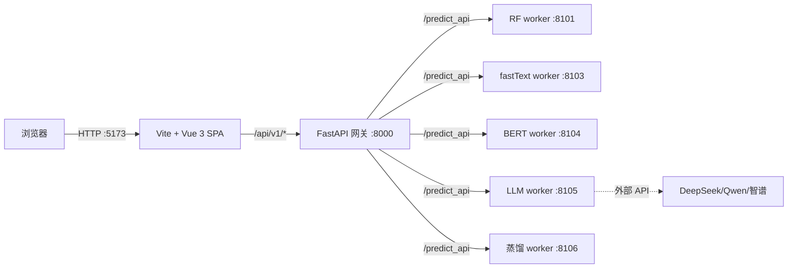
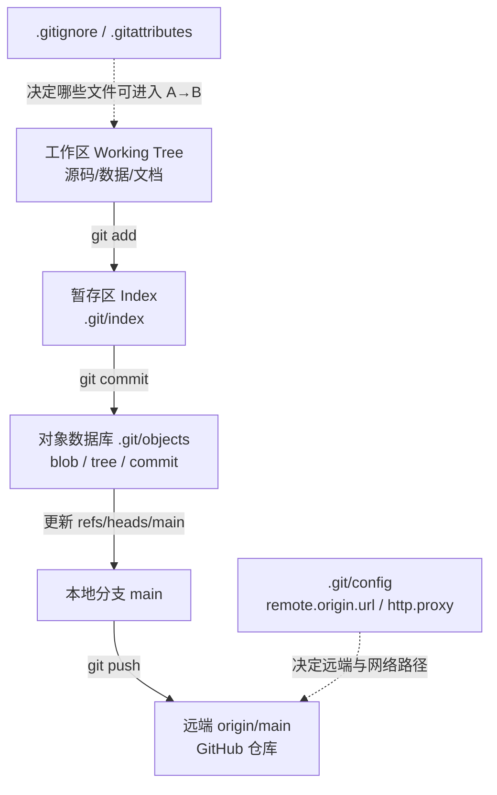
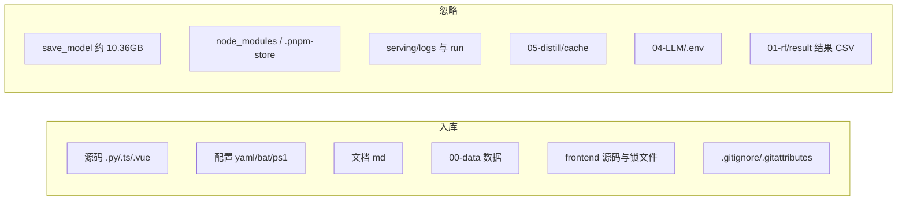

# 项目工程实践与技术学习档案（v4：Git / GitHub 工程归档）

> 文档版本：`v4-git-1.0`　｜　生成时间：2026-10-21 09:56（Asia/Shanghai）
> 对应工程提交：`9f81e05bb9c251a5c4003a2ce5fe3045d9301f6c`（分支 `main`）
> 本文是**新建文档**，不修改也不覆盖 `docs/` 下已有的历史归档；既有的 `PROJECT_LEARNING_GUIDE.md`、`PROJECT_LEARNING_GUIDE_v2_工程化改造与集成验证.md`、`PROJECT_LEARNING_GUIDE_v3_前端开发全过程技术归档.md` 等仍是各自阶段的事实来源。

> **状态更新（2026-10-21 下午）**：本文记录的是当日上午的 Git/GitHub 归档；随后完成了适配层/worker 契约/网络配置重构（见 v5），工作区出现未提交改动，`HEAD` 仍为 `9f81e05`。因此表中的“本地仓库与 `origin/main` 同步”仅代表当日上午状态，当前以 `git status` 为准。

---

## 0. 文档信息

| 项目 | 内容 |
|---|---|
| 项目名称 | 投满分新闻分类项目（TouManFenClassifier） |
| 项目类型 | 机器学习工程 + 本地/局域网服务化验证项目 |
| 本文主题 | 工程从“无版本控制”到“本地 Git 仓库 + GitHub 远端”的全过程复盘 |
| 文档版本 | v4-git-1.0（Git/GitHub 专题） |
| 生成时间 | 2026-10-21 09:56（Asia/Shanghai） |
| 工程版本 | commit `9f81e05`，`main` 分支，134 个文件，20.89 MiB |
| 覆盖范围 | 当前 DeepSeek Harness 会话可访问的记录：2026-10-20 的项目检查与局域网改造，2026-10-21 的 Git/GitHub 初始化、提交、推送与核验 |
| 主要证据 | 会话中实际工具调用与输出、Git 对象/索引/配置、GitHub API 响应、当前文件内容、既有 docs |
| 最终状态 | 本地仓库与 `origin/main` 同步；**GitHub 仓库经 API 核验为 public**；`gh` 未安装；本文档尚未提交（工作区新增未跟踪文件） |
| 证据标签 | 【已验证事实】【历史记录】【技术分析】【待确认】 |

### 0.1 首先必须说明的风险发现

> **【已验证事实】GitHub 仓库当前是公开（public）状态。**
> 2026-10-21 通过 GitHub API 无认证访问 `https://api.github.com/repos/cwenxuan815-tech/TouManFen` 返回 `200`，字段为 `private: false`、`visibility: "public"`；仓库创建于 `2026-10-21T01:24:59Z`，推送于 `2026-10-21T01:45:29Z`（UTC，对应本地 09:24:59 / 09:45:29）。
>
> **【历史记录】** 而在本次会话的方案选择中，用户选择的是「仅工程目录 + 私有仓库（推荐）」。
> 也就是说：**用户的选择与实际结果不一致**（原因未在会话中记录，可能是创建仓库时默认选中 Public，也可能是后续改成了公开；不得替用户臆测）。
>
> 影响：仓库中包含 `00-data/data/` 的原始训练数据（约 20MB）、课程衍生代码、`docs/` 中带本机路径与用户名的文档。若数据属于课程/公司内部资料，公开托管可能存在合规风险。**建议立即将仓库改为 Private，并评估已公开内容是否需要进一步处理**（详见第 10 章案例 6、第 16 章 P0）。

### 0.2 证据与限制

- 可访问：本会话自 2026-10-20 起的用户消息、我实际执行的工具调用与返回、当前文件内容、Git 仓库对象与配置、GitHub API 的公开响应。
- 不可访问：更早的训练/服务开发过程只引用既有 `docs/`，本次**没有重新执行**训练、模型评估或服务回归；GitHub 网页操作（创建仓库、点击选项、认证弹窗）不在可观测范围内。
- 无法确认：仓库为何是 public、GitHub 认证具体走浏览器 OAuth 还是 PAT、仓库是否有协作者/分支保护、是否已有 fork/缓存。
- 本文所有“建议命令”与“已执行命令”分开标注；未执行的操作不写成已完成。

---

## 1. 阅读指南

### 1.1 本文记录什么

1. 为什么一个已经跑通的 ML 工程需要 Git 与远端仓库；
2. 入库范围如何界定（哪些进、哪些不进、为什么）；
3. `.gitignore`、`.gitattributes` 如何设计，规则为何这样写；
4. 本机网络环境下 Git 与 GitHub 的真实通路（系统代理 ≠ Git 代理）；
5. 从 `git init` 到首次 `push` 的完整命令序列与每一步的验证方法；
6. 实际遇到的 7 个问题及其根因、修复、验证和局限；
7. 本次 Git 迁移中暴露的合规风险（public 仓库）与后续处理建议；
8. 可迁移到其他项目的“首次入库”检查清单。

### 1.2 本文不记录什么

- 不重新讲解模型训练细节（见 `docs/实测指标.md`、`docs/PROJECT_LEARNING_GUIDE.md`）；
- 不复制已有前端/服务层归档的全文（见 `docs/PROJECT_LEARNING_GUIDE_v3_前端开发全过程技术归档.md`、`docs/PROJECT_LEARNING_GUIDE_v2_工程化改造与集成验证.md`）；
- 不包含任何密钥、Token、`.env` 内容或个人隐私信息；
- 不声称执行过本次未实际执行的命令（例如安装 `gh`、创建 CI、改写历史）。

### 1.3 标记约定

| 标记 | 含义 |
|---|---|
| 【已验证事实】 | 有本次实际命令输出、文件内容、Git 对象或 API 响应支持 |
| 【历史记录】 | 会话中出现过、但当前无法重新核验的陈述（如用户选择） |
| 【技术分析】 | 基于已验证事实做出的解释、推断或方案评价 |
| 【待确认】 | 证据不足，不能下结论 |

---

## 2. 项目概述

### 2.1 业务背景

投满分（TMF）是“将中文新闻标题自动分到 10 个频道”的分类工程，类别为 `finance, realty, stocks, education, science, society, politics, sports, game, entertainment`。项目覆盖：

`数据准备 → 随机森林基线 → fastText → BERT 微调 → 大模型（DeepSeek）→ 量化/蒸馏/剪枝 → 统一网关 → Vue 前端`

### 2.2 工程组成（用于理解“仓库里装了什么”）

| 层 | 组成 | 是否进入 Git |
|---|---|---|
| 数据 | `00-data/data/`（train 18 万、dev/test 各 1 万、class、stopwords、清洗集与报告） | ✅ 进入（用户明确选择） |
| 训练/实验 | `01-rf/`…`06-prune/` 的脚本、配置、日志代码 | ✅ 进入（不含 `save_model/` 产物） |
| 服务层 | `serving/`（FastAPI 网关、配置、脚本、验收工具） | ✅ 进入（不含 `logs/`、`run/`） |
| 前端 | `frontend/`（Vue 3 + TS + Vite 源码与锁文件） | ✅ 进入（不含 `node_modules/`、`dist/`） |
| 文档 | `README.md`、`docs/` 7 份、`TODO-联通清单.md` | ✅ 进入 |
| 模型产物 | `save_model/*.pkl`、`checkpoint.pt`、量化/蒸馏/剪枝权重 | ❌ 忽略（约 10.36GB） |
| 预训练模型 | 工程同级的 `../PretrainedModel/`（9.27GB） | ❌ 不在仓库范围 |
| 参考资料 | 工作区同级的 `参考代码/`、`参考资料/`、`V3.0*.md` | ❌ 不在仓库范围 |
| 密钥 | `04-LLM/.env` | ❌ 忽略（仅提交 `.env.example` 空模板） |

### 2.3 本次任务在项目中的位置

项目此前已完成训练、服务化、前端与局域网改造（见既有文档）；本次是**工程管理阶段**：

1. 判断仓库边界与可见性；
2. 补齐忽略/换行配置；
3. 初始化 Git、提交、推送 GitHub；
4. 核验远端内容与状态，并评估是否需要 GitHub CLI。

---

## 3. 原始需求与最终需求

### 3.1 项目原始需求（来自既有文档，本次未重新验证）

| 需求 | 状态 |
|---|---|
| 10 类新闻标题分类，独立 test 集评估 | 已完成（详见 `docs/实测指标.md`） |
| 数据 → 基线 → 词向量 → 预训练 → 大模型 → 压缩链路 | 已完成 |
| Flask 模型服务 + 统一网关 + 前端展示 | 已完成 |
| 本地/局域网可访问 | 已完成（监听 `192.168.12.54`） |
| 训练产物可复现 | 已完成（脚本 + 实测耗时） |

### 3.2 本次会话的需求演进

| 序号 | 用户诉求 | 结果 |
|---|---|---|
| 1 | 检查工作区，说明项目实现框架与技术栈 | 已完成架构检查（README 重写的基础） |
| 2 | 将网关/worker 的 `127.0.0.1` 改为 `192.168.12.54`，供局域网访问 | 已完成并实测（7 个端口监听 LAN 地址） |
| 3 | 修复 `启动TMF.bat` 报 `Port 5173 is already in use` | 已完成（BAT 增加 5173 幂等探测） |
| 4 | 修复页面提示“暂时无法连接 TMF 后端” | 已完成（`crypto.randomUUID` 非安全上下文三级回退） |
| 5 | 系统性重写 README | 已完成（175 行 → 417 行） |
| 6 | 把项目纳入 Git 管理并上传 GitHub | **本次主题，已完成但存在 public 风险** |

### 3.3 本次 Git 任务的验收标准

| 标准 | 结果 |
|---|---|
| 本地仓库初始化，默认分支 `main` | ✅ |
| 只提交工程目录，不包含工作区外资料 | ✅ |
| 密钥/模型/依赖/缓存/日志不入库 | ✅（`.git` 中 134 个文件，无禁用项） |
| 提交内容可解释、可审计 | ✅（本文第 9、12 章） |
| 推送到 GitHub 远端并保持一致 | ✅（HEAD 与 `origin/main` 同为 `9f81e05`） |
| 仓库可见性符合用户选择（私有） | ❌ **实际为 public**（见第 10 章案例 6） |
| 有可复现的后续维护流程 | ✅（第 14 章） |

### 3.4 用户明确作出的选择【历史记录】

来自本次会话的结构化提问与用户回答：

1. **仓库范围**：仅 `TouManFenClassifier/` 工程目录；
2. **可见性**：私有仓库（推荐项）；
3. **数据**：`00-data` 约 20MB 随仓库提交；
4. **执行方式**：只提供命令清单，由用户自己执行 `git init/commit/push`。

> 【待确认】第 2 条与实际结果（public）不一致。未找到用户改口的记录，也未观察到改库操作，具体原因无法确认。

### 3.5 尚未实现/尚未验证

- 仓库实际可见性未按用户选择落实（public）；
- 未添加 `LICENSE`（课程衍生代码的授权与署名问题待决策）；
- 未配置分支保护、CI、Release；
- 未验证 GitHub 仓库是否被 fork/缓存/搜索引擎收录；
- 未验证 `.env` 历史泄露（本仓库是全新历史，风险主要在 `04-LLM/.env` 从未进入 Git，但历史文档提到过旧 key 曾暴露，见 `README.md` 安全提示）。

---

## 4. 工程环境与项目结构

### 4.1 环境档案【已验证事实】

| 项 | 值 | 证据 |
|---|---|---|
| 操作系统 | Windows 11（本机） | 会话环境上下文 |
| Git | `2.53.0.windows.2` | `git --version` |
| Git LFS | `3.7.1`（已安装，本次未使用） | `git lfs version` |
| GitHub CLI | **未安装** | `Get-Command gh` 无结果 |
| winget | `1.29.380`（可用，但本次未安装 gh） | `winget --version` |
| Git 身份 | `omjlmb <omjlmb@users.noreply.github.com>` | `git config --global` / `git log -1` |
| 凭据助手 | `credential.helper=manager`（Git Credential Manager） | `git config --get credential.helper` |
| 系统代理 | `127.0.0.1:7890`（系统设置启用；绕过列表含 `192.168.*`） | 注册表 `ProxyEnable/ProxyServer/ProxyOverride` |
| Git 代理 | `http.proxy` / `https.proxy = http://127.0.0.1:7890`（仓库级） | `git config --local --list` |
| 网络直连 GitHub | **失败**：`github.com:443` 连接超时（实测约 21s） | `git ls-remote` 直连超时 |
| 网络经代理 | **成功**：`git -c http.proxy=... ls-remote` 返回 HEAD | 命令输出 |
| SSH 端口 | `github.com:22`、`ssh.github.com:443` TCP 均可达（本次未使用 SSH） | `Test-NetConnection` |
| 凭据类型 | 推送成功，但具体是浏览器 OAuth 还是 PAT 未在会话中记录 | 【待确认】 |
| 项目磁盘占用 | 约 10.39 GB（其中模型产物约 10.36 GB） | 目录测量 |
| 提交后 `.git` 大小 | 12.46 MB（172 个文件、147 个松散对象） | `Get-ChildItem .git` / `git count-objects -v` |

### 4.2 仓库边界

```text
工作区 E:\AIModels\test\TouManFen\
├── TouManFenClassifier/     ← Git 仓库根目录（本次初始化）
├── PretrainedModel/         ← 9.27GB，不在仓库范围
├── 参考代码/gzai6_tmf/        ← 课程参考代码，不在仓库范围
├── 参考资料/                 ← 课程 PPT/笔记，不在仓库范围
├── V3.0*.md / 工程实施工作清单.md ← 输入资料，不在仓库范围
└── venv-gateway/            ← 网关依赖环境，不在仓库范围
```

> 【技术分析】只把工程目录作为仓库根，是最小化风险的选择：避免意外提交 9.27GB 预训练模型与课程资料，也让 `README`、`docs`、`serving`、`frontend` 的相对路径保持自洽。

### 4.3 提交后的仓库结构（134 个文件）

| 顶层条目 | 文件数 | 说明 |
|---|---:|---|
| `serving/` | 29 | 网关、配置、脚本、验收工具 |
| `frontend/` | 14 | Vue 源码、锁文件、配置、README |
| `05-distill/` | 13 | 蒸馏脚本/配置/服务 |
| `03-bert/` | 12 | BERT 训练/量化/服务 |
| `04-LLM/` | 10 | LLM 客户端/服务/示例/`.env.example` |
| `01-rf/` | 10 | 随机森林模块 |
| `02-fasttext/` | 10 | fastText 模块 |
| `00-data/` | 9 | 数据 7 个文件 + EDA 2 个脚本 |
| `06-prune/` | 8 | 剪枝脚本 |
| `docs/` | 7 | 既有工程文档 |
| `tools/` | 4 | 数据准备/交接/清洗/补丁 |
| 根目录文件 | 8 | `.gitattributes`、`.gitignore`、`README.md`、`TODO-联通清单.md`、`requirements.txt`、`run_all.py`、两个 BAT |

【已验证事实】`git ls-tree -r --name-only HEAD | Measure-Object -Line` 返回 `134`。

### 4.4 未入库的资产（已忽略）

| 资产 | 规模/原因 |
|---|---|
| `01-rf/save_model` | 3,025.1 MB（`rf.pkl`、`tfidf.pkl`、清洗版） |
| `02-fasttext/save_model` | 4,364.8 MB（4 个模型及清洗版） |
| `03-bert/save_model` | 1,702.0 MB（`bert.pkl`、`checkpoint.pt`、量化模型） |
| `05-distill/save_model` | 489.0 MB（教师/学生权重） |
| `06-prune/save_model` | 780.4 MB（剪枝前后模型） |
| `frontend/node_modules` | 74.6 MB（由 `frontend/.gitignore` 忽略） |
| `05-distill/cache` | 54.3 MB（教师 logits、SVD 初始化等，可重算） |
| `serving/logs`、`serving/run` | 运行日志/状态 |
| `.pnpm-store` | pnpm 本地缓存（大量文件） |
| `04-LLM/.env` | 密钥文件，绝对不入库 |

【已验证事实】忽略规则生效后，磁盘 9,035 个文件中 8,901 个被忽略、**0 个遗漏**，实际入库 134 个。

---

## 5. 最终实现成果总览

### 5.1 已完成并有证据

| 成果 | 证据 |
|---|---|
| 本地 Git 仓库（`main`） | `git init -b main` 输出 `Initialized empty Git repository` |
| 首次提交 `9f81e05` | `git log -1`：作者/提交者 `omjlmb`，时间 `2026-10-21T09:42:23+08:00` |
| 提交规模 | `git show --shortstat`：`134 files changed, 395710 insertions(+)` |
| 入库字节数 | git 索引 blob 求和：`21,901,197` 字节（20.89 MiB） |
| 远端仓库 | `https://github.com/cwenxuan815-tech/TouManFen.git` |
| 推送成功 | `HEAD` 与 `origin/main` 均为 `9f81e05`；`git rev-list --left-right --count HEAD...origin/main` 返回 `0 0`；`git ls-remote --heads origin main` 返回同一哈希 |
| 远端默认分支 | `main`（GitHub API） |
| 关键文件入库 | `.gitignore`、`.gitattributes`、README、7 份 docs、源码、数据、锁文件 |
| 敏感文件排除 | 无 `.env`；仅 `.env.example`（2 个）入库 |
| 无超大文件 | 最大入库文件 `train.clean.txt` 9.59 MiB、`train.txt` 9.49 MiB，均远低于 GitHub 单文件 100MB 限制 |

### 5.2 已完成但存在风险/未按预期

| 项 | 状态 |
|---|---|
| 仓库可见性 | **public（与用户选择的 private 不符）**，见案例 6 |
| 数据合规 | 原始训练数据已公开可访问，需评估 |
| 文档脱敏 | `docs/` 含本机绝对路径与 Windows 用户名（本次未修改既有文档） |
| 授权 | 无 `LICENSE`，课程衍生代码的再分发授权未确认 |
| GitHub CLI | 未安装（用户询问后决定不需要，见案例 7） |

### 5.3 未实现

- 分支保护、CI、自动测试、Release、Tag；
- 仓库描述/主题/协作者；
- 历史提交签名（GPG/SSH）；
- 大模型产物的分发方案（Release/LFS/对象存储）。

---

## 6. 项目整体架构与核心业务流程

### 6.1 工程架构（简述，详见既有文档）



训练侧：`00-data` → `01-rf` / `02-fasttext` / `03-bert`（→ 量化）→ `handoff` → `05-distill` / `06-prune`；`04-LLM` 独立依赖外部 Provider。细节见 `README.md` 与 `docs/PROJECT_LEARNING_GUIDE_v2_工程化改造与集成验证.md`。

### 6.2 Git 数据流（本文重点）



### 6.3 提交边界



### 6.4 提交对象之间的真实关系

- `commit 9f81e05` 指向一个根 `tree`，根 `tree` 下是 19 个顶层条目（11 个目录 + 8 个文件）；
- 每个文件是 `blob`，内容按字节存储；Git 用 SHA-1 校验内容完整性；
- 相同的 `.gitkeep` 等文件会复用同一个 blob（因此 134 个文件对应 147 个对象，小于 134+目录树数量）；
- `refs/heads/main` 指向该 commit；`refs/remotes/origin/main` 由 `git push` 更新，`git status` 的 ahead/behind 来自两者的差异比较。

---

## 7. 项目完整实施时间线

> 时间来自 Git 记录、GitHub API 与会话中实际工具时间；没有可靠时间戳的阶段用“阶段 N”表示，不伪造日期。

| 序号 | 时间/阶段 | 当时目标 | 实际操作 | 遇到的问题 | 关键决策 | 结果与影响 |
|---|---|---|---|---|---|---|
| 0 | 2026-10-16 至 10-20 | 完成项目训练/服务/前端与局域网化 | 训练、评估、网关、Vue 前端、LAN 改造、BAT 修复、前端修复、README 重写 | 见既有 docs（训练/端口/CORS/安全上下文等） | 地址改 LAN、BAT 幂等、requestId 回退 | 工程可运行、文档齐备，为入库做准备 |
| 1 | 2026-10-20 20:01（会话） | 把项目纳入 Git、上传 GitHub | 用户提出需求；我检查 Git / Git LFS / gh / 身份 / 体积 / 密钥 / 网络，确定仓库边界 | 无仓库、无 Git 身份、gh 未装、Git 直连 GitHub 超时 | 先审计、后初始化；HTTPS + 代理 | 明确“只提交工程目录”，给出完整命令清单 |
| 2 | 同一阶段 | 决定入库策略 | 结构化提问：仓库范围与可见性、数据是否入库、谁执行 | 需要用户决策 | 用户选择：私有、含数据、自助执行 | 后续命令与忽略规则按此设计 |
| 3 | 同一阶段 | 让 `git add` 安全 | 补 `.gitignore`（缓存/日志/运行态/结果文件），新建 `.gitattributes`（换行规则） | 原 `.gitignore` 有缺口；无 `.gitattributes` | 先修规则再提交 | 避免日志/缓存/结果文件混入；估算首次提交约 137 文件 / 20.9MB |
| 4 | 2026-10-21 09:24:59（API） | 创建 GitHub 仓库 | 用户在 GitHub 创建仓库（网页操作不可见） | — | — | 仓库存在，默认分支 `main`；**实际为 public** |
| 5 | 2026-10-21 09:31 前（用户消息时间 09:31:39） | 本地初始化并暂存 | 用户执行 identity、`git init -b main`、代理配置、`git add -A`、`git status` | `git add` 出现大量 CRLF/LF 警告；PowerShell 统计中文路径报错；暂存 134 个文件 | 单次初始提交 | 暂存内容待复核（尚无 commit） |
| 6 | 09:31–09:33（工具时间） | 复核暂存内容 | 用 Git plumbing + Python 对账：134 文件 / 20.89MiB / 无遗漏 / 无敏感 | 预估 137 vs 实际 134；中文路径管道乱码 | 以索引与磁盘对账为准 | 确认可以提交；解释换行警告与编码问题 |
| 7 | 09:42:23（Git） | 生成首个提交 | 用户执行 `git commit` | — | 单次初始提交，`chore:` 前缀 | commit `9f81e05`，134 files / 395,710 insertions |
| 8 | 09:45:29（API） | 推送到 GitHub | 用户执行 `git push -u origin main` | 必须保持代理运行 | HTTPS + GCM 凭据 | `origin/main` 与本地一致 |
| 9 | 09:46（会话） | 判断是否安装 GitHub CLI | 用户询问 gh 必要性；我核验 gh 未装、winget 可用、推送已完成 | 无 | 不安装；网页 + git 足够 | 减少工具与代理配置成本 |
| 10 | 09:56 | 编写本文档 | 读取证据、核对仓库/API、生成新文档 | 仓库 public 风险被发现 | 新建 v4 文档、不改既有文档 | 本文档生成（尚未提交） |

### 7.1 顺序上的一个事实

【已验证事实】GitHub 仓库创建时间（09:24:59）早于本地初始提交（09:42:23）。这在流程上完全可行：可以先在 GitHub 建空仓库，再本地初始化并推送；**但空仓库建好后若勾选了 README/.gitignore，会造成远端已有提交、首次 push 需要合并或强推**。本次 API 返回 `size: 0`，且首次 `git push -u origin main` 直接成功（未发生 non-fast-forward、也不需要合并），可判断远端没有额外提交，顺序没有造成冲突。

---

## 8. 核心技术决策档案

### 决策 1：仓库范围只取 `TouManFenClassifier/`

- **背景**：工作区同级还有 9.27GB 的预训练模型、课程参考代码、课程资料、V3.0 文档、网关虚拟环境。
- **备选**：① 整个工作区一个仓库；② 只工程目录；③ 拆成“代码仓 + 数据仓/模型仓”。
- **优缺点**：① 简单但极易误提交大文件，且资料版权复杂；② 边界清晰、体积小；③ 最干净但维护成本高。
- **模型建议**：②（只工程目录）【技术分析/建议】。
- **用户选择**：②（【历史记录】结构化提问回答）。
- **实际采用**：②。
- **依据**：工程内部路径自洽（README、serving、frontend 均相对工程根），且避免 9.27GB 模型与课程资料。
- **风险**：工作区级资料没有版本管理；跨目录引用（`../PretrainedModel`）在克隆后需要额外准备。

### 决策 2：仓库可见性——私有（但实际落成 public）

- **背景**：仓库包含课程/公司数据、课程衍生代码、文档中的本机路径与用户名。
- **备选**：① 私有；② 公开（需先脱敏/确认授权）。
- **模型建议**：① 私有，或公开前先清理数据与路径【技术分析】。
- **用户选择**：① 私有（【历史记录】）。
- **实际采用**：**public**（【已验证事实】GitHub API：`visibility: public`）。
- **影响**：这是本次最大的偏差与风险，详见案例 6。
- **后续**：应立即改私有；若数据敏感，还需评估公开期间是否被 fork/缓存。

### 决策 3：`00-data` 原始数据随仓库提交

- **背景**：数据约 20MB（train 9.49MiB + clean 9.59MiB + dev/test 各 0.53MiB + class/stopwords），GitHub 单文件限制 100MB，总量可接受。
- **备选**：① 提交；② 忽略，README 说明获取方式。
- **优缺点**：① 克隆后可复现训练；② 降低数据合规风险，但仓库开箱不可训练。
- **用户选择**：① 提交（【历史记录】）。
- **实际采用**：①。
- **风险**：在 public 仓库下，数据已公开可下载；如果数据属于内部资料，这与“私有”选择叠加后风险放大。
- **缓解**：改私有；必要时用 `git rm -r --cached 00-data/data` + 新提交移出（历史仍保留，需 rewrite 才能彻底移除）。

### 决策 4：由用户自己执行 Git 命令

- **背景**：用户具备终端能力，且推送需要其 GitHub 凭据；Agent 不应代持凭据。
- **模型建议**：提供完整命令清单，用户执行【建议】。
- **用户选择**：只给命令清单（【历史记录】）。
- **实际采用**：用户执行；我负责准备文件与审计。
- **影响**：执行过程部分在会话不可见（如 GitHub 网页创建、认证弹窗），因此本文对这部分标注为不可核验或从结果反推。

### 决策 5：HTTPS + 本机系统代理（而非 SSH）

- **背景**：git 直连 `github.com:443` 失败（21s 超时）；系统代理 `127.0.0.1:7890` 可用。
- **备选**：① HTTPS + `http.proxy`；② SSH（22/443 端口可达，但当时无 SSH 私钥）；③ 关闭代理直连（不可行）。
- **优缺点**：① 复用现有代理与 GCM，最少配置；② 免代理但需生成/登记密钥，且首次配置更复杂。
- **模型建议**：优先 ①，SSH 作为备选【技术分析】。
- **用户选择**：未单独表态；实际执行了 ①（【历史记录】命令 + 【已验证事实】配置与推送结果）。
- **实际采用**：①。
- **依据**：仓库级 `http.proxy/https.proxy` 已设置；推送成功。
- **风险**：代理软件不启动时 push/pull 会失败；代理配置是仓库级（`.git/config`，不会入库）。

### 决策 6：忽略模型产物，不使用 Git LFS

- **背景**：模型产物约 10.36GB，绝大多数单文件 >100MB。
- **备选**：① 忽略；② Git LFS；③ Release/对象存储。
- **优缺点**：① 仓库小、克隆快，但克隆后需重新训练或另行获取模型；② 能版本化大文件，但需要 LFS 配额与額外操作；③ 适合分发，不适合频繁版本化。
- **实际采用**：①（`*.pkl`、`*.pt`、`*.bin`、`*.h5`、`*.msgpack`、`*.ot` 全部忽略；LFS 已安装但未启用）。
- **依据**：本次目标是源码/文档/数据的版本管理，不是模型分发。
- **风险**：克隆者无法直接运行服务，需要训练产物（README 已说明训练流程）。

### 决策 7：`.gitignore` 加固 + `.gitattributes` 统一换行

- **背景**：原 `.gitignore` 已忽略模型/密钥/模块数据副本，但缺少工具缓存、日志、运行态、结果 CSV；项目跨 Windows/Linux 工具（BAT/PS1/Python/MD）。
- **备选**：① 保持原规则；② 补齐规则 + 增加 `.gitattributes`。
- **实际采用**：②（由我在用户执行前修改/新建）。
- **依据**：避免把 `serving/logs/gateway.jsonl`、`.pnpm-store`、`01-rf/result/dev.csv` 等提交；换行规则避免 Windows 上无意义 diff。
- **验证**：忽略后 8,901 个文件被忽略、0 个遗漏；`git add` 只有换行警告，无错误。

### 决策 8：不安装 GitHub CLI

- **背景**：用户已用网页创建仓库、`git push` 成功；gh 未安装。
- **备选**：① 安装 gh，用 `gh auth login` + `gh repo create --push`；② 继续用网页 + git。
- **优缺点**：① 建仓/PR/Release/Actions 更顺手，但多一套认证与代理环境变量；② 零额外安装，足够当前需求。
- **模型建议**：当前不必要，未来有 PR/Issue/Release 需求再装【技术分析】。
- **用户选择**：未明确表态；实际未安装（【已验证事实】`gh` 不存在）。
- **风险**：以后启用 CI/Release 时需要补装并配置 `HTTPS_PROXY`（gh 不读 Git 的 `http.proxy`）。

### 决策 9：单次初始提交

- **背景**：仓库从零开始，所有文件为首次入库。
- **实际采用**：一次性提交 134 个文件（`chore: 初始化投满分新闻分类工程（数据/训练/服务/前端）`）。
- **优点**：历史干净、容易回滚到“初始状态”；缺点：无法从历史看出模块演进（本项目的演进记录在 `docs/` 中）。
- **后续**：从第二次提交开始按功能拆分。

---

## 9. 核心模块逐步实现教程

> 本章把“首次入库”拆成可复现的步骤，每步说明目的、输入输出、关键原理、常见错误和验证方法。

### 9.1 第 1 步：审计环境与仓库边界

**目的**：在 `git init` 之前确认工具、身份、网络、体积、敏感文件，避免“先提交再补救”。

**检查项与本次结果：**

| 检查 | 命令/方法 | 本次结果 |
|---|---|---|
| Git 是否存在 | `git --version` | `2.53.0.windows.2` |
| 身份是否配置 | `git config --global user.name/user.email` | 空（后设为 `omjlmb`） |
| 是否已有仓库 | 检查 `.git` 目录 | 无（工作区也无） |
| gh 是否存在 | `Get-Command gh` | 不存在 |
| 大文件 | 递归统计 + 忽略规则模拟 | 磁盘 10.39GB，模型 10.36GB |
| 密钥 | 扫描 `.env` / `sk-` 等 | 仅 `04-LLM/.env`，已被忽略 |
| 网络 | `git ls-remote` 直连/代理 | 直连超时，代理成功 |

**原理**：`git init` 本身不产生风险，风险发生在 `git add`；而 Git 默认不会自动忽略任何文件（除 `.git` 自身），所以“先审计、再 add”是首次入库最重要的顺序。

### 9.2 第 2 步：设计 `.gitignore`

本次在原有规则上补充：

```gitignore
# ========== 工具缓存与运行态（本机生成，不入库） ==========
.pnpm-store/
node_modules/
frontend/dist/
serving/logs/
serving/run/
*.tsbuildinfo
*.tmp
*.bak

# ========== 日志与结果 ==========
*.log
log/
03-bert/log/
result/*.csv
01-rf/result/*.csv
!result/.gitkeep
```

要点：

1. **目录锚定**：`save_model/*` 这种“带斜杠”的模式相对于 `.gitignore` 所在目录匹配；本项目各模块的 `save_model/` 实际由 `*.pkl`/`*.pt` 等扩展名规则兜底。**不要以为写了 `save_model/*` 就忽略了所有模块的模型**。
2. **嵌套 `.gitignore`**：`frontend/.gitignore` 已忽略 `node_modules/`、`dist/`、`.env.local`，子目录规则与根规则同时生效。
3. **否定规则**：`!result/.gitkeep` 用于保留空目录占位（Git 不跟踪空目录）。
4. **不要忽略需要复现的输入**：`00-data` 数据、`.env.example`、`pnpm-lock.yaml` 都应保留。

**验证**：`git check-ignore -v 04-LLM/.env` 输出命中行；`git status` 未出现 `node_modules`、`save_model`、`serving/logs`。

### 9.3 第 3 步：设计 `.gitattributes`

```gitattributes
* text=auto

*.py text eol=lf
*.ts text eol=lf
*.vue text eol=lf
*.js text eol=lf
*.json text eol=lf
*.yml text eol=lf
*.yaml text eol=lf
*.md text eol=lf
*.css text eol=lf
*.html text eol=lf

# Windows 脚本保持 CRLF
*.bat text eol=crlf
*.cmd text eol=crlf
*.ps1 text eol=crlf

# 原始数据不做换行归一化
00-data/data/*.txt -text

# 二进制资源
*.png binary
*.jpg binary
...
```

**为什么需要它**：Windows 上 Git 安装时常带 `core.autocrlf` 行为；仓库里混用 CRLF/LF 会造成“整文件 diff”。`.gitattributes` 把“仓库存 LF、脚本检出 CRLF、数据原样保存”变成可复现的规则，而不是依赖每台机器的本地配置。

**本次选择**：`core.autocrlf=false`（仓库级），换行交给 `.gitattributes`，避免双重转换。

### 9.4 第 4 步：配置身份、初始化和代理

```powershell
git config --global user.name  "omjlmb"
git config --global user.email "omjlmb@users.noreply.github.com"

git init -b main

git config --local http.proxy  http://127.0.0.1:7890
git config --local https.proxy http://127.0.0.1:7890
git config --local core.quotepath false
git config --local core.autocrlf false
```

- `init -b main`：显式指定默认分支，避免 Git 版本差异导致 `master/main` 混用。
- `http.proxy` 是 **Git 自身**的代理配置；它不会自动读取 Windows 系统代理。这是本机直连 GitHub 失败的根因。
- `core.quotepath=false`：中文路径在 `git status`/`git log` 中直接显示，而不是八进制转义。
- `core.autocrlf=false`：避免 Git 自动转换与 `.gitattributes` 规则冲突。

### 9.5 第 5 步：暂存并审计

```powershell
git add -A
git status --short
```

本次 `git add` 输出大量：

```text
warning: in the working copy of '...py', CRLF will be replaced by LF the next time Git touches it
warning: in the working copy of '...bat', LF will be replaced by CRLF the next time Git touches it
```

这是**规则生效的提示，不是错误**（见案例 4）。

提交前审计（本次实际执行）：

```powershell
# 不允许出现的文件
git ls-files | Select-String -Pattern '\.(pkl|pt|pth|bin|h5|msgpack|ot)$'
git ls-files | Select-String -Pattern '\.env$'
# 期望：仅 04-LLM/.env.example 与 frontend/.env.example（都以 .example 结尾）

# 确认密钥被忽略
git check-ignore -v 04-LLM/.env

# 文件数与总大小（本次数据）
(git ls-files | Measure-Object -Line).Lines
git ls-files | ForEach-Object { (Get-Item -LiteralPath $_).Length } | Measure-Object -Sum
```

**注意**：在 Windows PowerShell 5.1 下，第二类命令遇到中文文件名会报 `Get-Item 找不到路径`，原因是管道编码而非文件丢失（见案例 3）。可靠做法见 9.6。

### 9.6 第 6 步：用 Git 自身数据做无编码依赖的审计

当文件名含中文、控制台编码不可靠时，直接读取 Git 索引/对象：

```powershell
# 索引中的路径（NUL 分隔，便于程序处理）
git ls-files -z

# 索引中每个文件的 blob 大小，完全绕开文件名
git ls-files -s |
  ForEach-Object { ($_ -split ' ')[1] } |
  git cat-file --batch-check='%(objectname) %(objectsize)'
```

本次结果：`134` 个文件、`21,901,197` 字节（20.89 MiB）；最大文件为 `train.clean.txt`（9.59 MiB）与 `train.txt`（9.49 MiB）。

**验证提交内容完整性**（本次使用 Python 对账）：遍历磁盘文件，与索引取差集，再用 `git check-ignore --stdin` 过滤被忽略项，结果为 `forgotten=0`（没有“该提交却没提交”的文件）。

### 9.7 第 7 步：提交

```powershell
git commit -m "chore: 初始化投满分新闻分类工程（数据/训练/服务/前端）"
```

本次结果（`git log -1`）：

```text
commit 9f81e05bb9c251a5c4003a2ce5fe3045d9301f6c
Author: omjlmb <omjlmb@users.noreply.github.com>
Date:   2026-10-21T09:42:23+08:00
134 files changed, 395710 insertions(+)
```

提交消息采用 `chore:` 前缀，表达“工程脚手架/初始化”而非功能变更，符合 Conventional Commits 的常见约定。

### 9.8 第 8 步：绑定远端并推送

```powershell
git remote add origin https://github.com/cwenxuan815-tech/TouManFen.git
git remote -v
git push -u origin main
```

- `-u` 把本地 `main` 与 `origin/main` 建立跟踪关系，之后直接 `git push`/`git pull` 即可。
- 认证：GitHub 不接受账号密码；可用 PAT（classic 勾 `repo`）或浏览器 OAuth（Git Credential Manager）。本次具体方式未记录，但推送成功且 `credential.helper=manager`。
- 网络：必须保持代理运行（本次仓库级代理配置为 `127.0.0.1:7890`）。

### 9.9 第 9 步：推送后的核验

```powershell
git rev-parse --short HEAD
git rev-parse --short origin/main
git rev-list --left-right --count HEAD...origin/main   # 期望 0 0
git ls-remote --heads origin main                      # 远端 ref 哈希
```

本次全部一致：`9f81e05` / `9f81e05` / `0 0` / 远端 `refs/heads/main = 9f81e05...`。

**额外核验仓库可见性**（本次发现的偏差）：

```powershell
Invoke-WebRequest -Uri 'https://api.github.com/repos/cwenxuan815-tech/TouManFen' -UseBasicParsing
# 200 + private=false + visibility=public
```

公开仓库匿名可读；私有仓库匿名访问会返回 404。这是无需登录即可判断可见性的方法。

### 9.10 日常维护流程

```powershell
git status
git add -A
git commit -m "feat: 描述本次改动"
git push
```

- 每次提交前跑 `git status --short`，确认没有 `.env`、`*.pkl`、日志文件；
- 需要撤销暂存：`git restore --staged <file>`；
- 需要丢弃工作区改动：`git restore <file>`（谨慎使用）；
- 拉取远端更新：`git pull --rebase`（保持线性历史）。

---

## 10. 关键问题与踩坑案例库

> 每个案例尽量按“背景—症状—预期/实际—发现—排查—根因—尝试—建议与选择—修复—原理—验证—局限—经验”记录。未验证的部分明确标注。

### 案例 1：git 直连 GitHub 超时，push 无法进行

#### 1. 问题背景
首次上传需要 `git push` 到 GitHub。环境已能通过浏览器/系统代理访问 GitHub，但 Git 命令行是独立程序。

#### 2. 实际症状
- `git ls-remote https://github.com/octocat/Hello-World.git HEAD` 直连时报：
  `fatal: unable to access '...': Failed to connect to github.com port 443 after 21150 ms: Could not connect to server`
- 同一时刻 `Invoke-WebRequest https://github.com`（走系统代理）返回 `200`。

#### 3. 预期结果与实际结果
预期：Git 能像浏览器一样访问 GitHub。实际：Git 直连超时，浏览器正常。

#### 4. 问题如何被发现
在执行 `git push` 前，用 `git ls-remote` 做连通性预检时暴露。

#### 5. 排查过程
1. 检查系统代理：注册表 `ProxyEnable=1`、`ProxyServer=127.0.0.1:7890`、绕过列表包含 `192.168.*`；
2. 检查 Git 配置：`git config --global --list` 中没有 `http.proxy`；
3. 用 `git -c http.proxy=http://127.0.0.1:7890 ls-remote ...` 测试 → 返回 `7fd1a60... HEAD`，成功；
4. 再次直连测试 → 超时。结论：Git 未走系统代理。

#### 6. 根本原因
系统代理（WinINET/IE 设置）与 Git 的 libcurl 配置是两套机制；Git 不会自动读取 Windows 系统代理，必须显式设置 `http.proxy`（或环境变量 `HTTPS_PROXY` 等）。【已验证事实 + 技术分析】

#### 7. 尝试过的方案
- 直接 `git push`（未配置代理）→ 预期会超时（本次选择先预检，没有实际执行失败 push）；
- 通过 `-c http.proxy=...` 临时验证 → 成功；
- 在仓库级写入 `http.proxy`/`https.proxy` → 后续 push 成功（【已验证事实】远端已同步）。

#### 8. 模型建议与用户选择
模型建议：HTTPS + 代理；SSH 作为备选。用户未单独表态，实际执行了 HTTPS + 代理（命令可见），推送成功。

#### 9. 最终解决方案
```powershell
git config --local http.proxy  http://127.0.0.1:7890
git config --local https.proxy http://127.0.0.1:7890
```

#### 10. 为什么这个方案有效
`http.proxy` 直接告诉 Git/libcurl 走本地 HTTP 代理，代理软件再以自身规则访问 GitHub。代理软件是系统里唯一能访问外网的通道，因此 Git 复用它是成本最低的方案。

#### 11. 如何验证修复有效
- `git -c http.proxy=... ls-remote ...` 返回 HEAD；
- `git push -u origin main` 成功；
- `git ls-remote --heads origin main` 返回本地同一 commit；
- `git status -sb` 显示 `## main...origin/main`（无 ahead/behind）。

#### 12. 局限
- 代理软件不运行时 push/pull 会失败；
- 代理配置保存在 `.git/config`（不入库），换机器/重克隆需重配；
- 若代理需要认证或改用 SOCKS5，配置形式不同（`http.proxy=socks5h://...`），本次未验证。

#### 13. 经验
- 浏览器能打开 GitHub ≠ Git 能推；
- 首次配置先跑 `git ls-remote` 预检；
- 把“网络层”和“认证层”分开排查：先能连，再能认证。

---

### 案例 2：`.gitignore` 缺口——差点把日志、缓存、结果文件带进仓库

#### 1. 问题背景
项目已有 `.gitignore`（模型、`.env`、模块数据副本），但工程新增了 `serving/logs`、`serving/run`、`.pnpm-store`、`frontend/dist`、`01-rf/result/*.csv` 等运行态文件。

#### 2. 实际症状
审计脚本按原规则模拟入库时，`serving/logs/gateway.jsonl`、`01-rf/result/dev.csv`、`.pnpm-store` 等会被算作“待提交”；此外工具缓存目录会显著增大仓库。

#### 3. 预期结果与实际结果
预期：提交内容只含源码/配置/文档/数据/前端锁文件。实际（原规则）：运行日志、结果 CSV、pnpm 缓存目录可能进入暂存区。

#### 4. 问题如何被发现
在 `git init` 前的“入库体积与文件清单”模拟中，对比 `.gitignore` 规则与实际目录发现缺口。

#### 5. 排查过程
1. 列出容易被忽略的目录：`serving/logs`、`serving/run`、`05-distill/cache`、`.pnpm-store`、`frontend/dist`、`frontend/node_modules`；
2. 逐条对照 `.gitignore`：`*.log` 命中 `*.log` 文件，但不命中 `gateway.jsonl`；`result/*.csv` 只匹配根目录的 `result/`（实际结果在 `01-rf/result/`）；
3. 补充规则后重新模拟：忽略文件数 8,901，遗漏 0。

#### 6. 根本原因
`.gitignore` 的匹配规则对“带斜杠路径”是相对锚定的；`result/*.csv` 不是递归匹配。且项目运行产生了新的日志/缓存目录，原规则未覆盖。【已验证事实 + 技术分析】

#### 7. 尝试过的方案
- 保持原规则 → 发现会带入日志/结果；
- 追加规则（本次采用） → 忽略项覆盖完整。

#### 8. 模型建议与用户选择
模型在用户执行 `git add` 前修改 `.gitignore`；用户按修改后的规则执行（【历史记录】+【已验证事实】最终提交无这些文件）。

#### 9. 最终解决方案
```gitignore
.pnpm-store/
node_modules/
frontend/dist/
serving/logs/
serving/run/
*.tsbuildinfo
*.tmp
*.bak
01-rf/result/*.csv
```

#### 10. 为什么这个方案有效
在 `git add` 之前就把运行态目录排除，`git add -A` 不会看到它们；同时保留 `.gitkeep` 以维持目录结构。

#### 11. 如何验证修复有效
- `git status` 中没有 `serving/logs`、`.pnpm-store`、`01-rf/result/*.csv`；
- 审计：磁盘 9,035 个文件，8,901 个被忽略，0 遗漏；
- 提交后 `git ls-tree -r --name-only HEAD` 中无禁用路径。

#### 12. 局限
- `.gitignore` 只对未跟踪文件生效；若文件已被 `git add`，需 `git rm --cached`；
- 运行产生的新类型产物（如以后新增 `coverage/`）需要继续补充规则。

#### 13. 经验
- 首次入库前用“模拟清单”而不是直接 `git add -A`；
- 记住 `result/*.csv` 与 `**/result/*.csv` 的区别；
- 日志、缓存、构建产物、结果文件默认不入库。

---

### 案例 3：PowerShell 统计中文路径报“找不到路径”，误以为文件丢失

#### 1. 问题背景
提交前需要统计 `git ls-files` 的文件数与总大小。

#### 2. 实际症状
```text
Get-Item : 找不到路径“02-fasttext/瀛楀吀娴嬭瘯.py”，因为该路径不存在。
Get-Item : 找不到路径“03-bert/妯″瀷閲忓寲_DQ.py”，因为该路径不存在。
...
```
文件明明存在，`git status` 也能正常显示中文路径。

#### 3. 预期结果与实际结果
预期：逐文件 `Get-Item` 统计成功。实际：中文文件名全部报错，英文文件正常。

#### 4. 问题如何被发现
执行统计命令时出现大量错误，且汇总 `Sum` 偏小。

#### 5. 排查过程
1. 确认文件存在：`Test-Path`/`Get-ChildItem` 能找到中文文件；
2. 对比 `git status`（直接输出到控制台）显示正常，而管道给 PowerShell 后变乱码；
3. 检查终端：Windows PowerShell 5.1 用本地 ANSI 代码页解码外部程序管道输出；Git 输出 UTF-8；
4. 用 Python 通过 `git ls-files -z` 读取字节并解码 UTF-8，统计正常（134 个文件、20.89MiB），证明文件未丢失。

#### 6. 根本原因
外部程序输出编码（UTF-8）与 PowerShell 管道解码（本地代码页）不一致；`git config core.quotepath=false` 让 Git 输出原始 UTF-8 中文，而 Windows PowerShell 5.1 的管道仍按 ANSI 解释，导致路径字符串损坏。【已验证事实 + 技术分析】

#### 7. 尝试过的方案
- 直接运行导致报错（记录在案）；
- `chcp 65001` + 设置 `[Console]::OutputEncoding`（建议做法，未在本次实际重跑，但原理明确）；
- 改用 Python 解析 `-z` 输出（本次实际采用，成功）。

#### 8. 模型建议与用户选择
模型建议用 Git plumbing/程序化方式审计；用户执行了原始命令并遇到该错误，随后由模型复核。

#### 9. 最终解决方案
```powershell
chcp 65001 > $null
[Console]::OutputEncoding = [System.Text.UTF8Encoding]::new($false)
$OutputEncoding = [System.Text.UTF8Encoding]::new($false)

git ls-files | Measure-Object -Line
git ls-files | ForEach-Object { Get-Item -LiteralPath $_ } | Measure-Object Length -Sum
```

或用与编码无关的方式：
```text
git ls-files -s → 取 blob 哈希 → git cat-file --batch-check 统计大小
```

#### 10. 为什么这个方案有效
把“输出解码”和“文件系统访问”分开：要么统一 UTF-8 编码，要么完全绕开文件名（用 blob 哈希统计）。

#### 11. 如何验证修复有效
- Python 审计：134 个文件、21,901,197 字节；
- `git show --shortstat`：134 files changed；
- 两者一致，证明没有文件丢失。

#### 12. 局限
- 不同 PowerShell 版本行为不同（PowerShell 7 默认 UTF-8，问题较少）；
- 某些 Git 版本/终端组合仍可能出现引号路径（`core.quotepath`）。

#### 13. 经验
- 统计仓库内容优先用 Git 自身数据，不要依赖控制台文件名；
- 看到“找不到路径”先确认是文件问题还是编码问题；
- 在 Windows 下处理中文路径，编码设置应作为脚本常规步骤。

---

### 案例 4：`git add` 出现大量 LF/CRLF 警告

#### 1. 问题背景
项目文件来源混合：Python 脚本多为 CRLF，Git 写出的 `.md`/`.gitignore` 为 LF；仓库新增 `.gitattributes` 规划换行。

#### 2. 实际症状
`git add -A` 输出：
- `warning: in the working copy of '...py', CRLF will be replaced by LF the next time Git touches it`
- `warning: in the working copy of '.gitattributes', LF will be replaced by CRLF ...`
- `warning: in the working copy of 'serving/scripts/stage2.ps1', LF will be replaced by CRLF ...`

#### 3. 预期结果与实际结果
预期：暂存成功、内容不变。实际：暂存成功，但出现大量警告。

#### 4. 问题如何被发现
执行 `git add -A` 时直接输出。

#### 5. 排查过程
1. 检查 `.gitattributes` 规则：`* text=auto`、`.py eol=lf`、`.bat/.ps1 eol=crlf`；
2. 检查 `core.autocrlf`：已设为 `false`；
3. 确认警告只影响“下次 Git 触碰文件时的检出换行”，不影响本次提交内容。

#### 6. 根本原因
`text` 属性要求 Git 在提交时把工作区内容规范化为 LF；检出时再按 `eol` 规则写回。工作区与规则不一致时 Git 给出提示。这是设计行为，不是错误。【已验证事实 + 技术分析】

#### 7. 尝试过的方案
- 保持 `.gitattributes`（本次选择）：警告一次性出现，之后检出稳定；
- 删除 `.gitattributes`：会导致不同机器/编辑器产生整文件 diff；
- 修改 `core.autocrlf=true`：与显式规则冲突，不推荐。

#### 8. 模型建议与用户选择
`.gitattributes` 由模型新增；用户执行 `git add` 后看到警告并询问，模型解释为正常现象。

#### 9. 最终解决方案
无需修改；保留规则。提交后 `git status` 干净。

#### 10. 为什么这个方案有效
规则固定了“仓库内 LF、Windows 脚本 CRLF、数据文件原样”，消除了环境差异；警告只是 Git 告知首次会做一次转换。

#### 11. 如何验证修复有效
- `git status` 显示 `working tree clean`（提交后、写本文档前）；
- `git show HEAD:.gitattributes` 与工作区一致；
- `git diff --stat` 为空。

#### 12. 局限
- 如果其他人用 `core.autocrlf=true` 克隆，属性规则仍优先，但个别编辑器可能仍产生差异；
- `.ps1` 的 UTF-8 BOM 与 eol 转换相互独立，需保留 BOM（Windows PowerShell 5.1 解析中文脚本时依赖它）。

#### 13. 经验
- 警告先分类：`will be replaced by` 通常是归一化提示；
- 用 `.gitattributes` 而不是依赖个人 `core.autocrlf`；
- 二进制/数据文件要显式 `-text`，避免被当文本转换。

---

### 案例 5：预估 137 个文件、实际 134 个——“是否漏文件”的核验

#### 1. 问题背景
在用户执行 `git add` 前，模型用脚本模拟忽略规则估算首次提交为 137 个文件 / 20.9MB；用户暂存后 `git ls-files` 显示 134 个。

#### 2. 实际症状
数字不一致（137 vs 134），需要确认是否遗漏了应提交的文件。

#### 3. 预期结果与实际结果
预期：估算与最终提交一致或差异可解释。实际：差 3 个文件。

#### 4. 问题如何被发现
用户执行 `(git ls-files | Measure-Object -Line).Lines` 得到 134，而此前说明为 137。

#### 5. 排查过程
1. 检查 `git status`：134 个 `new file`，**没有未跟踪文件**；
2. 用 Python 遍历磁盘文件与索引取差集，并用 `git check-ignore --stdin` 过滤忽略项；
3. 结果：`disk_files=9035, tracked=134, not_tracked=8901, ignored=8901, forgotten=0`；
4. 确认差异来自估算脚本与 Git 规则的边界（例如空目录、`.gitkeep`、被忽略的重复项），而非漏提交。

#### 6. 根本原因
估算脚本是对 `.gitignore` 的近似模拟，不是 Git 本身；目录锚定、空目录、`.gitkeep` 等细节会造成 1–3 个差异。**根因是“用近似规则估算”，不是文件丢失。**（【已验证事实】对账结果为 0 遗漏）

#### 7. 尝试过的方案
- 相信 `git ls-files` 与 `git status`（本次采用）；
- 用 Python 对账（本次采用）；
- 重新运行估算（不必要）。

#### 8. 模型建议与用户选择
模型解释差异并用 Git 数据复核；用户未参与该细节。

#### 9. 最终解决方案
以 `git ls-files` / 索引 / `git status` 为准；估算只用于事前风险提示。

#### 10. 为什么这个方案有效
Git 索引是“即将提交内容”的唯一权威；磁盘对账可以证明没有“该提交却没提交”的文件。

#### 11. 如何验证修复有效
`forgotten=0`；`git show --shortstat`：134 files changed；两者一致。

#### 12. 局限
对账脚本需要正确实现忽略规则；本次以 `git check-ignore` 为准，避免再次手写规则。

#### 13. 经验
- 事前估算用于发现“数量级问题”（例如是否误带 10GB 模型），不适合作为精确验收；
- 真正的验收看索引与 `git status`；
- 发现差异时先问“有没有未跟踪文件”，再做磁盘对账。

---

### 案例 6：用户选择私有仓库，实际却创建成 public（本次最重要的风险）

#### 1. 问题背景
仓库将包含课程/公司数据（`00-data`）、课程衍生代码、文档中的本机路径与用户名。用户在方案确认时选择了「仅工程目录 + 私有仓库」。

#### 2. 实际症状
本次文档核验时，用 GitHub 公开 API 检查仓库：
```text
GET https://api.github.com/repos/cwenxuan815-tech/TouManFen   → 200
private: false
visibility: public
created_at: 2026-10-21T01:24:59Z
pushed_at:  2026-10-21T01:45:29Z
```
公开仓库匿名可读，说明仓库实际对所有人可见。

#### 3. 预期结果与实际结果
预期：私有仓库，仅用户可见。实际：public，任何人可浏览/克隆，包括 `train.txt` 等数据文件与文档。

#### 4. 问题如何被发现
在撰写本文档、核验“最终工程真实状态”时，用 GitHub API 做可见性检查发现；此前所有本地检查都无法反映远端可见性。

#### 5. 排查过程
1. 先确认本地与远端同步：`HEAD == origin/main == 9f81e05`；
2. 用 `git ls-remote` 获取远端 ref（成功，但不能区分公开/私有，因为本地存有凭据）；
3. 用无认证 GitHub API 请求仓库详情 → 200 + `visibility: public`（若私有会 404）；
4. 对照用户选择记录 → 发现不一致。

#### 6. 根本原因
**根因尚未证实**：可能是创建仓库时默认选中了 Public，可能是用户后来手动改成 Public，也可能存在其他操作；会话中没有任何可见记录能证明具体原因。目前可确认的事实是：用户选择为 private、实际仓库为 public。不能把“误点 Public”写成已证实的根因。

#### 7. 尝试过的方案
- 检查 `.git/config`、remote URL：只能证明远端地址，不能证明可见性；
- `git ls-remote`：成功但无法判断可见性；
- GitHub API 匿名请求（本次采用）：可判断公开/私有（200 vs 404）。

#### 8. 模型建议与用户选择
模型建议私有；用户选择私有（【历史记录】）。实际落成 public（【已验证事实】）。二者矛盾，记录为偏差，不替用户解释原因。

#### 9. 最终解决方案
**（建议，尚未执行）** 立即改为私有：

- 网页：仓库 → Settings → General → Danger Zone → Change repository visibility → Make private（需输入仓库名确认）；
- 或安装 gh 后：`gh repo edit cwenxuan815-tech/TouManFen --visibility private`；
- 或有 Token 时用 API：`gh api -X PATCH repos/cwenxuan815-tech/TouManFen -F private=true`。

并评估：
1. 公开期间是否有 fork、镜像、搜索引擎缓存；
2. 数据是否属于不可公开的内部资料；若是，考虑删除仓库后重新以私有方式上传；
3. `docs/` 中的本机路径/用户名是否需要脱敏；
4. 是否需要为课程衍生代码补充授权说明或直接不公开。

#### 10. 为什么这个方案有效（原理）
GitHub 的可见性字段决定匿名 API/网页/克隆是否可访问；改为 private 后，未授权请求返回 404，公开访问被切断。但**已经发生的公开暴露不能被“改成 private”完全撤回**（缓存、fork、第三方镜像可能仍存在），因此需要评估暴露面。

#### 11. 如何验证修复有效
改私有后再次匿名请求 API：
```powershell
Invoke-WebRequest -Uri 'https://api.github.com/repos/cwenxuan815-tech/TouManFen' -UseBasicParsing
# 预期：404（未认证）
```
再用已登录凭据访问网页确认可管理。

#### 12. 局限
- 无法确认历史暴露范围；
- GitHub 可能保留缓存/事件记录；
- 若数据敏感，改私有只是止血，不等于“未泄露”。

#### 13. 经验
- “私有/公开”是远端设置，本地无法核验，必须用 API 或网页复核；
- 首次推送后立即做一次可见性检查；
- 含数据/课程资料的仓库默认私有，公开需单独审批与脱敏；
- 用户口头的选择不等于配置已生效，必须验证最终状态。

---

### 案例 7：`gh repo create ... --push` 是否必要，以及重复执行会失败

#### 1. 问题背景
用户看到可选方案：安装 GitHub CLI，然后用 `gh repo create TouManFen-News-Classifier --private --source . --remote origin --push`。

#### 2. 实际症状/问题
- 本机 `gh` 未安装；
- 仓库已经存在且已推送，若再执行 `gh repo create ...` 会因仓库/`remote origin` 已存在而失败；
- 用户询问“后续有必要安装吗”。

#### 3. 预期结果与实际结果
预期：判断是否需要额外工具。实际：当前流程已完成，无必要。

#### 4. 问题如何被发现
用户主动提问；模型检查 `gh`、`winget`、提交/远端状态后回答。

#### 5. 排查过程
1. `Get-Command gh` → 不存在；
2. `winget --version` → 1.29.380 可用；
3. `git log`/`git remote`/`git status` → 已有 commit 且已同步；
4. 评估 gh 的收益（建仓、PR、Issue、Actions、Release）与成本（安装、认证、代理环境变量）。

#### 6. 根本原因/判断依据
不是“问题”，而是工具选择：gh 解决的是 GitHub 平台操作效率，不解决 Git 本身的提交/推送；当前需求（单仓库一次性上传）用网页 + git 已满足。【技术分析】

#### 7. 尝试过的方案
- 不安装（实际采用）；
- 未来需要 PR/Issue/Release 时再装。

#### 8. 模型建议与用户选择
模型建议当前不必要；用户未明确要求安装（实际未安装）。

#### 9. 最终解决方案（若未来要装）
```powershell
winget install --id GitHub.cli -e --source winget

# 新终端
$env:HTTPS_PROXY = "http://127.0.0.1:7890"
$env:HTTP_PROXY  = "http://127.0.0.1:7890"
gh auth login
gh auth setup-git      # 可选：让 git 复用 gh 凭据

gh repo view cwenxuan815-tech/TouManFen --web
```
注意：**不要对已存在的仓库再执行 `gh repo create --push`**。

#### 10. 为什么这个方案有效
gh 使用独立的 HTTP 客户端（Go），不读取 Git 的 `http.proxy`，所以必须通过 `HTTPS_PROXY` 环境变量走代理；`gh auth setup-git` 则把 Git 的凭据交给 gh 管理，避免重复输入。

#### 11. 如何验证
（未执行）安装后 `gh --version`、`gh auth status`、`gh repo view`。

#### 12. 局限
- gh 与 Git Credential Manager 的凭据可能并存，需明确谁管理；
- 公司网络可能限制 gh 的 API 域名；
- `gh repo create --push` 只适合空仓库首次创建。

#### 13. 经验
- “能不能用命令行建仓”与“有没有必要”是两个问题；
- 工具链越少，认证/代理出错面越小；
- 一次性任务优先用最少的工具完成。

---

## 11. 重要方案变更与返工分析

1. **从“直接 `git add -A`”改为“先审计、再补规则、再暂存”**：原因是发现 `.gitignore` 缺口与 10GB 级模型产物；若直接提交，至少会引入日志/缓存文件，最坏会尝试上传大模型（虽被扩展名兜底，但不可依赖）。
2. **仓库可见性从“计划私有”变成“实际公开”**：这是一次未按决策执行的状态偏差，不是技术返工；修正成本低（改设置），但暴露风险不可逆。
3. **文件数预估 137 → 实际 134**：不是返工，是估算方式与 Git 规则的差异；以索引为准。
4. **推送方式从“可能用 gh”改为“网页 + git”**：用户选择自助执行、且已推送成功，gh 变为可选。
5. **文档策略：新建 v4 专题文档，不覆盖既有 docs**：既有 `PROJECT_LEARNING_GUIDE.md`（v1）与 v2/v3 是历史档案，本次只新增 Git/GitHub 专题，保持历史可追溯。

### 11.1 如何减少类似返工

- 首次入库前做“边界 + 体积 + 产物 + 密钥 + 远端可见性”五项检查；
- 所有“用户选择”在操作完成后用客观状态复核（本次 public 偏差就是漏了这一步）；
- 用 Git 索引而不是估算作为验收依据；
- 把网络层（代理）与认证层（Token/GCM）分开预检。

---

## 12. 测试、验证与验收证据

> 状态定义：已验证通过 / 已验证失败 / 已实现未验证 / 未实现 / 证据不足。

| 项目 | 验证方法 | 状态 | 证据 | 限制 |
|---|---|---|---|---|
| Git 安装 | `git --version` | 已验证通过 | `2.53.0.windows.2` | — |
| Git 身份 | `git config --global` + `git log -1` | 已验证通过 | `omjlmb <...noreply>` | — |
| 仓库初始化 | `git init -b main` 输出 | 已验证通过 | `Initialized empty Git repository` | — |
| 代理配置 | `git config --local --list` | 已验证通过 | `http.proxy=http://127.0.0.1:7890` | 代理软件需运行 |
| 忽略模型 | `git ls-files` 扫描 + 审计 | 已验证通过 | 无 `.pkl/.pt` 等 | — |
| 忽略密钥 | `git check-ignore -v 04-LLM/.env` | 已验证通过 | 命中 `.gitignore:14` | — |
| 暂存文件数 | `git ls-files` / 索引 | 已验证通过 | 134 | — |
| 暂存体积 | blob 求和 | 已验证通过 | 21,901,197 字节（20.89 MiB） | — |
| 文件数对账 | 磁盘遍历 + `git check-ignore` | 已验证通过 | ignored=8901，forgotten=0 | — |
| 首次提交 | `git log -1` / `git show --shortstat` | 已验证通过 | `9f81e05`，134 files，395,710 insertions | — |
| 远端地址 | `git remote -v` | 已验证通过 | GitHub URL | — |
| 推送同步 | `rev-parse` / `rev-list` / `ls-remote` | 已验证通过 | `0 0`，远端同哈希 | — |
| 远端仓库存在 | GitHub API | 已验证通过 | `200` | — |
| 仓库可见性 | GitHub API | **已验证失败（与选择不符）** | `private=false, visibility=public` | 原因待确认 |
| 分支 | `git branch -vv` / API | 已验证通过 | `main` 跟踪 `origin/main` | — |
| `.git` 体积 | 目录统计 | 已验证通过 | 12.46 MB / 172 文件 | 提交后测量 |
| 项目运行回归 | 本次未执行 | 未验证（本次任务） | 既有记录见 docs | 文档任务不改代码，未重跑服务 |
| GitHub CLI | `Get-Command gh` | 未安装 | 无输出 | 不影响当前流程 |
| LICENSE | 检查文件 | 未实现 | 无 `LICENSE` | 授权待决策 |
| CI/分支保护 | 检查仓库设置 | 未实现/未核验 | 无记录 | — |

### 12.1 本次文档核验新增的证据

- GitHub API 响应（可见性 public、创建/推送时间）；
- `git show --shortstat`、`git count-objects -v`、`.git` 体积；
- 提交文件按顶层目录的计数；
- 远端分支列表（仅 `main`）。

### 12.2 依赖既有文档、本次未复核的证据

- 训练指标、服务端口、前端行为、局域网改造细节：来自 `README.md` 与 `docs/`，本次未重跑；
- 项目早期时间（2026-10-16/10-19）来自 `docs/实测指标.md`、`docs/联调记录.md` 等。

---

## 13. 从本项目中学习到的核心技术原理

### 13.1 Git 的三棵树与对象模型

- **工作区（Working Tree）**：磁盘上的文件；
- **暂存区（Index）**：`.git/index`，记录“下一次提交要包含什么”，`git add` 写入；
- **对象数据库**：`blob`（文件内容）、`tree`（目录）、`commit`（树 + 父提交 + 作者/信息）；
- `git commit` 创建 commit 对象并移动分支 ref；`git push` 把对象与 ref 传到远端。

理解这一点，才能解释：

- 为什么 `git add` 之后再用编辑器改文件，`git status` 会同时显示 staged 与 unstaged；
- 为什么“提交了但没 push”远端看不到；
- 为什么改历史（rebase/filter-repo）麻烦：commit 哈希依赖父提交与树内容。

### 13.2 SHA-1 与内容完整性

Git 用内容哈希寻址；同一份 `.gitkeep` 在多个目录只存一个 blob。本次 134 个文件对应 147 个对象，说明存在对象复用。哈希同时用于校验完整性（`git fsck`）。

### 13.3 分支与远端跟踪

- `refs/heads/main` 是本地分支；
- `refs/remotes/origin/main` 是“上次 fetch/push 后记住的远端状态”；
- `git status -sb` 的 `## main...origin/main` 与 `ahead/behind` 来自两者比较；
- `git push -u` 建立 `branch.main.remote=origin`、`branch.main.merge=refs/heads/main`。

### 13.4 `.gitignore` 的匹配语义

- 不含斜杠的模式匹配任意层级（如 `*.log`）；
- 含斜杠的模式相对 `.gitignore` 所在目录锚定（如 `result/*.csv` 不匹配 `01-rf/result/`）；
- `!` 是否定，但已被父目录忽略的文件不能用 `!` 单独救回（需要先不忽略父目录）；
- 子目录 `.gitignore` 叠加生效；
- 已跟踪文件不受 `.gitignore` 影响，需 `git rm --cached`。

### 13.5 `.gitattributes` 与换行

`text`/`eol` 属性决定提交时规范化与检出时转换。仓库统一存 LF 可以减少跨平台 diff；Windows 脚本需要 CRLF 才能在 `cmd.exe`/Windows PowerShell 5.1 下更稳。原始数据显式 `-text`，避免被误转换。

### 13.6 代理：系统代理 ≠ Git 代理

- 浏览器/WinINET 使用系统代理设置；
- Git/libcurl 不自动读取 WinINET，需要 `http.proxy`/`https.proxy` 或环境变量；
- gh（Go）也不读 Git 配置，需要 `HTTPS_PROXY`；
- 因此同一个“网络能上 GitHub”可能同时存在“git 能/不能推”的差异。

### 13.7 认证：PAT 与 Git Credential Manager

GitHub 已禁用账号密码。常见方式：

- PAT（classic 勾 `repo`，fine-grained 需给 Contents 读写权限）；
- 浏览器 OAuth（GCM 自动处理）；
- SSH key（`ssh-keygen` + 公钥登记）。

本次 `credential.helper=manager`，具体认证方式未记录；`git push` 成功说明凭据已被管理。

### 13.8 GitHub 仓库可见性与暴露面

- public：匿名 API 200、网页可访问、可被搜索引擎收录、可被 fork；
- private：匿名 API 404，仅授权用户访问；
- **改为 private 不会撤回已经发生的公开暴露**（缓存/镜像/fork 可能保留）；
- 因此含敏感数据的仓库必须在**首次 push 前**确认可见性。

### 13.9 大文件与 LFS

GitHub 单文件 >100MB 会被拒绝，仓库建议 <1GB。本次通过 `.gitignore` 排除 10.36GB 模型，避免 LFS 成本；若未来需要版本化模型，再评估 Git LFS/Release/对象存储。

### 13.10 Windows 控制台编码

Windows PowerShell 5.1 管道按本地代码页解码外部程序输出；Git 输出 UTF-8。遇到中文路径统计时，应设置 `[Console]::OutputEncoding`/`chcp 65001`，或改用 `-z` + 程序化解析。

---

## 14. 可复现的实施与调试指南

> 以下命令均以本机为背景；标注【已验证】的来自本次实际执行或实际结果，标注【建议】的未在本次执行。

### 14.1 从零复现（新机器）

```powershell
# 1) 安装 Git、Node/pnpm、Python（版本要求见 README）
git --version

# 2) 配置身份（建议 GitHub noreply 邮箱）
git config --global user.name  "your-name"
git config --global user.email "you@users.noreply.github.com"

# 3) 进入工程目录
cd <path>/TouManFenClassifier

# 4) 初始化
git init -b main

# 5) 若网络需要代理（本机必须）
git config --local http.proxy  http://127.0.0.1:7890
git config --local https.proxy http://127.0.0.1:7890

# 6) 规范化显示与换行
git config --local core.quotepath false
git config --local core.autocrlf false

# 7) 预检忽略规则
git check-ignore -v 04-LLM/.env
git status --short            # 不应出现 node_modules/save_model/logs

# 8) 暂存与审计
git add -A
git ls-files | Select-String -Pattern '\.(pkl|pt|pth)$'   # 应为空
(git ls-files | Measure-Object -Line).Lines               # 本次 134
git diff --cached --stat | Select-Object -Last 1          # 本次 134 files

# 9) 提交
git commit -m "chore: 初始化投满分新闻分类工程（数据/训练/服务/前端）"

# 10) 绑定远端（先在 GitHub 创建空仓库，不要勾 README）
git remote add origin https://github.com/<user>/<repo>.git
git push -u origin main

# 11) 验证
git status -sb                     # ## main...origin/main
git rev-list --left-right --count HEAD...origin/main   # 0 0
git ls-remote --heads origin main
```

【建议】在 GitHub 上创建仓库时选择 **Private**，创建后立即用匿名 API 核验：

```powershell
try {
  Invoke-WebRequest -Uri 'https://api.github.com/repos/<user>/<repo>' -UseBasicParsing -TimeoutSec 15
  "PUBLIC（匿名可访问）"
} catch {
  "PRIVATE 或不存在（匿名 404）"
}
```

### 14.2 常见故障定位顺序

1. **`git push` 超时**：先 `git ls-remote` 测通路；检查 `http.proxy`；再确认代理软件在运行；
2. **`Authentication failed`**：PAT 权限/过期、GCM 凭据、是否用了密码；
3. **`Repository not found`**：URL/用户名错误、Token 权限不足、私有库未授权；
4. **`src refspec main does not match any`**：还没有 commit 或分支名不对；
5. **`failed to push some refs`**：远端有本地没有的提交，先 `git pull --rebase`；
6. **误提交了大文件/密钥**：立即 `git rm --cached`，并评估历史是否已推送；已推送则需 rewrite +  force push（高风险）；
7. **中文路径统计异常**：见案例 3；
8. **`git status` 出现大量换行 diff**：检查 `.gitattributes` 与 `core.autocrlf`。

### 14.3 紧急处理：仓库误设为 public

```powershell
# 网页（推荐，最直观）
# Settings → General → Danger Zone → Change repository visibility → Make private

# 或安装 gh 后
gh repo edit <user>/<repo> --visibility private

# 或使用 API（需要 token）
gh api -X PATCH repos/<user>/<repo> -F private=true
```

【建议】改私有后再用匿名 API 验证返回 404；评估已公开期间的缓存/fork。

### 14.4 日常命令（已验证路径）

```powershell
git status
git add -A
git commit -m "feat: ..."
git push
git pull --rebase
git log --oneline --graph --decorate -10
```

---

## 15. 工程避坑清单与最佳实践

| # | 场景/风险信号 | 推荐做法 | 不推荐做法 | 本项目关联 |
|---|---|---|---|---|
| 1 | 首次入库前未检查大文件 | 先统计/模拟忽略，再 `git add` | 直接 `git add -A` 后才发现 10GB | 案例 2 |
| 2 | `.gitignore` 只写 `result/*.csv` | 用 `**/result/*.csv` 或显式 `01-rf/result/*.csv` | 认为会递归匹配 | 案例 2 |
| 3 | 忽略规则修改后仍看到旧文件 | 已跟踪文件用 `git rm --cached` | 只改 `.gitignore` 就以为生效 | 案例 2 局限 |
| 4 | 浏览器能上 GitHub，git 不能 | 给 Git 配 `http.proxy`；先 `ls-remote` 预检 | 直接 push 后反复重试 | 案例 1 |
| 5 | 中文路径命令报“找不到路径” | 统一切 UTF-8，或用 `-z`/blob 哈希统计 | 误判文件丢失并重新生成 | 案例 3 |
| 6 | `git add` 大量 CRLF 警告 | 用 `.gitattributes` 固定规则，保留警告说明 | 删除 `.gitattributes` 或强改 `autocrlf` | 案例 4 |
| 7 | 上传后才发现仓库是 public | 首次 push 后立即用 API 匿名核验可见性 | 只凭本地 `git remote` 判断 | 案例 6 |
| 8 | 含数据/课程代码直接公开 | 默认私有；公开前脱敏、确认授权 | 先公开再补救 | 案例 6 |
| 9 | 对已存在仓库执行 `gh repo create --push` | 已有仓库改用 `git push` 或 `gh repo view` | 重复建仓 | 案例 7 |
| 10 | 用密码推 GitHub | 用 PAT/OAuth/SSH | 在 URL 中写密码 | 环境档案 |
| 11 | 提交密钥 | `.env` 忽略 + 提交前扫描 | 先提交后 `git rm`（历史仍保留） | 决策 7 |
| 12 | 全新仓库单次大提交 | 首次初始化可接受；后续按功能拆分 | 长期一个巨型 commit | 决策 9 |
| 13 | 无 LICENSE 就公开 | 私有或不公开；公开前补授权说明 | 默认公开课程衍生代码 | 第 5、16 章 |
| 14 | 只看“文件数估算”验收 | 以 `git ls-files`/索引为准 + 磁盘对账 | 相信近似脚本 | 案例 5 |

---

## 16. 未解决的问题、技术债务与后续路线

### P0：必须优先处理

1. **仓库可见性**：当前 public，与用户选择的 private 不符。立即改为私有，并评估公开暴露面（fork/缓存/数据敏感性）。
2. **数据合规**：若 `00-data` 属于内部资料，评估是否需要从历史中移除（需要 rewrite，风险高）；至少停止继续公开。
3. **文档脱敏**：既有 `docs/` 含本机绝对路径与 Windows 用户名；若仓库保持公开，应脱敏或保持私有。
4. **授权**：课程衍生代码/数据的 LICENSE 与再分发权利未确认；公开前必须确认。

### P1：近期改进

1. 增加 `.github/`（Issue/PR 模板、CI）——目前无 CI；
2. 为关键脚本补充自动化测试或 `verify_*` 的 CI 入口；
3. 更新 `TODO-联通清单.md`（部分勾选已过时）与 README 的“文档索引”加入本 v4 文档（本次按用户要求不改既有文档，仅新建）；
4. 明确 GitHub 认证方式（PAT vs OAuth）并记录恢复流程（Token 过期/凭据丢失）；
5. 考虑分支保护（至少禁止直接 push main 或要求 PR）。

### P2：可选

1. 若需要分发模型：Release（单文件 ≤2GB）或 Git LFS（有配额）或对象存储；
2. 仓库重命名/描述/主题（topics）；
3. 提交签名（GPG/SSH）；
4. 添加 CI 徽章、贡献指南；
5. 定期 `git gc`（当前 147 个松散对象，规模小无需优化）。

### 待确认事项

- 仓库为何是 public（误操作/主动改公开/其他）；
- 公开期间是否有 fork、镜像、搜索收录；
- 数据是否可以公开；
- 用户是否接受当前 git 身份 `omjlmb`（与 GitHub 用户名 `cwenxuan815-tech` 不同）；
- 是否有协作者或组织计划。

---

## 17. 项目文件与关键实现索引

| 路径/对象 | 作用 | 本次关注点 |
|---|---|---|
| `.gitattributes` | 换行/二进制规则 | `text=auto`、脚本 CRLF、数据 `-text` |
| `.gitignore` | 忽略规则 | 模型、密钥、缓存、日志、结果、运行态 |
| `.git/config`（不入库） | 仓库级配置 | `remote.origin.url`、`http.proxy`、分支跟踪 |
| `.git/index`（不入库） | 暂存区 | 134 个条目 |
| commit `9f81e05` | 初始提交 | 134 files / 395,710 insertions |
| `README.md` | 工程说明 | 系统性重写后的项目入口 |
| `docs/实测指标.md` | 指标与口径 | 引用，不在本次修改 |
| `docs/联调记录.md` | 接口/前端联调 | 引用 |
| `docs/前端对接说明.md` | API/CORS 契约 | 引用 |
| `docs/PROJECT_LEARNING_GUIDE_v3_前端开发全过程技术归档.md` | 前端归档 | 引用 |
| `docs/PROJECT_LEARNING_GUIDE.md` | v1 学习档案 | 未修改 |
| `docs/PROJECT_LEARNING_GUIDE_v2_工程化改造与集成验证.md` | v2 服务化归档 | 未修改 |
| `docs/PROJECT_LEARNING_GUIDE_v5_模型适配层与网络配置重构.md` | v5 适配层/网络重构归档 | 后续版本 |
| `docs/阶段0-工程基线报告.md` | 环境基线 | 引用 |
| `serving/scripts/stage2.ps1` | 服务启停 | 本次未修改 |
| `frontend/src/api.ts` | 前端 API 客户端 | 本次未修改 |
| `启动TMF.bat` / `停止TMF.bat` | Windows 启停 | 本次未修改 |
| GitHub API `repos/cwenxuan815-tech/TouManFen` | 远端仓库 | 可见性核验证据 |
| 本文档 | Git/GitHub 专题归档 | 新建，尚未提交 |

---

## 18. 关键操作与命令索引

### 18.1 本次实际执行过的命令（有输出证据）

| 命令 | 用途 | 结果 |
|---|---|---|
| `git --version` | 确认 Git | `2.53.0.windows.2` |
| `git lfs version` | 确认 LFS | `3.7.1` |
| `Get-Command gh` | 确认 gh | 不存在 |
| `winget --version` | 确认 winget | `1.29.380` |
| `git config --global user.name/user.email`（用户执行） | 设置身份 | `omjlmb` / noreply |
| `git init -b main`（用户执行） | 初始化 | 成功 |
| `git config --local http.proxy/https.proxy`（用户执行） | 代理 | 写入 |
| `git config --local core.quotepath/autocrlf`（用户执行） | 显示/换行 | 写入 |
| `git add -A`（用户执行） | 暂存 | 成功，CRLF/LF 警告 |
| `git status`（用户执行） | 查看暂存 | 134 个 new file |
| `git check-ignore -v 04-LLM/.env` | 验证忽略 | 命中 |
| `git commit`（用户执行） | 提交 | `9f81e05` |
| `git remote add origin ...`（用户执行） | 绑定远端 | 成功 |
| `git push -u origin main`（用户执行） | 推送 | 成功（后经核验） |
| `git ls-remote`（直连/代理） | 网络预检 | 直连超时；代理成功 |
| `git ls-files -s` + `git cat-file --batch-check` | 体积审计 | 134 文件 / 20.89 MiB |
| `git show --shortstat` | 提交规模 | 134 files / 395,710 insertions |
| `git rev-list --left-right --count HEAD...origin/main` | 同步状态 | `0 0` |
| `git ls-remote --heads origin main` | 远端 ref | 同哈希 |
| GitHub API `Invoke-WebRequest` | 可见性 | 200 / public |

### 18.2 建议但本次未执行的命令（明确标注）

| 命令 | 用途 | 风险/前提 |
|---|---|---|
| `git gc` | 压缩对象（当前无需） | 安全，非必要 |
| `gh repo edit ... --visibility private` | 改可见性 | 需安装 gh/授权 |
| `winget install --id GitHub.cli` | 安装 gh | 需网络/代理 |
| `git filter-repo` / `git rm --cached` 历史清理 | 移除已公开数据 | 高风险，需备份/协调 |
| `git tag v0.1.0` | 打标签 | 可选 |

---

## 19. 技术术语表

| 术语 | 含义（结合本项目） |
|---|---|
| 工作区（Working Tree） | 磁盘上可编辑的项目文件 |
| 暂存区（Index/Staging Area） | `.git/index`，下一次提交的内容清单 |
| 提交（Commit） | 一个快照对象（树 + 父提交 + 元信息），本项目 `9f81e05` |
| 分支（Branch） | 指向 commit 的可移动引用，本项目 `main` |
| 远端（Remote） | 另一份仓库地址，本项目 `origin` |
| `origin/main` | 本地记录的远端 main 状态（远程跟踪分支） |
| ahead/behind | 本地与远端跟踪分支的提交差异 |
| `.gitignore` | 指定哪些未跟踪文件不进入版本控制 |
| `.gitattributes` | 指定文件属性（换行、二进制、diff 行为等） |
| CRLF / LF | Windows 与 Unix 换行符 |
| `core.autocrlf` | Git 自动换行转换配置 |
| blob / tree / commit | Git 对象模型的三种核心对象 |
| SHA-1 | Git 内容寻址哈希（校验完整性） |
| reflog | 本地引用变更日志（恢复误操作） |
| PAT | Personal Access Token，GitHub 的 HTTPS 认证凭据 |
| GCM | Git Credential Manager，Windows 上的凭据管理器 |
| Git LFS | 大文件存储扩展（本项目未启用） |
| 系统代理 / Git 代理 | WinINET 代理 vs Git/libcurl 的 `http.proxy` |
| public / private | GitHub 仓库可见性 |
| API 404/200 | 匿名访问私有仓库返回 404，公开仓库返回 200 |
| 课程衍生代码 | 由课程参考代码整理而来的代码，再分发需关注授权 |

---

## 20. 最终复盘与知识迁移

### 20.1 这个项目最核心的技术挑战

不是“把文件 `git add` 进去”，而是三件事同时成立：

1. **边界**：10GB 级模型、课程资料、密钥不能进仓库；
2. **通路**：本机 Git 不能直连 GitHub，必须理解系统代理与 Git 代理的差异；
3. **状态**：本地推送成功不等于远端配置正确（可见性偏差就是证明）。

### 20.2 哪些决策对最终结果影响最大

1. **仓库范围只取工程目录**：决定了仓库规模从 10GB 降到 20.89MiB；
2. **`.gitignore`/`.gitattributes` 先行**：决定了提交内容是否干净、跨平台是否稳定；
3. **HTTPS + 代理**：决定了能否推送成功；
4. **可见性选择**：决定了数据是否公开——本次执行偏差是最需要吸取的教训。

### 20.3 哪些问题最值得学习

- 直连 GitHub 超时（系统代理与 Git 代理分离）；
- 中文路径在 PowerShell 管道中的编码陷阱；
- `.gitignore` 的锚定语义；
- 可见性必须用匿名 API 复核，而不是相信本地或口头选择。

### 20.4 哪些错误可以通过流程提前避免

- 首次入库前做“五项检查”（边界、体积、密钥、代理、可见性）；
- 创建仓库后先用匿名 API 检查 public/private；
- `git add` 前用 Git 规则模拟/对账；
- 把“用户选择”转成“可验证的配置”，操作后复核。

### 20.5 如果重新开始，步骤应如何调整

1. 先确认可见性与数据合规（private/是否含数据）；
2. 再补 `.gitignore`/`.gitattributes`；
3. 初始化并审计暂存内容；
4. 提交后创建远端（或创建空私有仓库），立即 push；
5. push 后立刻核验：同步状态 + 可见性 + 文件清单；
6. 最后考虑 gh/CI/Release。

### 20.6 哪些经验适用于其他类似工程

- ML 工程首次入库：模型/数据/密钥/日志四类排除；
- Windows + 代理环境：Git/gh/浏览器三套网络配置；
- 任何 GitHub 仓库：可见性用 API 复核；
- 课程/公司项目：默认私有，公开前确认授权与脱敏。

### 20.7 哪些问题仍值得继续研究

- 已公开数据的影响范围评估与补救；
- 课程衍生代码的合规发布方式；
- Git LFS/Release 与模型版本管理的结合；
- 在 GitHub Actions 中复现 CPU 训练/服务验收的可行性。

---

## 附录

### 附录 A：关键证据索引

**A.1 提交与远端**

```text
commit   9f81e05bb9c251a5c4003a2ce5fe3045d9301f6c
author   omjlmb <omjlmb@users.noreply.github.com>
date     2026-10-21T09:42:23+08:00
subject  chore: 初始化投满分新闻分类工程（数据/训练/服务/前端）
stat     134 files changed, 395710 insertions(+)
remote   https://github.com/cwenxuan815-tech/TouManFen.git
branch   main -> origin/main, ahead/behind = 0/0
```

**A.2 GitHub API（匿名）**

```text
GET https://api.github.com/repos/cwenxuan815-tech/TouManFen → 200
full_name       cwenxuan815-tech/TouManFen
private         False
visibility      public
default_branch  main
created_at      2026-10-21T01:24:59Z
pushed_at       2026-10-21T01:45:29Z
```

**A.3 索引体积（git plumbing）**

```text
tracked_files     134
staged_bytes      21,901,197（20.89 MiB）
largest           train.clean.txt 9.59 MiB；train.txt 9.49 MiB
forbidden         none
.env tracked      仅 .env.example ×2
```

**A.4 忽略审计**

```text
disk_files   9,035
tracked        134
ignored      8,901
forgotten        0
```

**A.5 `.git` 对象**

```text
.git size        12.46 MB（172 files）
objects          147 loose, 0 packs
count-objects    size=12720 KiB
```

### 附录 B：首次提交内容组成

| 顶层 | 文件数 |
|---|---:|
| serving | 29 |
| frontend | 14 |
| 05-distill | 13 |
| 03-bert | 12 |
| 04-LLM | 10 |
| 01-rf | 10 |
| 02-fasttext | 10 |
| 00-data | 9 |
| 06-prune | 8 |
| docs | 7 |
| tools | 4 |
| 根文件 | 8 |
| **合计** | **134** |

### 附录 C：忽略规则清单（本次新增部分）

```gitignore
# 日志与结果
*.log
log/
03-bert/log/
result/*.csv
01-rf/result/*.csv
!result/.gitkeep

# 工具缓存与运行态
.pnpm-store/
node_modules/
frontend/dist/
serving/logs/
serving/run/
*.tsbuildinfo
*.tmp
*.bak
```

### 附录 D：本次文档自检记录

- 文档已写入 `docs/PROJECT_LEARNING_GUIDE_v4_Git与GitHub工程归档.md`（新建，未改动既有文档）；
- 写后重新读取并检查章节完整性、代码块闭合、表格格式；
- 关键数字（commit、文件数、字节数、API 字段）来自实际输出，未使用估算值；
- 未执行的操作（改私有、安装 gh、改写历史）均标注为建议/未执行；
- 本文档尚未提交到 Git（`git status` 应显示为未跟踪文件），是否提交及是否公开由用户决定。

### 附录 E：待确认清单

1. 仓库为何是 public（与用户选择不符）；
2. 公开期间是否被 fork/缓存/收录；
3. `00-data` 数据是否允许公开；
4. 课程衍生代码的授权与署名要求；
5. GitHub 认证方式（PAT/OAuth）与凭据恢复流程；
6. 是否需要保留 `omjlmb` 作为提交身份；
7. 是否将本 v4 文档纳入仓库（以及是否在公开状态下提交）。

---

> **文档结束**。本文档基于当前可访问的会话记录、仓库对象与 GitHub 公开 API 生成；对无法核验的内容已标注【待确认】或【技术分析】。建议优先处理第 16 章 P0 的仓库可见性问题。
