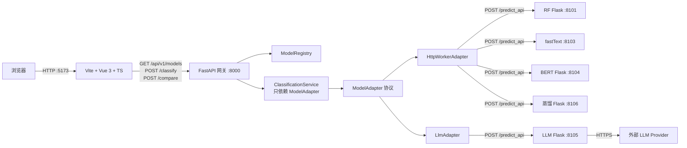
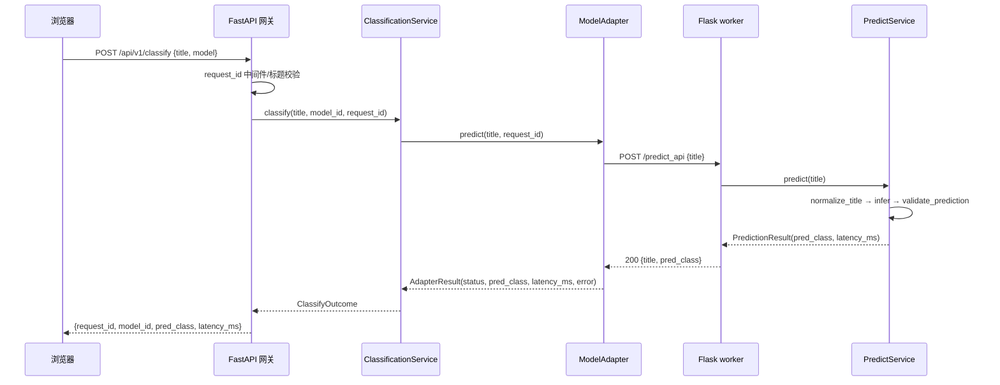
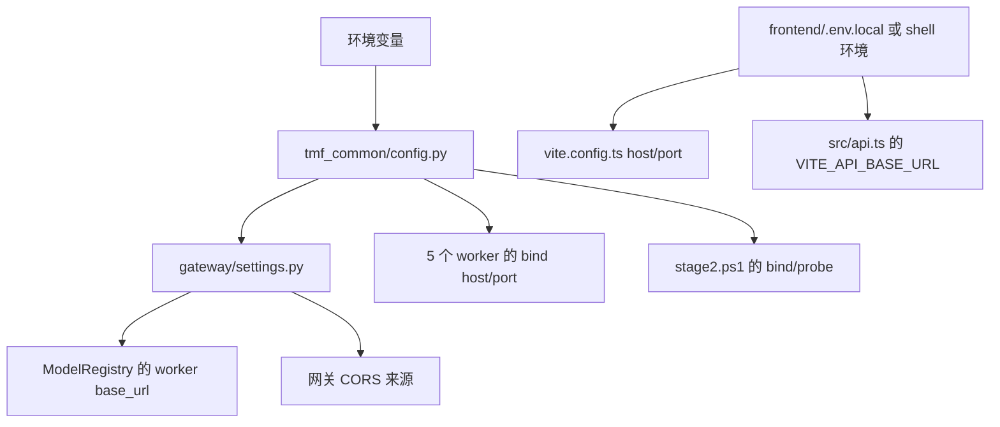

# 项目工程实践与技术学习档案（v5：模型适配层、worker 契约与网络配置重构）

> **状态更新（2026-10-22）**：本文为历史/前期归档，不代表最终实现；最终能力与验收状态以 [README](../README.md) 和 [v6 学习档案](PROJECT_LEARNING_GUIDE_v6_全链路交付与隔离验收.md) 为准。B8 LLM 仍 missing，D7 未执行，真实设备/真实 LLM 未验收。


> 版本：`v5-refactor-1.1`　｜　生成时间：2026-10-21（Asia/Shanghai）
> 对应工程：`E:\AIModels\test\TouManFen\TouManFenClassifier`
> 基准提交：`9f81e05`（`main`，2026-10-21 初始化提交）；**本次重构改动尚未提交**。
> 文档定位：不是开发日志，而是一份可追溯、可复核、可迁移的工程实践档案。
> 证据标记：**【已验证事实】**（本次会话工具输出/文件/日志/测试可直接核验）、**【历史记录】**（来自既有文档或更早会话，当前不可重新核验）、**【技术分析】**（基于证据的解释/推断）、**【待确认】**（证据不足）。

---

## 0. 文档信息

| 项目 | 内容 |
|---|---|
| 项目名称 | 投满分新闻标题分类（TouManFenClassifier） |
| 本文主题 | 模型适配层、5 个 worker 的统一预测契约、网络地址配置化（含局域网部署） |
| 文档版本 | v5-refactor-1.1 |
| 生成时间 | 2026-10-21 |
| 覆盖阶段 | 2026-10-21 的架构讨论 → 重构实施 → 自动化/真实服务验证 → 局域网部署 |
| 对应代码状态 | 基准提交 `9f81e05`；工作区存在未提交改动（本次重构 + 文档重命名/新增等），**未 commit** |
| 与既有档案关系 | 不覆盖 `PROJECT_LEARNING_GUIDE.md`（v1，2026-10-19）、`PROJECT_LEARNING_GUIDE_v2_工程化改造与集成验证.md`（v2）、`PROJECT_LEARNING_GUIDE_v3_前端开发全过程技术归档.md`（v3）、`PROJECT_LEARNING_GUIDE_v4_Git与GitHub工程归档.md`（v4）；本文是 v5 续篇 |
| 证据限制 | 无法读取 DSH 原始 Trajectory/事件流；只依据当前会话可见消息、工具输出、文件、日志和测试结果。早期会话（10-12～10-20）只能引用既有文档 |
| 项目最终状态 | 服务正在本机运行，监听 `192.168.12.54:5173/8000/8101/8103~8106`；重建后的适配层/worker 契约/网络配置已通过自动化与真实服务验证；局域网**外部机器**访问尚未实测 |

> 相关档案：[v1 学习档案](PROJECT_LEARNING_GUIDE.md) · [v2 工程化改造与集成验证](PROJECT_LEARNING_GUIDE_v2_工程化改造与集成验证.md) · [v3 前端开发归档](PROJECT_LEARNING_GUIDE_v3_前端开发全过程技术归档.md) · [v4 Git/GitHub 工程归档](PROJECT_LEARNING_GUIDE_v4_Git与GitHub工程归档.md)；当前能力见 [README](../README.md)。

### 0.1 为什么新建 v5 而不是覆盖 v1

- `docs/PROJECT_LEARNING_GUIDE.md` 已存在（127 KB，2026-10-19，记录早期 Streamlit/模型阶段），是历史档案，仍有价值；
- v2 记录阶段 0～4A 的后端工程化，v3 记录前端开发全过程，v4 记录 Git/GitHub 归档；
- 本次重构改变了架构（适配层、统一契约、网络配置），若覆盖 v1 会丢失历史演进；
- 因而新建本文件，并在 v1 顶部加入指向本文的说明（见文末“文档变更记录”）。

---

## 1. 阅读指南

### 1.1 本文记录什么

1. 为什么在 2026-10-21 决定重构模型适配层、worker 契约与网络配置；
2. 重构前架构的真实问题（不是事后想象的）；
3. 备选方案、选择依据、代价与风险；
4. 实施顺序、关键代码、配置变化；
5. 真实发生的失败、误判、排查过程与修复；
6. 自动化/真实服务/前端构建的实际验证结果；
7. 局域网部署的具体做法与当前限制。

### 1.2 本文不记录什么

- 不重述模型训练、数据集清洗、量化/蒸馏/剪枝的完整过程（见 v1 与 `docs/实测指标.md`）；
- 不把历史文档中的验证说成本次重新验证；
- 不提供本次没有执行过的验证结论；
- 不复制任何密钥/Token/`.env` 内容。

### 1.3 证据标签怎么读

| 标签 | 含义 |
|---|---|
| 【已验证事实】 | 本次会话中由工具输出、文件内容、日志或测试直接确认 |
| 【历史记录】 | 来自既有文档/更早会话，本次未重新核验 |
| 【技术分析】 | 基于证据的解释、根因分析或方案评价，不是当时的原始陈述 |
| 【待确认】 | 证据不足，需后续验证 |

### 1.4 建议阅读顺序

快速了解：§2 → §5 → §6 → §20
复现实施：§4 → §9 → §14
学习排障：§10 → §13 → §15
审计决策：§3 → §7 → §8 → §11 → §12

---

## 2. 项目概述

### 2.1 业务背景

投满分项目模拟“今日头条推荐系统”的频道投递子任务：把中文新闻标题自动分到 10 个类别（finance/realty/stocks/education/science/society/politics/sports/game/entertainment），用于精准推荐。

工程在 2026-10-16～10-19 已完成训练与模型产物（随机森林、fastText、BERT、LLM、量化、蒸馏、剪枝），10-20 加入 FastAPI 网关与 Vue 3 前端，形成“浏览器 → 网关 → 5 个 Flask worker”的验证型工程。

### 2.2 重构前的问题定义

重构前，工程虽然能运行，但存在三类问题：

1. **适配层没有真正独立**：网关直接持有 `WorkerHttpAdapter(classes, client)`，`ClassificationService` 依赖具体实现；`serving/models/http_adapter.py` 与 `models/registry.py`、`services/classification.py` 职责边界模糊。
2. **5 个 worker 的预测服务各写各的**：模型加载、标题兜底、类别校验、错误输出格式分散在 5 个 `*_predict_service.py` 中，行为一致性靠人工维护。
3. **地址写死具体网卡**：YAML、5 个 Flask 入口、Vite 配置、启动脚本、前端 API 默认值都写死 `192.168.12.54`，换机器/换网络必须全量修改。

### 2.3 本次重构的目标

- 抽出 `serving/adapters/`：`ModelAdapter` 协议 + `HttpWorkerAdapter` + `LlmAdapter`；
- 统一 5 个模型的内部预测契约，Flask 入口变为薄壳；
- 移除运行路径中的固定 IP，改为环境变量/配置，默认本地 `127.0.0.1`；
- **保持现有接口、模型 ID、类别名、错误语义、启动方式和前端交互兼容**；
- 除非当前结构无法安全实现，否则不整体替换 Flask worker 为 FastAPI；
- 补充自动化验证与文档。

### 2.4 项目边界

- 定位：本地/局域网“验证型工程”，不是生产系统；
- 不做：鉴权、HTTPS、数据库、容器化、CI、热搜业务、confidence、批量分类；
- 不修改：训练数据、模型权重、预训练模型、密钥文件；
- 不调用：真实 LLM Provider（验证只用 mock）。

---

## 3. 原始需求与最终需求

### 3.1 初始需求（2026-10-21 重构任务）

| 编号 | 需求 | 验收 |
|---|---|---|
| R1 | 新增 `serving/adapters/`，定义 `ModelAdapter` 协议，提供 `HttpWorkerAdapter`、`LlmAdapter` | 目录存在；网关业务层依赖协议；具体类只在装配处实例化 |
| R2 | 统一 worker 内部预测契约（加载/校验/推理/白名单/结果），Flask 入口薄壳 | 5 个 worker 均使用统一契约；`/predict_api` 兼容 |
| R3 | 移除源代码/配置中的 `192.168.12.54`，改为可配置地址 | 运行路径无固定 IP；本地默认可用；LAN 可覆盖 |
| R4 | 保持现有接口、模型 ID、类别名、错误语义、启动方式、前端交互兼容 | 旧契约测试不回归 |
| R5 | 除非无法安全实现，否则不整体替换 Flask worker 为 FastAPI | 保留 Flask |
| R6 | 补充验证与文档 | 自动化测试 + README 等更新 |

### 3.2 约束条件

- 不修改数据/模型/密钥；不调用真实 LLM；不写入密钥；
- 最小必要改动；迁移期保留兼容层；确认无调用方后才移除旧实现；
- 用户已授权项目内修改，不因常规选择停顿；
- 遇到实质阻塞先完成不依赖部分并说明。

### 3.3 后续追加需求

| 时间 | 用户要求 | 结果 |
|---|---|---|
| 2026-10-21 15:34 | 询问项目是否严格符合“Vue 3 + TypeScript + FastAPI + Python 模型适配层”架构 | 回答：不是严格四层；给出增量收敛建议，不重建 |
| 2026-10-21 15:45 | 追问“抽适配层/统一契约”是否与“5 个 Flask 进程隔离”冲突 | 回答：不冲突（进程拓扑 vs 代码契约）；该结论直接约束了本次实现（保留 5 个独立进程） |
| 2026-10-21 16:51 | “我需要同网段的人可以使用我的服务” | 切换为 LAN 模式并验证 |

### 3.4 最终需求与实现状态

| 需求 | 状态 | 说明 |
|---|---|---|
| R1 适配层 | ✅ 已实现并验证 | `serving/adapters/{protocol,http_worker,llm}.py`；`ClassificationService` 依赖 `Mapping[str, ModelAdapter]` |
| R2 统一契约 | ✅ 已实现并验证 | `tmf_common/prediction.py` + `flask_shell.py`；5 个服务统一模板；旧 `predict(dict)` 保留 |
| R3 网络配置化 | ✅ 已实现并验证 | 运行路径默认 `127.0.0.1`；环境变量覆盖；LAN 已实际运行 |
| R4 兼容性 | ⚠️ 大部分验证，存在一处细微语义变化 | `/predict_api` 字段/错误格式保留；worker 现在先做白名单校验（见 §16） |
| R5 保留 Flask | ✅ 遵守 | 5 个 worker 仍为 Flask 独立进程 |
| R6 验证/文档 | ✅ 本次补全 | 新增 2 个验收脚本 + README/serving/frontend/对接文档更新 |

### 3.5 尚未实现的要求

- 没有把 worker 换成 FastAPI（按需求保留 Flask）；
- 没有真实浏览器人工视觉验收；
- 没有从第二台机器验证 LAN 访问；
- 没有真实 LLM Provider 验证（约束禁止）；
- 没有 commit/push 本次重构。

---

## 4. 工程环境与项目结构

### 4.1 运行环境【已验证事实】

| 项 | 值 |
|---|---|
| OS | Windows 11（既有文档记录；本次未重新读 OS build） |
| ML/worker Python | `D:\Miniconda3\envs\py3109\python.exe`，Python 3.10.9 |
| 网关依赖 | 同级 `venv-gateway\Lib\site-packages`，由 `stage2.ps1` 注入 `PYTHONPATH` |
| FastAPI 依赖版本（实测） | fastapi 0.150.0 / starlette 1.7.0 / httpx 0.28.1 / pydantic 2.14.1 / uvicorn 0.54.0 / PyYAML 6.0.3 |
| Node / pnpm | Node v24.19.0；pnpm 11.25.0（Codex 运行时内置，非全局安装） |
| 训练依赖 | torch 2.14.1+cpu、transformers 4.57.6、numpy 2.2.6（fastText 已打补丁）、scikit-learn 1.7.2、fasttext-wheel 0.9.2【历史记录，见阶段 0 报告】 |
| 无 GPU | CPU-only；本次未重跑 CUDA 检测 |
| 当前监听 | `192.168.12.54:5173/8000/8101/8103/8104/8105/8106`（LAN 模式） |

### 4.2 项目结构（重构后）

```text
TouManFenClassifier/
├── 00-data/                    数据与类别
├── 01-rf/                      随机森林：config/预处理/训练/预测服务/薄 Flask/Streamlit
├── 02-fasttext/                fastText 四模型 + 预测服务/薄 Flask/Streamlit
├── 03-bert/                    BERT 微调/评估/预测服务/量化
├── 04-LLM/                     LLM 脚本/llm_predict_service/薄 Flask/.env
├── 05-distill/                 蒸馏教师学生/预测服务/薄 Flask
├── 06-prune/                   剪枝离线脚本
├── frontend/                   Vue 3 + TS + Vite（src/api.ts、vite.config.ts、.env.local[本地]）
├── tmf_common/                 ★ 新增：网关与 worker 共享契约/配置（零重依赖）
│   ├── prediction.py           PredictService 模板 + PredictionResult/错误类型
│   ├── flask_shell.py          worker 薄 Flask 入口
│   └── config.py               host/port/URL/CORS 环境变量解析与校验
├── serving/
│   ├── adapters/               ★ 新增：ModelAdapter 协议 + HttpWorkerAdapter + LlmAdapter
│   ├── gateway/                FastAPI 应用、路由、schema、errors、probes、stats、settings
│   ├── models/                 registry.py；http_adapter.py（旧名兼容层）
│   ├── services/               classification.py（只依赖协议）
│   ├── config/                 workers.yaml / models.yaml / processes.yaml
│   └── scripts/                stage2.ps1 / validate_config.py / verify_* / mock_worker.py
├── docs/
├── run_all.py
├── 启动TMF.bat / 停止TMF.bat
└── README.md / TODO-联通清单.md
```

### 4.3 主要入口

| 入口 | 作用 |
|---|---|
| `启动TMF.bat` / `停止TMF.bat` | Windows 一键启停 |
| `serving/scripts/stage2.ps1` | 启动/停止/状态/重启 5 worker + 网关；按 PID+命令行归属校验 |
| 5 × `api_flask_server.py` | worker 薄壳（统一由 `create_app(SERVICE)` 构造） |
| `serving/gateway/main.py` | FastAPI 应用；lifespan 内完成配置加载与适配器装配 |
| `frontend/vite.config.ts` + `src/api.ts` | 前端监听与 API 基址 |

### 4.4 关键配置关系【已验证事实】

- `workers.yaml`：worker base_url/路径/超时/启用状态；默认 `http://127.0.0.1:<port>`。
- `models.yaml`：模型 ID → worker、展示名、默认比较集合、默认模型 fasttext。
- `processes.yaml`：启动脚本使用的 gateway host/port 与 worker 端口。
- `tmf_common/config.py`：环境变量解析/校验，默认 `127.0.0.1`；`TMF_WORKER_HOST` 只替换 worker URL 主机，`TMF_WORKER_URL_<ID>` 覆盖完整 URL。
- `frontend/.env.local`（本地，不入库）：LAN 场景的 `VITE_API_BASE_URL` 与 `TMF_FRONTEND_HOST/PORT`。

### 4.5 鉴权与安全

- 无鉴权、无 HTTPS、无用户体系；
- LLM 密钥只在 `04-LLM/.env`，网关/适配器不读取；
- 当前 LAN 模式意味着同网段可调用全部模型（含 LLM 计费接口）。

---

## 5. 最终实现成果总览

### 5.1 已交付产物

| 类别 | 产物 | 状态 |
|---|---|---|
| 适配层 | `serving/adapters/{protocol,http_worker,llm}.py` | ✅ 已实现并验证 |
| 共享契约 | `tmf_common/{prediction,flask_shell,config}.py` | ✅ 已实现并验证 |
| worker 改造 | 5 个 `*_predict_service.py` + 5 个薄 `api_flask_server.py` | ✅ 已实现并验证 |
| 网关改造 | `main.py`、`settings.py`、`classification.py`、`models/http_adapter.py`（兼容层） | ✅ 已实现并验证 |
| 网络配置 | YAML/BAT/PS1/Vite/前端 API/Streamlit/本地客户端 | ✅ 运行路径无固定 IP |
| 验收脚本 | `verify_refactor_gateway.py`（45 项）、`verify_refactor_workers.py`（38 项） | ✅ RESULT PASS |
| 兼容验证 | `verify_stage2.py`（35 项）、`verify_stage3.py --llm-mode skip`（26 项） | ✅ 真实服务 PASS |
| mock 验证 | `verify_stage3.py --llm-mode mock`（46 项） | ✅ mock 栈 PASS |
| 前端 | type-check + build 通过，`dist/` 重建 | ✅ |
| 文档 | README/serving README/frontend README/前端对接/TODO + 本文件 | ✅ |
| LAN 部署 | 用户级环境变量 + `frontend/.env.local` + 服务已启动 | ✅ 本机验证；外部机器待确认 |

### 5.2 已验证 / 部分验证 / 未实现

- **已验证**：适配协议注入、HTTP 错误映射、配置校验、5 worker 契约、真实服务 `verify_stage2`/`stage3 skip`、mock LLM 路径、前端构建、LAN 本机访问。
- **部分验证**：LAN 外部机器访问（仅本机）；浏览器真实操作（仅接口/构建）；LLM 真实能力（仅历史样例）。
- **未实现**：FastAPI worker、鉴权、CI、真实 LLM 系统评估、热搜、confidence/批量/缓存/级联。

---

## 6. 项目整体架构与核心业务流程

### 6.1 最终架构【已验证事实】



### 6.2 worker 内部结构



### 6.3 关键接口契约

| 接口 | 输入 | 输出 | 说明 |
|---|---|---|---|
| `GET /api/v1/models` | — | 5 模型、默认模型、10 类、状态 | 前端初始化 |
| `POST /api/v1/classify` | `{"title","model"?}` | `{request_id, model_id, model_version, pred_class, latency_ms}` | `model` 默认 fasttext |
| `POST /api/v1/compare` | `{"title","models"?}` | `{summary, results[]}` | 合法请求恒 200；失败项无 `pred_class` |
| `POST /predict_api`（worker） | `{"title"}` | `{"title","pred_class"}` 或 `{"error"}` | 兼容旧契约 |
| `GET /healthz` `/readyz` `/metadata`（worker） | — | 存活/就绪/元数据 | 网关探测 |

### 6.4 错误映射

`HttpWorkerAdapter` 将 worker 行为归一化为网关错误码：

| 现象 | 网关错误码 | HTTP |
|---|---|---|
| 连接失败/连接超时 | `WORKER_UNAVAILABLE` | 502 |
| 读取超时 | `WORKER_TIMEOUT` | 504 |
| 非 200 | `WORKER_HTTP_ERROR` | 502 |
| 非法 JSON / 缺 `pred_class` | `WORKER_BAD_RESPONSE` | 502 |
| worker 返回 `error` | `MODEL_ERROR` | 502 |
| 类别不在白名单 | `INVALID_MODEL_OUTPUT` | 502 |

### 6.5 配置与地址关系



---

## 7. 项目完整实施时间线

> 日期均为 2026-10-21（Asia/Shanghai）。时间来自会话时间戳、日志或命令输出；无逐文件时间戳的阶段按执行顺序记录，不伪造精确时间。

| 序号 | 时间/阶段 | 当时目标 | 实际操作 | 问题/发现 | 决策与结果 |
|---|---|---|---|---|---|
| 0 | 10-12～10-20 | 项目可行性、训练、网关/前端 | 历史过程见 v1/v2 | — | 形成重构前基线【历史记录】 |
| 1 | 15:34 / 15:45 | 判断架构是否符合四层描述；抽适配层是否与进程隔离冲突 | 只读代码/文档分析，不改代码 | 发现“适配层”理解有 A（客户端适配）/B（统一运行时）两种 | 结论：保留 5 个独立进程，适配层只做 HTTP；后续重构按此执行 |
| 2 | 16:08 | 用户提交重构任务 | 盘点代码：网关 6 路由、5 worker、配置/脚本/前端 | 地址分散在 15 处运行文件 | 制定实施顺序：共享契约→适配层→worker→配置→验证 |
| 3 | 16:08～16:21 | 实现统一契约与适配层 | 新建 `tmf_common/`、`serving/adapters/`；改 5 个服务/入口、网关、配置、脚本、前端 | 需保证 worker 从模块目录启动也能导入共享包 | 采用 `Path(__file__).parents[1]` 注入工程根（见 §9.1） |
| 4 | 16:21:54 | 首次用新代码启动真实服务 | `stage2.ps1 -Action start`（仍默认 127.0.0.1） | 启动成功，5 worker + 网关全部 ready | 证明重构后的真实链路可运行 |
| 5 | 16:23～16:28 | 自动化/真实服务验证 | 运行 4 个验收脚本；修静态扫描/兼容细节 | 见 §10 案例 | `verify_stage2` 35 PASS、`stage3 skip` 26 PASS 等 |
| 6 | 16:29 | 前端构建验证 | 找到内置 Node/pnpm，`pnpm type-check`/`build` | PATH 无 node/pnpm | exit 0；`dist/` 重建（JS hash 变化） |
| 7 | 16:32～16:39 | 重启与稳定性 | 停止/启动；处理后台 job 生命周期 | job 终止导致服务树被杀（§10.5） | 改为 detached 启动并清理陈旧 state |
| 8 | 16:51 | 用户要求同网段访问 | 设置用户级环境变量与 `frontend/.env.local`，重启为 LAN 模式 | 需保证 CORS/前端 API/worker 地址一致 | 监听 `192.168.12.54:5173/8000/8101/8103~8106` |
| 9 | 16:54～16:55 | LAN 验证 | 经 LAN 调用 health/models/readyz/classify/compare/CORS | 外部机器未测 | 本机 LAN 链路全部通过 |
| 10 | 17:00 左右 | 文档整理与复核 | 盘点 Git/文档/测试输出；写 v5；修静态扫描排除项 | 静态扫描误报运行态 JSON（§10.7） | 45 项 PASS；本文生成 |

---

## 8. 核心技术决策档案

> 记录的是本次实际影响架构的决策。区分【当时明确】与【事后分析】。

### D1：保留 5 个独立 Flask 进程，不合并成“模型运行时”

- **背景**：用户问“抽适配层/统一契约是否与 5 个 Flask 进程的隔离取舍冲突”。
- **备选**：A) 合并为单进程统一加载 5 模型；B) 保留独立进程，只统一调用契约。
- **方案对比**：
  - A 的收益：进程数少、部署简单；代价：numpy 2/补丁、`transformers<5`、torch、openai SDK 等依赖混装，任一模型崩溃影响全部，冷启动耦合。
  - B 的收益：故障隔离、依赖隔离、独立冷启动；代价：进程管理复杂、需要 HTTP 契约。
- **实际选择**：B。适配器只做 HTTP 客户端，不加载模型；共享包 `tmf_common` 保持零重依赖。
- **依据**：进程拓扑与代码契约是两个层面，解耦不需要牺牲隔离。
- **影响**：后续所有设计（协议、配置、mock、验证）都按“多进程 + HTTP”展开。
- **验证**：真实服务 5/5 up；`verify_stage2` 通过。

### D2：共享契约放在顶层 `tmf_common/`，而不是 `serving/` 内

- **背景**：5 个 worker 以各自模块目录为工作目录启动；如果从 `serving` 导入，会引入网关依赖/包路径问题。
- **备选**：A) `serving/contracts/`；B) 顶层 `tmf_common/`；C) 每个 worker 复制一份契约。
- **实际选择**：B，零重依赖；worker 启动时把工程根加入 `sys.path`。
- **依据**：避免 worker 安装 fastapi/httpx；避免路径依赖当前 shell；避免复制导致行为漂移。
- **风险**：`sys.path` 注入是显式约定，必须每个入口都做；已在 5 个服务和 5 个入口实现并验证。

### D3：`ModelAdapter` 采用“每实例绑定一个模型”的协议

- **背景**：旧适配器一次调用需要传 `ModelSpec`；业务层依赖具体类。
- **备选**：A) 一个适配器接收 `ModelSpec`；B) 每个模型一个适配器实例。
- **实际选择**：B。`HttpWorkerAdapter(spec, classes, client)`，`predict(title, request_id)`。
- **依据**：协议更小、依赖注入更自然、测试 fake 更简单；worker URL/超时在构造时确定。
- **代价**：每个模型一个对象（5 个，可忽略）。

### D4：`LlmAdapter` 仍是本地 HTTP worker 适配器

- **背景**：LLM 可能被理解为“网关直连 Provider”。
- **备选**：A) 网关直连 Provider；B) 网关只调本地 worker，密钥留在 worker。
- **实际选择**：B。`LlmAdapter` 是 `HttpWorkerAdapter` 的策略子类，只标识 LLM 边界。
- **依据**：任务要求密钥不进入网关/源码；LLM worker 已有预算/重试/白名单逻辑。
- **验证**：mock 栈 `verify_stage3 --llm-mode mock` 46 项 PASS；未访问真实 Provider。

### D5：网络配置集中到 `tmf_common/config.py`，默认 127.0.0.1

- **背景**：固定 IP 散落在 YAML/5 worker/Vite/脚本/前端 API。
- **备选**：A) 继续写死但换 IP；B) 每处各自读环境变量；C) 集中解析+校验。
- **实际选择**：C。变量：`TMF_BIND_HOST`、`TMF_GATEWAY_HOST/PORT`、`TMF_FRONTEND_HOST/PORT`、`TMF_WORKER_HOST`、`TMF_WORKER_URL_<ID>`、`TMF_CORS_ORIGINS`。
- **依据**：默认本地开箱可用；LAN 显式覆盖；单一来源减少不一致；失败信息只含变量名。
- **验证**：`validate_config.py` 输出一致；非法变量快速失败；LAN 模式实测。

### D6：保留 Flask，不换 FastAPI

- **背景**：任务允许“若坚持 FastAPI 可逐个换壳”，但要求除非无法安全实现不要整体替换。
- **备选**：A) 5 个 worker 换 FastAPI；B) 保留 Flask。
- **实际选择**：B。
- **依据**：接口不变即可满足统一契约；换框架会引入每个 worker 环境新增 fastapi/uvicorn/pydantic、启动/异常语义变化，收益不明确。
- **后续**：如要统一框架，可逐壳切换，保持 `POST /predict_api` 与端口不变。

### D7：验证策略 = 单元/契约脚本 + mock 栈 + 真实服务

- **背景**：跨层重构需要在不加载 10 GB 模型时也能验证大部分逻辑。
- **实际选择**：
  - `verify_refactor_gateway.py`（配置/适配器/API/CORS/静态 IP）；
  - `verify_refactor_workers.py`（契约/兼容 JSON/Flask 薄壳）；
  - 5 个通用 mock worker + 网关做端到端；
  - 真实服务跑 `verify_stage2` / `stage3 skip`。
- **依据**：加载全部模型慢；mock 能覆盖错误路径；真实服务验证兼容。
- **结果**：见 §12。

### D8：LAN 部署采用“具体网卡 IP + 用户级环境变量 + `.env.local`”

- **背景**：用户要求同网段访问；默认已改 127.0.0.1。
- **备选**：A) 绑定 `0.0.0.0`；B) 绑定 `192.168.12.54`。
- **实际选择**：B（LAN 时）。
- **依据**：具体 IP 让 CORS 默认来源自动等于 `http://192.168.12.54:5173`，行为与旧版一致；`0.0.0.0` 需要额外 CORS 配置。
- **配套**：`frontend/.env.local` 固定前端 API 基址与监听地址；用户级环境变量让后续启动生效。
- **注意**：用户级环境变量对已经运行的进程无效，必须重启服务/新终端（见 §10.8 / §16）。

### D9：文档采用“新增 v5”而非覆盖 v1

- **背景**：`docs/PROJECT_LEARNING_GUIDE.md` 已存在且有效。
- **选择**：新建 `PROJECT_LEARNING_GUIDE_v5_模型适配层与网络配置重构.md`，v1 顶部加指针。
- **依据**：保留历史演进；v5 聚焦本次重构。
- **影响**：文档索引需增加 v5（见 §17）。

---

## 9. 核心模块逐步实现教程

### 9.1 `tmf_common/config.py`：网络配置单一来源

**解决什么问题**：同一套服务在本地/LAN/不同机器上运行时，host/port/URL/CORS 必须一致且可校验。

**关键实现**：

- `validate_host`：只接受主机名/IPv4，拒绝协议、端口、路径；
- `validate_port`：1–65535；
- `resolve_bind_host` → `TMF_BIND_HOST`（默认 127.0.0.1）；
- `resolve_worker_url`：优先 `TMF_WORKER_URL_<ID>`，其次 `TMF_WORKER_HOST` 替换主机，否则 YAML 默认；
- `default_frontend_origin`：`http://<probe_host>:<frontend_port>`；监听 `0.0.0.0` 时用 `127.0.0.1` 作为默认 CORS 来源；
- `resolve_cors_origins`：默认来源 + `TMF_CORS_ORIGINS`（逗号分隔，禁止 `*`）；
- `NetworkConfigError`：消息只含变量名与原因。

**为什么这样设计**：监听地址与连接地址不同；`0.0.0.0` 不可作为客户端目标；配置错误要在启动时暴露，而不是运行中随机失败。

**常见错误**：把 `http://host:port` 传给 `TMF_BIND_HOST`；用 `0.0.0.0` 作为 `TMF_WORKER_HOST`；CORS 用 `*`。

### 9.2 `tmf_common/prediction.py`：统一预测模板

**解决问题**：5 个模型各自处理标题校验、推理、类别校验、错误格式，容易漂移。

**模板方法**：

```python
def predict(self, title):
    clean_title = self.normalize_title(title)
    if not self.is_ready():
        raise ModelNotReadyError("模型或客户端尚未就绪")
    started = time.perf_counter()
    pred_class = self.infer(clean_title)
    latency_ms = round((time.perf_counter() - started) * 1000, 2)
    self.validate_prediction(pred_class)
    return PredictionResult(pred_class=pred_class, latency_ms=latency_ms)
```

**兼容层**：`handle_payload(payload)` 保留旧字典格式：

- 成功：`payload + pred_class`；
- 缺 title：`payload + error`（默认文案“传递的参数中没有title字段”）；
- 其他错误：`payload + error`；LLM 额外把 `pred_class` 置空；
- LLM 覆盖 `format_error` 为 `CODE: message`；新增 `format_title_error` 保证缺 title 文案不带代码前缀。

**为什么**：把“统一”限制在流程与错误边界，不强迫不同模型的预处理合并（tokenizer、jieba、Prompt 差异很大）。

**易忽略边界**：非 dict 输入要安全返回 dict；缺字段与空字符串行为要与历史一致；LLM 的错误格式与其它模型不同。

### 9.3 `tmf_common/flask_shell.py`：worker 薄壳

**职责**：创建 Flask app、注册 4 个端点、把 JSON 交给 `PredictService.handle_payload`、按 env 启动。

```python
@app.post("/predict_api")
def predict_api():
    payload = request.get_json()
    return jsonify(service.handle_payload(payload))
```

- `/readyz`：`service.is_ready()` 为假时返回 503 `{"status":"not_ready"}`，否则 `service.ready_payload()`；
- `/metadata`：`service.metadata()`；
- `run_worker`：`TMF_BIND_HOST` + `TMF_WORKER_PORT_<ID>`（默认端口）。

**为什么薄**：路由不再包含 tokenizer/白名单/模型逻辑；换模型只改 service。

### 9.4 `serving/adapters/protocol.py`：协议与结果

```python
@dataclass(frozen=True)
class PredictionResult:
    pred_class: str
    latency_ms: int

@runtime_checkable
class ModelAdapter(Protocol):
    model_id: str
    model_version: str | None
    async def predict(self, title: str, request_id: str) -> AdapterResult: ...
```

- `AdapterResult` 额外含 `status`、`error_code`、`error_message`，供网关映射；
- 业务层不 import 具体类，只依赖协议。

### 9.5 `serving/adapters/http_worker.py`

**职责**：按模型配置拼 URL/超时，调用 worker，把失败路径归一化为既有错误码。

关键点：

- 复用应用级 `httpx.AsyncClient`（lifespan 创建、关闭），不按请求新建；
- 超时：`httpx.Timeout(total, connect=min(0.5,total))`；连接超时映射 `WORKER_UNAVAILABLE`，读取超时 `WORKER_TIMEOUT`；
- 非 200 → `WORKER_HTTP_ERROR`；JSON 解析失败/非 dict/缺 `pred_class` → `WORKER_BAD_RESPONSE`；`error` 字段 → `MODEL_ERROR`；类别不在白名单 → `INVALID_MODEL_OUTPUT`；
- 不返回 worker 原始错误文本/堆栈。

### 9.6 `serving/adapters/llm.py`

- `LlmAdapter(HttpWorkerAdapter)`：只增加 `adapter_kind="llm"` 与文档说明；
- **不**直连 Provider，**不**读 `.env`；
- LLM 的预算/重试/白名单在 04-LLM worker 内；
- 通过注入 `httpx.AsyncClient`（可带 `MockTransport`）即可 mock 验证。

### 9.7 网关装配（`serving/gateway/main.py`）

lifespan 顺序：

1. `load_settings()`（配置+网络校验）；
2. `StatsCollector`、`WorkerProber`、`httpx.AsyncClient(trust_env=False)`；
3. `ModelRegistry(settings)`；
4. `_build_adapters(...)`：遍历 5 个模型，`llm` 用 `LlmAdapter`，其余 `HttpWorkerAdapter`；
5. `ClassificationService(registry, adapters, classes, max_title_chars, stats, logger)`；
6. 关闭时 `prober.close()`、`http_client.aclose()`。

CORS 由 `load_network_settings().cors_origins` 提供；`TMF_CORS_ORIGINS=*` 在应用创建阶段直接失败。

### 9.8 `ClassificationService`

- 只依赖 `adapters: Mapping[str, ModelAdapter]`；
- 标题校验、模型存在/启用校验、并发 `asyncio.Semaphore(5)`、逐模型失败隔离、统计与日志均保持；
- `compare` 中某适配器抛异常时，生成 `WORKER_UNAVAILABLE` 错误项，不影响其他模型。

### 9.9 5 个 worker 预测服务

| 服务 | model_id | 预处理/模型 | 关键点 |
|---|---|---|---|
| `RfPredictService` | rf | jieba 前 30 词 + TF-IDF + RF | 类别列表从 class.txt 一次加载 |
| `FasttextPredictService` | fasttext | jieba 分词 + fastText word_auto | 保留 numpy 2 补丁（环境层） |
| `BertPredictService` | bert | `batch_encode_plus`（transformers<5）+ torch | 不改 tokenizer/权重结构 |
| `LlmPredictService` | llm | Prompt + OpenAI SDK | 预算/重试/白名单/日志脱敏在 worker 内；缺 title 文案保持“缺少 title 字段” |
| `StudentPredictService` | distill | 从 state_dict 推断结构 + BiLSTM | 兼容 v1/v2/v2b checkpoint |

每个文件：

- 顶部把工程根加入 `sys.path`（因为 stage2 以模块目录为 cwd 启动）；
- 模块导入时加载模型一次；
- 暴露 `SERVICE`；
- 保留 `predict(news_data)` 兼容函数 → `SERVICE.handle_payload(news_data)`。

### 9.10 前端配置

`vite.config.ts`：

- `loadEnv(mode, '.', 'TMF_')` 读取 `.env*` 中的 `TMF_FRONTEND_HOST/PORT`；
- 同时兼容 shell 环境变量（避免依赖 Node 类型声明）；
- `strictPort: true` 保持。

`src/api.ts`：默认 `http://127.0.0.1:8000`；可用 `VITE_API_BASE_URL` 覆盖（`.env.local`）。

### 9.11 脚本与验证

- `stage2.ps1`：网络 env 读取/校验、worker/gateway 启动、PID+命令行归属、状态文件、UTF-8 BOM+CRLF；
- `validate_config.py`：输出 bind/gateway/frontend/cors/worker_urls；
- `verify_refactor_gateway.py`：配置/适配器/API/CORS/静态 IP（45 项）；
- `verify_refactor_workers.py`：契约/兼容/薄壳/入口静态检查（38 项）；
- `mock_worker.py`：通用 mock，`--special-titles` 仅 LLM mock 启用错误/超时用例。

---

## 10. 关键问题与踩坑案例库

> 以下案例均来自本次重构实施/验证过程。按模板记录；未能确认的根因明确标注。

### 10.1 案例：`stage2.ps1` 编辑后 Windows PowerShell 解析失败

#### 1. 问题背景
为支持网络配置，修改 `serving/scripts/stage2.ps1`（增加 host/port 环境变量与探测逻辑），随后用 `powershell.exe -File ... -Action status` 验证。

#### 2. 实际症状
PowerShell 5.1 报解析错误（节选）：
```
The string is missing the terminator: ".
Missing closing '}' in statement block or type definition.
At ...stage2.ps1:581 char:25
```
`-Action status` 无法执行。

#### 3. 预期结果与实际结果
预期：输出“未运行（无状态文件）”。
实际：脚本在解析阶段失败，任何 Action 都不可用。

#### 4. 问题如何被发现
执行 `stage2.ps1 -Action status` 时立即暴露。

#### 5. 排查过程
1. 读取脚本尾部，确认语法结构（`try/catch`、字符串）本身完整；
2. 检查文件字节：`no-BOM`、`CRLF=0`、纯 LF；
3. 判断 PowerShell 5.1 对无 BOM 的 UTF-8 脚本按本地代码页解析，中文字符串/引号被错误解码，导致“字符串未闭合”“大括号缺失”等连锁报错；
4. 用 .NET 以 UTF-8 BOM + CRLF 重写文件；
5. 重新执行 `-Action status`，输出正常。

#### 6. 根本原因
【已验证事实】脚本被编辑工具写成 **UTF-8 无 BOM + LF**；Windows PowerShell 5.1 对无 BOM UTF-8 的中文脚本解析不可靠。不是逻辑错误。

#### 7. 尝试过的方案
- 只修语法：无效（错误是编码导致）；
- 改用 PowerShell 7：本机无 `pwsh`；
- 重写编码（BOM+CRLF）：有效。

#### 8. 模型建议与用户选择
用户未参与；模型根据字节检查直接修复。

#### 9. 最终解决方案
```powershell
$text = [System.IO.File]::ReadAllText($p, [Text.UTF8Encoding]::new($false))
$text = $text -replace "`r`n","`n" -replace "`n","`r`n"
[System.IO.File]::WriteAllText($p, $text, [Text.UTF8Encoding]::new($true))
```
之后 `stage2.ps1 -Action status/start/stop` 均正常。

#### 10. 为什么这个方案有效
BOM 让 5.1 明确按 UTF-8 解码；CRLF 避免脚本/批处理的行尾兼容问题。

#### 11. 如何验证修复有效
- `status` 输出“未运行（无状态文件）”；
- 后续 `start` 成功拉起 6 个进程并 ready；
- `stop` 输出“全部已停止，状态文件已清理”。

#### 12. 本次解决方案的局限
以后任何编辑器重写该文件都可能再次丢失 BOM；需要在流程上固定编码（编辑器设置/提交检查）。

#### 13. 这个问题真正教会了我们什么
- Windows PowerShell 5.1 脚本必须关注 BOM/换行；
- “语法错误”先看编码，不要只盯括号；
- 修改 `.ps1`/`.bat` 后至少执行一次 `-Action status` 做冒烟。

---

### 10.2 案例：PowerShell 客户端编码导致“模型被改坏”的误判

#### 1. 问题背景
重构后真实服务启动，使用 PowerShell `Invoke-RestMethod` 发送中文标题做快速验证。

#### 2. 实际症状
已知样例返回异常类别，例如：
- “体验2D巅峰 倚天屠龙记十大创新概览”经 fastText 返回 `finance`；
- “中华女子学院：本科层次仅1专业招男生”经 BERT 返回 `game`；
- “北京二手房成交量创年内新高”经 BERT 返回 `science`。
看起来像重构破坏了模型预处理。

#### 3. 预期结果与实际结果
预期样例应返回 `game`/`education`/`realty` 等；实际返回明显不相关类别。

#### 4. 问题如何被发现
人工 smoke 测试时发现结果与 README/历史记录不一致。

#### 5. 排查过程
1. 用独立 Python 进程直接调用 `BertPredictService` → 正确（education/realty/game）；
2. 用 Python `httpx` 直接 POST worker → RF game、fastText education、BERT education、distill game，全部正确；
3. 对比发现唯一差异是客户端：PowerShell 5.1 的 `Invoke-RestMethod -Body` 对字符串默认按本地代码页/非 UTF-8 发送，中文被破坏；
4. 用 Python/UTF-8 重新验证，确认服务与模型无回归。

#### 6. 根本原因
【已验证事实】客户端请求体编码错误（PowerShell 5.1 字符串 body 默认非 UTF-8），导致服务收到乱码标题。不是模型/服务重构缺陷。

#### 7. 尝试过的方案
- 怀疑模型加载路径/类别顺序：检查 config、class.txt、inline 推理，均正常；
- 怀疑 worker 代码：直接调用 service 正常；
- 改用 Python `httpx`：恢复正常。

#### 8. 模型建议与用户选择
用户未参与；模型在对比测试后修正结论，并更新验收方法。

#### 9. 最终解决方案
验证统一使用 UTF-8 客户端（Python httpx）；如必须用 PowerShell，应显式编码为 UTF-8 字节后发送。文档记录该坑。

#### 10. 为什么这个方案有效
HTTP JSON 的字符集必须与声明一致；中文乱码会直接改变分词/tokenizer 输入，模型自然输出错误类别。

#### 11. 如何验证修复有效
Python httpx 样例全部正确；LAN smoke 的 classify/compare 通过；模型服务日志无异常。

#### 12. 本次解决方案的局限
没有修改服务端容错（服务端按 UTF-8 解析是正确行为）。

#### 13. 这个问题真正教会了我们什么
- 先用“同一输入、不同客户端”对比，区分服务端与客户端问题；
- 中文 NLP 服务验收必须显式验证编码；
- 不要因一个客户端的异常输出就断定模型回归。

---

### 10.3 案例：mock worker 过度特化，导致 `compare partial` 测试失败

#### 1. 问题背景
为了不加载 10 GB 模型，使用 5 个通用 mock worker 替代 5 个真实 worker，运行 `verify_stage3.py --llm-mode mock`。

#### 2. 实际症状
```
FAIL compare partial llm failure
RESULT FAIL (1)
```
预期：只有 LLM 失败，其余 4 个成功，`summary.status=partial`。
实际：所有模型都失败，`summary.status=all_failed`。

#### 3. 预期结果与实际结果
预期只验证 LLM 的失败隔离；实际 mock 把 `MOCK_ERROR` 应用于所有模型。

#### 4. 问题如何被发现
自动验收脚本输出 FAIL。

#### 5. 排查过程
1. 查看测试用例：发送标题 `MOCK_ERROR`，默认 compare 5 模型；
2. 查看 mock 实现：所有 mock 实例都会识别 `MOCK_ERROR` 并返回错误；
3. 判断：mock 行为与真实部署拓扑不一致（真实场景只有 8105 是特殊 mock）。

#### 6. 根本原因
【已验证事实】测试替身设计错误：通用 mock 默认启用特殊标题行为，掩盖了“只有 LLM 应该失败”的场景。

#### 7. 尝试过的方案
- 改测试期望为 all_failed：会丢失“失败隔离”验证，拒绝；
- 只启动 LLM mock，其余用真实 worker：需加载模型，失去轻量验证目标；
- 给 mock 增加 `--special-titles` 开关，仅 LLM mock 启用：有效。

#### 8. 模型建议与用户选择
用户未参与；模型修复。

#### 9. 最终解决方案
`mock_worker.py` 增加 `--special-titles`（默认关闭）；LLM mock 启动时显式开启；其他 mock 始终返回成功类别。

#### 10. 为什么这个方案有效
让 mock 行为与部署角色一致：只有 LLM mock 模拟错误/超时，其余模拟正常模型。

#### 11. 如何验证修复有效
重新启动 mock 栈后 `verify_stage3 --llm-mode mock` **46 项全部 PASS**。

#### 12. 本次解决方案的局限
mock 仍是简化模型；真实 worker 的失败模式需要真实服务验证（已用 `verify_stage2` 覆盖）。

#### 13. 这个问题真正教会了我们什么
- 测试替身必须匹配真实拓扑与角色；
- “通用 mock”容易把多个失败源混在一起，应按角色配置；
- 失败隔离类测试尤其要控制变量。

---

### 10.4 案例：LLM 缺少 title 的错误字符串回归

#### 1. 问题背景
统一 `PredictService.handle_payload` 后，所有模型共用错误格式化逻辑。

#### 2. 实际症状
`verify_refactor_workers.py` 报：
```
FAIL llm missing title payload
{'wrong': 'x', 'error': 'INVALID_TITLE: 缺少 title 字段'}
```
而历史行为是 `{"error": "缺少 title 字段"}`（无代码前缀）。

#### 3. 预期结果与实际结果
预期：缺 title 文案与历史一致；实际：多了 `INVALID_TITLE:` 前缀。

#### 4. 问题如何被发现
新增的 worker 契约验收脚本。

#### 5. 排查过程
1. 定位 `handle_payload` 对所有 `PredictionError` 调用 `format_error`；
2. LLM 的 `format_error` 会加 `CODE:` 前缀（用于 LLM_TIMEOUT 等）；
3. 缺 title 属于 `TitleValidationError`，不应走同一格式。

#### 6. 根本原因
【已验证事实】模板方法缺少“标题错误”的独立扩展点。

#### 7. 尝试过的方案
- 改测试期望：会破坏兼容性，拒绝；
- 在 LLM 中重写 `handle_payload`：重复逻辑；
- 增加 `format_title_error` 钩子：有效。

#### 8. 模型建议与用户选择
用户未参与；模型修复。

#### 9. 最终解决方案
基类新增 `format_title_error`（默认返回 `exc.message`），`handle_payload` 的标题分支调用它；LLM 继承默认行为。

#### 10. 为什么这个方案有效
把“标题错误”和“预测错误”的格式策略分开，既保持 LLM 的 `CODE: message`，又保持缺 title 的历史文案。

#### 11. 如何验证修复有效
`verify_refactor_workers.py` **38 项 RESULT PASS**；旧 `/predict_api` 契约测试通过。

#### 12. 本次解决方案的局限
错误字符串属于隐式契约，未来统一错误格式时应作为版本化变更处理。

#### 13. 这个问题真正教会了我们什么
- 兼容性包括错误文案；测试要断言字符串；
- 模板方法要为差异点留钩子，而不是在子类复制整个流程。

---

### 10.5 案例：终止后台 job 导致已启动服务被杀、状态文件陈旧

#### 1. 问题背景
通过 DSH 后台 job 执行 `stage2.ps1 -Action start`。脚本日志显示全部 ready，但 job 状态一直“running”（子进程持有句柄），随后用 `job_kill` 结束 job。

#### 2. 实际症状
- 所有监听端口消失；
- `serving/run/stage2-state.json` 仍存在，记录 PID 已不存在；
- `stage2.ps1 -Action status` 显示 `Owned=False`、`Listening=False`。

#### 3. 预期结果与实际结果
预期：job 结束不影响已 detach 的服务；实际：服务进程被一起终止。

#### 4. 问题如何被发现
后续检查监听端口时发现全部消失。

#### 5. 排查过程
1. 检查 `Get-NetTCPConnection`：无监听；
2. 检查 state 文件：PID 均为旧值；
3. 检查 stage2 日志：停服记录并非来自 `-Action stop`；
4. 判断：Windows Job Object/进程树在 job 取消时终止了子进程（Start-Process 创建的子进程仍属于该 job）。

#### 6. 根本原因
【技术分析，证据一致】工具后台 job 的进程树被终止时，其派生的服务进程一并退出；state 文件未同步清理。

#### 7. 尝试过的方案
- 重新 start：提示端口未占用，可启动，但旧 state 需要清理；
- 先 `stage2.ps1 -Action stop` 清理陈旧状态：有效（跳过不存在进程并删除 state）。

#### 8. 模型建议与用户选择
用户未参与；模型调整启动方式。

#### 9. 最终解决方案
长期服务改用独立 `Start-Process powershell.exe -WindowStyle Hidden` 启动（不放进会被 kill 的 job），用单独命令轮询健康；清理陈旧 state 用 `-Action stop`。

#### 10. 为什么这个方案有效
父进程/作业与长期服务解耦；健康检查与启动解耦。

#### 11. 如何验证修复有效
重新启动后监听恢复；`readyz=ok 5/5`；后续多次独立检查服务仍在。

#### 12. 本次解决方案的局限
Windows 进程生命周期仍受桌面会话影响；生产化需要服务管理器。

#### 13. 这个问题真正教会了我们什么
- “后台任务完成”不等于“它派生的服务仍在”；
- 终止 job 前确认进程树归属；
- state 文件与真实进程要定期核对，清理逻辑必须幂等。

---

### 10.6 案例：前端构建找不到 node/pnpm

#### 1. 问题背景
需要执行 `pnpm type-check` / `pnpm build` 验证前端配置改动。

#### 2. 实际症状
```
node : 无法将“node”项识别为 cmdlet...
pnpm : 无法将“pnpm”项识别为 cmdlet...
```

#### 3. 预期结果与实际结果
预期：直接运行 pnpm；实际：DSH shell 的 PATH 无全局 Node。

#### 4. 问题如何被发现
执行 type-check 时立即失败。

#### 5. 排查过程
1. 检查 `C:\Program Files\nodejs`：不存在；
2. 检查 BAT 中的 Codex runtime fallback 路径：存在；
3. 找到 `%USERPROFILE%\.cache\codex-runtimes\codex-primary-runtime\dependencies\node\bin\node.exe` 与 `...\fallback\pnpm.cmd`；
4. 将 node bin 前置到 PATH 后运行。

#### 6. 根本原因
【已验证事实】Node/pnpm 是 DSH/Codex 运行时内置，不在全局 PATH。

#### 7. 尝试过的方案
- 安装 Node：不必要且可能影响环境，拒绝；
- 使用内置运行时：有效。

#### 8. 模型建议与用户选择
用户未参与；模型使用项目已有 fallback 路径。

#### 9. 最终解决方案
```powershell
$nodeBin="$env:USERPROFILE\.cache\codex-runtimes\codex-primary-runtime\dependencies\node\bin"
$pnpm="$env:USERPROFILE\.cache\codex-runtimes\codex-primary-runtime\dependencies\bin\fallback\pnpm.cmd"
$env:PATH="$nodeBin;$env:PATH"
& $pnpm type-check
& $pnpm build
```

#### 10. 为什么这个方案有效
工具链按绝对路径调用，不依赖全局安装。

#### 11. 如何验证修复有效
`type-check` 与 `build` 均 exit 0；`dist/` 于 2026-10-21 16:29 重建。

#### 12. 本次解决方案的局限
这是本机/本会话环境方案；其他机器仍需 Node 24 + pnpm。

#### 13. 这个问题真正教会了我们什么
- GUI/Agent 运行时与终端 PATH 可能不同；
- 先找项目已有约定（BAT fallback），不要急着重装依赖；
- 构建验证记录版本（node v24.19.0、pnpm 11.25.0）。

---

### 10.7 案例：静态“无硬编码 IP”检查误报运行态文件

#### 1. 问题背景
LAN 切换后重跑 `verify_refactor_gateway.py`，静态检查本应确认源码无固定 IP。

#### 2. 实际症状
```
FAIL no hardcoded LAN IP in runtime files
RESULT FAIL (1)
```
命中 `serving/run/stage2-state.json`。

#### 3. 预期结果与实际结果
预期通过；实际把运行态状态文件当成源码扫描。

#### 4. 问题如何被发现
自动化验收输出 FAIL。

#### 5. 排查过程
1. 打印命中文件列表；
2. 确认 state 文件记录的是本机实际启动命令行（含 LAN IP），属生成物；
3. 检查扫描排除项：未排除 `serving/run/`。

#### 6. 根本原因
【已验证事实】扫描范围定义错误：生成物（run/logs/dist/依赖）不应参与“源码固定 IP”检查。

#### 7. 尝试过的方案
- 删除 state 文件：治标且影响运行状态，拒绝；
- 修正扫描排除项：有效。

#### 8. 模型建议与用户选择
用户未参与；文档核验阶段修正测试脚本。

#### 9. 最终解决方案
排除 `node_modules/__pycache__/dist/logs/run/.git` 与 `.env.local`（本地未入库配置）；重新运行。

#### 10. 为什么这个方案有效
“源码固定 IP”检查的对象应是会进入版本库的源码/配置，而不是运行态或机器本地覆盖。

#### 11. 如何验证修复有效
`verify_refactor_gateway.py` **45 项全部 PASS**。

#### 12. 本次解决方案的局限
`.env.local` 中的 LAN IP 是设计允许的本地配置，不在检查范围；文档需说明。

#### 13. 这个问题真正教会了我们什么
- 检查规则要明确“检查对象”；
- 生成物应被排除，但排除项本身要可审计；
- 失败时先看命中清单，不要直接改代码。

---

### 10.8 案例：`stage2.ps1` 端口告警逻辑自指条件（代码审查发现）

#### 1. 问题背景
为支持可配置端口，重写 `Status-System` 的端口占用告警。

#### 2. 实际症状
代码为：
```powershell
foreach ($port in ($knownPorts | Sort-Object -Unique)) {
    if ($occupiedBy -and -not ($knownPorts -contains $port)) { ... }
}
```
`$port` 来自 `$knownPorts`，因此 `-contains` 恒为真，告警分支永不执行。

#### 3. 预期结果与实际结果
预期：状态文件外的端口占用要告警；实际：永不告警。

#### 4. 问题如何被发现
代码复查时发现（未等到运行暴露）。

#### 5. 排查过程
1. 阅读重写后的 Status-System；
2. 发现循环变量与集合来自同一来源；
3. 拆分 `statePorts`（实际运行）与 `knownPorts`（配置候选）。

#### 6. 根本原因
【已验证事实】控制流条件写错（自指），不是环境问题。

#### 7. 尝试过的方案
- 保留原逻辑：功能缺失；
- 拆分状态端口与配置端口：有效。

#### 8. 模型建议与用户选择
用户未参与；模型自审修复。

#### 9. 最终解决方案
```powershell
$statePorts = @()
foreach ($entry in $rows) { $statePorts += [int]$entry.Port }
$knownPorts = @($statePorts) + $gatewayPort + worker ports
foreach ($port in ($knownPorts | Sort-Object -Unique)) {
    if ($occupiedBy -and -not ($statePorts -contains $port)) { WARN }
}
```

#### 10. 为什么这个方案有效
“配置中可能出现”与“当前状态已记录”分离，条件才有意义。

#### 11. 如何验证修复有效
正常启动/停止状态下 `status` 输出正常；未发现状态外占用场景，未做专门负例测试【未验证】。

#### 12. 本次解决方案的局限
告警分支仍缺少自动化测试；属于低风险但应补。

#### 13. 这个问题真正教会了我们什么
- 复杂脚本改动后要自审控制流；
- 把“候选集合”和“已记录集合”分开命名；
- 监控告警逻辑本身也要测试。

---

### 10.9 其他已记录问题（简表）

| 问题 | 状态 | 处理 |
|---|---|---|
| `verify_stage3.py` 仍用旧 `adapter=None` 构造 | 已修复 | 改为 `adapters={}`，禁用模型仍在调用前拒绝 |
| `mock_worker.py` 旧版不返回 `title`，不满足旧 predict 契约 | 已修复 | 成功响应回显 `title` |
| 前端 dev/preview 传 `--host` 与配置重复 | 已修复 | 改为由 `vite.config.ts` 读取环境变量 |
| `serve_worker` 缺 `TMF_WORKER_PORT_<ID>` 时端口来源 | 已设计 | 默认端口 + env 覆盖；stage2 仍以 YAML 为准 |
| 中文文档链接因文件重命名失效 | 已修复 | 更新 README/v2/v3/阶段 0 链接 |
| 文档核验时 `python -c` 导入检查疑似长时间无输出 | 待确认 | 后续分步导入均成功；未复现，未定位（见 §16） |

---

## 11. 重要方案变更与返工分析

| 变更 | 原方案 | 新方案 | 触发原因 | 影响 |
|---|---|---|---|---|
| 适配层位置 | `serving/models/http_adapter.py` 由业务层直接依赖 | 新增 `serving/adapters/` 协议包；旧文件变兼容层 | R1 要求业务层依赖协议 | 业务层可注入 fake；旧调用方仍可用 |
| 共享代码位置 | 契约散在各 worker | 顶层 `tmf_common/` 零依赖 | worker 独立 cwd/依赖 | 需要 `sys.path` 引导；避免重依赖 |
| worker 入口 | 各自维护 Flask 路由/校验 | 统一 `create_app(SERVICE)` | R2 | 路由薄壳；错误格式统一 |
| 网络默认 | 固定 `192.168.12.54` | 默认 `127.0.0.1` + env 覆盖 | R3 | 旧 LAN 启动需显式配置 |
| mock 行为 | 所有 mock 都识别 `MOCK_*` | `--special-titles` 按角色启用 | 测试失败（§10.3） | mock 更贴近部署拓扑 |
| LAN 部署 | 默认 127.0.0.1 | 用户级 env + `.env.local` 绑定具体 IP | 用户 16:51 要求 | 同网段可用；外部机器未测 |
| 文档 | 覆盖 `PROJECT_LEARNING_GUIDE.md` 的选项 | 新建 v5 + v1 指针 | 已有有效历史档案 | 保留演进；需维护索引 |

**返工分析**：

- 编码问题（§10.1）本可通过“修改脚本后固定用 BOM/CRLF 写入”避免；
- mock 问题（§10.3）源于测试替身未按部署角色设计；
- 静态扫描误报（§10.7）源于“源码检查”未排除生成物；
- 这些返工都不是架构选择错误，而是**工程约束未前置**。若重来，应先写“文件编码/生成物/测试替身”的检查清单。

---

## 12. 测试、验证与验收证据

### 12.1 本轮实际执行的验证【已验证事实】

| 编号 | 验证 | 命令/方式 | 环境 | 结果 |
|---|---|---|---|---|
| V1 | Python 语法编译 | `python -m py_compile <改动文件>` | py3109 | exit 0（35 个文件） |
| V2 | 配置/适配层/API/CORS/静态 IP | `verify_refactor_gateway.py` | py3109 + venv-gateway 包 | **45 项 PASS** |
| V3 | worker 契约/兼容/薄壳 | `verify_refactor_workers.py` | py3109 | **38 项 PASS** |
| V4 | 真实服务只读+旧契约 | `verify_stage2.py` | 真实 5 worker + 网关（LAN） | **35 项 PASS** |
| V5 | 真实服务分类/compare | `verify_stage3.py --llm-mode skip` | 真实服务（LAN） | **26 项 PASS + SKIP LLM** |
| V6 | LLM mock 路径 | `verify_stage3.py --llm-mode mock` | 5 mock worker + 网关（127） | **46 项 PASS** |
| V7 | 前端类型检查 | `pnpm type-check` | Node v24.19.0 / pnpm 11.25.0 | exit 0 |
| V8 | 前端生产构建 | `pnpm build` | 同上 | exit 0；`dist/` 重建 |
| V9 | 服务启停 | `stage2.ps1 start/status/stop` | Windows PowerShell 5.1 | 成功；readyz 5/5 |
| V10 | 配置非法拒绝 | `TMF_GATEWAY_PORT=99999 stage2.ps1 status` | 同上 | exit 1，错误信息含变量名 |
| V11 | 通配监听 smoke | mock `--host 0.0.0.0 --port 18101` | py3109 | 监听 `0.0.0.0` |
| V12 | LAN 本机链路 | Python httpx 经 `192.168.12.54` | 运行中服务 | 前端 200、models 5、readyz ok 5/5、classify game、compare 4/4、CORS 通过 |
| V13 | 真实模型样例 | Python httpx 直连 worker | 运行中服务 | RF game / fastText education / BERT education / distill game |

> 说明：V2 在文档核验阶段修正了静态扫描排除项（§10.7）后为 45 项 PASS；V6 在文档核验阶段重新跑过 mock 栈（46 项），与实现阶段结论一致。

### 12.2 状态分类

| 类别 | 项目 |
|---|---|
| **已实际验证通过** | V1–V13 中列出的内容 |
| **已实现但未验证** | 完整 LAN 外部机器访问、浏览器人工视觉/交互、真实 LLM 能力/成本 |
| **未实现** | FastAPI worker、鉴权、CI、真实 LLM 系统评估、热搜、confidence/批量/缓存/级联 |
| **证据不足/待确认** | 一次导入检查疑似挂起（未复现）；窗口 stop 在普通桌面的完整行为（历史问题） |

### 12.3 与验收标准对照

- ✅ `serving/adapters/` 存在并定义 `ModelAdapter`；
- ✅ `HttpWorkerAdapter` / `LlmAdapter` 职责清晰，可用 mock 验证；
- ✅ 网关业务逻辑依赖协议，装配在 lifespan；
- ✅ 5 个预测服务统一契约，Flask 入口不承担推理；
- ✅ worker API 与网关 API 兼容（少数错误语义差异见 §16）；
- ✅ 运行路径无固定 `192.168.12.54`（`.env.local` 与运行态文件除外，见 §10.7）；
- ✅ 启动脚本/前端/文档同步；
- ✅ 自动化验证未调用真实 LLM；
- ✅ 未修改模型权重/数据/密钥（仅运行态 env/.env.local 与文档）。

---

## 13. 从本项目中学习到的核心技术原理

### 13.1 面向协议编程（Protocol）而不是面向实现

`ClassificationService` 只要求对象有 `model_id`、`model_version`、`async predict(...)`。这让：
- fake adapter 可直接注入测试；
- 未来加模型/换传输不需要改业务层；
- Python `Protocol` 是结构化类型，不要求继承。

**迁移建议**：先定义“业务层最小需要什么”，再让适配器满足它；不要把业务层需要的字段藏在具体实现的私有属性里。

### 13.2 模板方法模式：统一流程、保留差异

`PredictService.predict` 固定“校验→推理→白名单→结果”，`infer` 是唯一模型相关步骤。这样既统一行为，又不强迫 tokenizer/分词/Prompt 合并。

**边界**：错误格式、缺 title 文案、readiness 是可覆盖的“策略点”，应显式做成钩子（如 `format_title_error`），而不是子类重写整个流程。

### 13.3 进程隔离 vs 代码契约（本项目最重要的架构判断）

- **进程隔离**解决依赖冲突、故障传播、冷启动耦合；
- **代码契约**解决业务层与模型实现的耦合；
- 两者正交。抽适配层不需要合并进程；合并进程也不会自动带来好契约。

**判断方法**：问“这次抽象会不会改变运行时边界？”如果只是调用方式/接口，保留隔离；如果要把模型装进同一进程，必须重新评估依赖与故障模型。

### 13.4 HTTP 客户端的超时与错误语义

`httpx.Timeout(total, connect=...)` 区分：
- 连接超时 = 服务不可达（`WORKER_UNAVAILABLE`）；
- 读取超时 = 服务处理超时（`WORKER_TIMEOUT`）。
把非 200、坏 JSON、缺字段、业务 error、非法类别分别映射为稳定错误码，才能让前端和监控做确定性处理。

**迁移建议**：先定义错误码表，再实现适配器；不要把原始异常直接透传给 API。

### 13.5 配置分层与“监听地址 ≠ 连接地址”

- 监听地址可用 `0.0.0.0`；
- 客户端/网关连接地址必须是具体 IP/host；
- 默认本地 `127.0.0.1`，LAN 显式覆盖；
- 配置错误在启动期失败，信息只含变量名。

**迁移建议**：集中解析函数 + 单元测试覆盖非法 host/port/URL/CORS；不要在每个模块各写一套 env 读取。

### 13.6 Flask 薄壳与“可替换 Web 框架”

路由只做：取 JSON → 调 service → 序列化结果。模型框架（Flask/FastAPI）因此可替换，而不影响业务契约。

**迁移建议**：先抽 service，再决定 Web 框架；不要先换框架再补 service。

### 13.7 Windows PowerShell 5.1 的编码/换行

- 无 BOM UTF-8 中文脚本可能解析失败；
- BAT 建议 ASCII + CRLF；
- 修改后先跑 `-Action status` 冒烟。

**迁移建议**：把编码作为脚本验收项；编辑器/生成器固定编码。

### 13.8 客户端字符集与中文 NLP

PowerShell 5.1 字符串 body 默认编码可能不是 UTF-8；中文标题一旦乱码，模型输出必然错误。

**迁移建议**：验收用 UTF-8 客户端；API 文档声明 `application/json; charset=utf-8`；对中文输入做字节级检查。

### 13.9 测试替身必须匹配部署拓扑

5 个 mock 都识别 `MOCK_ERROR` 会让“只有 LLM 失败”的测试变成“全部失败”。

**迁移建议**：按角色配置 mock（`--special-titles`）；明确每个 mock 模拟哪个真实组件；失败隔离测试要控制变量。

### 13.10 进程生命周期与 Job Object

后台 job 取消可能终止其进程树；长期服务应 detach；状态文件要与真实进程核对。

**迁移建议**：启动器与健康检查分离；停服按 PID+命令行归属；state 清理幂等。

---

## 14. 可复现的实施与调试指南

### 14.1 前置条件

- Windows 10/11；Python 3.10（本项目 `py3109`）；Node 24 + pnpm；模型产物与 `../PretrainedModel/bert-base-chinese` 存在。
- 网关依赖：`venv-gateway\Lib\site-packages`（由 stage2 注入）。
- 默认端口：5173/8000/8101/8103/8104/8105/8106。

### 14.2 本地默认启动（已执行验证）

```powershell
cd E:\AIModels\test\TouManFen\TouManFenClassifier
powershell -NoProfile -ExecutionPolicy Bypass -File serving\scripts\stage2.ps1 -Action start
cd frontend
pnpm dev
```

### 14.3 验证命令（已执行验证）

```powershell
# 配置/适配层（不加载模型）
$env:PYTHONPATH='E:\AIModels\test\TouManFen\venv-gateway\Lib\site-packages'
D:\Miniconda3\envs\py3109\python.exe serving\scripts\verify_refactor_gateway.py
D:\Miniconda3\envs\py3109\python.exe serving\scripts\verify_refactor_workers.py

# 真实服务
D:\Miniconda3\envs\py3109\python.exe serving\scripts\verify_stage2.py
D:\Miniconda3\envs\py3109\python.exe serving\scripts\verify_stage3.py --llm-mode skip
```

> 若服务运行在 LAN 地址，需同时设置 `TMF_GATEWAY_HOST=192.168.12.54`、`TMF_WORKER_HOST=192.168.12.54`（本次已按此验证 35/26 项 PASS）。

### 14.4 局域网启动（已执行验证）

```powershell
$ip='192.168.12.54'
$env:TMF_BIND_HOST=$ip
$env:TMF_GATEWAY_HOST=$ip
$env:TMF_WORKER_HOST=$ip
$env:TMF_FRONTEND_HOST=$ip
$env:VITE_API_BASE_URL="http://$ip`:8000"
powershell -NoProfile -ExecutionPolicy Bypass -File serving\scripts\stage2.ps1 -Action start
# 前端：cd frontend; pnpm dev
```

本次还写入了用户级环境变量与 `frontend/.env.local`（后者不入库），使后续启动无需重复设置。

### 14.5 停止

```powershell
powershell -NoProfile -ExecutionPolicy Bypass -File serving\scripts\stage2.ps1 -Action stop
```

### 14.6 常见排查顺序

1. 端口是否监听、监听在哪个地址（`Get-NetTCPConnection`）；
2. `/api/v1/healthz`、`/readyz`；
3. worker `/healthz`、`/readyz`、`/metadata`；
4. 配置校验 `validate_config.py`；
5. 编码（PS 客户端/脚本文件）；
6. 进程归属与 state 文件；
7. 前端 `pnpm type-check/build` 与 `.env.local`。

---

## 15. 工程避坑清单与最佳实践

| 场景 | 风险信号 | 推荐做法 | 不推荐 |
|---|---|---|---|
| 修改 `.ps1` 中文脚本 | 无 BOM、LF；解析报“字符串未闭合” | UTF-8 BOM + CRLF；改完跑 `status` | 只修括号/引号 |
| 中文 API 验收 | 已知样例输出异常类别 | 用 UTF-8 客户端（httpx/curl `--data-binary`） | 仅用 PowerShell 字符串 body 下结论 |
| mock 测试 | 多模型同时失败/成功异常 | 按角色配置 mock；只用 LLM mock 开特殊标题 | 一个通用 mock 模拟所有角色 |
| 兼容层错误文案 | 错误多了前缀/少了字段 | 对错误字符串写断言；用钩子扩展 | 直接改测试期望 |
| 后台 job 启动服务 | job 一直 running；kill 后端口消失 | detach 启动；独立健康检查；state 与进程核对 | 把长期服务放在可被 kill 的 job 下 |
| 前端构建 | `node/pnpm` 不在 PATH | 使用项目约定的内置运行时/绝对路径 | 直接重装全局依赖 |
| 源码静态扫描 | 命中 run/logs/dist/.env.local | 明确排除生成物与本地覆盖；打印命中清单 | 为通过而删除运行态文件 |
| 进程管理 | 端口被非本脚本进程占用 | PID+命令行归属校验；拒绝误杀 | `taskkill /IM python.exe` |
| 网络配置 | 0.0.0.0 当连接地址；CORS 失败 | 监听/连接分离；显式 CORS 来源 | 写死 IP 或 `*` |
| 架构抽象 | 抽适配层变成合并进程 | 先判断是否改变运行时边界 | 为“层次纯洁”牺牲隔离 |

---

## 16. 未解决的问题、技术债务与后续路线

### P0（影响正确性/安全）

1. **LAN 无鉴权**：同网段可调用全部模型（含 LLM 计费接口）；建议只在可信网络，或加反向代理/鉴权。
2. **真实浏览器未验收**：模型列表/分类/compare/错误提示/窄屏布局需人工检查。
3. **LAN 外部机器未实测**：本机经 LAN IP 验证通过，但另一台机器的防火墙/路由/CORS 未验证。

### P1（工程化）

4. **兼容性细微变化**：worker 现在先做类别白名单校验；若真实模型输出非法类别，网关会得到 `MODEL_ERROR` 而非 `INVALID_MODEL_OUTPUT`。正常模型不受影响，但应在契约文档中记录。
5. **无 commit/CI**：重构改动未提交；建议按“适配层/契约/配置/文档”拆分提交，并加 GitHub Actions 跑两个 refactor 验证脚本。
6. **兼容层待移除**：`serving/models/http_adapter.py` 与 `predict(dict)` 是为旧调用方保留；确认无调用方后可下版本移除。
7. **`frontend/.env.local` 是机器本地配置**：换机器/换 IP 需更新；`.gitignore` 已忽略。

### P2（可选）

8. **`stage2.ps1` 端口告警缺负例测试**（§10.8）；
9. **统一 FastAPI worker**（逐壳切换，接口不变）；
10. **真实 LLM 系统评估**（需单独授权与预算）；
11. **`run_all.py` 端到端**与 `tools/evaluate_all.py` 统一评估脚本；
12. **一次导入检查疑似挂起**（未复现）：可能与本机控制台/句柄/工具封装有关，未定位；不影响功能验证。

---

## 17. 项目文件与关键实现索引

| 文件 | 作用 |
|---|---|
| `tmf_common/config.py` | 网络配置解析/校验 |
| `tmf_common/prediction.py` | PredictService 模板/结果/错误/兼容 JSON |
| `tmf_common/flask_shell.py` | worker 薄 Flask 入口 |
| `serving/adapters/protocol.py` | ModelAdapter 协议、结果类型 |
| `serving/adapters/http_worker.py` | HTTP worker 适配器/错误映射 |
| `serving/adapters/llm.py` | LLM 适配器边界 |
| `serving/services/classification.py` | 分类编排（依赖协议） |
| `serving/gateway/main.py` | 应用装配/CORS/中间件 |
| `serving/gateway/settings.py` | YAML+env 配置与校验 |
| `serving/models/registry.py` | 模型元数据 |
| `serving/models/http_adapter.py` | 旧名兼容层（弃用） |
| `serving/config/workers.yaml` | worker URL/超时/路径（默认 127.0.0.1） |
| `serving/config/processes.yaml` | 启停清单（默认 127.0.0.1） |
| `serving/scripts/stage2.ps1` | 启停/状态/探活（BOM+CRLF） |
| `serving/scripts/validate_config.py` | 配置校验 |
| `serving/scripts/mock_worker.py` | 通用 mock（按角色/特殊标题） |
| `serving/scripts/verify_refactor_gateway.py` | 网关/适配层验收 |
| `serving/scripts/verify_refactor_workers.py` | worker 契约验收 |
| `serving/scripts/verify_stage2.py` / `verify_stage3.py` | 既有验收（兼容） |
| 5 × `api_flask_server.py` | worker 薄壳 |
| 5 × `*_predict_service.py` | 模型专用预测实现 + `SERVICE` + 兼容函数 |
| `frontend/vite.config.ts` | 前端监听地址/端口 |
| `frontend/src/api.ts` | API 基址/requestId/错误 |
| `frontend/.env.local` | 本地 LAN 覆盖（不入库） |
| `README.md` / `serving/README.md` / `frontend/README.md` / `docs/前端对接说明.md` | 当前架构/配置/契约 |
| `docs/PROJECT_LEARNING_GUIDE.md`（v1） / v2 / v3 / v4 | 历史档案 |
| `docs/PROJECT_LEARNING_GUIDE_v5_模型适配层与网络配置重构.md` | 本文 |

---

## 18. 关键操作与命令索引

### 18.1 实际执行过（本轮）

| 命令 | 用途 | 结果 |
|---|---|---|
| `powershell -File serving\scripts\stage2.ps1 -Action status/start/stop` | 启停/状态 | 成功；start 后 5/5 ready |
| `python -m py_compile <files>` | 语法检查 | exit 0 |
| `python serving/scripts/verify_refactor_gateway.py` | 配置/适配层/API | 45 PASS |
| `python serving/scripts/verify_refactor_workers.py` | worker 契约 | 38 PASS |
| `python serving/scripts/verify_stage2.py` | 真实服务只读 | 35 PASS |
| `python serving/scripts/verify_stage3.py --llm-mode skip` | 真实分类/compare | 26 PASS + SKIP |
| `python serving/scripts/verify_stage3.py --llm-mode mock` | mock LLM | 46 PASS |
| `pnpm type-check` / `pnpm build` | 前端验证 | exit 0 |
| `git status/log` | 版本状态 | HEAD 9f81e05；工作区有未提交改动（含既有文档） |
| `setx`/`[Environment]::SetEnvironmentVariable` | 持久化 LAN 配置 | 已设置 5 个变量 |
| Python httpx LAN smoke | 真实链路 | 全部通过 |

### 18.2 参考命令（本次未执行完整外部验证）

```powershell
# 外部机器（在另一台同网段机器上）
curl http://192.168.12.54:8000/api/v1/healthz
# 浏览器打开
http://192.168.12.54:5173
```

---

## 19. 技术术语表

| 术语 | 含义 |
|---|---|
| 适配器（Adapter） | 把不同模型/传输统一成同一调用接口的代码层 |
| Protocol | Python 结构化类型协议；只约束方法/属性，不要求继承 |
| 模板方法 | 基类固定流程、子类实现差异步骤 |
| worker | 本项目指一个模型的独立 Flask 推理进程 |
| 网关（Gateway） | 前端唯一入口，负责模型注册/路由/错误归一化/统计 |
| CORS | 浏览器跨源资源共享策略 |
| MiB/MB | 2²⁰/10⁶ 字节，本项目文档历史存在混用 |
| 幂等 | 重复执行不改变系统状态 |
| 进程隔离 | 不同服务运行在不同进程，依赖/故障不互相污染 |
| Job Object | Windows 进程组管理机制，终止 job 可能终止其进程树 |
| SecureContext | 浏览器安全上下文（HTTPS/localhost），决定 `crypto.randomUUID` 等 API 可用性 |

---

## 20. 最终复盘与知识迁移

1. **最核心的技术挑战**：在保持 5 个异构模型进程隔离的前提下，建立统一的调用契约与可配置部署方式。
2. **影响最大的决策**：D1 保留进程隔离、D2 共享零依赖契约、D5 配置集中化；它们决定了后续代码结构与验证方式。
3. **最值得学习的问题**：
   - 编码问题同时出现在服务端脚本（PS1 BOM）与客户端请求（PowerShell 中文 body），说明“编码要端到端检查”；
   - mock 过度特化导致失败隔离测试失真，说明测试替身必须匹配部署拓扑；
   - 错误字符串属于兼容契约，不能随意统一。
4. **可通过流程提前避免的错误**：
   - 修改 PS1/BAT 后强制 `-Action status` 冒烟；
   - 中文接口验收固定使用 UTF-8 客户端；
   - 重构前先列“兼容清单”（字段、错误文案、端口、启动方式）；
   - 静态检查先定义扫描范围（源码 vs 生成物）。
5. **如果重新开始，顺序会怎么调整**：
   - 先写 `tmf_common` 契约与测试，再改 worker，最后改网关装配；
   - 先确定环境变量命名与默认值，再改脚本/前端；
   - 先做 mock 栈端到端，再启动真实服务，减少等待模型加载的时间。
6. **可迁移经验**：
   - 进程隔离与代码抽象正交；
   - 面向协议 + 组合根装配；
   - 配置校验前置、错误码稳定；
   - 编码/换行/客户端字符集是 Windows 工程的常见隐性故障源；
   - 验证要覆盖“真实服务 + mock + 静态检查”三层。
7. **仍值得继续研究**：
   - 用容器/进程管理器替代桌面脚本；
   - 统一 FastAPI worker 的收益/成本；
   - 真实 LLM 的准确性/成本/超时统计；
   - 浏览器端到端自动化（Playwright）替代人工视觉验收。

---

## 附录 A：关键证据索引

| 证据 | 位置/方式 | 说明 |
|---|---|---|
| 适配层协议与实现 | `serving/adapters/*.py` | 本次新增 |
| 统一契约 | `tmf_common/*.py` | 本次新增 |
| 网关装配 | `serving/gateway/main.py` lifespan | composition root |
| worker 薄壳 | 5 × `api_flask_server.py` | 仅 create_app/run_worker |
| 启动日志 | `serving/logs/stage2-script.log` | start ready/stop 清理 |
| 网关日志 | `serving/logs/gateway.jsonl` | 请求/错误（历史与本次） |
| 配置 | `serving/config/*.yaml`、`tmf_common/config.py` | 默认 127.0.0.1 |
| 验收脚本输出 | 本次会话工具输出 | V1–V13 |
| Git | `HEAD 9f81e05`；工作区有未提交改动（含既有未提交文档） | 未提交 |
| 运行状态 | `Get-NetTCPConnection` | LAN 监听 |

## 附录 B：需求→实现→验证对照

| 需求 | 实现 | 验证 |
|---|---|---|
| R1 适配层 | `serving/adapters/` + main 装配 | V2、fake adapter 测试 |
| R2 worker 契约 | `tmf_common` + 5 service/薄壳 | V3、V4、V6 |
| R3 网络配置化 | config.py + YAML/BAT/PS1/Vite/API | V2、V10、V11、V12 |
| R4 兼容 | 旧 `/predict_api`、`predict(dict)`、错误码 | V4、V5、V6 |
| R5 保留 Flask | 5 个 Flask 进程 | 运行状态 |
| R6 验证/文档 | 两个新脚本 + README 等 | V1–V13 |

## 附录 C：关键请求/响应示例

```json
// POST /api/v1/classify
{"title": "北京二手房成交量创年内新高", "model": "bert"}

// 200
{"request_id": "...", "model_id": "bert", "model_version": null,
 "pred_class": "realty", "latency_ms": 31}
```

```json
// POST /predict_api（worker，兼容契约）
{"title": "体验2D巅峰 倚天屠龙记十大创新概览"}
// 200
{"title": "体验2D巅峰 倚天屠龙记十大创新概览", "pred_class": "game"}
```

## 附录 D：验证清单（可复用）

- [ ] `python -m py_compile` 全部改动文件
- [ ] `verify_refactor_gateway.py` PASS
- [ ] `verify_refactor_workers.py` PASS
- [ ] 真实服务 `verify_stage2.py` PASS
- [ ] 真实服务 `verify_stage3.py --llm-mode skip` PASS
- [ ] mock 栈 `verify_stage3.py --llm-mode mock` PASS
- [ ] `pnpm type-check` / `pnpm build`
- [ ] 端口/监听地址符合预期
- [ ] 无真实 LLM 调用
- [ ] 无密钥/模型/数据改动
- [ ] 文档与配置一致

---

## 文档变更记录

| 版本 | 日期 | 变更 |
|---|---|---|
| v5-refactor-1.0 | 2026-10-21 | 首版：记录适配层、worker 契约、网络配置重构与 LAN 部署 |
| v5-refactor-1.1 | 2026-10-21 | 文档版本重排：本文由 v4 调整为 v5；前端归档改为 v3、Git 归档改为 v4；同步所有索引/链接 |

> 本文与 v1–v4 并存；v1 顶部已增加指向本文的说明，`README.md` 文档索引已加入本文件。
