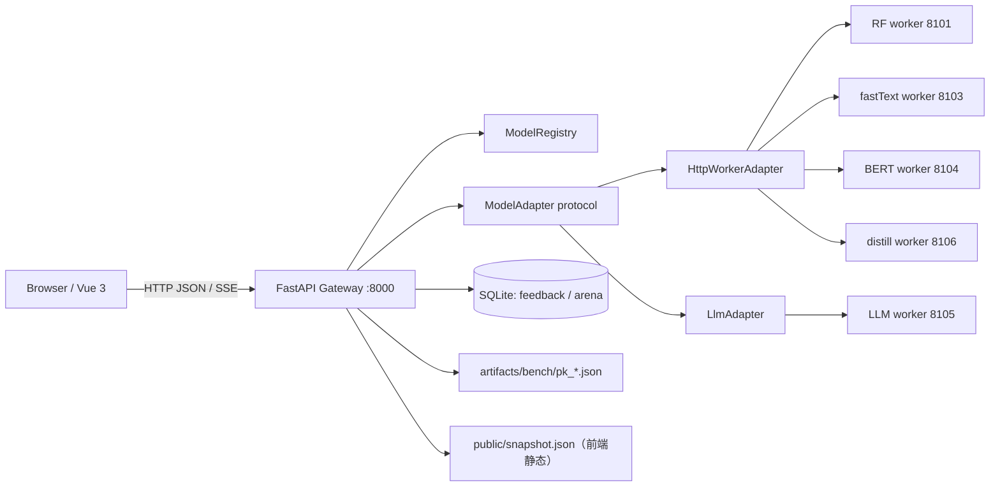
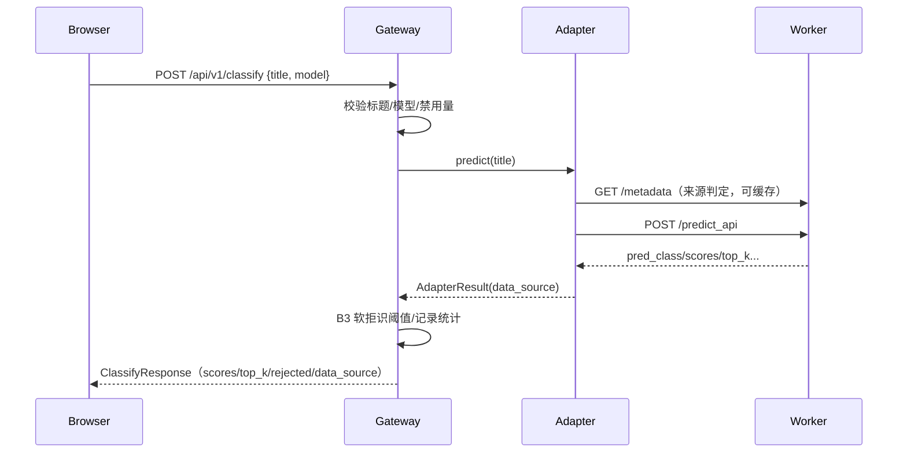

# 项目工程实践与技术学习档案（v6：全链路交付、离线基准、演示真实性与隔离验收）

> 文档版本：`v6-final-1.0`　|　生成时间：2026-10-22（Asia/Shanghai）
> 对应工程：`E:\AIModels\test\TouManFen\TouManFenClassifier`
> 对应代码状态（生成时 2026-10-22）：当时工作区存在大量未提交改动（**本轮未执行任何 Git 写操作**；不是某个已提交 commit 的完整快照）；截至 2026-10-25 已提交 afd3ff2，最新状态见下方横幅与 v7。
> 文档定位：不是日报、周报或按时间复制聊天记录，而是一份**过程可追溯、决策可区分、失败可学习、实现可复现**的工程学习档案。
> 文件关系：本文件是新的 v6；不覆盖 v1–v5。早期历史背景主要引用仓库已有 v1–v5 与 README，当前实现以本轮可访问的工具输出、源码、产物和测试记录为准。

> **状态更新（2026-10-25）**：本文为历史归档，不代表最终实现；最新能力、验收边界与启动方式以 [README](../README.md) 与 [v7 学习档案](PROJECT_LEARNING_GUIDE_v7_访问控制与阶段4-5D工程复盘.md) 为准。截至 2026-10-25，`main` 已提交 `afd3ff2`（批量分类/前端文件导入/LLM 每 IP 配额/访问名额控制等已交付并隔离验证）；B8 LLM 仍 missing，D7 未执行，真实 LAN/手机/真实 LLM 未验收。

---

## 0. 文档信息与证据边界

### 0.1 覆盖范围

| 项目 | 内容 |
|---|---|
| 覆盖阶段 | 2026-10-19 至 2026-10-22 的项目演进；重点覆盖 2026-10-21 架构重构之后、2026-10-22 的 D5/D6 交付与最终收尾（B9/B11/D1/D2/B10/F14/D3/D4/F15 启动来源） |
| 可获得资料 | 当前会话上下文与工具结果、仓库源码/配置/文档、`artifacts/` 产物、测试脚本输出、D4 隔离证据、现有 v1–v5 学习档案 |
| 不可获得资料 | DeepSeek Harness 原始 Trajectory/逐事件工具 ID（当前环境未提供可逐条回放的原始事件流）；早期 10-12～10-20 的完整逐轮聊天 |
| 历史资料处理 | 早期事实以仓库 v1–v5、README、阶段报告和联调记录为依据；能核验的当前事实以文件/命令/测试为准 |
| 项目最终状态 | D6 阶段及最终收尾任务完成；B8 的 LLM 仍为 missing；D7 未执行；D4 已用隔离环境复验通过（mock/headless，不是真实设备/真实 LLM） |

### 0.2 信息性质标记

全文对关键结论使用以下标记：

- **【已验证事实】**：有可访问文件、命令输出、测试报告、产物或当前工具结果支持。
- **【历史记录】**：来自既有文档或更早会话的陈述，本轮无法重新逐条核验。
- **【技术分析】**：基于已验证事实作出的解释、权衡或事后分析。
- **【待确认】**：证据不足，不能作为确定事实。

**重要原则**：模型/团队的推荐、用户的明确选择、实际执行方案三者分开写；未执行的测试不写成通过，未实现的计划不写成已实现。

### 0.3 与 v1–v5 的关系

- `docs/PROJECT_LEARNING_GUIDE.md`：v1，覆盖早期数据/模型/Streamlit/接口联调历史。
- `docs/PROJECT_LEARNING_GUIDE_v2_工程化改造与集成验证.md`：v2，覆盖网关化、阶段 2/3/4A 的早期重构。
- `docs/PROJECT_LEARNING_GUIDE_v3_前端开发全过程技术归档.md`：v3，前端开发历史。
- `docs/PROJECT_LEARNING_GUIDE_v4_Git与GitHub工程归档.md`：v4，Git 相关历史。
- `docs/PROJECT_LEARNING_GUIDE_v5_模型适配层与网络配置重构.md`：v5，适配层/worker 契约/网络配置重构。
- 本文 v6：在上述基础上补齐 **D5 SSE、D6 P0/P1、B9/B11/D2/B10/F14、D3/D4 隔离彩排、F15 启动来源**，重点解释“最终为什么这样工作”。

> 【历史记录】v1–v5 的正文未被本轮改写；本文件不声称重新验证了其中所有历史结论。

---

## 1. 阅读指南

### 1.1 这份文档记录什么

1. 项目从早期模型训练/Streamlit，到统一网关 + 5 worker + Vue 前端的演进逻辑。
2. 最终架构如何支持单模型分类、对比（POST/SSE）、反馈、竞技场、离线 benchmark、演示真实性、启动来源状态。
3. 关键决策的备选方案、约束、最终选择与实际后果。
4. 真实发生过的失败、限制、返工和测试环境陷阱。
5. 可直接复用的命令、接口、证据路径和避坑清单。

### 1.2 这份文档不记录什么

- 不把早期 10-12～10-20 的每一次对话逐字复述；其细节见 v1–v5。
- 不把 D6 之外的未授权阶段（D7）写成已完成。
- 不把 mock/浏览器模拟写成真实模型、真实设备或真实 Provider 验收。
- 不记录任何真实 API Key、Token、私钥或数据库凭据；涉及密钥只描述用途与边界。

### 1.3 怎么读最有效

- 想快速理解最终能力：读 §2、§5、§6。
- 想理解工程为什么这样设计：读 §8。
- 想学习排障：直接读 §10。
- 想复现：读 §14 和 §18。
- 想做质量审计：读 §12、§16，并打开对应证据文件。

---

## 2. 项目概述

### 2.1 业务背景

**投满分（TouManFen）新闻标题分类**：将中文新闻标题分为 10 类：

`finance`（财经）、`realty`（房产）、`stocks`（股票）、`education`（教育）、`science`（科技/科学）、`society`（社会）、`politics`（政治）、`sports`（体育）、`game`（游戏）、`entertainment`（娱乐）。

项目从课程参考实现演进为可训练、可评估、可服务、可局域网访问的验证型工程，最终加入演示级 UI、离线 PK 基准、竞技场人类偏好和演示真实性标识。

### 2.2 最终目标

- 提供统一的网关 API 和 Vue 前端，覆盖单模型/多模型分类、错误处理、反馈、对比流式结果。
- 用独立 test 集（10,000 条）给出可复核的离线指标，不以训练集或 mock 冒充。
- 在演示中清楚区分 live/mock/cached/unknown，避免把演示数据当真实指标。
- 在隔离环境中可重复验证，不依赖真实 LLM Provider 或用户正在运行的服务。

### 2.3 使用场景

- 本地演示：新闻标题分类 + 模型对比 + 纠错反馈 + 竞技场 + PK 榜。
- 局域网展示：Vue 前端 + FastAPI 网关 + 5 个本地 worker。
- 工程教学：展示从单体模型脚本到适配层、SSE、SQLite、测试脚本、隔离彩排的演进。

### 2.4 项目边界

- 不是生产系统：无鉴权、无 HTTPS、无容器化、无生产级监控/限流。
- LLM 默认不参与 compare（B9 opt-in）；真实 Provider 未做系统评估。
- 真实 LLM 未纳入 B8 离线基准；B8 LLM=missing。
- D7、真实设备/真实局域网断开、真实投影/手机验收未执行。

---

## 3. 原始需求与最终需求

### 3.1 早期需求（【历史记录】，来自 v1–v5/README）

- 中文新闻标题 10 类分类。
- 5 个模型：RF、fastText、BERT、distill（蒸馏 BiLSTM）、LLM（DeepSeek 等 Provider）。
- 完整链路：数据准备 → 训练 → 压缩/蒸馏 → 统一服务 → 前端。
- 本地/局域网可访问，默认回环地址，环境变量覆盖网络配置。
- 验证脚本、启动/停止脚本、文档。

### 3.2 阶段化需求（用户明确约束）

用户要求按阶段门（stage gate）推进，每个阶段完成后汇报并停止，等待下一条指令；不允许擅自进入下一阶段。后期具体任务包括：

| 阶段/任务 | 用户要求摘要 |
|---|---|
| D5 | SSE 渐进式对比、总截止、取消、前端流式面板 |
| D6 | B8 离线 benchmark + PK API、B12 并发/线程边界、F10 竞技场、F11 PK 榜 |
| 最终收尾 | B9 LLM opt-in、B11 真实性/快照、D1 文档、D2 演示数据、B10 回归、F14 前端质量、D3 演示脚本、D4 彩排 |
| D4 返工 | 补 F15 cached 回退、完整 10 步与 5 故障场景 |
| D4 再次返工 | 修复启动徽标“来源待确认”，实现启动来源接口，再做隔离复验 |

### 3.3 明确的安全/工程约束

- 不调用真实 LLM/provider，不使用外部 API Key，不产生计费请求。
- 不连接、停止、重启、改配置或压测用户正在运行的 stage2/worker。
- D2 `--reset` 只能指向显式临时 `TMF_DB_PATH`，绝不触碰 `serving/run/tmf.db` 或用户 DB。
- 不执行系统级杀进程；只停止本轮自己启动的隔离进程。
- 无 Git 写操作；保护所有未提交改动和阶段产物。
- B8 的 LLM 缺失必须保留“missing”，不能以 mock/估算填分。
- mock/cached 不得进入 live 统计、反馈或离线指标。

### 3.4 最终需求状态

| 需求 | 最终状态 |
|---|---|
| 单模型分类 + 错误处理 | 已实现并验证（B1/B3/B10） |
| 多模型 POST 对比 | 已实现并验证（B1/B2/B10） |
| SSE 渐进对比 + 总截止 + 取消 | 已实现并验证（B6/B10） |
| 反馈 pending + 相似提示 | 已实现并验证（B4/B10） |
| 竞技场匿名/投票/Elo | 已实现并验证（B7/B10） |
| 离线 benchmark + PK API | 已实现；4 本地模型 + 派生指标；**LLM missing**（B8） |
| 并发/线程边界 | 已实现；真实模型隔离测量（B12） |
| LLM opt-in | 已实现并验证（B9） |
| 演示真实性/快照 | 已实现并验证（B11/F15） |
| 演示数据/seed | 已实现；8 标题、20 题、临时 DB 幂等（D2） |
| 前端可访问性/质量 | F14 完成；F13 设备为模拟 |
| 6 分钟演示脚本/彩排 | D3/D4 完成（隔离 mock/headless） |
| D7/真实设备/真实 LLM | 未执行 |

---

## 4. 工程环境与项目结构

### 4.1 环境（【已验证事实】/当前状态）

| 项 | 内容 |
|---|---|
| OS | Windows 10/11 本机 |
| Python | `D:\Miniconda3\envs\py3109\python.exe`，3.10.9 |
| 网关依赖 | `PYTHONPATH=E:\AIModels\test\TouManFen\venv-gateway\Lib\site-packages`（历史环境约定） |
| 前端 | Vue 3 + TypeScript + Vite 8；构建最终 97 modules |
| 浏览器 | Microsoft Edge headless（CDP）用于隔离验收 |
| 默认端口 | 网关 8000；worker 8101/8103/8104/8105/8106；前端 5173 |
| D4 隔离端口 | 网关 14520；mock worker 14511–14515；静态 18084/18085；Edge 调试 19224 |
| 数据库 | SQLite，默认 `serving/run/tmf.db`（B4/B7 共用），D2/D4 使用临时 `TMF_DB_PATH` |
| Git | 生成时（2026-10-22）：工作区存在未提交改动，本文不声称提交状态；2026-10-25 已提交 afd3ff2（见横幅） |

> 敏感信息：`04-LLM/.env` 可能含 Provider Key，未在本文记录；真实 Key 不进入文档/测试。

### 4.2 目录（核心）

```text
TouManFenClassifier/
├─ 00-data/                 数据与 class.txt
├─ 01-rf/ 02-fasttext/ 03-bert/ 04-LLM/ 05-distill/
│  ├─ *_predict_service.py  统一 PredictService 兼容层
│  └─ api_flask_server.py   Flask 薄壳
├─ serving/
│  ├─ gateway/              FastAPI 网关、routers、schemas、settings、stats、probes
│  ├─ adapters/             ModelAdapter / HttpWorkerAdapter / LlmAdapter / protocol
│  ├─ services/             classification、feedback、arena
│  ├─ models/registry.py
│  ├─ scripts/              verify_*.py、mock_worker.py、demo_seed.py、stage2.ps1
│  └─ config/               models.yaml、workers.yaml、processes.yaml
├─ frontend/
│  ├─ src/api/              client/classify/bench/feedback/arena/demo
│  ├─ src/composables/      useClassify/useCompareStream/useDemoState/useTheme...
│  ├─ src/components/       sections/result/arena/placeholders/layout/common
│  ├─ tests/                f9/f10/f11/f14/f15/d4 隔离 harness
│  └─ public/snapshot.json  cached 离线快照
├─ tools/                   bench_signature.py、make_demo_data.py、make_demo_snapshot.py、validate_meta.py...
├─ artifacts/               bench/b12/demo/d4/f13 证据
└─ docs/                    v1–v6 学习档案、接口/口径/彩排/演示文档
```

### 4.3 关键配置文件

- `serving/config/models.yaml`：模型 ID、worker、display_name、版本、enabled、`compare_by_default`、B3 拒识阈值、类别文件等。
  - **B9 后 llm.compare_by_default=false**；其余 4 个默认 true。
- `serving/config/workers.yaml`：worker base_url、超时、health/ready/metadata/predict 路径。
- `serving/config/processes.yaml`：本地启动端口/脚本。
- 环境变量：`TMF_GATEWAY_HOST/PORT`、`TMF_BIND_HOST`、`TMF_WORKER_URL_*`、`TMF_CORS_ORIGINS`、`TMF_COMPARE_CONCURRENCY`、`TMF_COMPARE_TOTAL_TIMEOUT_MS`、`TMF_TORCH_THREADS`、`TMF_DB_PATH`、`VITE_API_BASE_URL`。

### 4.4 已知环境限制

- 真实 stage2 服务由用户运行，本任务禁止触碰；验收使用隔离 mock/临时网关。
- 没有真实投影/手机/外部网络断开验收条件；F13/D4 使用浏览器模拟。
- 没有可用真实 LLM benchmark 授权；B8 只评估 4 个本地模型。
- `frontend/.env.local` 会覆盖 shell 环境变量（详见问题案例 10.1），测试必须使用独立 envDir。
- 早期会话无法完整回放；历史结论以既有文档/产物为准。

---

## 5. 最终实现成果总览

### 5.1 已交付能力

| 能力 | 状态 | 关键证据 |
|---|---|---|
| 5 个 worker + FastAPI 网关 + Vue 前端 | 已实现/历史验证 | `serving/`、`frontend/`、v5 |
| 单模型分类 | 已实现/验证 | `verify_refactor_gateway.py` 101 PASS |
| 多模型 POST compare | 已实现/验证 | 同上；summary ok/partial/all_failed |
| SSE 渐进 compare | 已实现/验证 | `verify_compare_stream.py` 67 PASS；B6 |
| B3 软拒识/分数/Top-k | 已实现/验证 | B10 worker/gateway 断言；F6 |
| B4 反馈 pending/相似提示 | 已实现/验证 | `verify_feedback.py` 112 PASS；B10 |
| B7 匿名竞技场/Elo | 已实现/验证 | `verify_arena.py` 74 PASS；F10 87 断言 |
| B8 离线 benchmark/PK API | 已实现；LLM missing | `pk_2026-10-22.json`、`verify_bench.py` 65 PASS |
| B9 LLM opt-in | 已实现/验证 | `verify_b9_llm_optin.py` 16 PASS |
| B11 data_source/快照 | 已实现/验证 | `verify_b11_data_source.py` 39 PASS；快照 meta |
| B12 并发/线程边界 | 已实现/验证 | `verify_concurrency.py` 89 PASS；真实隔离测量 |
| D2 演示数据/seed | 已实现/验证 | 8 cases、20 arena、临时 DB 幂等 |
| F14 前端质量 | 已实现/验证 | 6 场景/66 断言；typecheck/build |
| F15 启动来源/cached | 已实现/验证 | `/api/v1/demo/state`；12 PASS；7/7 浏览器 |
| D3 演示脚本 | 已写 | `docs/演示脚本_6分钟.md` |
| D4 隔离彩排 | 已重新执行 | 10/10，7.584s；5 故障场景；网络审计 |

### 5.2 最终交付物

- 源码：网关、适配器、服务、前端、工具、脚本。
- 配置：models/workers/processes、环境变量覆盖。
- 数据/模型：`00-data/`、各模型权重（路径见各目录）。
- 离线基准：`artifacts/bench/pk_2026-10-22.json`（真实 test 10,000 条；4 本地模型；LLM missing）。
- 演示快照：`artifacts/demo/snapshot_2026-10-22.json`（4 cases，B11）；`frontend/public/snapshot.json`（8 cases，D2）。
- 测试证据：`artifacts/d4/`、`artifacts/b12/`、各 verify 输出、前端 tests 报告。
- 文档：README、接口/口径/演示/彩排、v1–v6 学习档案。

### 5.3 部分完成/未完成

| 项 | 状态/边界 |
|---|---|
| B8 LLM | **missing**：外部 Provider 未授权，未调用，无 LLM 基准分数 |
| F13 设备验收 | 模拟（Edge headless/CDP）；无真实投影/手机/笔记本 |
| D4 正常彩排 | 使用 mock worker；真实 B7/B4/B8 路由但模型响应是 mock；不是真实模型精度验收 |
| D7 | 未执行 |
| 真实 LLM/Provider | 未在本轮调用、未做系统评估 |
| F15 启动来源 | 依赖 worker metadata；混合/缺失时保守 unknown，不猜 live |

---

## 6. 项目整体架构与核心业务流程

### 6.1 最终架构（【已验证事实】）



关键事实：

- 网关不 import torch/transformers/模型权重，不读取 LLM 密钥；只通过 HTTP 调 worker。
- 适配器层负责协议/错误归一化/分数校验/data_source 判定；业务层只依赖 `ModelAdapter` 协议。
- B4/B7 共用 SQLite；B8 是只读产物；D2 快照是前端静态文件；cached 不进入网关统计。
- F15 启动来源接口通过 `/readyz` + `/metadata` 探测，不调用 `/predict_api`。

### 6.2 单模型分类流程



- `scores/score_kind/top_k` 是**未校准原始分数**，不是 calibrated confidence。
- `rejected` 为软拒识：`max_score < 0.518` 或 entropy > 0.699 时提示，但保留 pred_class/分数。
- B4 相似 pending 反馈只作为 `human_feedback_hint`，不覆盖 pred_class。
- `data_source` 由 worker `/metadata.display_name` 判定；结果卡显示来源。

### 6.3 对比流程

- **POST `/compare`**：旧接口，合法请求统一 200，逐模型 ok/error，summary 表达 ok/partial/all_failed；不受 SSE 总截止影响。
- **GET `/compare/stream`**：SSE；`model` 事件逐项落位，`summary`/`done` 结束；总截止 `TMF_COMPARE_TOTAL_TIMEOUT_MS=18000`，并发 `TMF_COMPARE_CONCURRENCY=3`；客户端断开取消未完成网关 task。
- **B9**：默认 compare 4 个本地模型，不含 LLM；显式选 LLM 才调用；LLM 不可用只影响该项，summary partial。

### 6.4 反馈与竞技场

- **反馈**：`client_id + trim(title) + model_id` 去重；status=pending；30 天清理；相似反馈 hint；不训练、不自动改模型。
- **竞技场**：`/arena/next` 返回匿名候选（无 model_id/名称）；`/arena/vote` 揭晓选中模型并按 Elo 更新；`/arena/leaderboard` 票数 <50 为 warming_up，无 rank；Elo 是**人类偏好**，不是准确率。
- 演示投票/反馈只使用临时 DB；不写真实库。

### 6.5 离线基准与 PK 榜

- B8 产物：test 10,000 条；4 本地模型（RF/fastText/BERT/distill）；指标为 macro-F1/accuracy/latency/size/confusion；LLM=missing。
- 派生指标：dev 固定抽样（seed=20261022，每类 200，共 2,000）得到权重，加权投票集成；oracle 为参考上界；二者明确是派生，不是独立模型。
- F11 只读 API + B8 产物；图表按 F1/latency/size 切换；LLM 显示“未纳入 · 未授权”，不伪造 0/分数。

### 6.6 演示真实性三态

| 状态 | 判定 | 展示 |
|---|---|---|
| live | `/metadata.display_name` 非 `mock-` 且有效 | “实时” |
| mock | `display_name` 以 `mock-` 开头 | “演示数据（mock）” |
| unknown | metadata 缺失/非法/worker down/混合 | “来源未确认”+worker 明细 |
| cached | 仅前端快照成功加载 | “离线快照”+生成时间 |

F15 启动时请求 `/api/v1/demo/state`；只有所有 enabled 模型 ready 且来源一致才显示 mock/live；否则 unknown，避免误报 live。分类/对比结果仍按各自 `data_source` 更新结果卡。

---

## 7. 项目完整实施时间线

> 早期时间线为【历史记录】（依据 v1–v5/README）；D5 之后为【已验证事实】（依据本轮工具/产物）。无法精确到分钟的部分用“阶段/轮次”表示。

| 序号 | 阶段 | 当时目标 | 实际操作/问题 | 关键决策 | 结果/影响 |
|---|---|---|---|---|---|
| 1 | 早期（10-19 前后） | 数据/模型/Streamlit/接口联调 | 训练 RF/fastText/BERT/distill/LLM，跑通主链路 | 10 类白名单、固定 test 口径 | 形成项目基线与 v1 |
| 2 | 阶段 2–4A（10-20） | 服务化/LAN/LLM 韧性 | 5 worker + 网关；Vue 前端；LLM opt-in 讨论 | 网关不导入模型；worker HTTP 契约 | v2/v3 基础 |
| 3 | 架构重构（10-21） | 适配层/网络配置 | 统一 ModelAdapter/PredictService；环境变量覆盖固定 IP | 协议优先、worker 薄壳 | v5；回归通过 |
| 4 | D5 | SSE 渐进 compare | 总截止/取消/心跳/前端 EventSource | SSE 仅用于流式；POST 保留 | B6/F9；67/68 断言 |
| 5 | D6-B8 | 离线 PK 基准 | 真实 test 10k；5 模型尝试；LLM 无法授权 | 不造 LLM 数据；4 本地 + 派生 | B8 产物/65 PASS |
| 6 | D6-B12 | 并发/线程边界 | 默认并发 3；torch threads 4；锁；真实隔离测量 | 配置与总截止分离；worker 内锁 | 89 PASS + 原始 JSON |
| 7 | D6-F10/F11 | 竞技场/PK 榜 | 匿名投票、翻牌、预热榜；真实 B8 API | 票数不足不排名 | 87 断言 / F11 5 场景 |
| 8 | D6 收尾 | B9/B11/D2/B10/F14 | LLM opt-in；data_source；快照；seed；回归；可访问性 | 真实性优先、不伪造 | 16/39/101/93/59/66 等 |
| 9 | D3/D4 | 演示脚本/彩排 | 10 步 + 5 故障；浏览器/接口证据 | 隔离 mock；不碰用户服务 | 初版 D4 部分失败/证据疑点 |
| 10 | F15 | 启动来源/cached | 徽标原显示“来源待确认” | 新增 `/demo/state` + 保守混合规则 | 12 PASS + 7/7 浏览器 |
| 11 | D4 隔离复验 | 证明网络隔离 | `.env.local` 覆盖 VITE_API_BASE_URL | 使用测试 envDir；重建 D4 证据 | 正常 10/10 7.584s；故障通过；网络审计 all_isolated |

后续阅读：§10 记录问题细节；§12 记录验收状态；§16 记录未解决项。

---

## 8. 核心技术决策档案

### D-01 阶段门（stage gate）与停止点

- **背景**：项目跨 D1–D6/收尾，多个阶段有依赖，用户要求每阶段汇报后停止。
- **备选**：连续自动推进；阶段门。
- **选择**：**用户明确要求阶段门**；团队按轮次实施并汇报。
- **依据**：降低越权、误改用户运行服务和未授权阶段风险。
- **代价**：上下文切换/等待增加；好处是每阶段可核验、可停止。
- **结果**：D6 完成后用户另行授权 B9/B11/D1/D2/B10/F14/D3/D4；D7 未执行。
- **可复用**：多阶段、共享运行环境的工程，先把阶段边界和停止点写进约束。

### D-02 网关/worker 分层，网关不加载模型

- **问题**：多个模型依赖不同、加载慢、LLM 有密钥/费用；若网关直接 import 模型会耦合重依赖。
- **备选**：单体 Flask；网关直接加载全部模型；HTTP worker + 适配器。
- **选择**：FastAPI 网关 + 5 个 Flask worker；网关只依赖协议；HTTP 调用。
- **依据**：进程隔离、失败隔离、依赖隔离、可独立启停。
- **代价**：多进程/端口/超时/网络错误；好处是模型崩溃不拖垮网关，密钥限制在 04-LLM。
- **证据**：`serving/adapters/*`、`verify_refactor_gateway/workers`。
- **风险**：worker 各自预处理，跨模型分数不能直接横比（已在文档标注）。

### D-03 统一 worker 预测契约与兼容层

- **问题**：各模型原始入口结构不同（dict、numpy、tokenizer、LLM Prompt）。
- **选择**：`PredictService` 模板 + `SERVICE.predict(dict)` + 薄 Flask 壳；保留旧 `predict(dict)`。
- **理由**：统一网关适配、降低破坏权重的风险；不强行合并预处理。
- **结果**：worker 契约验证 93 PASS（B10），5 个入口统一。

### D-04 对比接口 POST 200 + summary 语义

- **问题**：多模型比较部分失败时，HTTP 应返回 200 还是 502？
- **选择**：合法请求统一 200；每项 ok/error；`summary.status` 表达 ok/partial/all_failed。
- **理由**：部分成功是业务正常态；用 JSON 表达而不是 HTTP 错误；便于前端渲染。
- **证据**：`verify_refactor_gateway`、`verify_compare_stream`。

### D-05 SSE vs 轮询/POST

- **问题**：5 模型延迟差异大，用户希望先看到已完成结果。
- **备选**：轮询任务状态；WebSocket；SSE；仅 POST。
- **选择**：SSE（GET `/compare/stream`），保留 POST。
- **理由**：服务端单向推送、EventSource 简单、无需额外任务队列；适配本地网关。
- **关键契约**：逐模型 model 事件；summary/done；15s 心跳；18000ms 总截止；客户端断开清理。
- **代价**：SSE 与 POST 双路径、前端状态机复杂；通过 F9 快照/回退解决。
- **结果**：B6 67 PASS；F9 68 断言。

### D-06 B8 离线基准：LLM 缺失不补 mock

- **问题**：LLM 无法在授权边界内调用；B8 验收要求 5 模型但真实 LLM 分数不可得。
- **备选**：调用真实 Provider；用 mock 填 LLM；只评估 4 本地并标 missing；伪造估算。
- **选择**：4 本地真实 test + 派生集成/oracle；LLM=missing；页面显示 missing。
- **依据**：真实性优先；mock LLM 无法代表真实模型指标；用户明确禁止伪造。
- **代价**：PK 榜不完整；好处是所有展示数字可追溯。
- **证据**：`artifacts/bench/pk_2026-10-22.json`；B8 65 PASS；F11 5 场景 PASS。

### D-07 派生指标标注（集成/oracle）

- **问题**：加权投票/oracle 不是独立模型，容易被误读为真实模型。
- **选择**：在产物/API/UI 标 `derived/oracle`、权重来源、非独立模型/上界。
- **理由**：避免把派生数字当模型能力；保留可复核的集成参考。
- **结果**：F11 明确绿色/斜纹标签；文档/口径同步。

### D-08 B11 `data_source`：metadata 约定，不猜 live

- **问题**：如何区分 mock/live？仅看服务可达/进程存活会把 mock 当 live。
- **选择**：worker `/metadata.display_name`：`mock-` 前缀=mock，非 mock 有效=live；缺失/异常=unknown；cached 只由前端快照。
- **理由**：服务端显式来源、可测试、可缓存；不依赖 URL/可达性。
- **代价**：metadata 成为关键契约；worker 必须提供；混合来源要保守。
- **结果**：B11 39 PASS；统计只计 live；F15 启动接口复用唯一判定函数。

### D-09 B9 LLM opt-in

- **问题**：默认 compare 5 模型含 LLM，普通请求可能触发外部计费。
- **选择**：`llm.compare_by_default=false`；默认 4 本地；显式 models 才调用 LLM。
- **依据**：默认安全/无费用；保留用户显式选择。
- **结果**：默认 mock 计数 0；显式 LLM 在线/离线四组合 16 PASS；显式离线 partial。

### D-10 B12 并发/线程：配置、总截止、worker 锁

- **问题**：compare 并发和 worker 线程不可控，可能 OOM/抢 CPU。
- **选择**：`TMF_COMPARE_CONCURRENCY=3`（1–10）；`TMF_COMPARE_TOTAL_TIMEOUT_MS=18000` 仅 SSE；`TMF_TORCH_THREADS=4`；BERT/distill 进程内锁。
- **理由**：限制同时负载、保持 B6 契约、避免同一 worker 多推理抢 torch 线程。
- **测量**：fake 1/3/5 + 真实 BERT/distill 隔离 1/3/5；max active inference=1；无 OOM；BERT c5 P95 996ms 等。
- **边界**：真实生产压测未做；不同 worker 是不同进程，锁不跨进程。

### D-11 反馈 pending，不“已学会”

- **选择**：反馈只进入 pending；去重；30 天清理；相似 hint 不覆盖预测；无训练/审核后台。
- **依据**：避免误导用户认为模型立即学习；符合数据边界。
- **结果**：B4 112 PASS；文案红线落地。

### D-12 竞技场 Elo 是人类偏好

- **选择**：匿名卡片 → 投票 → 揭晓；Elo/Wilson；n<50 预热无 rank。
- **依据**：没有真实标签，不能叫准确率；投票少时不排名。
- **结果**：B7 74 PASS；F10 87 断言。

### D-13 D2 演示 seed：显式临时 DB、幂等

- **问题**：演示需要反馈/投票初态，但 reset 可能清库。
- **选择**：`demo_seed.py --reset` 强制显式 `TMF_DB_PATH`，拒绝默认/`serving/run/`；只清相关表；固定 seed 数据；两次 reset 幂等。
- **依据**：防误删；可重复演示；不与真实用户数据混用。
- **结果**：8 标题、20 题、临时 DB 摘要一致；默认库未创建/未触达。

### D-14 F15 启动来源：`/demo/state` + 保守混合

- **问题**：首屏徽标原显示“来源待确认”，不满足 D4 第 1 步。
- **备选**：等首次分类结果；按 URL/可达性猜；新增只读状态接口。
- **选择**：`GET /api/v1/demo/state`，探测 enabled worker 的 ready+metadata；仅全部 ready 且来源一致返回 mock/live；混合/缺失=unknown + worker_sources。
- **依据**：服务端显式、无模型推理、保守不误报 live。
- **结果**：首屏 mock/live/unknown 正确；测试 12 PASS；浏览器 7/7；分类卡与徽标一致。
- **限制**：依赖 metadata；启动瞬间 worker 未 ready 时为 unknown；不轮询。

### D-15 D4 隔离：envDir 覆盖 `.env.local`

- **问题**：Vite 读取 `frontend/.env.local`，shell 的 `VITE_API_BASE_URL` 被覆盖，旧 D4 可能指向 LAN。
- **选择**：测试专用 `tests/d4/env` + `vite.config.mjs` 的 `envDir`；静态服务去掉外链字体；CDP 记录网络目标；所有场景使用 145xx/18084/18085/18996。
- **依据**：不修改用户 `.env.local`，但能确保构建产物含隔离 API base；网络审计可验证。
- **结果**：正常 10/10；故障五场景；`all_isolated=true`，`bad_network=[]`；旧 D4 证据不再作为通过依据。
- **代价**：测试构建/静态服务复杂；好处是证据可信。

### D-16 F14 可访问性不引入框架

- **选择**：skip link、`:focus-visible`、面板焦点管理/Escape、aria-live 单次播报、reduced-motion、50 卡/6×CPU 模拟；用现有 Edge/CDP harness。
- **理由**：项目无 vitest；不新增依赖；浏览器实测更接近用户。
- **结果**：6 场景/66 断言；typecheck/build 通过。

---

## 9. 核心模块逐步实现教程

### 9.1 适配器与 worker 协议

**解决什么**：把“模型怎么被调用”与“业务如何编排”分离。  
**输入**：`title`、model spec/worker config、classes。  
**处理**：构造 URL/超时；预测；解析 pred_class/scores/top_k；错误归一化；data_source 判定；统计只计 live。  
**输出**：`AdapterResult`（status/latency/pred_class/scores/score_kind/top_k/data_source/error）。  
**边界**：worker 不返回 data_source；网关适配器根据 metadata 判定；fake adapter 可为 None，不能当 live。  
**证据**：`serving/adapters/protocol.py`、`http_worker.py`、`llm.py`；B10 workers 93 PASS。

### 9.2 分类服务与 B3 软拒识

**输入**：标题、模型 ID、适配器结果。  
**处理**：校验标题；调用适配器；基于未校准 scores 计算 max/entropy；阈值 0.518/0.699；保留 pred_class；生成 threshold_meta；记录统计。  
**输出**：`ClassifyOutcome` → schema → 前端结果卡。  
**易错点**：把 rejected 当分类失败；把未校准分数当 calibrated confidence；无分数时不要伪造。  
**验证**：gateway 101 PASS；F6 UI。

### 9.3 SSE 对比

**输入**：title、models。  
**处理**：信号量限并发；逐模型 task；完成即发 model 事件；总截止取消未完成；心跳；断开检测；summary/done。  
**边界**：POST 不应用总截止；客户端 abort 不保证中止已发出的 worker 请求；LLM 离线只影响该项。  
**前端**：`useCompareStream` 状态机；3s 首事件回退 POST；F9 68 断言。

### 9.4 反馈与竞技场

**反馈**：client_id+title+model 去重；pending；相似 3-gram Jaccard≥0.75；cleanup 30 天；无审核/训练。  
**竞技场**：匿名候选；vote 揭晓；Elo K=24；Wilson 区间；<50 warming；人类偏好不是准确率。  
**证据**：`serving/services/feedback.py`、`arena.py`；B4 112、B7 74。

### 9.5 B8 离线基准

**输入**：test.txt 10,000、4 模型预测、dev 固定抽样。  
**处理**：批量指标；延迟取前 200 单条；dev 权重；集成/oracle；meta 校验；产物 JSON。  
**关键**：LLM missing；集成/oracle 派生；不回写训练数据；产物供 B8 API/F11 只读消费。  
**证据**：`tools/bench_signature.py`、`artifacts/bench/pk_2026-10-22.json`、`verify_bench.py` 65。

### 9.6 B12 worker 线程/锁

**处理**：BERT/distill 在加载前 `torch.set_num_threads(4)`；进程内 `threading.Lock` 包住 tokenize+forward；compare 信号量控制并发。  
**原理**：锁保证单 worker 内不并行进入临界区；多 worker 是独立进程，锁不跨进程；总截止属于网关编排层。  
**测量**：真实 BERT/distill 1/3/5；max active=1；RSS稳定；BERT c5 延迟上升但无 OOM。  
**证据**：`artifacts/b12/real_concurrency_2026-10-22.json`。

### 9.7 前端页面与真实性

- F1–F8：分类/对比/反馈/错误/实时/无障碍；F10 竞技场；F11 PK；F13 主题/大屏/断点；F14 质量横切；F15 启动来源/cached；F16 安全上下文复制降级。
- 页面路由：默认 lab；`#arena`/`#bench` 懒挂载，避免首页触发竞技场抽题。
- 结果卡：分数、Top-3、拒识、threshold_meta、data_source。
- F15：启动 `/demo/state`；后端不可达读取 `public/snapshot.json`；混合/缺失 unknown；URL 参数仅提示。

### 9.8 D2 演示数据

`tools/make_demo_data.py` 生成 8 条固定标题、20 道 test 题、`public/snapshot.json`；`demo_seed.py --reset` 只使用显式临时 DB，填充 3 pending 反馈、2 演示票、5 Elo 初始；两次 reset 语义摘要一致；不伪造 50 票/准确率。

---

## 10. 关键问题与踩坑案例库

> 本文选取对最终架构/验收影响最大的问题；早期历史问题见 v1–v5。每个案例区分已验证事实与分析。

### 10.1 `.env.local` 覆盖构建 API base，旧 D4 证据可能指向 LAN

#### 1. 背景
D4 要求浏览器请求只能指向隔离服务。测试通过 shell 设置 `VITE_API_BASE_URL=http://127.0.0.1:189xx` 并执行 `pnpm build`。

#### 2. 实际症状
- 页面在 mock 服务启动时仍显示 cached/无法连接。
- 检查 dist JS 发现实际仍包含 `192.168.12.54:8000`，而不是隔离端口。
- 旧 D4/F15 浏览器证据因此不能证明网络隔离。

#### 3. 预期与实际
预期：shell 环境变量覆盖 API base。实际：Vite 读取项目 `.env.local`，其 `VITE_API_BASE_URL` 覆盖了 shell 值。

#### 4. 如何发现
为 F15 启动来源做浏览器测试时，mock API 已启动但页面请求失败；检查构建产物字符串发现 LAN API。

#### 5. 排查过程
1. 确认 mock 服务/端口正常；排除服务未启动。
2. 检查 dist JS 字符串，发现 LAN base；确认构建配置问题。
3. 阅读 `frontend/.env.local` 与 Vite env 规则；确认优先级。
4. 创建测试专用 `tests/d4/env` + `envDir` 配置，重新构建并检查产物包含 14520。
5. 用 CDP Network 记录所有请求，确认没有 LAN/外部地址。

#### 6. 根因
Vite 会加载项目根 `.env.local`（本地覆盖文件），其值优先于 shell 环境变量；这会静默改变构建时注入的 API base。  
【技术分析】这是“配置来源优先级未显式隔离”的典型问题，不是网络代码缺陷。

#### 7. 尝试过的方案
- 直接改 shell env：失败（被 `.env.local` 覆盖）。
- 使用 `--mode test` + `.env.test.local`：仍失败（`.env.local` 优先级问题）。
- 临时修改/删除用户 `.env.local`：未采用，因为会触碰用户配置且有恢复风险。
- 最终：测试专用 `envDir` + `.env`，不改用户文件；重新构建并审计网络。

#### 8. 模型建议与用户选择
用户没有选择技术方案，只要求“必须证明隔离”；团队选择 envDir，并在旧证据可能受污染时主动声明取代。没有把旧证据当成本轮通过依据。

#### 9. 最终方案
```ts
// frontend/tests/d4/vite.config.mjs
export default defineConfig({
  plugins: [vue()],
  envDir: 'tests/d4/env',
})
```
`tests/d4/env/.env` 只含 `VITE_API_BASE_URL=http://127.0.0.1:14520`。构建后检查 bundle 字符串；测试静态服务移除 Google Fonts 外链；CDP 记录 Network 目标，生成 `d4-network-audit-isolated.json`。

#### 10. 为什么有效
`envDir` 改变 Vite 读取 env 文件的目录，测试构建不再读取项目根 `.env.local`；API base 由测试 `.env` 决定。网络审计进一步验证运行时实际目标，而不是只相信构建配置。

#### 11. 验证
- 隔离构建产物含 14520、不含 LAN。
- 正常/故障/审计汇总共 10 条 CDP 目标报告，`all_isolated=true`、`bad_network=[]`。
- 正常 10/10、故障 5 场景通过。
- F15 cached/启动测试使用拦截/隔离 API，未访问 LAN。

#### 12. 局限
- 测试专用配置增加了构建复杂度和需要维护的 env 文件。
- 只解决测试隔离；用户实际 LAN 构建仍会读取 `.env.local`，这是设计行为。
- 旧 D4 文件还留在 artifacts，但文档已标注不再作为通过依据。

#### 13. 教训
- **构建产物字符串检查**是最直接的配置验证，不要只看命令执行成功。
- 本地覆盖文件（`.env.local`）是隐蔽的配置来源；测试应显式 envDir/配置文件，而不是依赖 shell。
- 关键验收要记录“实际网络目标”，不能只记录“服务已启动”。

---

### 10.2 LLM 默认参与 compare 的计费风险 → B9 opt-in

#### 1. 背景
原默认 compare 包含 5 个模型（含 llm）；普通演示/请求可能触发外部 Provider。

#### 2. 症状/预期
预期默认请求不产生 LLM 调用；实际默认集合包含 LLM，可能计费。

#### 3. 发现
审查 `models.yaml` 与 B9 清单时发现 `llm.compare_by_default: true`。

#### 4. 排查/根因
配置层默认值；前端显式传 models 时行为不同，但默认请求仍有风险。

#### 5. 尝试与决策
备选：仅前端不勾选（后端仍可默认调用）；后端默认排除；禁用 LLM。  
选择：后端 `compare_by_default: false`，LLM 仍 enabled/可显式选择；默认 4 本地模型。  
用户要求“显式请求用 mock 验证，不调用真实 provider”。

#### 6. 验证
`verify_b9_llm_optin.py` 16 PASS：默认在线/离线均不调用 llm；显式在线 5/5（data_source=mock）；显式离线 partial（4 本地保留，LLM WORKER_UNAVAILABLE/unknown）。

#### 7. 局限与教训
默认集合变化会影响旧断言/前端默认模型选择，需要同步测试；安全默认值应写进配置和验收，不只靠 UI。

---

### 10.3 B8 LLM 无法真实评估：missing 而不是假数据

#### 1. 背景
D6 要求离线 benchmark 覆盖 5 模型；LLM 是外部 Provider，授权边界禁止调用，真实 test 分数不可得。

#### 2. 症状/风险
若用 mock LLM 或估算分数，会污染 B8 指标、PK 榜与演示真实性。

#### 3. 决策
- 4 个本地模型在 test 10k 上真实评估；
- LLM 状态 missing，页面/API 明确“未授权/未纳入”；
- 加权投票/oracle 标为派生；不把派生当第 5 模型。

#### 4. 验证与指标
RF 0.830205、fastText 0.917395、BERT 0.930724、distill 0.907386；weighted 0.939、oracle 0.975493；B8 total 669.7s；`verify_bench.py` 65 PASS；F11 显示 missing。

#### 5. 教训
- “无法获得”是合法结果；诚实缺失优于伪完整。
- 派生指标必须与独立模型分列。
- API/UI 都要保留 missing 状态，不能只藏起来。

---

### 10.4 mock/live 真实性不清 → data_source 与统计边界

#### 1. 背景
演示可能使用 mock worker、缓存快照或真实 worker；页面若统一标“实时”会误导。

#### 2. 决策
worker `/metadata.display_name`：`mock-` 前缀=mock，非 mock=live；缺失=unknown；cached 仅前端快照。结果卡/API/SSE 逐项透传；统计只计 live。

#### 3. 问题
- metadata 缓存/失败重试；worker 切换后状态恢复。
- compare 每项/错误项都要有来源；SSE 增量字段要保持兼容。
- 启动时需额外 `/demo/state` 才能首屏准确，不能等首次结果。

#### 4. 验证
B11 39 PASS：fake transport live/mock/unknown；隔离 mock worker；API/SSE；统计排除；快照 meta。  
F15 7/7：首屏 mock/live/mixed/unknown、URL 参数不改变来源、分类后徽标/卡一致。

#### 5. 教训
“来源”是数据契约，不是 UI 装饰；必须由服务端显式给出，并在统计/缓存/演示中一致传播。

---

### 10.5 SSE partial/总截止与“收到卡片≠完成”

#### 1. 背景
D4 故障 1 测试时，脚本只等 `compare-card` 数量达到 5，立即读文本，得到“等待中 0/5”或 stale 结果，误判失败。

#### 2. 症状
- 在线检查在 0/5 等待态读取；
- 离线检查在 5 张骨架卡已存在但 LLM 尚未失败时读取；
- 断言 `partial/WORKER_UNAVAILABLE` 不成立。

#### 3. 根因
SSE 卡片在请求开始即创建占位，**卡片数量不等于结果完成**；必须等待 summary/具体状态。

#### 4. 修复
测试等待 `全部模型已完成` 或 `部分结果已返回/WORKER_UNAVAILABLE`；超时足以覆盖 LLM 超时；恢复后重新提交。

#### 5. 验证
故障 1：online 5/5；offline 4/5 partial（1,969ms）；recover 5/5（20,575ms）。  
D4 正常 step5 4 cards；F9 SSE 断言。

#### 6. 教训
异步 UI 验收要等**业务完成信号**，不能等 DOM 占位数量；测试本身也会“看似成功、实际读到旧状态”。

---

### 10.6 F15 首屏“来源待确认” → `/api/v1/demo/state`

#### 1. 背景
D4 第 1 步要求打开页面即显示真实数据态；原实现只在分类响应后更新徽标。

#### 2. 需求/约束
来源必须来自服务端 metadata；不能按 URL/可达性猜 live；混合/缺失不得误报 live；cached 仅快照。

#### 3. 备选
- 等首次分类：不满足首屏。
- 前端逐个探 metadata：跨域/工作量大、重复规则。
- 服务端状态接口：复用 prober/适配器规则，返回 ready/total/worker_sources。

#### 4. 实现
`GET /api/v1/demo/state`：对 enabled 模型 `/readyz`+`/metadata`；所有 ready 且来源一致→mock/live；混合/缺失/不可达→unknown，附 `worker_sources`。前端启动 `refresh()`，展示来源+已就绪数+明细；cached 仍由快照逻辑。

#### 5. 验证
`verify_f15_startup.py` 12 PASS（mock/live/mixed/missing/down）；真实隔离网关 mock 5/5；浏览器 7/7；分类后徽标/卡一致；`?demo=cached` 不改来源。

#### 6. 局限
依赖 metadata；worker 尚未 ready 时 unknown；没有轮询/重试；启动接口只读不推理。

#### 7. 教训
“页面级状态”最好由服务端一次聚合，避免前端多请求/规则漂移；混合来源要用保守 unknown + 明细，而不是挑一个代表值。

---

### 10.7 cached 快照缺失/非法与恢复

#### 1. 背景
F15 需要后端不可达时读取 `public/snapshot.json`，但不能把“读取失败”伪装成 cached。

#### 2. 实现/行为
- 模型/来源请求失败 → `loadSnapshot()`；校验 `data_source=cached`、`generated_at`、`demo.titles` 非空；
- 成功：显示离线快照+生成时间+8 条；恢复后退出；
- 失败：显示“离线快照不可用：HTTP 404/JSON 错误”，不显示 cached；
- URL `?demo=cached` 只提示，不改变来源。

#### 3. 验证
F15 cached 脚本 exit 0（8 cases）；D4 后端全停 3,567ms cached，恢复 3,521ms；非法快照/缺失地址错误态；D4 网络审计无外部。

#### 4. 教训
离线回退必须有“失败态”；“有快照文件”不等于“可以标注 cached”；校验和错误展示同样重要。

---

### 10.8 D2 临时 DB/seed 幂等

#### 1. 背景
演示需要反馈/投票初态；reset 若默认指向真实库会破坏用户数据。

#### 2. 方案
`demo_seed.py --reset` 强制显式 `TMF_DB_PATH`，拒绝默认库和 `serving/run/`；仅清 feedback/vote/arena_model 与本脚本 demo arena_item；固定 `--at` 可复现；两次 reset 摘要一致；3 feedback/2 vote/6 vote_item/5 Elo。

#### 3. 验证
临时 DB A 两次、B 另库、C 默认时间；语义摘要 `8d39dcd3…`；默认库不存在/未触达；临时目录删除。

#### 4. 教训
有破坏性的脚本必须显式目标 + 护栏 + 幂等测试；演示数据不能与用户数据/真实统计混用。

---

### 10.9 F14 可访问性：skip link/焦点/aria-live

#### 1. 背景
F14 要求纯键盘完成“输入→提交→纠错→投票”，reduced-motion，50 卡可操作。

#### 2. 发现的问题
- 页面无 skip link；焦点环不稳定；
- 反馈面板打开后焦点不进入/不归还；移动菜单 Escape 无归焦；
- 全结果区 `aria-live` 重复播报；50 卡重复 id；
- 动效未完全 reduced-motion 降级。

#### 3. 修复
AppShell skip link + `main#main-content`；`focus-visible` tokens；FeedbackBar 焦点循环/Escape/归焦；NavBar 菜单 Escape；ResultStage/Toaster/AsyncState/BenchPage 单次状态播报；F10/F11/F6/Toaster/spinner reduced-motion；useId 修复重复 id。

#### 4. 验证
6 场景/66 断言；键盘全流程；6× CPU 输入中位 26.1ms；50 卡可操作；typecheck/build。

#### 5. 局限
CDP 模拟，不是真实低端设备；测试是浏览器 harness，不是手工真机验收。

---

### 10.10 启动/测试进程与用户 stage2 边界

#### 1. 背景
用户 stage2 在 8000/810x 运行；任务禁止连接/停止/压测。多个测试需要 worker/gateway。

#### 2. 做法
所有联调使用临时端口/隔离 gateway/mock worker/临时 DB；Edge/CDP headless；只停止本轮启动进程；最终网络审计验证无 LAN。

#### 3. 问题
早期测试构建因 `.env.local` 可能指向 LAN（见 10.1）；发现后改用 envDir，旧证据标注取代。  
【已验证事实】最终隔离报告无 LAN/外部请求；【待确认】旧 D4 证据的实际调用无法完整回放，因此不作为通过依据。

#### 4. 教训
“测试环境”也必须纳入网络证据审计；不能只凭命令参数相信隔离。

---

## 11. 重要方案变更与返工分析

| 变更 | 触发原因 | 之前 | 之后 | 影响 |
|---|---|---|---|---|
| LLM 默认 compare → opt-in | 计费风险 | 默认 5 模型 | 默认 4 本地，显式 LLM | B9/前端默认/测试同步 |
| B8 LLM 分数 | 无法授权真实 Provider | 计划 5 模型 | 4 本地 + 派生；LLM missing | PK 榜/快照/F11 保留 missing |
| mock/live 判定 | 真实性风险 | 可能按可达/UI 提示 | metadata 规则 + data_source | B11/B10/F15 |
| F15 首屏 | D4 第 1 步不满足 | 分类后更新徽标 | `/demo/state` 启动查询 | B11/F15/D4 |
| cached 回退 | 后端停机演示 | 普通错误态 | 快照+生成时间/失败态 | F15/D4 故障 2 |
| D4 证据 | `.env.local` 风险 | shell env 构建，证据疑点 | envDir 隔离 + 网络审计 | 旧证据被 `*-isolated` 取代 |
| 并发默认 | 文档/实现不一致 | 旧代码 5 | 文档要求 3 | B6/B12 测试最小同步 |
| 演示 reset | 误删库风险 | 默认 DB | 显式临时 DB + 拒绝默认 | D2 幂等/安全 |

**返工教训**：
- 需求变更（LLM 缺失/opt-in）要同步配置、测试、前端、文档、演示，不要只改一层。
- “测试通过”必须附环境隔离证据；构建配置是证据链的一部分。
- 旧证据不要删改历史，但必须在新文档明确“不再作为通过依据”。

---

## 12. 测试、验证与验收证据

### 12.1 已实际验证通过

| 需求/行为 | 验证方法 | 证据/结果 |
|---|---|---|
| 网关/worker 契约 | `verify_refactor_gateway.py` / `workers.py` | 101 / 93 PASS |
| stage3 mock 全链路 | `verify_stage3.py --llm-mode mock --isolate-mock` | 59 PASS |
| B9 opt-in | `verify_b9_llm_optin.py` | 16 PASS |
| B11 data_source/快照 | `verify_b11_data_source.py` | 39 PASS |
| B8 benchmark/API | `verify_bench.py` | 65 PASS |
| B12 并发/超时 | `verify_concurrency.py` / `verify_compare_stream.py` | 89 / 67 PASS |
| B7/B4 | `verify_arena.py` / `verify_feedback.py` | 74 / 112 PASS |
| F10 竞技场 UI | `tests/f10/run-scenarios.mjs` | 9 场景/87 断言 |
| F11 PK 榜 | `tests/f11/run-scenarios.mjs` | 5 场景 PASS |
| F14 前端质量 | `tests/f14/run-scenarios.mjs` | 6 场景/66 断言 |
| F15 启动来源 | `verify_f15_startup.py`；浏览器 harness | 12 PASS；7/7 |
| F15 cached | `tests/f15/run-f15-cached.mjs` | PASS，8 cases |
| D2 数据/seed | `tools/make_demo_data.py`、临时 DB | 8 标题/20 题；幂等摘要一致 |
| D4 正常 | 隔离网关+mock worker | 10/10，7.584s |
| D4 故障 1–5 | 隔离 harness | 全部 PASS；网络审计 all_isolated |
| 前端类型/构建 | `vue-tsc`/`vite build` | exit 0；97 modules |

### 12.2 已实现但验证有限/未验证

| 项 | 状态 | 限制 |
|---|---|---|
| B8 LLM | 未纳入 | 无真实 Provider 授权/分数；missing |
| 真实设备（F13） | 模拟 | Edge headless/CDP；无真实投影/手机 |
| D4 真实性能 | mock | 7.584s/10.002s 是 mock 响应，不是真实模型时延 |
| B12 生产并发 | 隔离测量 | 未压测真实用户 stage2/生产 |
| 真实 LLM/B9 真实调用 | 未执行 | 只用隔离 mock；显式真实调用未验证 |
| D7 | 未执行 | 无证据 |
| 真实局域网断开/防火墙 | 模拟 | 故障 3 使用未监听 loopback |

### 12.3 证据不足/待确认

- 旧 D4 证据的实际调用目标无法完整回放；已由本轮 `*-isolated` 取代，但不修改旧文件。
- 早期 v1–v5 的部分历史结论本轮未重新执行，仅按历史文档引用。
- 用户 stage2 的长期运行状态不是本项目验证对象；本轮只确认未主动触碰。

---

## 13. 从本项目中学习到的核心技术原理

### 13.1 适配器/协议隔离

**原理**：高层只依赖接口，不依赖具体实现；HTTP 适配器负责超时/错误/分数校验/来源。这样可以在不改业务编排的前提下替换 worker/LLM。  
**项目例子**：`ModelAdapter` + `HttpWorkerAdapter`/`LlmAdapter`；fake adapter 可测异常路径。  
**迁移**：任何多后端、多供应商、模型/工具异构系统都可使用；关键是协议稳定、错误归一化。

### 13.2 异步流式结果与“完成”语义

SSE 逐项事件适合“部分结果先到”；但 UI 占位卡存在≠结果完成。必须用 summary/状态事件作为完成边界；总截止是编排层职责，不是单 worker 超时。  
**项目例子**：`model/summary/done`；`partial`；B6/F9。  
**迁移**：长任务/多模型 fan-out 时，要同时设计“中间结果、最终状态、取消/截止”。

### 13.3 真实性三态与来源传播

数据来源必须由服务端显式声明并在 API/UI/统计传播；不能从 URL、可达性、进程存活推断 live；混合来源要保守 unknown。  
**项目例子**：B11 metadata 规则、B9 opt-in、F15 `/demo/state`、cached 快照。  
**迁移**：演示/缓存/离线数据混用的系统，必须建立来源契约和统计排除规则。

### 13.4 离线基准与数据泄漏

- test 集独立，dev 只用于权重/阈值；
- LLM 缺失不补 mock；
- 派生集成/oracle 与独立模型分列；
- latency 口径（单条 vs 批量）要写清，不能横比。
**项目例子**：B8 `pk_2026-10-22.json`；F11。

### 13.5 并发、线程与锁

- 网关并发用信号量；
- worker 内 torch 推理用进程内锁，避免同一进程多请求抢线程；
- 不同 worker 是不同进程，锁不跨进程；
- 真实负载需测 RSS/CPU/P50/P95/最大活跃推理。
**项目例子**：B12；真实 BERT/distill 1/3/5；`max_active=1`。

### 13.6 配置优先级与测试隔离

- Vite `.env.local` 会覆盖 shell；测试必须显式 envDir；
- 构建产物字符串检查比“命令成功”可靠；
- 网络目标审计是隔离证明。
**项目例子**：D4 `.env.local` 问题（10.1）。

### 13.7 SQLite/临时 DB/幂等

- 演示 reset 必须显式路径 + 护栏；
- 语义摘要/全表比较验证幂等；
- 默认库/用户库不可触。
**项目例子**：D2 seed。

### 13.8 可访问性与 reduced-motion

- skip link/焦点管理/aria-live 单次播报/reduced-motion 不是装饰；
- 焦点掉失和重复播报是实际可用性缺陷；
- 50 卡/CPU 模拟验证性能边界。
**项目例子**：F14。

---

## 14. 可复现的实施与调试指南

> 以下命令按项目实际使用方式整理；未在本轮执行或依赖用户环境的部分标记“建议/未验证”。

### 14.1 环境

```powershell
# Python 3.10（项目约定）
D:\Miniconda3\envs\py3109\python.exe --version
# 网关依赖（历史环境路径）
$env:PYTHONPATH='E:\AIModels\test\TouManFen\venv-gateway\Lib\site-packages'
```

### 14.2 启动/检查（实际项目命令，注意会使用配置端口）

```powershell
# 项目自带启停脚本（会管理自己启动的进程；不要用于本任务的隔离测试）
powershell -NoProfile -ExecutionPolicy Bypass -File serving/scripts/stage2.ps1 -Action status
powershell -NoProfile -ExecutionPolicy Bypass -File serving/scripts/stage2.ps1 -Action start
# 健康检查
curl http://127.0.0.1:8000/api/v1/healthz
curl http://127.0.0.1:8000/api/v1/readyz
```

> 本任务中未对用户 stage2 执行 start/stop；以上是项目已有运行方式，不是本轮操作。

### 14.3 验证脚本（本轮实际执行）

```powershell
$env:PYTHONPATH='E:\AIModels\test\TouManFen\venv-gateway\Lib\site-packages'
python serving\scripts\verify_refactor_gateway.py          # 101 PASS
python serving\scripts\verify_refactor_workers.py          # 93 PASS
python serving\scripts\verify_stage3.py --llm-mode mock --isolate-mock  # 59 PASS
python serving\scripts\verify_b9_llm_optin.py              # 16 PASS
python serving\scripts\verify_b11_data_source.py           # 39 PASS
python serving\scripts\verify_f15_startup.py               # 12 PASS
python serving\scripts\verify_bench.py                     # 65 PASS
python serving\scripts\verify_concurrency.py               # 89 PASS
python serving\scripts\verify_compare_stream.py            # 67 PASS
python serving\scripts\verify_arena.py                     # 74 PASS
python serving\scripts\verify_feedback.py                  # 112 PASS
```

### 14.4 前端

```powershell
cd frontend
pnpm exec vue-tsc --noEmit
pnpm build
node tests/f15/run-f15-cached.mjs
# F9/F10/F11/F14 harness（各自 mock）
node tests/f9/run-scenarios.mjs
node tests/f10/run-scenarios.mjs
node tests/f11/run-scenarios.mjs
node tests/f14/run-scenarios.mjs
```

### 14.5 D4 隔离复验（本轮实际）

- 测试构建：`pnpm exec vite build --config tests/d4/vite.config.mjs --mode d4`；
- API base：`http://127.0.0.1:14520`；静态：`18084`/`18085`；mock worker：14511–14515；临时 DB；
- 正常 10 步与故障场景通过；证据：`artifacts/d4/d4-*-isolated.json`、`d4-network-audit-isolated.json`；
- 不修改用户 `.env.local`；测试专用 envDir。

### 14.6 建议但未验证

- 真实设备（投影/手机）上的 10 步彩排；
- 真实局域网断开/防火墙/外部 Provider；
- 真实 stage2 端到端（用户环境）；
- 生产级并发压测。

---

## 15. 工程避坑清单与最佳实践

1. **先确认配置优先级**：`.env.local`/环境变量/CLI 覆盖顺序；测试用 envDir，不靠 shell。
2. **验证构建产物字符串**：`dist` 中是否含预期 API base；不要只看 build exit 0。
3. **记录网络目标**：浏览器验收不仅看页面，还看 CDP Network；防止连接到不应连接的服务。
4. **“无法获得”如实标注**：LLM missing 优于 mock 填分。
5. **派生指标与模型分列**：集成/oracle 必须标注来源/非独立。
6. **来源由服务端声明**：不让前端根据 URL/可达性猜 live。
7. **混合/缺失用 unknown**：不要为了 UI 好看挑一个代表值。
8. **异步测试等完成信号**：不要以卡片数量/元素存在代替结果完成。
9. **测试脚手架也需隔离**：临时端口/DB/Edge profile；清理并审计。
10. **破坏性脚本护栏**：显式路径、拒绝默认库、幂等测试。
11. **超时/截止分层**：worker 超时、SSE 总截止、POST 无第二截止不要混淆。
12. **worker 锁只解决进程内并发**：不要误以为能限制多 worker/多实例。
13. **旧证据要标注取代关系**：不删历史，但不把受污染证据当本轮通过依据。
14. **键盘/焦点/aria-live 是功能**：不是装饰；F14 用真实键盘事件验收。
15. **文档与实现同步**：接口/默认值/限制变更必须同步 README、前端对接、口径文档和测试。

---

## 16. 未解决的问题、技术债务与后续路线

### 必须优先
- B8 LLM 仍 missing：若要完整 5 模型 PK，需要真实 Provider 授权、成本/稳定性评估，不能用 mock 代替。
- 真实设备/真实 LAN/真实 Provider 验收：F13/D4 仍是 mock/headless。
- F15 启动来源接口在 worker 尚未 ready 时只显示 unknown；没有轮询/重试，需要决定是否自动刷新。
- 旧 D4 非隔离证据仍在 `artifacts/d4/`，文档已标注取代；后续可清理或归档到 `artifacts/archive/`（本轮未删除）。

### 一般改进
- D4 正常彩排使用 mock worker；真实模型/真实网络时延仍需实测。
- B12 真实并发只有隔离测量，没有生产压测。
- `.env.local` 优先级问题已用测试 envDir 绕过；正式环境应明确构建配置来源。
- F11/CompareBoard 数据来源标签已支持，但历史 mock harness 覆盖有限。
- D2 演示 seed 只在临时库验证；真实演示环境需按文档重新生成。
- 旧 v1–v5 的部分历史结论未重新验证。

### 可选优化
- 增加统一 `docs/README` 索引 v1–v6。
- 增加 CI 脚本封装 verify（当前无 CI）。
- 真机/投影验收清单自动化。
- B8 LLM 若授权，增加独立 LLM benchmark 并在 F11 显示（仍需保留 missing 逻辑）。

### 待确认
- 用户 stage2 的长期运行状态、真实 LAN 环境是否仍为 192.168.12.54；
- 真实 LLM 是否后续授权；
- D7 的具体范围/优先级（本轮未执行）。

---

## 17. 项目文件与关键实现索引

| 路径 | 作用 |
|---|---|
| `serving/gateway/main.py` | 网关入口/路由注册/lifespan |
| `serving/adapters/protocol.py` | 适配器协议、data_source 常量/唯一规则 |
| `serving/adapters/http_worker.py` | HTTP worker 调用、分数校验、metadata/data_source |
| `serving/adapters/llm.py` | LLM worker 适配器 |
| `serving/services/classification.py` | 分类/对比/SSE 编排、B3 拒识、统计 |
| `serving/services/feedback.py` | B4 反馈/相似 hint/清理 |
| `serving/services/arena.py` | B7 匿名/投票/Elo/SQLite |
| `serving/gateway/routers/classify.py` | classify/compare/models |
| `serving/gateway/routers/stream.py` | SSE compare |
| `serving/gateway/routers/feedback.py` | 反馈 API |
| `serving/gateway/routers/arena.py` | 竞技场 API |
| `serving/gateway/routers/bench.py` | B8 只读 API |
| `serving/gateway/routers/demo.py` | F15 启动来源状态 |
| `serving/gateway/probes.py` | worker ready/metadata 探测 |
| `serving/scripts/verify_*.py` | 各项验收 |
| `serving/scripts/demo_seed.py` | D2 临时 DB seed |
| `tools/bench_signature.py` | B8 离线评估 |
| `tools/make_demo_data.py` | D2 8 标题/20 题/快照 |
| `tools/make_demo_snapshot.py` | B11 快照 |
| `frontend/src/App.vue` | 页面视图/启动来源/cached 面板 |
| `frontend/src/composables/useClassify.ts` | 分类/对比/实时/来源更新 |
| `frontend/src/composables/useCompareStream.ts` | SSE 状态机 |
| `frontend/src/composables/useDemoState.ts` | 来源/快照/cached |
| `frontend/src/components/result/*` | 结果卡/对比板 |
| `frontend/src/components/placeholders/*` | Arena/Bench/Feedback/F15 badge |
| `frontend/tests/f9..f15` | 浏览器 mock/harness |
| `frontend/tests/d4` | D4 envDir 隔离配置 |
| `frontend/public/snapshot.json` | D2 cached 8 cases |
| `artifacts/bench/pk_2026-10-22.json` | B8 真实产物 |
| `artifacts/b12/real_concurrency_2026-10-22.json` | B12 原始测量 |
| `artifacts/d4/*-isolated.json` | D4 隔离证据 |
| `docs/彩排记录_2026-10-22.md` | D4 隔离记录 |
| `docs/演示脚本_6分钟.md` | D3 脚本 |

---

## 18. 关键操作与命令索引

| 命令/动作 | 用途 | 条件/预期 |
|---|---|---|
| `stage2.ps1 -Action status/start/stop` | 项目本地服务 | 会管理自身进程；本任务未操作用户 stage2 |
| `verify_refactor_gateway.py` | 网关 101 项 | 需 `PYTHONPATH` |
| `verify_refactor_workers.py` | worker 93 项 | 不加载模型 |
| `verify_stage3.py --llm-mode mock --isolate-mock` | 隔离 mock 全链路 | 自启临时端口/DB，59 PASS |
| `verify_b9_llm_optin.py` | 默认/显式 LLM 四组合 | 16 PASS |
| `verify_b11_data_source.py` | mock/live/unknown/统计 | 39 PASS |
| `verify_f15_startup.py` | `/demo/state` 保守判定 | 12 PASS |
| `verify_bench.py` | B8 API/产物 | 65 PASS |
| `verify_concurrency.py` / `verify_compare_stream.py` | 并发/SSE | 89/67 PASS |
| `verify_arena.py` / `verify_feedback.py` | B7/B4 | 74/112 PASS |
| `pnpm exec vue-tsc --noEmit` | 前端类型 | exit 0 |
| `pnpm build` | 前端构建 | 97 modules |
| `tests/f15/run-f15-cached.mjs` | 离线快照 | 8 cases |
| D4 envDir build | 隔离浏览器 | API 14520；不读 `.env.local` |

---

## 19. 技术术语表

- **适配器（Adapter）**：把不同后端（worker/LLM）统一成同一协议，隔离业务层。
- **SSE（Server-Sent Events）**：服务器单向推送事件；适合逐模型结果，不需要 WebSocket 双向。
- **soft rejection / 软拒识**：根据未校准分数提示“可能是非新闻”，不丢弃原预测。
- **macro-F1**：各类 F1 的等权平均；类别不均衡时与 accuracy 不同。
- **oracle 上界**：每个样本只要有一个模型正确就算对的参考值；不可部署。
- **data_source**：结果来自 live/mock/cached/unknown 的显式标记。
- **cached**：静态快照数据，非实时；只用于后端不可达时展示。
- **envDir**：Vite 读取环境变量文件的目录；用于测试隔离，避开项目 `.env.local`。
- **幂等（idempotent）**：重复执行 `--reset` 得到相同语义状态。
- **CDP**：Chrome DevTools Protocol；headless 浏览器自动化/网络审计。
- **reduced-motion**：系统偏好减少动效；UI 应跳过/缩短动画。
- **Wilson 区间**：小样本比例的不确定性区间；竞技场预热榜使用，不代表准确率。
- **Elo**：人类偏好比较的评分；不是模型准确率。

---

## 20. 最终复盘与知识迁移

### 20.1 最核心的技术挑战

不是“把 5 个模型跑起来”，而是让**异构模型/外部 Provider/演示缓存/用户服务**在同一系统中保持**真实性、可解释、可隔离**：默认不触发计费、mock/live/cached 不混淆、部分失败可表达、离线指标不造假、测试不碰用户服务。

### 20.2 影响最大的决策

1. 网关/worker 分层 + 适配器协议（可替换/可隔离/可测）。
2. B9 LLM opt-in（默认安全）。
3. B8 LLM missing + 派生指标分列（真实性）。
4. B11/F15 来源契约（server metadata + 保守 unknown）。
5. D4 envDir 隔离（证据可信）。
6. SSE 与总截止契约（部分结果/恢复）。

### 20.3 最值得学习的问题

- `.env.local` 覆盖导致测试可能连 LAN：配置优先级必须验证，证据要审计网络目标。
- LLM 无法评估时选择 missing：诚实缺失比伪完整更有工程价值。
- 首屏来源/混合来源：不能猜 live；unknown+明细是保守正确解。
- SSE 测试“卡片出现≠结果完成”：异步验收要等业务完成信号。
- D2 reset 防误删：破坏性脚本的护栏/幂等/临时库。

### 20.4 可提前避免的错误

- 在项目初期建立配置优先级/测试隔离规范。
- 对任何“演示/缓存/外部 Provider”先定义来源契约与统计边界。
- 对破坏性脚本先设计安全护栏和幂等验收。
- 对多阶段工程先写阶段门和停止点。
- 对异步 UI 先定义完成事件，再写测试断言。

### 20.5 如果重新开始

1. 先定义真实性与隔离契约（live/mock/cached/unknown、统计排除）。
2. 先建立测试 envDir/临时 DB/端口规范，再写浏览器验收。
3. 先定义 B8 LLM 缺失策略，再做 PK UI。
4. 先设计 SSE 完成/截止/取消，再做前端状态机。
5. 每阶段结束保留“证据审计”而不是只保留通过截图。

### 20.6 可迁移到其他工程

- 多模型/多供应商适配器；
- 流式 fan-out 的完成/截止/取消契约；
- 演示真实性三态/统计排除；
- 离线基准与派生指标标注；
- 临时 DB/seed 护栏；
- 配置优先级与浏览器网络审计；
- 分阶段交付与证据驱动验收。

### 20.7 仍值得研究

- 真实 LLM benchmark 的授权/成本/稳定性；
- 真实设备/真实网络下的演示性能；
- F15 启动来源的轮询/缓存/恢复策略；
- 生产级并发/限流/监控；
- 将 v1–v6 组织成可维护的知识库索引。

---

## 附录 A. 关键证据索引

| 证据 | 路径 |
|---|---|
| B8 产物 | `artifacts/bench/pk_2026-10-22.json` |
| B8 验证 | `serving/scripts/verify_bench.py`（65 PASS） |
| B9 | `serving/scripts/verify_b9_llm_optin.py`（16 PASS） |
| B11 | `serving/scripts/verify_b11_data_source.py`（39 PASS） |
| B10 | gateway 101 / workers 93 / stage3 59 |
| B12 | `artifacts/b12/real_concurrency_2026-10-22.json` |
| F14 | `frontend/tests/f14/artifacts/f14-report.json` |
| F15 | `serving/scripts/verify_f15_startup.py`；`frontend/tests/f15/run-f15-cached.mjs` |
| D2 | `artifacts/demo/demo_data_acceptance_2026-10-22.json`；`frontend/public/snapshot.json` |
| D4 | `artifacts/d4/*-isolated.json`；`docs/彩排记录_2026-10-22.md` |
| 网络审计 | `artifacts/d4/d4-network-audit-isolated.json` |
| 演示脚本 | `docs/演示脚本_6分钟.md` |
| 接口/口径 | `docs/接口变更记录_2026-10-21.md`、`docs/指标来源与三类数据.md`、`docs/演示三态.md`、`docs/并发与超时契约.md` |

## 附录 B. 历史与最终方案对照

| 主题 | 早期/历史 | 最终 |
|---|---|---|
| 前端 | Streamlit（v1） | Vue 3 + Vite |
| 服务 | 模型脚本/Flask 直连 | FastAPI 网关 + 5 worker |
| 网络 | 固定 IP/LAN 示例 | 环境变量覆盖，默认回环 |
| LLM | 默认参与/可能计费 | opt-in，默认 4 本地 |
| 基准 | 历史 4 模型指标 | B8 4 本地 + 派生；LLM missing |
| 对比 | POST | POST + SSE |
| 演示真实性 | 无统一来源 | live/mock/unknown/cached 契约 |
| 测试隔离 | 可能有 LAN 风险 | envDir + 临时端口/DB + 网络审计 |
| D4 | 初版部分证据 | 隔离复验 10/10 + 5 故障 |

## 附录 C. 文档自检清单

- [x] 原始/最终需求分别记录。
- [x] 模型建议、用户选择、实际执行分开。
- [x] 失败/返工/旧证据风险保留。
- [x] 关键事实附路径/命令/产物。
- [x] 已验证/部分/未验证/待确认分开。
- [x] 真实 LLM/设备/网络限制明确。
- [x] 未修改业务代码（本文档任务只读+新增文档）。
- [x] 敏感信息未写入。
