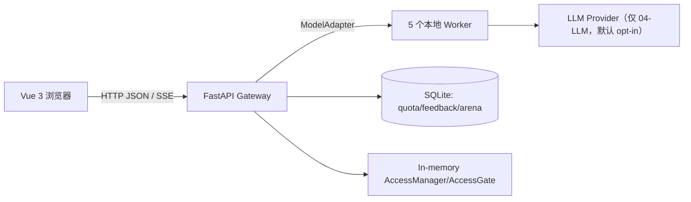
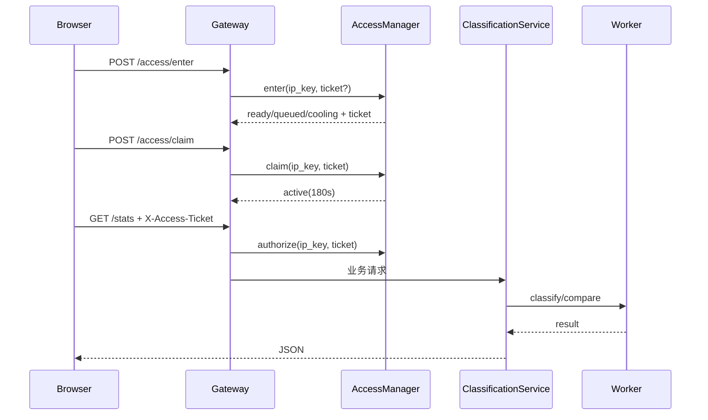

# 项目工程实践与技术学习档案（v7：阶段 4B–5D、访问控制与最终工程复盘）

> 文档版本：`v7-2026-10-25-r3`
> 生成/更新时间：2026-10-25（Asia/Shanghai）
> 最近更新：在 OCR 导航之外补充微博热搜外部导航入口，并更新 F20/F14 回归结果与访问覆盖层限制；提交后状态回填（HEAD `afd3ff2`、工作区干净），并补充 2026-10-25 隔离复跑证据。
> 对应工程：`E:\AIModels\test\TouManFen\TouManFenClassifier`
> 对应代码状态：`main` 分支 HEAD `afd3ff2 feat: complete access control and delivery integration`（2026-10-25 11:47 +0800，与 origin/main 同步）；本文记录的工作已随该提交入库；v7 初稿生成时（11:37）工作区尚未提交，差异见附录 A/D。
> 文档定位：不是日报、周报或聊天记录整理，而是一份**过程可追溯、决策可区分、失败可学习、实现可复现**的工程学习档案。
> 文件关系：仓库已存在 `PROJECT_LEARNING_GUIDE.md`（v1）以及 v2–v6。本文是新的 **v7**，不覆盖 v1–v6。v1–v6 主要覆盖 2026-10-22 之前的训练、Gateway、前端、交付与隔离验收；v7 补齐阶段 4B–5D 的配额、访问控制、前端接入、部署就绪检查以及后续 UI 修复。

---

## 0. 文档信息、覆盖范围与证据边界

### 0.1 文档覆盖范围

本文重点覆盖以下真实工作：

- 阶段 4A/4B/4C：LLM 每 IP 配额、SQLite 审计、离线管理员 CLI、计量边界；
- 阶段 5A：单进程内存访问状态机；
- 阶段 5B：FastAPI access API、业务 API gate、CORS `X-Access-Ticket`；
- 阶段 5C：Vue 前端访问状态、ticket、队列、轮询、claim、倒计时和恢复；
- 阶段 5D-1/5D-2/5D-3：部署就绪检查、启用/回滚文档、安全检查与验收准备；
- 后续针对性修复：模型对比标题输入框、竞技场四个候选等间距、文档中的 `.env` 精确表述；
- 2026-10-25 追加：在“关于 TMF”前增加 OCR 识别（`http://192.168.12.82:8000/#image`）和微博热搜（`http://192.168.12.54:8080/`）两个外部导航入口，并补充相关回归与限制说明。

早期阶段（数据、训练、RF/fastText/BERT/LLM/蒸馏、Flask worker、FastAPI 网关、Vue 页面、SSE、竞技场、反馈、bench、主题与大屏）以仓库中 v1–v6、README、阶段报告和源码为依据，本文不重复抄写全部早期内容。

### 0.2 可获得与不可获得的资料

| 类别 | 实际情况 |
|---|---|
| 当前可访问 | 当前会话上下文、当前工作区源码/配置/测试/文档、Git status/HEAD、已有 v1–v6 学习档案、历史测试输出（会话中可见） |
| 不可完整回放 | DeepSeek Harness 原始 Trajectory/逐事件工具 ID；更早阶段的全部逐轮聊天；某些历史命令的完整 stdout |
| 文档处理方式 | 有当前文件/命令支持的写“已验证事实”；来自更早文档的写“历史记录”；原因解释写“技术分析”；缺证据写“待确认” |

**重要原则**：本文不会把“模型曾经建议”“用户明确选择”“最终实际执行”混为一谈；不会把未执行的测试写成通过；不会把当前工作区状态说成已部署状态。

### 0.3 信息性质标记

- **【已验证事实】**：有当前文件、命令输出、测试报告或其他可访问证据支持。
- **【历史记录】**：来自已有文档或会话陈述，本文未重新逐条回放。
- **【技术分析】**：基于事实的推理、权衡或事后解释。
- **【待确认】**：证据不足，不能当作确定事实。

### 0.4 文档生成时的环境快照

- Python：`3.10.9`（`D:\Miniconda3\envs\py3109\python.exe`）。
- Node：`v24.21.0`，前端使用 Vue 3、TypeScript、Vite；依赖清单见 `frontend/package.json`。
- Gateway 依赖：FastAPI `0.150.0`、Uvicorn `0.54.0`、Pydantic `2.14.1`、httpx `0.28.1` 等，见 `serving/requirements-gateway.txt`。
- 操作系统：Windows；开发/演示包含 LAN、手机、本地 worker 和浏览器。
- v7 初稿生成时（11:37）Git 工作树：本文初次生成前为 94 个状态条目；生成 v7 后为 95；完成 OCR/微博热搜导航与 F14/F20 回归后为 100 个状态条目（包含测试产物更新），无暂存内容。
- v7 初稿记录：运行环境曾通过用户级环境变量持久化 `TMF_ACCESS_CONTROL_ENABLED=true`；用户级 HMAC key 状态为 `PRESENT/VALID`（不记录值）。这只说明配置文件已提供，**不代表真实网关/手机/LAN 已验收**；2026-10-25 提交后复核的用户级/进程环境差异见下段。

**提交后复核（2026-10-25；变量作用域以本段为准）**：

- `git status` 仅 2 个未跟踪 `.lnk`（指向 `E:\AIModels\test\爬虫\start.bat` / `stop.bat` 的快捷方式，非项目内容）；
- 用户级 `TMF_ACCESS_CONTROL_ENABLED=false`，当前父进程环境为 `true`（两者作用域不同，生成时快照未区分，以本段为准，详见附录 D）；
- 用户级 `TMF_LLM_QUOTA_HMAC_KEY` 存在（44 字节，不记录值）；
- 真实网关未启动、access 真实验收仍未完成。

---

## 1. 阅读指南

### 1.1 本文记录什么

- 一个新闻标题 10 类分类项目从“模型训练/多模型服务”到“局域网可演示系统”的演进；
- LLM 计量与访问控制两个高风险边界的实现方式；
- 真实出现过的环境、测试、前端交互、文档和验收问题；
- 关键决策的备选方案、取舍和局限；
- 如何复现隔离测试、如何理解代码和数据流；
- 如何区分“代码存在”“配置已设置”“真实服务已验证”。

### 1.2 本文不记录什么

- 不逐字还原模型内部思维链；
- 不补写未发生的用户选择、命令或测试；
- 不记录真实 API key、Token、密钥、Cookie 或数据库凭据；
- 不把 mock/headless 结果等同于真实手机/真实 LLM/真实 LAN 验收。

### 1.3 推荐阅读路径

- 想理解最终系统：第 5、6 章；
- 想理解访问控制：第 8 章的 D5–D9、第 9.6 节、第 10 章 P4–P7、P10–P11；
- 想学习排障：直接读第 10 章；
- 想复现：第 14 章和第 18 章；
- 想迁移经验：第 13、15、20 章。

---

## 2. 项目概述

### 2.1 业务背景

“投满分”面向新闻/短文本标题的 10 类频道分类，类别包括财经、房产、股票、教育、科技、社会、政治、体育、游戏、娱乐。项目不是单一模型脚本，而是一个可演示、可比较、可评测的工程系统：

- 多种模型：随机森林、fastText、BERT、LLM、蒸馏模型；
- 统一 worker 契约和 FastAPI 网关；
- Vue 3 前端：单条、单模型批量、文件导入、多模型对比、SSE、反馈、竞技场、PK 榜、主题和大屏；
- LLM 配额与访问控制：让演示更可控，同时明确“本地演示”不是生产系统。

### 2.2 项目边界

- 定位为本地/局域网验证型工程，不是带账号认证、HTTPS、生产数据库和安全审计的生产系统；
- LLM 真实 Provider 只做过有限历史调用，未做系统性准确性/成本评估；默认 opt-in；
- 竞技场是人的偏好投票，不是模型准确率；
- 访问控制按 IP 分配名额，不是认证；NAT 下设备共享名额；
- 真实手机/真实 LAN/真实 LLM 的最终验收仍有未完成项。

---

## 3. 原始需求、最终需求与变更

### 3.1 原始目标

1. 完成 10 类新闻标题分类；
2. 完成“数据 → 训练 → 评估 → 部署 → 前端”的完整链路；
3. 展示多个模型的能力差异；
4. 提供本地可演示的 API 和页面；
5. 积累可复现的工程文档和测试证据。

### 3.2 后续追加需求

- 多模型批量分类与 TXT/CSV 本地文件导入；
- `/compare` 与 `/compare/stream` 的对比和流式体验；
- LLM 每 IP 配额、封禁与离线管理员 CLI；
- 5A/5B 的访问名额：10 个 active/ready、50 个 queued、180/15/120/60 秒规则；
- 访问控制与业务 API gate、前端 ticket/排队/冷却 UI；
- 启用/回滚文档、CORS 预检、部署就绪检查；
- 模型对比标题输入框修复；
- 竞技场四个候选的等间距 UI；
- 在主导航“关于 TMF”前增加 OCR 识别外部服务入口，点击跳转到 `http://192.168.12.82:8000/#image`；
- 在 OCR 识别之后、“关于 TMF”之前增加微博热搜入口，点击跳转到 `http://192.168.12.54:8080/`。

### 3.3 关键需求变更

| 变化 | 之前 | 之后 | 触发原因 |
|---|---|---|---|
| 竞技场候选 | 前端旧设计和 mock 仍按 5 个候选 | 后端实际只取 4 个本地模型；UI 改为 4 列、A–D | 阶段 4B 配额设计使竞技场排除 LLM |
| 对比输入 | 切到“多模型对比”后标题输入框消失 | 对比模式保留单标题输入框 | 单标题 × 多模型是对比契约 |
| access 配置说明 | 文档笼统写“不读取 `.env`” | 精确写“不加载 access 配置；stage2 仍读取 `04-LLM/.env` 判断 LLM worker” | 5D-3 核对代码发现文档过宽 |
| SSE | 对 compare 默认使用 EventSource | access 启用时改走带 ticket 的 POST fallback | EventSource 无法设置 `X-Access-Ticket` |

---

## 4. 工程环境与项目结构

### 4.1 主要目录

```text
TouManFenClassifier/
├── 00-data/                  数据与类别定义
├── 01-rf/ ... 05-distill/    模型训练/worker
├── 06-prune/                 剪枝实验
├── serving/
│   ├── gateway/              FastAPI 装配、路由、鉴权/配额/访问 gate
│   ├── services/             分类、配额、访问状态机和业务服务
│   ├── adapters/             HTTP worker、LLM、配额包装
│   ├── config/               models/workers/processes YAML
│   ├── scripts/              启停、验证、离线 CLI
│   └── requirements-gateway.txt
├── frontend/                 Vue 3 + TypeScript + Vite
│   ├── src/api/              统一 HTTP、access、quota 错误映射
│   ├── src/composables/      useClassify/useBatch/useAccess/useArena...
│   ├── src/components/       UI 区块和 access 面板
│   └── tests/                F9/F10/F14/F17/F18/F19/F20 harness
├── tmf_common/               预测契约、网络/CORS 配置
├── 启动TMF.bat / 停止TMF.bat Windows 启停
└── docs/                     契约、验收记录、学习档案
```

### 4.2 环境变量关系

| 变量 | 作用 | 关键约束 |
|---|---|---|
| `TMF_ACCESS_CONTROL_ENABLED` | 访问控制开关 | 默认 false；true 时必须给 key |
| `TMF_LLM_QUOTA_HMAC_KEY` | quota + access IP HMAC 共用 key | 至少 32 字节；只从进程环境读取；不写 `.env` |
| `TMF_ACCESS_STATUS_MIN_INTERVAL_MS` | access status 每 IP 最小轮询间隔 | 0–10000ms，默认 1000 |
| `TMF_CORS_ORIGINS` | CORS 来源 | 禁止 `*`；LAN 来源需覆盖实际设备 |
| `TMF_GATEWAY_HOST`/`PORT` | 网关监听 | 默认 127.0.0.1；LAN 启动脚本覆盖为 0.0.0.0 |
| `TMF_WORKER_HOST` | gateway 调 worker | 默认 127.0.0.1；worker 不暴露 LAN |
| `TMF_DB_PATH` | 反馈/竞技场/配额 SQLite | 正式库不写入；测试用临时库 |

**不要把 access 配置写进 `.env`**：`启动TMF.bat` 和 `stage2.ps1` 不加载 access 配置的 `.env`；网关继承启动它的 shell/用户环境。`stage2.ps1` 读取 `04-LLM/.env` 仅用于判断 LLM worker 是否具备 Provider key。

---

## 5. 最终实现成果总览

### 5.1 已实现并验证过的部分

- 5A 状态机：90 checks PASS；
- 5B access API + gate + CORS：80 checks PASS；
- 4A quota infra：PASS；
- 4B quota gateway：59 checks PASS；
- 4C quota CLI：59 checks PASS；
- F20 前端 access UI：55 checks PASS；compare 输入修复后 56；OCR 导航断言加入后 57；微博热搜导航断言加入后 **58 checks PASS**；
- 外部导航：`NavBar.vue` 在“关于 TMF”前增加 `OCR 识别` 和 `微博热搜`；F20 断言两个 href 分别为 `http://192.168.12.82:8000/#image` 和 `http://192.168.12.54:8080/`，且都可见；
- F19 分类/文件导入 UI：158 checks PASS；
- F10 竞技场：10/10 场景 PASS；改为四模型后 S1 36/36，布局等宽断言 PASS；
- F9 compare/SSE：在显式 `VITE_API_BASE_URL=http://127.0.0.1:18080` 下 68 checks PASS；
- TypeScript type-check：在相应修改后 `TYPECHECK_EXIT=0`。

### 5.2 已实现但尚未做真实环境验收

- 真实网关以 `TMF_ACCESS_CONTROL_ENABLED=true` 启动；
- 真实 LAN/手机访问和 CORS 预检；
- 真实 180 秒租约、60 秒 cooling、120 秒 queued 等待；
- 真实多标签并发 claim/leave；
- 真实 Provider/LLM 的系统性调用（默认不启用）；
- 访问控制开启后的完整业务页面回归。

### 5.3 未实现/受限能力

- 竞技场不使用 LLM（故意排除）；
- 多模型对比只支持单标题，不支持多标题批量 × 多模型；
- 文件导入只服务“多标题 × 单模型”批量分类；
- access 启用时 SSE 不接入，compare 使用 POST fallback；
- 访问控制不能按“本机”白名单豁免；
- 真实用户服务、真实 LAN、真实手机未完成最终验收。

---

## 6. 最终架构与核心业务流程

### 6.1 分层



- 网关是 composition root：负责配置、CORS、request ID、日志、配额、access gate 和 adapter 装配；
- 业务服务不加载模型权重，只通过 `ModelAdapter` 调用 HTTP worker；
- LLM 的唯一入口经过 `QuotaedLlmAdapter`，缺少配额 store 时 fail-closed；
- access manager 在网关进程内存中，只有单 Uvicorn 进程时语义正确。

### 6.2 关键请求流



### 6.3 Access 内存状态

- 10 个 active/ready 唯一 IP；
- FIFO 最多 50 queued；
- ready 15s、active 180s、cooling 60s、queued ticket 120s；
- 轮询不续期；
- 单 `threading.Lock` 保护状态；
- ticket 只保存 SHA-256 哈希，使用常量时间比较；
- 进程重启清空全部状态。

---

## 7. 项目完整实施时间线

| 序号 | 阶段/时间 | 当时目标 | 实际操作 | 遇到的问题 | 关键决策/结果 | 后续影响 |
|---|---|---|---|---|---|---|
| 1 | 2026-10-19～10-22（历史） | 完成训练/模型/前端/交付 | 数据、5 模型、Flask worker、FastAPI、Vue、SSE、反馈、竞技场、bench、v1–v6 文档 | 见 v1–v6 | 形成现有工程基线 | 为 4B–5D 提供可扩展骨架 |
| 2 | 阶段 4A | LLM 韧性、配额基础设施 | HMAC、SQLite quota、审计、测试 | key 缺失/配额边界 | quota fail-closed | 后续 access 复用同一 HMAC 约定 |
| 3 | 阶段 4B | quota 接入分类/compare/stream | `QuotaedLlmAdapter`、预检、CLI | 每 IP 3 次、并发抢额度 | LLM opt-in + 原子 reserve | 竞技场排除 LLM |
| 4 | 阶段 4C | 离线运维 | `manage_llm_quota.py`、测试 | 正式库保护/密钥管理 | 只做离线 CLI | 不新增管理 API |
| 5 | 阶段 5A | 访问状态机 | `AccessManager`、fake clock/ticket 验收 | deadline 0 被 `or` 吞掉、测试时序 | 显式 `is not None`、fake clock | 90 checks PASS |
| 6 | 阶段 5B | access API/gate/CORS | 配置、manager 装配、middleware、路由、CORS、测试 | key 缺失 fail-closed；OPTIONS 断言不足 | 80 checks PASS | 业务 API 可被 ticket 门禁 |
| 7 | 阶段 5C | 前端访问交互 | `useAccess`、access API client、ticket 存储、UI、F20 | cooling 轮询被 enter 饿死、storage 内存缓存掩盖清除、SSE 无 header | 状态机修正；SSE 用 POST fallback | 55 checks PASS |
| 8 | 阶段 5D-1 | 部署就绪检查 | 代码/脚本/env/docs 只读检查 | 当前进程 key 缺失、文档过宽、真实 LAN 未验 | 不启用，报告阻塞 | 需要安全配置 |
| 9 | 阶段 5D-2 | 启用/回滚文档 | 更新根 README、serving README、前后端契约 | `.env` 绝对表述 | 补充检查/回滚/SSE | 文档覆盖部署流程 |
| 10 | 阶段 5D-3 | 安全检查与验收准备 | 检查 AGENTS/代码/服务/环境变量 | key 缺失、.env 精确性、真实 LAN 未验 | 条件不满足，停止 | 后续需隔离 E2E |
| 11 | 后续定向修复 | 文档精确性/模型对比/竞技场 | 修正“不读取 .env”为精确表述；对比输入框；四模型等宽 | 前端条件与后端契约不一致 | 文档、F20/F10 回归通过 | UI/文档与当前代码一致 |
| 12 | 2026-10-25 OCR 导航 | 在现有导航中直达外部 OCR 服务 | 在 `NavBar.vue` 的“关于 TMF”前增加 `OCR 识别`，链接 `http://192.168.12.82:8000/#image`；同步 F14 Tab 顺序与 F20 OCR 断言 | access overlay 会遮挡导航；未连接外部 OCR 验证 | 不修改框架，仅加导航项 | F20 57/57；F14 nav-specific pass，整体因 access overlay 仍失败 |
| 13 | 2026-10-25 微博热搜导航 | 在现有导航中直达外部微博热搜服务 | 在 OCR 之后、“关于 TMF”之前增加 `微博热搜`，链接 `http://192.168.12.54:8080/`；同步 F14 Tab 顺序与 F20 断言 | 同上，access overlay 遮挡；未连接外部服务验证 | 只加导航项 | F20 58/58；F14 nav/mobile 子项通过，整体仍受 access overlay 影响 |
| 14 | 最终状态（2026-10-25 11:47 提交） | 准备真实启用 | 11:47 提交 `afd3ff2`；复核用户级 flag 为 `false`（父进程环境 `true`），key `PRESENT/VALID`；真实服务未启动 | 真实 LAN/手机/180s 尚未验收 | 功能条件具备，运行验收未完成 | 下一步真实 E2E/部署 |

时间线说明：2026-10-25 的 access 配置属于运行环境快照（变量作用域见 0.4 提交后复核与附录 D），不是 Git 源码提交；11:47 已提交 `afd3ff2`，但真实服务状态没有被本档案重新启用或验证。

---

## 8. 核心技术决策档案

### D1：FastAPI 网关 + adapter composition root，而不是前端直连 worker

- **背景**：5 个 worker 技术栈不同、端口不同；前端需要统一错误/超时/request ID/CORS。
- **备选**：前端直连 worker；每个 worker 自带前端 API；统一网关。
- **选择**：统一 FastAPI 网关；worker 只暴露 `predict_api`，网关使用 `ModelAdapter`。
- **收益**：可替换 adapter、隔离模型依赖、统一配额/访问/日志。
- **成本**：多一跳网络；网关成为编排和配置中心。
- **证据**：`serving/gateway/main.py`、`serving/adapters/*`。

### D2：对比和批量是两个不同契约，不合并

- **背景**：对比需要多模型对同一标题；批量需要多标题、每批一个模型。
- **选择**：`/compare` 的 `title` 是单个字符串；`/classify/batch` 的 `model` 是单个字符串，`items` 是标题数组。
- **原因**：结果 UI、并发、超时、LLM 配额和错误模型不同；批量还明确拒绝 LLM。
- **后果**：当前不能“多标题 × 多模型”；这不是 UI 不小心漏掉，而是契约未定义。
- **可迁移经验**：先定义结果矩阵和失败粒度，再决定是否合并接口。

### D3：文件导入在浏览器本地解析

- **背景**：用户数据是 TXT/CSV，不应上传原始文件或把标题写入日志。
- **选择**：前端 `titleFiles.ts`/`FileImportPanel` 本地解析，只把规范化标题进入批量 JSON。
- **收益**：文件字节不离开浏览器；边界可控；可做预览/坏行确认。
- **限制**：只接单模型批量；不支持多标题 × 多模型；不支持任意编码/无限大小。
- **证据**：`frontend/src/utils/titleFiles.ts`、`frontend/tests/f19`。

### D4：LLM quota 采用每 IP SQLite + HMAC，而非全局计数

- **背景**：LLM 可能计费，演示需要限制每 IP 3 次。
- **选择**：用 HMAC(key, IP) 作为索引；SQLite 事务原子 reserve；失败不退款；CLI 离线管理。
- **收益**：不保存明文 IP；并发下可计数；便于审计。
- **代价**：key 轮换会改变所有 IP 索引；正式库需保护；quota 不是鉴权。
- **证据**：`quota_config.py`、`services/llm_quota.py`、`manage_llm_quota.py`。

### D5：access 状态用单进程内存 manager，限制单 Uvicorn

- **背景**：10 个名额、FIFO、冷却和 ticket 都是短生命周期演示状态；不需要 DB 持久化。
- **选择**：`AccessManager` + `threading.Lock`；状态随进程重启清空。
- **收益**：简单、无需迁移；失败清空是显式语义。
- **代价**：不能多 worker；不能跨进程共享；重启后 ticket 全失效。
- **证据**：`serving/services/access.py`、`stage2.ps1` 无 `--workers`。

### D6：ticket 只走 `X-Access-Ticket`，服务端只存哈希

- **背景**：不能把 ticket 放 URL、日志或普通存储；需要防止伪造。
- **选择**：32 字节随机 token；服务端 SHA-256；常量时间比较；按 IP HMAC key 绑定。
- **收益**：URL/日志不泄露；跨 IP 不可用；数据库/内存泄露不直接暴露 ticket。
- **限制**：浏览器刷新需本地存储；SSE 不能带头；前端存储不是安全边界。

### D7：CORS 精确允许 `X-Access-Ticket`

- **背景**：跨源前端必须做 preflight；access 启用后所有业务请求带自定义头。
- **选择**：`allow_headers` 包含 `Content-Type`、`X-Request-ID`、`X-Access-Ticket`；`allow_origins` 只来自配置。
- **验证**：F9/F20 与 5B CORS 预检（GET/POST）通过；不是只观察 OPTIONS 未被 gate 拦。
- **证据**：`serving/gateway/main.py` CORS 段。

### D8：前端 access 用本地状态协调，而非每页重复 enter

- **背景**：页面导航不能丢失 active 倒计时或反复 enter。
- **选择**：根 `useAccess` 保存状态/ticket/计时器；业务内容仅在 disabled/active 挂载；`sessionStorage` 不合适，改用 `localStorage` + fallback。
- **收益**：页面级共享、刷新恢复、同源标签共享；切换模式不重复名额。
- **代价**：需处理 storage event、旧响应、多标签 claim 幂等和 poll 退避。

### D9：access 启用时 compare 不使用 EventSource，改 POST fallback

- **背景**：`EventSource` API 不支持自定义请求头，无法携带 ticket。
- **备选**：ticket 放 URL（拒绝）；cookie（后端不支持，且引入认证语义）；改 fetch streaming（需要新后端协议）；退回 POST。
- **选择**：保留 access 关闭时的 SSE；access 启用时前端不建立 EventSource，compare 走带 ticket 的 POST。
- **收益**：不绕过 gate、不泄露 URL ticket、无需修改后端契约。
- **代价**：失去渐进式流式体验；这是明确的功能降级，不是隐藏 bug。
- **证据**：`useAccess.streamAllowed`、`ClassifyPanel` 的 `compareStreamEnabled`、F20 场景。

### D10：竞技场排除 LLM

- **背景**：竞技场刷新会自动调用多个候选；LLM 有每 IP 配额、Provider 成本和稳定性问题。
- **选择**：`ArenaService._model_ids()` 过滤 `llm`/`worker_id=llm`；只用 4 个本地模型。
- **收益**：刷新不隐式消耗配额，不依赖 Provider；匿名比较更稳定。
- **代价**：竞技场看不到 LLM；若未来需要，必须另行设计 opt-in。
- **证据**：`serving/services/arena.py` `_model_ids()`。

### D11：配置通过进程/用户环境注入，不读取 access `.env`

- **背景**：用户习惯把配置放 `.env`，但启动脚本没有 access dotenv loader。
- **实际行为**：`access_config.py` 读 `os.environ`；`stage2.ps1`/`启动TMF.bat` 继承启动环境；`stage2.ps1` 只读取 `04-LLM/.env` 的 `DEEPSEEK_API_KEY` 决定 LLM worker。
- **选择**：文档明确“access 配置不来自 `.env`”；用户需要同一 shell/用户环境。
- **后果**：双击启动需要 Explorer 刷新环境或用户级持久变量；仅改 `.env` 不生效。

### D12：隔离测试优先于真实服务

- **背景**：用户服务不应被测试启停；LLM Provider 可能计费；正式 DB 不能碰。
- **选择**：FastAPI `TestClient`、临时 SQLite、fake clock/ticket、F9/F10/F19/F20 mock + Edge headless。
- **收益**：可重复、无真实副作用；可以覆盖异常/并发/UI。
- **限制**：不能证明真实 LAN、真实手机、真实 Provider；需要明确标注。

---

## 9. 核心模块逐步实现教程

### 9.1 网关与 adapter

**解决什么问题**：前端只面对一个 API，worker 的端口/协议/错误差异被隔离。

- 输入：HTTP 请求、模型注册表、settings；
- 网关装配：`compose` adapter、业务服务、stats、probes、CORS、access；
- 输出：统一 JSON 错误/响应；
- 边界：worker 不加载在网关；网关不读取 LLM Provider key；worker 仅 loopback；
- 常见错误：把 worker 暴露 LAN；在网关 import 模型；缺少 worker 却让网关启动失败。

### 9.2 分类/对比/批量

- `/classify`：一个 title + 一个 model；
- `/compare`：一个 title + models 列表，返回逐模型结果；
- `/compare/stream`：同 title 的 SSE，事件 `model/summary/done/error`；
- `/classify/batch`：多 items + 单 model，30s 总时限、100 条上限、LLM 预检拒绝。
- **教学点**：对比是“结果矩阵行=模型”；批量是“行=标题”；两种失败粒度（模型失败 vs 条目失败）不同，不能简单合成。

### 9.3 LLM quota

- `QuotaedLlmAdapter` 是唯一 LLM 包装；
- 预检在 fanout 前，避免启动本地模型后才发现 quota 用完；
- 真正调用前原子 reserve；并发最后一个额度由 SQLite 事务决定；
- store 不可用时 fail-closed（503），不退回未保护 LLM；
- 审计事件包含操作/used before/after，不包含 key。

### 9.4 access manager

- `enter`：冷却优先；已有记录复用；无空位入 FIFO；队列满返回 `queue_full`；
- `claim`：ready 15s 内转 active；重复 claim 幂等，不重置 180s；
- `sweep`：过期清理并晋级队列；
- `leave/cancel`：释放名额/位置，不进入冷却；
- `status`：不续期；
- 正确性关键：所有状态变更在锁内；时间使用 high-water，时间回拨不延长 TTL。

### 9.5 access gate 与 API

- `is_access_exempt`：OPTIONS、health/readyz、access/*；
- `AccessGate._ip_key`：domain-separated HMAC；
- `authorize`：只允许 active；queued/ready/cooling/expired 映射稳定错误；
- middleware：gate 在 handler 前，失败不执行业务；
- 启停：flag false 不创建 manager；flag true 初始化失败即启动失败。

### 9.6 前端 access 状态机

- `useAccess` 是单例级应用状态：初始化、操作、轮询、计时、恢复；
- `enter` → ready → claim → active；
- active 本地倒计时仅展示，服务端 `remaining_seconds` 是权威；
- queued 每 2s+jitter 轮询，隐藏页 8s；
- cooling 由 ticker 到点 status，避免 enter 反复重置 deadline；
- storage event 用 `event.newValue`，不能用内存缓存读取，否则看不到其他标签的清除；
- 业务 API 自动注入 ticket；access API 不自动复用旧 ticket；
- 业务 403 `ACCESS_REQUIRED`/`TICKET_INVALID` 触发恢复，不静默重试。

### 9.7 前端对比/批量/文件导入

- 对比模式显示单个 InputBox，models 多选；
- 批量模式显示 BatchInputBox/FileImportPanel；文件本地解析；
- `submitCompareStream()` 在 access 启用或 EventSource 不支持时返回 false，`onSubmit` 退回 `submit()` POST；
- 注意比较：如果只改样式而不改条件，输入框可能消失；如果只改后端而不同步 UI 文案/网格，会出现“5 列但 4 个候选”。

### 9.8 竞技场

- `ArenaService` 抽题 + 并发调用 4 个本地模型；
- 匿名 candidates 不含 model_id；
- 投票后才揭晓；
- 榜单预热/正式名次；
- UI 使用动态 `--arena-columns`，正常 4 列等宽，partial 3 列等宽；
- 旧文案“5 个”是契约变化后的遗留，需要随后端模型集合更新。

### 9.9 外部服务导航（OCR + 微博热搜）

- 需求：在主导航“关于 TMF”前增加 `OCR 识别` 和 `微博热搜`，分别直达 `http://192.168.12.82:8000/#image` 与 `http://192.168.12.54:8080/`；
- 实现：仅在 `NavBar.vue` 增加两个普通 `<a href>`，不引入路由、不调用外部 API、不修改后端或框架；
- 导航顺序：分类实验台 → 模型矩阵 → 竞技场 → PK 榜单 → OCR 识别 → 微博热搜 → 关于 TMF；
- 桌面和移动端折叠菜单都来自同一个 `primary-nav`，因此自动包含两个入口；
- F20 分别断言两个链接存在、可见、href 精确；F14 同步 Tab 顺序并在移动菜单中确认两项都存在；
- **限制**：access overlay 是全局 fixed 层，覆盖导航；当访问控制未 active（排队/冷却/错误）时，两个外部导航都不可点击。若产品要求外部服务在排队时仍可访问，需要单独设计 access overlay 的例外，而不是本次“只加导航项”的范围。

---

## 10. 关键问题与踩坑案例库

### 问题案例 P1：F9 测试访问了错误的 API base

**1. 背景**：F9 是 SSE compare 的前端 harness，mock server 在 `127.0.0.1:18080`；需要构建 harness 指向本地 mock。

**2. 症状**：F9 运行失败，SSE/POST 请求访问既有 LAN 地址 `http://192.168.12.54:8000`，无法得到 mock 事件；失败断言 26 条。

**3. 预期/实际**：预期请求 18080 mock；实际请求非 mock 生产式地址。

**4. 发现方式**：F9 headless 网络日志/构建产物显示错误 base。

**5. 排查**：检查 `run-scenarios.mjs`、`vite.harness.config.mjs`、env 文件；确认 mock 端口 18080；在构建前显式设置 `VITE_API_BASE_URL=http://127.0.0.1:18080` 后重新构建，bundle 和请求均变为 18080。

**6. 根因**：当前构建环境被既有 `VITE_API_BASE_URL`/`.env.local` 覆盖；测试 harness 的环境隔离没有在当前进程生效。**这是已验证的环境覆盖问题，不是 F9 业务断言错误。**

**7. 尝试过的方案**：直接运行（失败）；显式 process env（通过）。没有修改测试断言来掩盖错误。

**8. 模型/用户选择**：用户要求定向回归，明确不修改测试源码；最终采用环境变量注入。

**9. 解决方案**：同一 shell/process 设置 mock API base，运行 F9；F9 68 checks PASS。

**10. 为什么有效**：Vite 构建时的 `import.meta.env.VITE_API_BASE_URL` 决定浏览器 bundle 的 API base；进程环境在构建时注入后，所有请求指向 mock。

**11. 验证**：F9 68/68 PASS；bundle 中 18080 计数 1、192.168 计数 0；report `serverPort=18080`。

**12. 局限**：不证明测试脚本在没有环境覆盖时自动隔离；未来应在 harness runner 内固定该变量。

**13. 经验**：测试失败先确认实际网络目标，而不是先改断言；构建时环境变量和运行时端口必须显式校验。

---

### 问题案例 P2：5A 中 `deadline = x or now` 让零值失效

**1. 背景**：访问状态机需要计算 queued/active/ready 的剩余时间。

**2. 症状**：queued 剩余时间出现 120 秒而非预期的 60 秒（或状态转换错误）；测试失败。

**3. 预期/实际**：按状态 deadline 计算；实际 `0.0 or now` 得到 now，零值 deadline 被吞掉。

**4. 发现方式**：fake clock 的 5A 测试暴露。

**5. 排查**：检查 `_result_locked` 的 deadline 表达式，发现 Python 空值语义把 `0.0` 当 false。

**6. 根因**：使用 `x or now` 表达“没有 deadline 就用 now”，但 `0.0` 是合法的 deadline。

**7. 尝试/修复**：改为显式 `x is not None` 判断，并为 active/ready/queued/cooling 分别处理。

**8. 选择**：模型修复；用户未参与具体代码选择。

**9. 最终方案**：显式 None 检查 + fake clock 验证。

**10. 为什么有效**：保留零值 deadline，避免时间基准被替换；状态机在 fake clock 下可确定测试。

**11. 验证**：5A 90 checks PASS。

**12. 局限**：需要所有 TTL 分支持续测试，避免类似布尔短路。

**13. 经验**：涉及时间/计数/空值的 `or` 是高风险；应显式区分 `None` 和合法零值。

---

### 问题案例 P3：测试 fake classifier 让批量 API 返回 500

**1. 背景**：5B 测试为 SSE 注入 fake classifier；同一 app 随后调用 batch 测试。

**2. 症状**：batch LLM 预期 400 `BATCH_LLM_NOT_ALLOWED`，实际 500 `INTERNAL_ERROR`。

**3. 预期/实际**：业务层应在调用 worker 前拒绝 LLM；实际 fake classifier 缺少 `classify_batch` 方法，属性错误冒泡为 500。

**4. 发现方式**：5B 测试断言失败，查看响应码与 fake 实现。

**5. 排查**：确认测试在 batch 之前全局替换了 classifier；fake 只实现了 stream 所需接口；batch 调用 fake 不存在的方法。

**6. 根因**：测试夹具范围过大，把“为 stream 注入 fake”扩散到 batch；不是生产 batch 逻辑错误。

**7. 尝试/修复**：batch 测试使用真实 classifier；只在 SSE 场景安装 fake classifier；fake 保持最小接口。

**8. 选择**：测试隔离修复；生产代码未改。

**9. 最终方案**：按场景安装 fake，或给 fake 补齐契约方法。

**10. 为什么有效**：测试不再改变无关路由的依赖图；batch 的真实业务预检得以执行。

**11. 验证**：5B 80 checks PASS。

**12. 局限**：任何全局替换依赖都有跨场景污染风险。

**13. 经验**：fake 应实现其被测契约的全部方法；测试夹具应尽量局部化；500 优先怀疑夹具，而不是先改业务异常处理。

---

### 问题案例 P4：访问控制启用时 key 缺失导致启动失败

**1. 背景**：5B/5D 要求 flag true 时使用 HMAC key 初始化 access manager。

**2. 症状**：当前检查进程 key `MISSING`；若此时启动真实网关，预期启动失败（fail-closed），业务不可用。

**3. 预期/实际**：预期必须提供 ≥32 字节 key；实际环境尚未提供。

**4. 发现方式**：5D-1/5D-3 安全标签检查、`access_config.load_access_settings` 代码核对。

**5. 排查**：确认 key 从 `os.environ` 读取；flag true 时不回退；`main.py` 将 `AccessConfigError` 转为 `ConfigError`；`stage2` 不一定立即发现，但 gateway 会失败。

**6. 根因**：运行配置缺失，不是代码 bug；fail-closed 是预期行为。

**7. 尝试**：没有生成/设置真实 key；没有用测试 key 启动真实服务。文档记录安全配置步骤。

**8. 用户选择**：先不启用/未提供 key；后续用户要求将 flag 持久化为 true，但真实服务仍未验证。

**9. 最终方案**：用户需在启动环境设置有效 key；本轮只准备步骤。

**10. 为什么有效**：缺失 key 时拒绝启动，避免访问控制被误以为已生效。

**11. 验证**：配置检查标签；无真实启动验证。

**12. 局限**：用户级 key/flag 与当前 Agent 进程状态可能不同；真实服务状态未知。

**13. 经验**：安全开关必须 fail-closed；不要用假 key/空值“先启动看看”；配置检查只输出 VALID/INVALID。

---

### 问题案例 P5：早期 CORS 测试只断言 OPTIONS 未被 gate 拦截

**1. 背景**：access 启用后业务请求带 `X-Access-Ticket`，跨源浏览器先发 preflight。

**2. 症状**：仅检查 `OPTIONS` 状态不等于 403，不能证明 `Access-Control-Allow-Headers` 包含 ticket。

**3. 预期/实际**：需要真实 `Origin` + `Access-Control-Request-Method/Headers`；实际初始测试不足。

**4. 发现方式**：定向 CORS 检查要求真实 preflight。

**5. 排查**：检查 `CORSMiddleware` allow_headers；用 TestClient 发 GET/POST preflight，读取 allow-origin/method/headers。

**6. 根因**：测试断言覆盖面不足，不是运行时 CORS 配置缺失。

**7. 尝试/修复**：增加真实 CORS preflight 断言。

**8. 选择**：只补测试，不改生产 CORS（已正确）。

**9. 最终方案**：GET/POST preflight 200；origin/method/headers 全部允许。

**10. 为什么有效**：cors middleware 在 access middleware 外层处理 preflight；真实头验证了浏览器所需条件。

**11. 验证**：5B 80 checks PASS。

**12. 局限**：未在真实 LAN/手机 origin 上重复；F20 同源不测 CORS。

**13. 经验**：CORS 测试必须检查响应头，而不是只看 OPTIONS 路由状态。

---

### 问题案例 P6：5C cooling 倒计时被 `enter` 反复重置，轮询被饿死

**1. 背景**：cooling 60s，ticker 到 0 后需要恢复。

**2. 症状**：F20 cooling 场景 8 秒内无法到达 active，面板一直 cooling。

**3. 预期/实际**：cooling 到期后应 status/claim 恢复；实际 tick 到 0 调 `enter`，mock 每次返回 cooling+1.5s，重置 deadline；2s 轮询 generation 被 enter 失效，轮询永远没有机会。

**4. 发现方式**：F20 场景超时；分析 timer 和网络日志。

**5. 排查**：检查 `tick()`、`enterFlow()`、`schedulePoll()` 的 generation；发现每次 enter 都递增 generation 并重置 deadline，导致旧 poll 被丢弃；新的 poll 在 2s 后才到，又被下一次 tick 的 enter 覆盖。

**6. 根因**：恢复动作选择错误（用 enter 而不是 status）导致自激重置；不是服务端冷却错误。

**7. 尝试/修复**：cooling 到 0 改为 `refreshStatus()`；由 status 返回 ready 后 claim。

**8. 选择**：模型修复；用户要求验证冷却交互。

**9. 最终方案**：tick cooling → status；status 成功 ready → claim；保留服务端 TTL 权威。

**10. 为什么有效**：status 不改变 deadline、不创建新冷却；轮询不再被 enter 的 generation 反复作废。

**11. 验证**：F20 cooling 场景 PASS，最终 55/55（后续 56）。

**12. 局限**：网络慢/服务端状态不稳定时仍需退避；status 频繁失败会进入错误恢复。

**13. 经验**：倒计时到点不要“猜状态并写状态”；用服务端状态查询做状态迁移；警惕 timer 与请求 generation 的相互覆盖。

---

### 问题案例 P7：storage 事件被内存 ticket 掩盖

**1. 背景**：同源多标签通过 localStorage 共享 ticket；其他标签 leave/clear 后本标签要恢复。

**2. 症状**：模拟 `storage` clear 后不触发恢复，waitFor timeout。

**3. 预期/实际**：`storage` 事件 newValue=null 应触发 enter；实际 `readAccessTicket()` 优先返回本标签内存缓存，读不到清除，误以为 ticket 未变。

**4. 发现方式**：F20 storage 失效场景超时；检查 `onStorage` 与 `readAccessTicket`。

**5. 排查**：`readAccessTicket` 的 memoryTicket 优先于 localStorage；本标签内存仍是旧值；`event.newValue` 未使用。

**6. 根因**：缓存一致性设计错误；storage event 的语义是外部状态变化，不能再用本进程缓存判断。

**7. 修复**：`onStorage` 直接使用 `event.newValue`；null → recover；新值 → storeTicket + refreshStatus。

**8. 选择**：模型修复；用户要求多标签行为。

**9. 最终方案**：事件值优先；内存只作为无事件时的缓存。

**10. 为什么有效**：外部清除不再被本标签缓存遮蔽；恢复流程清除旧状态并重新 enter。

**11. 验证**：F20 storage 场景 PASS；最终 55/55。

**12. 局限**：sessionStorage fallback 不跨标签；storage 不可用时刷新会重新 enter。

**13. 经验**：缓存和事件同时存在时，事件处理要以事件携带的新值为准；不要用“读当前缓存”判断外部变化。

---

### 问题案例 P8：模型对比输入框消失

**1. 背景**：用户切换到“模型对比”需要输入标题。

**2. 症状**：对比模式只显示模型选择，没有标题输入框，无法提交。

**3. 预期/实际**：应保留一个标题输入框；实际 `InputBox` 条件仅 `mode==='single' && titleMode==='single'`。

**4. 发现方式**：代码审查/用户反馈；F20 对比场景初始未在切换后检查输入框。

**5. 排查**：检查 `ClassifyPanel` 的 `v-else-if` 链；对比模式不满足 Batch/File/Imported 条件，也不满足 InputBox 条件。

**6. 根因**：单条/多条输入设计在加对比模式时漏掉 compare 分支。

**7. 修复**：条件改为 `mode === 'compare' || (mode === 'single' && titleMode === 'single')`；F20 改为切换 compare 后断言 `#news-title` 可见、输入并提交。

**8. 选择**：模型修复；用户明确提出。

**9. 最终方案**：对比复用单标题 state，不复制组件。

**10. 为什么有效**：v-if 条件覆盖 compare；对比提交仍读同一 title/selectedModels。

**11. 验证**：`TYPECHECK_EXIT=0`；F20 56/56；新增 PASS “title input remains visible”。

**12. 局限**：多标题对比仍不支持；SSE 启用时 POST fallback。

**13. 经验**：模式切换要检查所有输入组件的 v-if/v-else 覆盖；用“切换后”而非“切换前”断言。

---

### 问题案例 P9：竞技场 4 个模型却按 5 列布局和 5 个文案展示

**1. 背景**：后端 `ArenaService._model_ids()` 排除 LLM，只 4 个本地模型。

**2. 症状**：4 张卡片放在 `repeat(5)` 网格中，右侧留空、间距不等；文案仍写“5 个匿名结果”；F10 mock 仍返回 5 个（含 LLM）。

**3. 预期/实际**：应展示 4 个等间距候选；实际旧 UI 和测试数据是 5 模型时代。

**4. 发现方式**：用户提供截图；代码搜索 `repeat(5)` 和文案；F10 mock/test 仍有 5。

**5. 排查**：确认后端过滤逻辑；确认 `LETTERS` A–E、`grid-template-columns: repeat(5)`、F10 MODELS 包含 LLM。

**6. 根因**：后端契约在阶段 4B 改成 4 个本地模型，但前端布局、文案和测试 mock 未同步。

**7. 修复**：A–D；动态 `--arena-columns`（max4）；文案 4；F10 mock 4、partial3；测试更新为 4 卡片/4 行/rank1..4，新增等宽断言。

**8. 选择**：用户要求修改 UI 设计；模型执行。

**9. 最终方案**：正常 4 列等宽；partial 3 列等宽；F10 mock 与真实后端一致。

**10. 为什么有效**：CSS Grid 列数由实际候选数决定；测试数据不再包含被后端过滤的 LLM；视觉和契约一致。

**11. 验证**：F10 10/10 场景 PASS；S1 36/36；宽度 `[145,145,145,145.015625]`，columns=4；`TYPECHECK_EXIT=0`。

**12. 局限**：真实 760/390 布局为 2 列自适应；没有真实手机视觉验收。

**13. 经验**：后端模型集合变化必须同步前端文案、网格、测试 mock；布局测试要测计算后的列数和实际宽度，不只是卡片数量。

---

### 问题案例 P10：`.env` 文档表述过宽

**1. 背景**：5D-2 文档写“启动脚本不读取 `.env`”。

**2. 症状**：严格核对发现 `stage2.ps1` 读取 `04-LLM/.env` 的 `DEEPSEEK_API_KEY` 判断 LLM worker；前半句若理解为“完全不读任何 `.env`”不准确。

**3. 预期/实际**：access 配置不来自 `.env`；但 stage2 确实读取 `04-LLM/.env`（仅 LLM worker 判定）。

**4. 发现方式**：5D-3 代码/脚本核对。

**5. 排查**：搜索 `.env` 引用；定位 `Test-LlmLocalConfig()` 和 `Start-Worker` 的调用。

**6. 根因**：文档把“access 配置文件”简化成“所有 `.env`”。

**7. 修复**：README、serving README、前端对接说明改为“启动脚本不会从 `.env` 加载 access 配置；stage2 会读取 `04-LLM/.env` 的 DEEPSEEK_API_KEY，仅用于 LLM worker 判定”。

**8. 选择**：用户要求定向修正；只改三处直接相关句子。

**9. 最终方案**：精确限定范围。

**10. 为什么有效**：读者知道 access 变量必须进程环境，同时不会误解 stage2 完全没有任何 dotenv 读取。

**11. 验证**：`git diff --check=0`；三处替换；未改代码。

**12. 局限**：未重新验证真实启动日志。

**13. 经验**：文档中的“从不/全部”是高风险词；用“不加载 access 配置”限定语义。

---

### 问题案例 P11：SSE 无法携带 `X-Access-Ticket`

**1. 背景**：access 启用后业务请求需要 ticket；F9 使用 EventSource。

**2. 症状/限制**：浏览器 `EventSource` 构造函数不支持自定义 header；若直接保留 SSE，请求无 ticket，会被 gate 拒绝。

**3. 预期/实际**：不能把 ticket 放 URL（安全要求）；不能改后端契约；需要安全降级。

**4. 发现方式**：前端 API 设计检查 + 5C 需求明确要求核对。

**5. 备选**：URL ticket（拒绝）；cookie（后端无此契约）；fetch streaming（需新协议）；POST fallback。

**6. 选择**：access 启用时 `streamAllowed=false`，compare 使用受 gate 的 `POST /compare`；access 关闭时保留 SSE。

**7. 为什么有效**：POST 是 fetch，统一 client 自动注入 header；仍通过同一 access gate；无 URL 泄露。

**8. 验证**：F20 active compare 场景确认 POST fallback，未发 `/compare/stream`，POST 带 ticket。

**9. 局限**：没有渐进式流式体验；如果产品要求 SSE，需要后端/前端协议改造。

**10. 经验**：浏览器原生 API 的限制不能靠“看起来能用”绕过；安全降级必须保留在同一权限边界内。

---

### 问题案例 P12：外部服务导航与 access overlay 的交互限制

**1. 背景**：用户要求在主导航“关于 TMF”前增加 `OCR 识别` 和 `微博热搜`，分别访问已有服务 `http://192.168.12.82:8000/#image` 与 `http://192.168.12.54:8080/`，并要求不改项目框架。

**2. 症状/限制**：两个链接已加入桌面和移动导航；在 access 启用且页面未 active 时，全局 access overlay（`position: fixed; inset: 0; z-index: 160`）覆盖整个页面，导航栏（z-index 20）也被遮挡，两个外部链接不能点击。

**3. 预期/实际**：预期用户点击导航直接跳转外部服务；实际在 access active/disabled 时可用；在 queued/cooling/error 时被 access 层遮挡。没有修改该交互，因为用户要求只加导航、不改框架。

**4. 发现方式**：实现后检查 access overlay 的 z-index 和 DOM 层级；F14 运行时页面被 access overlay 遮挡，`#lab/#models/#about` 找不到，S2/S5 也因内容不可见失败。

**5. 排查**：检查 `NavBar.vue` 与 `AccessGatePanel`；确认 overlay 是全局 fixed 层，没有为外部链接豁免；F14 mock 未提供 access API，导致页面进入错误 overlay。

**6. 根因**：新增外部导航位于全局导航栏，但 access overlay 设计目标是“在未获得名额前遮住整个业务页面”；导航没有例外通道。直接原因不是链接本身，而是 overlay 与导航的层级/产品规则。

**7. 尝试/修复**：仅加两个链接、F14 Tab 顺序和 F20 断言；没有修改 overlay 或框架。

**8. 模型/用户选择**：用户明确选择“只加导航项、不改框架”；模型遵守该边界并记录限制。

**9. 最终方案**：`OCR 识别` 与 `微博热搜` 均使用普通 `<a href>`，放在“关于 TMF”前；同标签页跳转，未做 target blank。

**10. 为什么有效**：普通 anchor 由浏览器直接导航，不需要网关、CORS 或外部 API 接入；导航组件同时覆盖桌面和移动菜单。

**11. 验证**：`TYPECHECK_EXIT=0`；F20 58/58，两个外部链接断言 PASS；F14 Tab 顺序（含两个链接）和移动菜单通过；F14 整体仍因 access overlay 有 7 条失败（不是新增链接导致）。

**12. 局限**：access 未 active 时两个链接都不可点击；硬编码 LAN IP；未连接 OCR/微博服务验证可达；同标签页会离开 TMF；如果外部服务需要登录/跨域，未处理。

**13. 经验**：全局遮罩层增加“外部链接”时，必须明确它是否应绕过遮罩；只加 `href` 不代表在排队状态下可用；测试要区分“链接存在/可见”与“在 overlay 下可操作”。

---

## 11. 重要方案变更与返工分析

| 方案变化 | 触发原因 | 是否返工 | 教训 |
|---|---|---|---|
| 竞技场 5 个候选 → 4 个本地候选 | 后端阶段 4B 排除 LLM | 是（UI/mock/test） | 契约变更必须同步所有表现层和测试数据 |
| compare 单标题输入消失 → 保留输入 | 对比模式条件漏分支 | 是（前端） | 模式切换要覆盖所有输入组件 |
| 5D-2 “不读取 .env” → 精确限定 | 代码核对 `04-LLM/.env` | 是（文档） | 文档要限定变量范围而非绝对化 |
| SSE → access 启用时 POST fallback | EventSource 无法带头 | 设计降级 | 不能把 ticket 放 URL；降级仍走同一 gate |
| 5C cooling 由 enter 重置 → status 恢复 | 轮询被饿死 | 是（前端状态机） | 状态迁移应基于服务端查询，不使用会重置 TTL 的 enter |
| storage 读取内存缓存 → event.newValue | 外部清除不可见 | 是（前端） | 事件值是外部变更的权威 |
| 导航新增 OCR/微博热搜 → 与 access overlay 共存 | 用户要求仅加链接、不改框架 | 部分（链接可用；排队遮罩仍挡住） | 全局遮罩下的外部链接需单独产品规则 |

没有证据表明以下事项发生了：真实生产部署切换、真实 Provider 的大量调用、真实手机验收。不得把准备步骤当成已完成。

---

## 12. 测试、验证与验收证据

### 12.1 已实际验证通过（来自本会话历史输出）

| 需求/模块 | 验证方法 | 结果 | 证据 |
|---|---|---|---|
| 5A 状态机 | `verify_access_state.py`（fake clock/ticket） | 90 checks PASS | 会话工具输出 |
| 5B access API/gate/CORS | `verify_access_gateway.py`（TestClient/临时环境） | 80 checks PASS | 会话工具输出 |
| 4A quota infra | `verify_llm_quota_infra.py` | PASS | 会话工具输出 |
| 4B quota gateway | `verify_llm_quota_gateway.py` | 59 checks PASS | 会话工具输出 |
| 4C quota CLI | `verify_llm_quota_cli.py` | 59 checks PASS | 会话工具输出 |
| 5C access UI | `tests/f20/run-scenarios.mjs` | 55 checks PASS；compare 修复后 56；OCR 导航后 57；微博热搜后 **58 checks PASS** | 会话工具输出 |
| 外部导航入口 | F20 active 场景 + F14 Tab/移动菜单 | 两个 href 正确、可见；Tab 顺序含 OCR/微博热搜；F14 整体仍受 access overlay 影响 | 会话工具输出 |
| 分类/文件导入 | `tests/f19/run-scenarios.mjs` | 158 checks PASS | 会话工具输出 |
| 竞技场（四候选） | `tests/f10/run-scenarios.mjs` | 10/10 场景 PASS；S1 36/36 | 会话工具输出 |
| compare SSE | `tests/f9/run-scenarios.mjs`（显式 18080） | 68 checks PASS | 会话工具输出 |
| type-check | `vue-tsc --noEmit` | exit 0 | 会话工具输出 |

### 12.2 已实际验证失败过、后来修复

- F9 初始 26 条断言失败 → 显式 API base 后通过；
- F20 cooling 超时 → status 恢复后通过；
- F20 storage 超时 → event.newValue 修复后通过；
- F20 compare 标题输入消失 → 条件修复后通过；
- F10 5 模型旧数据/布局 → 四模型修复后通过；
- F14 在 OCR/微博热搜导航后出现 7 条失败：S1 锚点、S2/S5 内容不可见，根因是 access overlay 覆盖；两个外部链接的 Tab 顺序和移动菜单本身通过。未在本轮修复 F14 mock 的 access 集成。

### 12.3 已实现但尚未验证

- access flag=true 的真实网关启动；
- 真实 LAN/手机 CORS 与排队；
- 180s/60s/120s 实际等待；
- 真实多标签并发 claim/leave；
- 真实 Provider LLM 的系统性调用；
- 访问控制启用后完整业务页面回归；
- OCR 服务 `http://192.168.12.82:8000/#image` 与微博热搜 `http://192.168.12.54:8080/` 的实际可达性和页面内容；
- 真实多用户/多设备负载。

### 12.4 未实现/证据不足

- 多标题 × 多模型对比；
- 竞技场 LLM opt-in；
- 按本机白名单豁免 access；
- 真实手机视觉验收；
- 真实生产安全边界。

### 12.5 2026-10-25 提交后复跑（隔离）

| 脚本 | 结果 | 说明 |
|---|---|---|
| `serving/scripts/verify_batch.py` | `RESULT PASS`（exit 0） | TestClient + fake adapter；覆盖批量 API/预检/LLM 拒绝/回归 |
| `serving/scripts/verify_access_state.py` | **90 PASS**（exit 0） | fake clock/ticket；不启动服务 |
| `serving/scripts/verify_access_gateway.py` | **80 PASS**（exit 0） | TestClient/临时环境/CORS |
| `serving/scripts/verify_llm_quota_infra.py` | `RESULT PASS`（exit 0） | 临时 DB；不启动服务 |
| `serving/scripts/verify_llm_quota_gateway.py` | **59 PASS**（exit 0） | fake adapter/临时 SQLite；需先清除进程 `TMF_ACCESS_CONTROL_ENABLED`，否则 lifespan 因 access 缺 key 启动失败 |
| `serving/scripts/verify_llm_quota_cli.py` | **59 PASS**（exit 0） | 离线 CLI；临时 SQLite |

本轮只做隔离复跑：**未启动真实网关/真实 worker，未调用真实 Provider**；access 开启、真实 LAN/手机仍属未验收。

---

## 13. 从本项目中学习到的核心技术原理

### 13.1 分层网关与 adapter

网关不 import 模型，业务只依赖协议；这使得 worker 可独立部署/替换，故障隔离，但多一跳和配置复杂性。

### 13.2 单进程内存状态机的适用边界

线程锁能保护单进程并发，但不能跨 Uvicorn worker。访问名额依赖共享内存，因此必须单 worker；这不是性能问题，而是语义正确性问题。

### 13.3 TTL 与权威时间

服务端 TTL 是权威；前端倒计时只展示。轮询不续期；到期恢复必须查服务端，不要用会创建/重置状态的 enter 操作。

### 13.4 缓存与事件

localStorage 内存缓存 + storage event：事件携带的新值优先；否则外部 clear 不可见。类似问题常见于多标签登录/令牌同步。

### 13.5 CORS preflight

自定义 header 触发 preflight；必须允许 `X-Access-Ticket`。只测 OPTIONS 未被业务 gate 拦截是不够的，必须检查 `Access-Control-Allow-*` 响应头。

### 13.6 EventSource 的限制

EventSource 只能 GET/query，不能带自定义 header。需要鉴权头的流式接口应考虑 fetch streaming 或服务端安全替代；不能把敏感 ticket 放 URL。

### 13.7 配额与 fail-closed

LLM 计费敏感，配额必须原子、可审计、失败不退款；store 不可用时不能退回未保护路径。key 轮换影响 HMAC 索引，需单独运维方案。

### 13.8 前后端契约同步

对比/批量/竞技场的行/列语义不同；模型集合变化会影响 UI 文案、网格、mock 和测试。契约变化应作为跨层变更处理。

---

## 14. 可复现的实施与调试指南

### 14.1 已实际执行过的隔离验证命令

以下命令来自会话历史，运行时未启动用户真实服务：

```powershell
# 5A 状态机
py3109 python serving/scripts/verify_access_state.py

# 5B access API/gate/CORS
py3109 python serving/scripts/verify_access_gateway.py

# 4A/4B/4C
py3109 python serving/scripts/verify_llm_quota_infra.py
py3109 python serving/scripts/verify_llm_quota_gateway.py
py3109 python serving/scripts/verify_llm_quota_cli.py

# 前端 harness（在 frontend/）
node tests/f19/run-scenarios.mjs
node tests/f20/run-scenarios.mjs   # 含 OCR/微博热搜导航断言，58/58
node tests/f10/run-scenarios.mjs
node tests/f14/run-scenarios.mjs   # 当前整体仍受 access overlay 影响；外部链接 Tab 顺序/移动菜单子项通过

# F9 需要显式 mock API base
$env:VITE_API_BASE_URL='http://127.0.0.1:18080'
node tests/f9/run-scenarios.mjs
```

注意：实际 Python 路径为 `D:\Miniconda3\envs\py3109\python.exe`，实际 `PYTHONPATH` 在会话中设为 `venv-gateway\Lib\site-packages`。上面的 `py3109` 是说明性缩写，**不是已核验的独立命令**。

### 14.2 建议但未作为本次文档任务执行的部署检查

以下是操作步骤，不是本档案生成时执行过的命令：

```powershell
# 只检查 key 有效性，不打印 key
$key = [Environment]::GetEnvironmentVariable('TMF_LLM_QUOTA_HMAC_KEY','Process')
$valid = -not [string]::IsNullOrWhiteSpace($key) -and [Text.Encoding]::UTF8.GetByteCount($key) -ge 32
if ($valid) { 'key: VALID' } else { 'key: INVALID' }
Remove-Variable key

# access 开关
$flag = [Environment]::GetEnvironmentVariable('TMF_ACCESS_CONTROL_ENABLED','Process')
if ($flag -eq 'true') { 'access: ENABLED' } else { 'access: DISABLED' }
```

**不要**在这些命令中输出 key；**不要**把 key 写进 `.env`/脚本/仓库/聊天。

### 14.3 真实启动前置条件

1. key 在启动 shell/用户环境；
2. flag true；
3. 单 Uvicorn；
4. CORS 实际 origin；
5. 防火墙 5173/8000；
6. worker 端口 loopback；
7. 同意维护窗口；
8. 手机与电脑同 LAN；
9. 不用真实 LLM 做无授权测试。

### 14.4 复现 access 流程

```text
POST /api/v1/access/enter
GET  /api/v1/access/status
POST /api/v1/access/claim
POST /api/v1/access/leave
POST /api/v1/access/cancel
```

业务请求带 `X-Access-Ticket`。不要输出 ticket 到日志/聊天；验证脚本只输出 state。

---

## 15. 工程避坑清单与最佳实践

1. **不要把“当前 Agent 进程没有 key”推断成“用户机器没有 key”**；两者作用域不同。
2. 运行测试前先确认 API base 和端口，F9 的失败就是环境覆盖。
3. 涉及时间/TTL 的 `or` 表达式要显式区分 `None` 与 `0`。
4. 测试 fake 要局部安装，避免污染无关路由；fake 应覆盖被测方法。
5. CORS 测试必须检查真实响应头，不是只看 OPTIONS 状态。
6. 多标签存储事件以事件 newValue 为准，不要先读内存缓存。
7. 倒计时到点用 status/服务端查询恢复，不要用会重置 TTL 的 enter 猜状态。
8. 切换前端模式后，测试输入组件是否存在；用切换后的 DOM 做断言。
9. 后端模型集合变化，必须同步前端文案、网格、mock 和测试期望。
10. access 启用时 SSE 不可用要显式降级，不要把 ticket 放 URL。
11. 不要多 Uvicorn worker；内存 access 状态会分裂。
12. 不要把 `TMF_LLM_QUOTA_HMAC_KEY` 写 `.env`/仓库/脚本；只注入进程/用户环境。
13. 启用前检查 key/flag/CORS/防火墙/手机 LAN；mock 通过不等于真实验收。
14. 不要把竞技场候选数、对比输入、批量输入混为一个 UI 开关；它们有不同契约。
15. 文档用限定语（“不加载 access 配置”）而不是绝对化（“从不读取任何 .env”）。

---

## 16. 未解决的问题、技术债务与后续路线

### 优先级 P0：正式启用前

- 完成隔离端到端验收（临时端口、临时 key、mock/真实网关组合）；
- 在真实服务确认 flag/key/CORS/health/enter/claim/active；
- 真实 LAN/手机验收；
- 验证 access 关闭回滚与旧 ticket 失效；
- 确认单 Uvicorn、worker loopback、防火墙。

### 优先级 P1：功能/文档

- 多标题 × 多模型对比：需要新契约/结果矩阵/超时/取消/配额；
- 竞技场是否提供 LLM opt-in：需要成本/配额/匿名性设计；
- 本机 access 豁免：需要后端 CIDR + 前端 access mode，不能只加后端白名单；
- OCR/微博热搜外部导航与 access overlay：当前排队/冷却时链接被全局遮罩挡住；如需随时可点，需要产品规则/层级调整；
- F14 的 access mock 集成：当前 F14 页面进入 access 错误遮罩，导致非 nav 场景失败；需要补 mock access API 或专用测试开关；
- 文档补充 `.env` 继承的精确操作示例；
- 真实手机截图/可读性验收。

### P2：可选优化

- 将测试 harness 的 API base 固定为独立 env，不依赖外部 `.env`；
- 为 access 内存状态增加更系统的指标/日志（不泄露 ticket/IP）；
- 多标签真实浏览器窗口并发测试；
- 把 F10/F20 的布局断言扩展到移动端；
- OCR/微博热搜导航在 access active/disabled 下的真实浏览器验证；排队/冷却下是否应允许外部跳转由产品决定。

### 待确认

- 用户实际服务是否有其他环境变量覆盖；
- 真实 Provider 当前是否可用；
- 真实 LAN 设备/防火墙配置；
- 用户级 access 配置是否在目标服务启动时被继承。

---

## 17. 项目文件与关键实现索引

| 文件/目录 | 作用 |
|---|---|
| `serving/gateway/main.py` | FastAPI 装配、CORS、middleware、access/quota 初始化 |
| `serving/gateway/access_config.py` | access flag/key/interval 解析；默认关闭 |
| `serving/gateway/access_gate.py` | IP HMAC、gate、错误映射、路径豁免 |
| `serving/gateway/routers/access.py` | access API |
| `serving/services/access.py` | 内存状态机、FIFO、TTL、ticket 哈希 |
| `serving/gateway/quota_config.py` | quota key/DB/trusted proxy 配置 |
| `serving/services/llm_quota.py` | SQLite quota reserve/audit |
| `serving/gateway/batch_schemas.py` | 多标题 × 单模型批量契约 |
| `serving/gateway/schemas.py` | `CompareRequest(title, models)` 等 |
| `serving/gateway/routers/classify.py` | classify/compare/batch 路由 |
| `serving/gateway/routers/stream.py` | compare SSE |
| `serving/services/arena.py` | 竞技场；排除 LLM |
| `frontend/src/api/client.ts` | ticket 注入、错误映射、超时 |
| `frontend/src/api/access.ts` | access API 封装 |
| `frontend/src/api/accessTicket.ts` | localStorage/sessionStorage/memory ticket |
| `frontend/src/composables/useAccess.ts` | 全局 access 状态机 |
| `frontend/src/App.vue` | 全局 access UI/业务挂载门 |
| `frontend/src/components/access/*` | 排队/冷却/倒计时/active badge |
| `frontend/src/components/layout/NavBar.vue` | 主导航；2026-10-25 增加 OCR/微博热搜外部服务入口 |
| `frontend/src/components/sections/ClassifyPanel.vue` | 单条/多条/对比输入与提交流程 |
| `frontend/src/components/placeholders/ArenaPage.vue` | 竞技场 UI；4 列候选 |
| `frontend/tests/f9`–`f20` | 历史/mock/UI 验收 |
| `docs/PROJECT_LEARNING_GUIDE*.md` | v1–v6 及本 v7 学习档案 |
| `README.md`、`serving/README.md` | 启动、环境变量、访问控制启用/回滚 |

---

## 18. 关键操作与命令索引

### 18.1 本会话实际执行过（摘要）

| 命令/操作 | 目的 | 结果 |
|---|---|---|
| `git status --short` / `git branch` / `git log -1` | 状态/HEAD 取证 | v7 初稿生成时记录 94 条目、HEAD `cdc6d2e`；2026-10-25 11:47 提交后 HEAD `afd3ff2`、工作区干净（仅 2 个非项目 `.lnk`） |
| `python serving/scripts/verify_batch.py` | 批量 API | `RESULT PASS` |
| `python serving/scripts/verify_access_state.py` | 5A | 90 PASS |
| `python serving/scripts/verify_access_gateway.py` | 5B/CORS | 80 PASS |
| `python serving/scripts/verify_llm_quota_infra.py` / `verify_llm_quota_gateway.py` / `verify_llm_quota_cli.py` | 4A/4B/4C 具名脚本 | PASS / 59 / 59 |
| `node frontend/tests/f20/run-scenarios.mjs` | 5C UI + OCR/微博热搜导航 | 55→56→57→58 PASS |
| `node frontend/tests/f19/...` | 分类/文件 | 158 PASS |
| `node frontend/tests/f10/...` | 竞技场 | 10/10 场景 PASS；S1 36/36 |
| `node frontend/tests/f9/...` + VITE base 18080 | SSE | 68 PASS |
| `vue-tsc --noEmit` | 类型 | 0 |
| `git diff --check` | 格式 | 0 |

### 18.2 建议参考命令（未在本文档任务中执行）

- 启动 `启动TMF.bat` / 停止 `停止TMF.bat`；
- `stage2.ps1 -Action status/start/stop/restart`；
- access API health/enter/claim 的 PowerShell 验证；
- 真实 LAN/手机访问。

---

## 19. 技术术语表

| 术语 | 含义 |
|---|---|
| TMF | 投满分；本项目简称 |
| Gateway | FastAPI 网关，统一 API、CORS、配额、access |
| Worker | 各模型独立 HTTP 推理服务 |
| Adapter | 网关调用 worker/LLM 的协议适配层 |
| Quota | 每 IP LLM 调用额度（3 次） |
| HMAC | 用密钥对 IP 做不可逆索引；不保存明文 IP |
| Ticket | access 会话票据，header-only，服务端只存哈希 |
| active/ready/queued/cooling | 访问状态 |
| Lease | active 180s 固定租约 |
| SSE | Server-Sent Events；compare 的渐进流 |
| EventSource | 浏览器 SSE API，不能带自定义 header |
| CORS preflight | 跨源自定义 header 前的 OPTIONS 检查 |
| Fail-closed | 配置/依赖异常时拒绝而非放行 |
| mock/headless | 本地 mock 服务和 Edge headless 验收，不等于真实设备 |
| F9/F10/F19/F20 | 前端 harness 编号 |

---

## 20. 最终复盘与知识迁移

### 20.1 最核心的技术挑战

不是单个模型训练，而是**在多个模型、多个进程、多个前端模式和多个安全边界之间保持契约一致**。配额与 access 都是“失败必须安全”的边界；任何缓存、header、TTL 或 UI 条件错误都可能让用户误以为系统已保护/已可用。

### 20.2 影响最大的决策

1. 统一网关 + adapter；
2. quota/access 复用 HMAC 但域分离；
3. access 单进程内存，强制单 Uvicorn；
4. ticket header-only + 哈希；
5. access 与 SSE 的冲突用 POST fallback 解决；
6. 测试隔离优于真实服务。

### 20.3 最值得学习的案例

- F9 API base 环境覆盖：先验证目标，不要改断言；
- 5A `or` 吞掉 0 deadline；
- 5C cooling 自激重置；
- 5C storage 缓存掩盖事件；
- 对比输入 v-if 条件；
- 竞技场 5→4 的跨层同步；
- OCR/微博热搜导航与 access overlay 的边界；
- `.env` 文档精确性。

### 20.4 更好的流程

- 契约变更时列“后端 schema → API → 前端 UI → mock → 测试 → 文档”影响矩阵；
- 所有 access/quota 开关在启动前做显式 preflight；
- 测试 harness 必须固定 API base，不能依赖外部 `.env`；
- UI 模式切换测试必须从目标模式开始；
- 增加外部导航/链接时检查全局遮罩和可操作状态，并为每个外部目标单独写 href 断言；
- 真实 LAN 验收前不把 mock/headless 说成通过。

### 20.5 如果重新开始

先定义契约/结果矩阵（对比 vs 批量），再做前端；先写失败/边界测试，再做 UI；先完成隔离 E2E，再配置真实 flag；文档与代码在一个变更中同步。

### 20.6 可迁移经验

- 任何“内存会话”都必须检查部署进程模型；
- 任何 header 鉴权都要核对 EventSource/CORS/preflight；
- 任何全局遮罩/外部链接都要明确“存在、可见、可点击”是三个不同测试层级；
- 任何缓存都要设计外部失效事件；
- 任何 TTL 都要区分显示时间与服务端权威；
- 任何“本机白名单”都是安全边界变化，不是简单配置。

### 20.7 仍值得研究

- 多标题 × 多模型对比的结果矩阵和配额模型；
- EventSource 的 fetch streaming 替代；
- 单进程内存 access 是否应改为共享存储（当前 v1 明确不）；
- 真实手机/LAN/Provider 的可用性和成本。

---

## 附录 A：证据限制与待确认

1. 本文未能逐条回放 DeepSeek Harness 原始事件流和全部工具 ID；历史测试结果来自会话中可见输出。
2. 文档未记录真实 key 值；当前环境标签只用于说明配置状态。
3. 真实服务/LAN/手机未在本档案生成时重新执行验收。
4. v7 初稿生成时（11:37）工作区有大量未提交改动；2026-10-25 11:47 已提交 `afd3ff2`，提交后工作区干净；本文正文保留生成时视角，提交后状态见附录 D。
5. 2026-10-25 access flag 的启用是运行环境配置（用户级/进程作用域见 0.4 提交后复核与附录 D），不是源码事实，也不代表真实服务已启动。

## 附录 B：历史与最终方案对照

| 历史 | 最终/当前 |
|---|---|
| 竞技场 5 候选（含 LLM） | 4 个本地模型；A–D，4 列等宽 |
| 对比标题输入框在某些模式消失 | 对比模式显示单标题输入 |
| 文档“不读取 .env”绝对化 | 精确限定 access 配置；stage2 读取 04-LLM/.env 判断 worker |
| SSE 默认 | access 关闭时 SSE；access 启用时 POST fallback |
| 导航只有分类/模型/竞技场/PK/关于 | 在“关于 TMF”前新增 OCR 识别与微博热搜外部入口 |

## 附录 C：本文档自检

- [x] 未覆盖现有 v1–v6 文档；
- [x] 文档实际路径为 `docs/PROJECT_LEARNING_GUIDE_v7_访问控制与阶段4-5D工程复盘.md`；
- [x] 区分已验证事实、历史记录、技术分析、待确认；
- [x] 记录 12 个问题案例、12 个决策；
- [x] 不记录真实密钥；
- [x] 未修改业务代码/配置/启动脚本；
- [x] 明确真实 LAN/手机/Provider 未验收；
- [x] 会写入后重新读取并检查章节/截断。

## 附录 D：提交后状态回填（2026-10-25）

- **提交**：`afd3ff2 feat: complete access control and delivery integration`，2026-10-25 11:47:04 +0800，`main` 分支，与 `origin/main` 同步（`https://github.com/cwenxuan815-tech/TouManFen.git`，无 ahead/behind）。
- **工作区**：`git diff --stat` 为空；仅 2 个非项目未跟踪 `.lnk`（`爬虫start.bat.lnk`、`爬虫stop.bat.lnk`，指向 `E:\AIModels\test\爬虫\` 的快捷方式，不提交、不属于项目交付内容）。
- **本轮隔离复跑**：`verify_batch.py` PASS、`verify_access_state.py` 90 checks、`verify_access_gateway.py` 80 checks、`verify_llm_quota_infra.py` PASS、`verify_llm_quota_gateway.py` 59 checks、`verify_llm_quota_cli.py` 59 checks；明细见 12.5。
- **环境变量作用域**：Windows 用户级 `TMF_ACCESS_CONTROL_ENABLED=false`；当前父进程环境为 `true`；用户级 `TMF_LLM_QUOTA_HMAC_KEY` 存在（44 字节，不记录值），进程环境没有。4B 脚本若在保留 `true` 的进程里运行，会在 lifespan 因 access 缺少 key 启动失败；清除该变量后 59 PASS。这是环境作用域问题，不是 4B 断言失败或产品缺陷。
- **仍成立的边界**：真实网关未启动；access 开启验收、真实 LAN/手机/CORS 预检、真实 180s/60s/120s 等待与多标签并发 claim/leave 均未完成；真实 Provider 未系统评估（B8 LLM 仍 `missing`）；D7 未执行；F14 整体仍受 access overlay 影响；OCR/微博热搜外部服务的实际可达性与页面内容未验证。

---

> **文档结束**。若后续完成真实 LAN/手机/Provider 验收，应新增 v8 或在本文附录追加“新证据”，不要回写未执行的历史。
