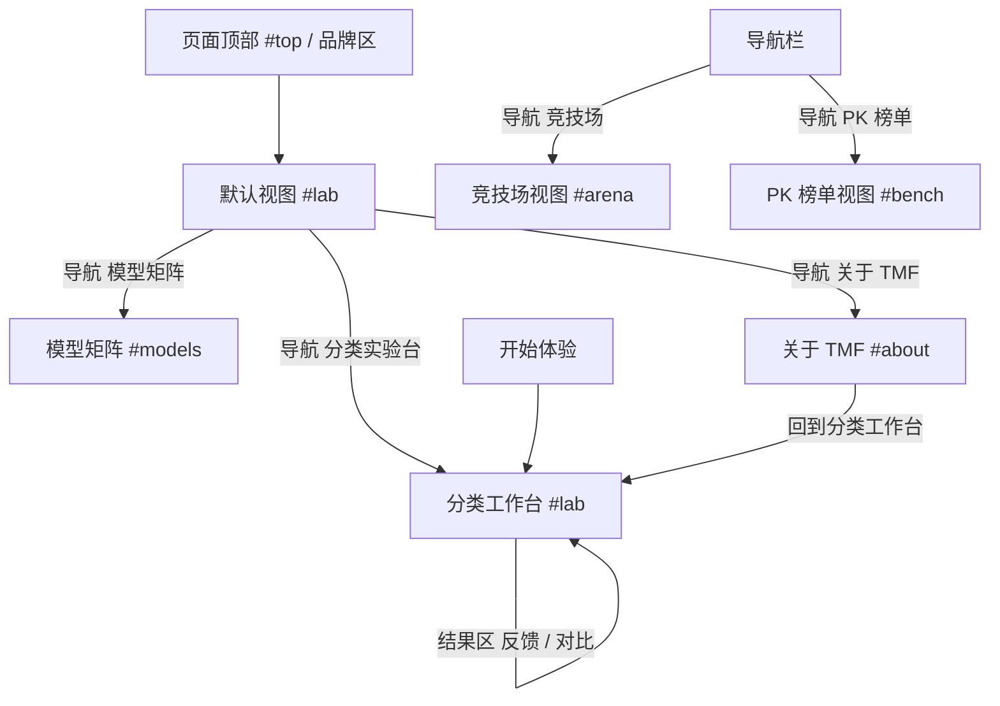
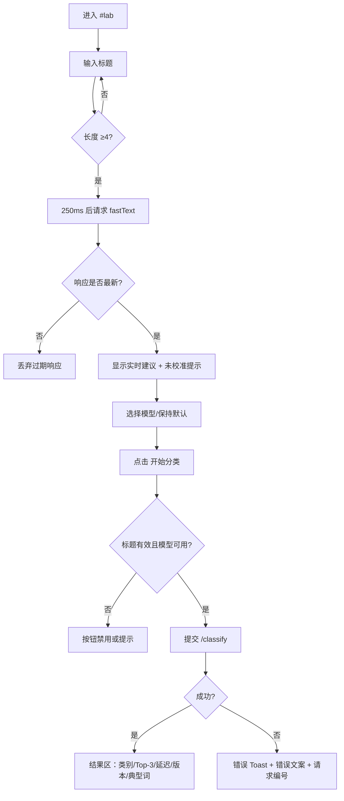
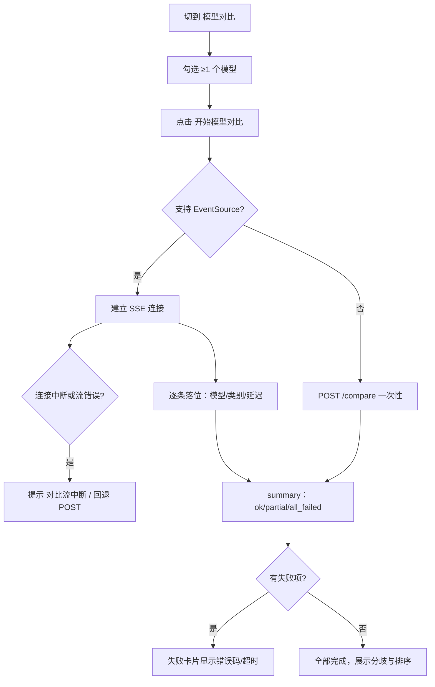

# 投满分（TMF）产品需求文档

## 1. 文档信息

| 项 | 内容 |
|---|---|
| 文档名称 | 投满分（TMF）中文新闻标题分类实验台 · 产品需求文档 |
| 文档版本 | v1.0 |
| 编写日期 | 2026-10-22 |
| 适用对象 | 产品设计师、前端开发、验收/演示负责人 |
| 文档状态 | 依据当前代码与项目资料编写；**待产品方评审**，其中标记为「待确认」的事项尚未定论 |
| 事实基线 | 工作区 `main` 分支最新提交（含适配层重构、75 工时实施成果）；本文件只读核查，未改动任何代码或配置 |
| 证据优先级 | 代码与运行时可验证接口 > `docs/` 中的验收记录 > `README` 叙述；三者冲突时以代码为准，并在第 12 章记录差异 |

> 阅读约定：
> - **【已实现】**：当前代码中存在且可验证的行为。
> - **【推断】**：由代码行为推导出的设计意图或约束，需设计师确认。
> - **【待确认】**：项目资料无法判定，需产品/业务方决策，本文件不代为决定。
> - 本文件不包含任何密钥、令牌或私有配置值；环境变量只记录名称与用途。

---

## 2. 项目概述

### 2.1 项目定位

TMF（投满分）是一个**中文新闻标题自动归类**的实验台：输入一条新闻标题，由本地部署的多个分类模型给出 10 个新闻频道之一，并支持多模型横向对比、人工反馈、匿名偏好投票与离线指标展示。

它同时承担两个用途：
1. **模型验证工具**：把随机森林、fastText、BERT、大模型、蒸馏模型放在同一入口，用统一口径观察差异；
2. **现场演示与教学载体**：在局域网内可被他人访问，支持讲者演示、观众投票与数据来源追溯。

### 2.2 解决的问题与用户价值

| 问题 | 产品应对 |
|---|---|
| 新闻标题人工归入频道效率低 | 单条标题即时分类，输入即出实时建议 |
| 多个模型入口分散、口径不一 | 单一页面选择模型；对比模式并行展示五个模型结果 |
| 不知道模型“有没有把握” | 展示**未校准原始分数**与 Top-3，并明确标注“未校准” |
| 非新闻内容被强行分类 | 软拒识提示“可能是非新闻内容”，同时保留原预测 |
| 模型判断有误无处沉淀 | “判错了”反馈：记录纠正类别，状态固定为**待审核** |
| 缺乏人工偏好数据 | 竞技场匿名投票 + Elo 榜（仅表达偏好强度，非准确率） |
| 指标容易被误读 | PK 榜只展示离线基准产物，附数据来源、样本量、生成时间与口径 |
| 演示时 mock/真实数据混淆 | 全局数据来源徽标：实时 / 演示数据（mock）/ 离线快照 / 来源未知 |

### 2.3 范围

**本期包含（当前已实现）：**

- 单条标题分类（单模型）与多模型对比（SSE 渐进返回 + 非流式回退）；
- 输入即预测的实时建议（fastText，250ms 防抖，未校准）；
- 软拒识提示（基于未校准分数的阈值规则）；
- 结果区：类别、未校准 Top-3、置信环、延迟、模型版本、类别典型词、“人工反馈参考（未审核）”；
- 纠错反馈提交（进入待审核队列）与已记录计数；
- 竞技场：匿名候选 A–E 投票、翻牌揭晓、人类偏好榜（预热态/正式名次）；
- PK 榜单：离线基准（四个本地模型 + LLM 缺失标注 + 加权集成 + oracle 参考上界）；
- 模型矩阵：5 个模型的状态与类型说明；
- 全局：数据来源徽标与来源明细、离线快照回退、暗色主题、大屏模式、Toast、请求编号、复制降级；
- 局域网访问（多网卡地址由启动脚本自动配置）。

**本期不包含（明确非目标）：**

| 非目标 | 依据 |
|---|---|
| 热搜抓取、新闻正文/多语言分类、批量文件分类 | 未实现；`frontend/README.md` 标注“热搜功能仍暂缓” |
| 用户账号、登录、权限、个人历史 | 未实现；仅有匿名 `client_id` |
| 反馈审核后台、模型再训练与发布 | 未实现；反馈状态固定 `pending` |
| 置信度校准 | 未实现；页面与接口统一标注“未校准” |
| PWA / 离线安装 / 系统通知 / 摄像头 | 局域网 HTTP 非安全上下文下不可用，且未实现 |
| 真实业务流量监控、实时准确率 | 未实现；运行时统计只有请求计数，不含准确率 |

### 2.4 术语表

| 术语 | 解释 |
|---|---|
| TMF / 投满分 | 本产品名称 |
| 新闻频道 | 10 个分类：财经、房产、股票、教育、科技、社会、政治、体育、游戏、娱乐 |
| 五模型 | 随机森林（rf）、fastText、BERT、大模型（llm）、蒸馏 BiLSTM（distill） |
| 实时建议 | 输入过程中由 fastText 给出的即时提示；不是用户提交后的最终结果 |
| 未校准原始分数 | 模型原始输出（概率/softmax 等），**不是**校准概率，不可跨模型比较分值 |
| Top-3 | 分数最高的前 3 个类别 |
| 软拒识 | 分数低于阈值或熵过高时提示“可能是非新闻内容”，但**不丢弃**原预测 |
| 数据态 | `live` 实时 / `mock` 演示数据 / `cached` 离线快照 / `unknown` 来源未知 |
| 离线基准 | 在固定测试集上一次性评测生成的产物，**不是**实时线上指标 |
| Elo | 竞技场中表达“人类偏好强度”的积分，**不是**准确率 |
| SSE | Server-Sent Events，服务端逐条推送的流式响应 |
| mock worker | 用固定规则返回预测的本地模拟服务，用于联调与演示 |

---

## 3. 用户角色与使用场景

### 3.1 角色

| 角色 | 关注点 | 典型行为 |
|---|---|---|
| 演示讲解者 | 6 分钟内展示完整能力，且现场不出错 | 打开首页 → 实时建议 → 单模型 → 对比 → 反馈 → 竞技场 → PK 榜 → 主题/大屏 |
| 评审 / 观众 | 判断系统是否可信、是否可参与 | 观看来源徽标与口径说明；在竞技场投一票并看到揭晓 |
| 内容运营试用者 | 判断一条标题属于哪个频道 | 粘贴标题 → 查看类别与 Top-3 → 判断错误时提交纠正 |
| 设计与前端 | 需要明确页面结构、状态与交互边界 | 依据本文件做设计稿与实现核对 |
| 开发者 / 维护者 | 需要理解数据来源与限制 | 通过 PK 榜与徽标确认数据性质，避免误读 |

### 3.2 典型任务

1. 快速判断一条标题的频道（单模型）；
2. 比较五个模型对同一条标题的判断差异；
3. 识别非新闻输入，避免错误归类；
4. 提交一次纠正，看到“已提交，待审核”；
5. 参与一次匿名投票，看到翻牌揭晓与偏好榜变化；
6. 查看离线基准，理解各模型在测试集上的表现与 LLM 缺失原因；
7. 在手机或他人电脑上通过局域网地址打开同一页面。

### 3.3 使用前提

| 前提 | 说明 |
|---|---|
| 服务已启动 | 网关（默认 `:8000`）与 5 个模型 worker 需运行；推荐用仓库根目录 `启动TMF.bat` 一键启动 |
| 浏览器 | 需支持 `EventSource`（SSE）与 ES2022；当前只在 Chromium/Edge 系验证 |
| 访问地址 | 本机 `http://127.0.0.1:5173`；局域网由启动脚本输出当前可用地址 |
| 数据态可见 | 页面顶部会显示服务端判定的数据来源，演示前必须确认 |
| LLM 默认关闭 | “大模型”需用户显式勾选“本次允许调用大模型”，默认不参与 |

---

## 4. 服务与功能总览

| 模块 | 用途 | 用户入口 | 实现状态 | 依赖 |
|---|---|---|---|---|
| 分类实验台 | 单条分类、实时建议、软拒识、结果与反馈 | 导航「分类实验台」/ 品牌区 / 「开始体验」 | 【已实现】 | 网关 `/classify`、`/compare`、`/compare/stream`、`/feedback` |
| 模型对比 | 五模型并行结果、分歧与缺失展示 | 工作台「模型对比」页签 | 【已实现】 | SSE 流式接口；失败回退 POST |
| 模型矩阵 | 5 个模型的状态与类型说明 | 导航「模型矩阵」（同页锚点） | 【已实现】 | `/models`、`/readyz` 探测结果 |
| 竞技场 | 匿名偏好投票、揭晓、Elo 榜 | 导航「竞技场」（独立视图） | 【已实现】 | `/arena/next`、`/arena/vote`、`/arena/leaderboard` |
| PK 榜单 | 离线基准与口径展示 | 导航「PK 榜单」（独立视图） | 【已实现】 | `/bench/pk`（离线产物） |
| 关于 TMF | 项目定位与回到工作台 | 导航「关于 TMF」（同页锚点） | 【已实现】 | 静态内容 |
| 数据来源徽标 / 来源明细 | 标识 live/mock/unknown/cached | 页面顶部全局区 | 【已实现】 | `/demo/state` |
| 离线快照 | 后端不可达时的只读兜底 | 后端请求失败时自动出现 | 【已实现】 | 构建产物 `public/snapshot.json` |
| 主题 / 大屏 | 暗色切换、演示放大 | 顶部右侧按钮 | 【已实现】 | 浏览器本地存储 |
| 运行状态点 | 连接中 / 后端离线 / 实验环境 | 顶部导航右侧 | 【已实现】 | `/models` 请求结果 |
| 运行统计（仅接口） | 请求计数与耗时桶 | 无前端页面 | 【已实现，无界面】 | `/stats` |
| 健康检查（仅接口） | 网关与 worker 就绪 | 无前端页面 | 【已实现，无界面】 | `/healthz`、`/readyz` |

> 说明：`/stats`、`/healthz`、`/readyz` 目前没有独立页面，仅作为接口与运维手段存在，不计入页面清单。

---

## 5. 信息架构与页面清单

### 5.1 视图与锚点（以代码为准）

前端为**单页应用 + Hash 路由**，没有引入路由库：

| 视图 | 触发 | 组成 |
|---|---|---|
| 默认视图 `#lab` | 无 hash 或其它 hash | Hero 区 → 分类工作台（`#lab`）→ 模型矩阵（`#models`）→ 关于（`#about`） |
| 竞技场视图 `#arena` | hash = `#arena` | 竞技场区块（独立挂载） |
| PK 榜单视图 `#bench` | hash = `#bench` | PK 榜单区块（独立挂载） |

关键事实（易被误解，需设计师注意）：
- 「模型矩阵」与「关于 TMF」**不是独立页面**，而是默认视图内的锚点区块；
- 竞技场与 PK 榜单是**独立视图**，且**懒挂载**——首页不会触发竞技场的 5 模型抽题；
- 品牌区链接指向 `#top`（页面顶部）；「开始体验」指向 `#lab`；
- 任何未知 hash 均回到默认视图并尝试滚动到对应锚点。

### 5.2 导航关系



返回方式：竞技场与 PK 榜单没有独立“返回”按钮，用户通过顶部导航回到「分类实验台」；浏览器前进/后退由 hash 变化驱动。

### 5.3 全局布局壳

| 区域 | 内容 | 响应式行为 |
|---|---|---|
| 顶部导航栏 | 品牌、5 个导航项、暗色/亮色切换、大屏切换、运行状态点、「开始体验」 | ≤760px 收起为汉堡菜单（含 Esc 关闭并归还焦点）；≤390px 进一步压缩 |
| 数据来源行 | 数据来源徽标、URL 演示提示、快照加载提示 | 自动换行 |
| 来源明细 | 当服务端返回 `worker_sources` 时显示逐模型来源 | 小字号折行 |
| 主内容区 | 按视图渲染 | 单列流式布局 |
| 离线快照区 | 仅后端不可达且快照可用时出现（见 6.6） | 单列卡片 |
| 页脚 | 品牌名与一句话说明 | 居中 |
| 全局 Toast | 右上/顶部浮层，最多同时 3 条 | 窄屏时占满宽度 |

---

## 6. 页面需求

### 6.1 页面一：分类实验台（默认视图）

#### 6.1.1 页面目标

让用户在 10 秒内完成“输入标题 → 得到频道”，并能立即判断结果是否可信。

#### 6.1.2 访问入口

- 默认打开即进入；
- 导航「分类实验台」、品牌区、顶部「开始体验」、关于页「回到分类工作台」均指向本区。

#### 6.1.3 区域与内容层级

```
Hero 区
  ├ 主标题 / 副标题
  ├ 主按钮「开始一次分类」
  └ 三个价值点（标题语义 / 智能分发 / 10 个新闻频道）
分类工作台（#lab）
  ├ 顶部条：标题「分类工作台」+ 模型登记状态
  ├ 模式页签：单模型分类 / 模型对比
  ├ 左列：标题输入 + 实时建议 + 模型选择 + LLM 授权
  ├ 右列：操作卡（当前选择摘要 + 提交按钮 + 隐私说明）+ 3 个迷你统计
  └ 结果区（单模型结果 / 对比结果 / 空）
模型矩阵（#models）
关于（#about）
```

#### 6.1.4 Hero 区

| 元素 | 文案/内容 | 数据来源 | 行为 |
|---|---|---|---|
| 主标题 | 「让每一条新闻，找到它的频道。」 | 静态 | — |
| 副标题 | 「从标题出发，看看不同模型如何理解同一条新闻。」+「一个轻量、直观的中文新闻分类实验台。」 | 静态 | — |
| 主按钮 | 「开始一次分类」 | 静态 | 滚动聚焦到分类工作台 |
| 价值点 | 标题语义 / 智能分发（10 个新闻频道）/ 分类 · 对比 · 探索 | 静态 | — |

#### 6.1.5 分类工作台：模式与选择

| 元素 | 规则 |
|---|---|
| 模式页签 | 两枚按钮「单模型分类（选择一个模型）」「模型对比（并行查看结果）」，使用 `role="tablist"`、`aria-selected`；切换模式会重置结果区与错误提示 |
| 单模型选择 | 下拉框「选择分类模型」，选项来自 `/models` 中 `enabled=true` 的模型；标签右侧提示「默认：<默认模型>」（当前默认 fastText） |
| 对比选择 | 模型胶囊多选，显示「N 个已选择」；每个胶囊有选中态与 `aria-pressed`；至少 1 个才可提交 |
| 大模型（LLM） | 默认**不参与**。未勾选时，下拉/胶囊中的「大模型」处于禁用态并标注「需启用 / 需手动启用」 |
| LLM 授权复选框 | 文案：「本次允许调用大模型」+「真实供应商尚未验证；调用可能产生费用。默认关闭。」；勾选后出现黄色提示：「已启用大模型。请确认后端 8105 当前连接的是本地 mock；若是真实供应商，调用可能产生费用。」 |
| 模型登记状态 | 「N 个模型已登记」/「正在读取模型状态」/「等待后端连接」 |
| 迷你统计 | 「10 新闻频道」「N 可用模型」「API 本地推理」 |

#### 6.1.6 分类工作台：输入区

| 元素 | 规格 |
|---|---|
| 输入控件 | 多行文本框，标签「新闻标题」，占位符「例如：北京二手房成交量创年内新高」 |
| 长度上限 | **200 字符**（`maxlength` 强制；超出无法继续输入） |
| 示例 | 「试试这些」+ 3 条示例标题（北京二手房成交量创年内新高 / 新一代人工智能芯片发布，算力提升显著 / 中国女篮公布亚洲杯参赛名单），点击即填入 |
| 实时建议 | 输入长度 ≥ **4 字符**且停止输入 **250ms** 后自动请求 fastText；请求期间显示「实时分析中…」；返回后显示「实时建议（fastText）」+ 类别中文名 + 「仅作输入提示，未校准」 |
| 中文输入法 | 组合输入期间不触发实时请求（`compositionstart/end`） |
| 竞态控制 | 每次输入立即取消上一次实时请求，并用单调序号丢弃过期响应，保证旧结果不覆盖新输入 |
| 实时请求失败 | **静默处理**：不弹全局错误、不清空已输入内容、不阻塞用户提交 |

> 【推断】实时建议被设计为“输入提示”而非结果，因此不展示分数条，也不参与最终判定。设计师若需强化，应先确认是否允许展示分数。

#### 6.1.7 分类工作台：操作区

| 元素 | 规则 |
|---|---|
| 操作卡标题 | 单模型：ONE MODEL + 标题；对比：SIDE BY SIDE + 「让不同模型，给出各自的判断。」类文案 |
| 选择摘要 | 显示当前模型名（或「N 个模型」）与其说明 |
| 主按钮 | 单模型「开始分类」；对比「开始模型对比」；提交中变为「正在分析标题」并带加载指示；未满足条件时禁用 |
| 可提交条件 | 标题非空、长度 ≤200、无进行中的提交、模型列表无错误；对比模式还需至少 1 个模型 |
| 隐私说明 | 「标题仅用于本次推理，不会显示在服务日志中」 |
| 模型列表错误 | 工作台顶部出现错误状态块：错误文案 + 「重新连接」按钮 |

#### 6.1.8 结果区：单模型

| 元素 | 内容与数据来源 |
|---|---|
| 标题 | 「这条新闻，属于 <类别中文名>」（类别来自 `pred_class`） |
| 数据来源徽标 | 来自响应 `data_source`；缺失时不渲染，**不推断为实时** |
| 请求编号 | 「REQUEST · <前 8 位>`，来自 `request_id` |
| 类别徽章 | 类别中文名 + 提示语（如“楼市 · 地产动态”） |
| 延迟 | `<latency_ms> ms` |
| 模型版本 | `model_version`，缺失显示「未提供」 |
| 未校准分数卡 | 仅有有效分数时出现：标题「未校准原始分数」，说明「仅作模型原始输出展示，不是校准概率，也不代表真实置信度」，展示 Top-3 条形与「最高分」、置信环 |
| 无分数时 | 显示「该模型不提供可信度」+「本次响应没有通过校验的原始分数；不绘制置信环、不推断概率。」（LLM 属于此情况） |
| 类别典型词 | 静态类别词表（来自训练集词频，标注「相关词，非因果」）；无数据时显示「典型词来源未接入，暂不展示。」 |
| 软拒识横幅 | 命中阈值时显示「可能是非新闻内容」+ 标签「软拒识 · 预测仍保留」+ 阈值脚注（最高分阈值等） |
| 人工反馈参考 | 若存在相似的**待审核**反馈，显示「人工反馈参考（未审核）：<类别>」，与模型预测**并列**，不替换 |
| 反馈条 | 见 6.1.9 |
| 复制按钮 | 仅本地交互，见 8.6 |

#### 6.1.9 纠错反馈条

| 元素 | 规则 |
|---|---|
| 入口 | 「这个判断不对？」按钮（展开面板） |
| 说明 | 「可以提交纠正类别，反馈会进入待审核队列。」 |
| 当前判断 | 显示「当前模型判断：<类别>。」 |
| 类别选择 | 10 个类别按钮；当前预测类别标注「当前判断」 |
| 提交 | 提交后成功文案固定为「反馈已提交，待审核」；Toast 同时提示并附请求编号 |
| 去重 | 后端判定重复时提示「已记录过，待审核」 |
| 失败 | 显示错误并提供「重试一次」；已重试过则提示「重试仍未成功，请稍后再试。」 |
| 计数 | 若已获取统计，显示「已记录 N 条待审核」 |
| 红线 | 任何文案**不得**出现“已学会 / 已训练 / 模型已更新” |

#### 6.1.10 结果区：模型对比

| 元素 | 内容与来源 |
|---|---|
| 标题 | 流式进行中：「正在逐个返回模型结果…」；流式完成：「同一个标题，<N> 个模型完成判断。」；流式不可用回退：「流式不可用，已回退完整请求：<N> 个模型完成判断。」；流式出错：「对比没有完成，请稍后重试。」；非流式：「同一个标题，<ok> 个模型完成判断。」 |
| 概览 | 状态文案：全部模型已完成 / 部分结果已返回 / 对比流中断 / 正在等待模型返回… / 模型暂时无法完成判断；并显示「已返回 x / total」「成功 / 失败」「用时」「总截止」 |
| 首结果耗时 | 「首结果 <n> ms」 |
| 分歧徽标 | 有多数且存在不同：「模型间存在分歧（N 个不同）」；无多数：「预测分歧，无多数」 |
| 排序 | 两个切换：「按延迟」「按一致度」；一致度说明「一致度 = 与多数预测相同」或「当前无多数预测，一致度显示 —」 |
| 单模型卡片 | 模型名、类别、延迟、版本、数据来源徽标、一致度标签（「与多数一致 / 与多数不同」） |
| 失败卡片 | 错误文案 + 「错误码 <CODE>」 |
| 超时卡片 | 「未在总截止前返回结果」 |
| 等待中 | 「等待中…」；LLM 为「LLM 等待中…」 |
| 回退标识 | 当 SSE 不可用而回退整请求时，显示「已回退完整请求（POST）」 |
| 空态 | 流已开始但无结果：「正在等待首个模型结果…」 |
| 流级错误 | 错误状态块 + 错误文案 + 请求编号 |

#### 6.1.11 该页面的状态矩阵

| 场景 | 表现 |
|---|---|
| 模型列表加载中 | 状态点「连接中」；工作台提示「正在读取模型状态」；对比选择区「正在读取模型列表…」 |
| 模型列表失败 | 状态点「后端离线」；工作台错误块 + 「重新连接」；页面其余部分仍可浏览 |
| 提交中 | 按钮禁用并显示「正在分析标题」 |
| 结果为空 | 结果区不渲染 |
| 部分失败（对比） | summary 为 partial；成功项正常展示，失败/超时项单独标注 |
| 全部失败 | summary 为 all_failed；各卡片显示错误或超时 |
| 请求被取消 | 不展示为网络错误 |
| 标题超长 | 无法继续输入（200 上限） |
| 网络断开 | 全局 Toast 错误 + 若后端不可达则进入离线快照流程（6.6） |

#### 6.1.12 桌面端与移动端

| 断点 | 行为 |
|---|---|
| >1050px | 工作台双列（输入列 + 操作列），结果区横向排布 |
| ≤1050px | 工作台收为单列，操作卡移到输入下方 |
| ≤760px | 导航折叠为汉堡菜单；条形控件与卡片改纵向；字号下调 |
| ≤640px | 结果卡、对比卡单列；按钮撑满可用宽度 |
| ≤390px | 顶部控件进一步压缩；避免横向滚动 |

要求：任一断点下 `scrollWidth <= clientWidth`（不允许横向滚动）。

#### 6.1.13 可访问性与长文本

- 模式页签、模型胶囊、反馈面板均可用键盘操作；展开面板有焦点管理；
- 结果区与实时建议使用 `aria-live` 播报；
- 错误使用 `role="alert"`；
- 长标题在结果中被截断/换行但不撑破布局；类别典型词、错误码可换行；
- 尊重 `prefers-reduced-motion`：关闭脉冲与过渡动画。

---

### 6.2 页面二：模型矩阵（同页锚点 `#models`）

#### 6.2.1 页面目标

让用户一眼看到“有哪几个模型、分别是什么类型、现在是否可用”。

#### 6.2.2 内容

| 元素 | 内容 |
|---|---|
| 区块标题 | 「五种视角，同一个标题。」 |
| 说明 | 「从传统机器学习到预训练模型，看看它们如何理解新闻。」 |
| 模型卡（5 张） | 模型显示名 + 类型说明：随机森林「传统机器学习基线」/ fastText「词向量分类模型」/ BERT「预训练语言模型」/ 大模型「大语言模型 · 外部服务」/ 蒸馏 BiLSTM「轻量蒸馏模型」 |
| 状态标签 | 「服务就绪」/「暂不可用」/「未启用」/「状态未知」 |
| 脚注 | 「大模型状态仅表示本地 worker 就绪，不代表真实供应商已验证。模型版本信息以服务端返回为准。」 |

#### 6.2.3 状态与规则

- 加载中：状态块骨架；
- 无模型数据：空状态「连接后端后，这里会展示当前模型列表。」；
- 状态取值来自 `/models` 与就绪探测，**不代表模型准确率**；
- 点击模型卡不跳转、不改变当前选择。

---

### 6.3 页面三：竞技场（独立视图 `#arena`）

#### 6.3.1 页面目标

用匿名对比收集“人类更认可哪个模型”的偏好数据，并让观众看到自己的选择被揭晓。

#### 6.3.2 区域

```
标题区：匿名投票，偏好可读。
左栏（01 匿名候选）：题目标题 + 换一题/下一题 + 5 张匿名卡 A–E + 揭晓说明 + 规则说明
右栏：人类偏好榜
```

#### 6.3.3 左栏规则

| 元素 | 规则 |
|---|---|
| 题目 | 从测试集抽取；在面板头部下方独立整行展示；桌面 16px/1.6、移动端 14px/1.55；最多 3 行，超出省略并通过 `title` 属性保留完整文本；中英文、数字与连续字符可断行 |
| 顶部按钮 | 未投票时「换一题」；已投票后「下一题」；加载中禁用 |
| 指令 | 「点击卡片投下偏好票；投票前不会显示任何模型名称。」 |
| 匿名卡 | 只有字母 A–E + 该候选的**预测类别**；投票前 DOM 中**不存在**真实模型名或 `model_id` |
| 投票 | 点击卡片即投票，无需二次确认；同一题每客户端只计 1 票；单客户端每分钟最多 20 票 |
| 翻牌揭晓 | 投票成功后仅被选中的卡片显示「你选择了」+ 模型名（`display_name`）与 `model_id`；其余卡片变暗 |
| 揭晓播报 | 区域文本：「已揭晓：<模型名>（<model_id>），预测类别 <类别>」，`role="status"` |
| 部分候选 | 若部分模型缺失，显示「部分候选已返回 / 部分模型结果缺失，仅展示可用候选；投票只作用于本次展示的匿名结果。」 |
| 投票后 | 出现「再抽一题」按钮 |
| 规则说明 | 「同一题目每个客户端只计 1 票；单客户端每分钟最多 20 票。票数可被本机清除，仅作演示参考。」 |

#### 6.3.4 投票反馈

| 情况 | 反馈 |
|---|---|
| 成功 | Toast「投票已记录，已揭晓你选择的模型。」+ 请求编号 |
| 重复投票 | 警告 Toast「你已经对这道题投过票了。」+「同一道题每个客户端只计 1 票；可以换一题继续。」 |
| 触发限速 | 警告 Toast「投票太快了，请稍后再试。」+「单客户端每分钟最多 20 票，请稍后再试。」 |
| 存储故障 | 错误 Toast「竞技场存储暂时不可用，请稍后重试。」 |
| 网络/超时 | 错误 Toast（统一错误文案映射） |

#### 6.3.5 右栏：人类偏好榜

| 状态 | 表现 |
|---|---|
| 未投票 | 不加载、不展示榜单（匿名性硬约束），显示 `idle` 占位 |
| 加载中 | 骨架/加载态 |
| 加载失败 | 错误块 + 重试 |
| 无数据 | 「榜单暂未就绪」 |
| 预热中 | 显示各模型票数与区间，附「预热中」标签，**不显示名次** |
| 正式 | 显示「名次」列；顶部说明「所有模型参与的比较样本均达到 50，显示正式名次。」 |

列结构：名次（仅正式态）/ 模型 / 获选票（样本 n）/ Wilson 95% 区间。
脚注：「人类偏好投票强度，仅供演示参考；票数可被本机清除。」数据性质固定标注为投票数据（`vote`）。

#### 6.3.6 空态与错误

| 场景 | 表现 |
|---|---|
| 题库为空 | 空状态「暂无可用题目」+「重新抽取」 |
| 抽取失败 | 错误块「重新抽取」 |
| 部分模型不可用 | 部分候选提示（见上表） |
| 后端不可达 | 全局离线快照流程；竞技场不伪造题目 |

#### 6.3.7 响应式与可读性

- ≤1050px：左右栏改为上下堆叠；榜单列在窄屏下改为卡片式（表头转为行内标签）；
- 题目标题在面板头部下方独立整行展示（桌面 16px/1.6，≤760px 14px/1.55，最多 3 行）；不横向溢出、不与「换一题/下一题」重叠，完整文本同时由 `title` 属性提供；
- 卡片字母、类别、揭晓信息在 390px 宽度下仍可读；
- 投票后焦点从被禁用的卡片移到揭晓文本，避免键盘用户迷失。

---

### 6.4 页面四：PK 榜单（独立视图 `#bench`）

#### 6.4.1 页面目标

在固定测试集上横向比较各模型，并让读者明确“这是离线基准，不是线上表现”。

#### 6.4.2 内容结构

```
标题区：离线测试集上的模型对比。
说明：数据来自离线基准产物，不是实时线上指标；LLM 缺失时单独标注。
数据来源条：数据集 / 切分 / 样本量 / 生成时间 / 代码版本 / 指标口径（可展开）/ 数据性质
指标切换：Macro-F1 / 平均延迟 / 模型体积
榜单：5 个模型 + 加权投票集成（非独立模型）+ oracle 参考上界（非独立模型）
口径脚注
```

#### 6.4.3 数据来源条（必须逐项展示）

| 字段 | 展示 | 说明 |
|---|---|---|
| 数据集 | 原样 | 当前为测试集文件路径 |
| 切分 | 原样 | 当前为 `test` |
| 样本量 | `n = <数量>` | 当前为 10,000 |
| 生成时间 | 原样 | 离线产物生成时间 |
| 代码版本 | 原样 | 含提交信息或 `uncommitted` |
| 指标口径 | 「N 项定义（展开查看）」 | 展开后展示指标定义与模型版本 |
| 数据性质 | 「离线评估（测试集）」或「演示数据（demo）」 | 由产物 `data_kind` 决定 |

#### 6.4.4 指标切换

| 指标 | 方向 | 单位 | 备注 |
|---|---|---|---|
| Macro-F1 | 越大越好 | 无量纲（0–1） | 默认选中 |
| 平均延迟 | 越小越好 | 毫秒 | 离线逐条推理口径，不含网络 |
| 模型体积 | 越小越好 | 自动格式化 B / KiB / MiB | 模型文件字节数 |

> 【待确认】产物与接口中还存在 `accuracy` 字段，但页面**未提供**该指标切换（只 3 项）。是否要新增，见第 12 章。

#### 6.4.5 榜单行为

| 规则 | 说明 |
|---|---|
| 数值来源 | 全部来自 `/bench/pk` 返回的离线产物；前端不内置、不推算、不补零 |
| 缺失项 | 缺失模型只标注「未纳入」+ 原因（如「外部 Provider 未授权」），**不画条形**，也不参与当前指标的归一化基准 |
| 派生项 | 「加权投票集成（非独立模型）」展示权重；「oracle 参考上界（非独立模型）」以参考线形式标注 |
| 精确值 | 条形旁提供精确数值文本（如字节换算前的数值） |
| 加载/错误 | 加载骨架；失败时展示错误（产物不存在/结构非法）+ 请求编号 |
| 空数据 | 空状态提示无可用基准数据 |

#### 6.4.6 口径脚注（必须保留）

「以上均为离线测试集（…），不代表实时或线上表现；派生项与 oracle 仅为参考，不与竞技场 Elo 混用。缺失模型只标注「未纳入」，不画条形，也不参与当前指标的归一化基准。」

---

### 6.5 页面五：关于 TMF（同页锚点 `#about`）

| 元素 | 内容 |
|---|---|
| 标题 | 「让内容抵达更合适的地方。」 |
| 副标题 | 「TMF 新闻分类实验台」「为模型验证与产品探索而设计。」 |
| 操作 | 「回到分类工作台」按钮 → 滚回 `#lab` |

该区块为品牌与定位说明，不含数据请求。

---

### 6.6 全局能力：数据来源与离线快照

#### 6.6.1 数据来源徽标（页面顶部常驻）

| 状态 | 标签 | 触发条件 | 颜色语义 |
|---|---|---|---|
| `live` | 实时 | 所有已启用 worker 就绪且 `/metadata.display_name` 不以 `mock-` 开头 | 绿色 |
| `mock` | 演示数据（mock） | 所有已启用 worker 来源一致且以 `mock-` 开头 | 黄色 |
| `unknown` | 来源未知 / 页面显示「来源未确认」 | 混合来源、worker 未就绪或 metadata 缺失 | 灰色 |
| `cached` | 离线快照 | 仅来自快照产物，不由运行中网关返回 | 灰色 |

- 判定在**服务端**完成（启动时请求 `/demo/state`），前端只展示；
- 当服务端返回 `worker_sources` 时，页面额外显示「来源明细：<逐模型来源>」；
- 结果卡、对比项也会各自显示来源徽标（来自该响应的 `data_source`）；
- 不得根据 URL 参数或“能否访问”推断 `live`。

#### 6.6.2 离线快照区

| 项 | 规则 |
|---|---|
| 触发 | 模型列表请求失败（后端不可达）且快照可用 |
| 位置 | 主内容区上方，独立区块 |
| 标题 | 「离线快照」+ 小标「OFFLINE SNAPSHOT · 非实时」 |
| 说明 | 后端不可达；内容来自构建产物 `public/snapshot.json`；生成于 `<时间>`；来源统一标为 `cached`；不写入运行时统计；**LLM 未纳入** |
| 列表 | 8 条固定演示案例：案例编号、标题、状态、预期类别、各模型缓存结果 |
| 操作 | 「重试后端」（加载中显示「正在重连…」） |
| 恢复 | 后端恢复后自动退出快照并回到正常视图 |
| 快照不可用 | 显示明确错误「离线快照不可用：<原因>」 |
| URL 提示 | `?demo=mock|cached` 只改变提示文案，**不改变数据来源**、不替换接口响应 |

#### 6.6.3 状态点

| 文案 | 条件 |
|---|---|
| 连接中 | 模型列表请求进行中 |
| 后端离线 | 模型列表请求失败 |
| 实验环境 | 请求成功 |

---

## 7. 核心用户流程

### 7.1 流程一：输入即预测 + 单模型分类



**分支说明**

| 步骤 | 分支 | 系统响应 |
|---|---|---|
| 输入 | 小于 4 字符 | 不请求，也不显示实时建议 |
| 输入 | 超过 200 字符 | 无法继续输入 |
| 实时 | 请求失败/被取消 | 静默，不打断提交 |
| 提交 | 模型列表错误 | 按钮不可提交（需先「重新连接」） |
| 提交 | 超时 | 「模型响应超时，可以稍后重试。」 |
| 提交 | worker 不可达 | 「所选模型服务不可达，请确认后端 worker 已启动。」 |

### 7.2 流程二：多模型对比（SSE + 回退）



**关键规则**

- 首个结果应在约 1 秒内出现；慢模型不阻塞其他项；
- 总截止时间到达后，未完成项标记「未在总截止前返回结果」；
- 流级错误（如参数非法）显示错误块并可重试；
- 任何情况下不伪造结果。

### 7.3 流程三：软拒识（非新闻输入）

1. 用户输入「今天天气不错」并提交；
2. 系统仍返回预测类别，但 `rejected=true`；
3. 结果区显示「可能是非新闻内容」+「软拒识 · 预测仍保留」，并展示阈值说明；
4. 用户仍可继续判错反馈或换模型；
5. 若模型不提供分数（如 LLM），**不做拒识判定**，不显示阈值脚注。

### 7.4 流程四：纠错反馈

1. 结果区点「这个判断不对？」；
2. 面板展开，显示当前判断与 10 个类别；
3. 选择正确类别 → 提交；
4. 成功：Toast「反馈已提交，待审核」+ 面板内状态「已记录」+ 计数 +1；
5. 重复：提示「已记录过，待审核」；
6. 失败：保留已选内容，可「重试一次」；
7. 后续：相似标题的结果区可能出现「人工反馈参考（未审核）」——仅提示，不改预测。

### 7.5 流程五：竞技场投票与揭晓

1. 进入 `#arena`，系统抽题并给出 5 个匿名候选；
2. 用户点击任一卡片；
3. 系统记录投票、更新 Elo，返回被选中模型身份；
4. 被选卡片翻牌显示模型名；其他卡片变暗；
5. 右侧榜单首次加载（此前不请求），显示预热态或正式名次；
6. 用户可「再抽一题」继续。

### 7.6 流程六：查看 PK 榜单

1. 进入 `#bench`；
2. 系统加载离线产物，返回 meta + 模型/派生项；
3. 用户切换指标查看条形；
4. 缺失模型显示「未纳入」与原因，不参与归一化；
5. 用户可展开「指标口径」查看定义与版本。

### 7.7 流程七：后端不可达 → 离线快照 → 恢复

1. 页面加载时模型列表失败；
2. 状态点变「后端离线」；
3. 自动读取 `public/snapshot.json`：显示「离线快照」区块与生成时间；
4. 顶部徽标为「离线快照」，不显示实时；
5. 用户可点「重试后端」；
6. 后端恢复后自动退出快照，徽标回到服务端判定的 live/mock/unknown；
7. 快照读取失败：显示「离线快照不可用：<原因>」，不伪造内容。

---

## 8. 全局交互与界面规则

### 8.1 导航与当前状态

- 5 个导航项均带当前态高亮与 `aria-current="page"`；
- 竞技场/PK 榜单为独立视图，点击后 hash 变化并重新挂载；
- 模型矩阵/关于为锚点，点击后滚动定位；
- 移动端汉堡菜单：点击展开，Esc 关闭并归还焦点；
- 品牌区回顶部；「开始体验」回工作台。

### 8.2 按钮与表单

| 规则 | 说明 |
|---|---|
| 禁用态 | 不可提交时按钮禁用（而非点击后报错）；禁用原因应可从上下文推断 |
| 加载态 | 提交按钮显示「正在分析标题」+ 指示器；其他区域用骨架 |
| 焦点 | 面板展开/关闭、菜单关闭均需管理焦点；不得让焦点落到 `body` |
| 输入约束 | 标题 ≤200 字符；超出被物理阻止 |
| 双击/重复提交 | 提交中禁用按钮；重复反馈由后端去重 |

### 8.3 提示（Toast）

- 类型：成功（绿）、警告（黄）、错误（红）、信息（蓝）；
- 同屏最多 3 条；含可选补充说明与请求编号；
- 成功与失败都必须给出明确下一步（重试 / 换一题 / 重新连接）；
- 取消类错误（用户主动中止）不显示为故障。

### 8.4 请求编号

- 每个结果与错误都可展示请求编号（结果区显示前 8 位，Toast/错误块显示完整）；
- 用途：现场排查与截图取证。

### 8.5 术语与文案一致（观察到的差异，需统一）

| 位置 | 现有文案 A | 现有文案 B | 说明 |
|---|---|---|---|
| 未知来源 | 全局徽标「来源未知」（组件默认） | 首页传入「来源未确认」 | 同义不同词，建议统一 |
| 工作台 | 「分类工作台」 | 导航/标题「分类实验台」 | 同一区域两种称呼 |
| 榜单 | 导航「PK 榜单」 | 内容「PK 榜」 | 建议统一为「PK 榜单」 |
| 分数 | 「未校准原始分数」 | 「分数」 | 建议始终带“未校准”限定 |

> 【待确认】以上为代码中并存的文案，本文件**不擅自定稿**，请产品/文案确认统一口径。

### 8.6 复制与剪贴板

- 通过局域网 HTTP 访问时浏览器不提供剪贴板 API，因此复制按钮提供三种降级：
  1. 「尝试兼容复制」；
  2. 「全选文本」（选中结果文本，供手动复制）；
  3. 提示「失败时请手动按 Ctrl+C / ⌘+C」。
- 不出现“已复制”的假成功提示。

### 8.7 主题、大屏与动效

| 能力 | 规则 |
|---|---|
| 暗色/亮色 | 首次跟随系统 `prefers-color-scheme`；手动切换后写入本地存储并在刷新后保持；按钮文案在「暗色 / 亮色」间切换 |
| 大屏模式 | 点击「大屏」进入：字号约 ×1.25、隐藏请求编号等调试信息、尝试进入全屏；全屏被拒不影响布局，按钮变「退出大屏」 |
| 动效 | 统一短过渡；`prefers-reduced-motion` 下关闭脉冲/过渡 |
| 主题与数据 | 主题与大屏**不改变**任何数据来源或模型结果 |

### 8.8 字号、对比度与溢出

- 正文最小可用字号在 390px 宽度下仍可读；关键数字（类别、延迟、票数）不小于 16px；
- 暗色下正文对比度实测 ≥ 8:1（验收记录），亮色同样需满足 ≥4.5:1；
- 长标题、长错误码、长模型名需换行/省略，不撑破卡片；
- 任意断点无横向滚动。

---

## 9. 数据与服务边界

### 9.1 前端消费的接口

| 方法 | 路径 | 用途 | 前端使用位置 |
|---|---|---|---|
| GET | `/api/v1/models` | 模型列表、默认模型、10 类 | 工作台、模型矩阵 |
| GET | `/api/v1/demo/state` | 启动数据来源判定 | 顶部徽标、来源明细 |
| POST | `/api/v1/classify` | 单模型分类 | 结果区 |
| POST | `/api/v1/compare` | 非流式对比（回退路径） | 对比区 |
| GET | `/api/v1/compare/stream` | SSE 流式对比 | 对比区（首选） |
| POST | `/api/v1/feedback` | 提交纠正 | 反馈条 |
| GET | `/api/v1/feedback/stats` | 反馈聚合计数 | 反馈条计数 |
| GET | `/api/v1/arena/next` | 抽取匿名题目 | 竞技场 |
| POST | `/api/v1/arena/vote` | 投票 + 揭晓 | 竞技场 |
| GET | `/api/v1/arena/leaderboard` | Elo 榜 | 竞技场右栏 |
| GET | `/api/v1/bench/pk` | 离线基准 | PK 榜单 |
| GET | `/api/v1/healthz` / `readyz` | 存活/就绪 | 非页面（运维与脚本） |
| GET | `/api/v1/stats` | 进程内统计 | 非页面（运维） |

### 9.2 数据性质分列（不得混用）

| 类别 | 来源 | 展示位置 | 允许表述 | 禁止表述 |
|---|---|---|---|---|
| 离线评估 | `artifacts/bench/pk_*.json`（10,000 条测试集） | PK 榜单 | 「离线评估（测试集，YYYY-MM-DD，n=10000）」 | 「实时准确率」「线上准确率」 |
| 运行时统计 | 网关内存计数（重启清零，仅计 live） | 无页面 | 「本次会话统计」 | 「模型准确率」 |
| 人类偏好投票 | SQLite 投票表 + Elo | 竞技场榜 | 「人类偏好（n 票）」「仅供演示参考」 | 「准确率」「客观排名」 |
| 演示样例 | mock worker / 离线快照 | 徽标与结果卡 | 「演示数据（mock）」「离线快照」 | 任何暗示实时推理的表述 |

### 9.3 模型可用性与 LLM 边界

| 情况 | 界面表现 |
|---|---|
| 某 worker 未启动 | 模型矩阵显示「暂不可用」；提交该模型返回「所选模型服务不可达…」；对比中该项失败，其他项正常 |
| LLM 未勾选 | 单模型下拉与对比胶囊中 LLM 禁用并注明「需启用」 |
| LLM 已勾选但 worker 为 mock | 顶部提示确认 8105 是否为 mock；结果来源徽标显示 mock |
| LLM 真实供应商未验证/未授权 | PK 榜单中 LLM 标「未纳入」+「外部 Provider 未授权」；不展示其分数 |
| 模型无分数（LLM） | 结果区显示「该模型不提供可信度」，不画置信环 |

### 9.4 反馈与隐私（以实现为准）

| 项 | 现状 |
|---|---|
| 身份 | 无账号；浏览器生成随机 `client_id` 并保存在本地存储（键：`tmf.feedback.client_id`），清除后视为新客户端 |
| 提交内容 | 标题、模型、原预测、纠正类别、可选分数、来源标记（网页为 `source=web`） |
| 状态 | 固定 `pending`（待审核）；界面只承诺“已提交，待审核” |
| 去重 | 同一客户端 + 标题 + 模型视为重复 |
| 保留期 | 30 天，过期清理；界面不展示原始反馈列表 |
| 导出 | 不提供页面导出；仅提供聚合统计（总数、待审核数、按类别/模型分布、相似命中数） |
| 日志 | 页面明示「标题仅用于本次推理，不会显示在服务日志中」 |
| 相似提示 | 与已有待审核反馈的标题相似度 ≥0.75 时，结果区显示「人工反馈参考（未审核）」，仅提示，不改变预测 |

### 9.5 竞技场数据规则

| 项 | 现状 |
|---|---|
| 题目来源 | 测试集抽样（保留真实标签，但投票前不下发标签与模型身份） |
| 匿名 | 服务端打乱并分配匿名 ID；投票前前端 DOM 不含模型身份 |
| 计分 | Elo 初始 1200、K=24；1 票 = 选中者与其余各对局一次 |
| 防刷 | 同题每客户端 1 票；每客户端每分钟 20 票；票数可被清除，页面注明“仅作演示参考” |
| 榜单门槛 | 参与样本 <50 为预热态（无 rank，显示 Wilson 区间）；≥50 才显示名次 |
| 数据性质 | 固定标注为「人类偏好」，与离线准确率分列 |

### 9.6 超时与并发（影响交互的约束）

| 场景 | 前端等待 | 后端 |
|---|---|---|
| 实时建议 | 10s | 复用单模型接口 |
| 单模型分类 | 20s | worker 超时由配置决定（默认 10s 级） |
| 模型对比 | 25s | 总截止默认 18s、并发默认 3（可配置）；到点返回已完成项并标 partial |
| 竞技场 | 25s | 抽题/投票受同一套模型超时约束 |

> 超时不是“失败即报错”：对比会保留已完成项并显示部分结果；用户可重试或改选模型。

### 9.7 错误码与用户文案（已实现映射）

| 错误码 | 用户可见文案 |
|---|---|
| `TITLE_TOO_LONG` | 标题最多支持 200 个字符。 |
| `INVALID_TITLE` | 请先输入新闻标题。 |
| `UNKNOWN_MODEL` | 所选模型不存在，请刷新模型列表。 |
| `MODEL_DISABLED` | 所选模型当前不可用。 |
| `INVALID_MODELS` | 请选择至少一个可用模型。 |
| `WORKER_TIMEOUT` | 模型响应超时，可以稍后重试。 |
| `WORKER_UNAVAILABLE` | 所选模型服务不可达，请确认后端 worker 已启动。 |
| `WORKER_BAD_RESPONSE` / `WORKER_HTTP_ERROR` | 模型返回格式异常 / 模型服务暂时不可用 |
| `INVALID_MODEL_OUTPUT` | 模型返回了无法识别的类别，请稍后重试。 |
| `NETWORK_ERROR` | 无法连接分类服务，请确认后端已启动。 |
| `CLIENT_TIMEOUT` | 请求等待时间过长，请稍后重试。 |
| `ARENA_NO_ITEMS` | 当前没有可用的竞技场题目。 |
| `ARENA_DUPLICATE_VOTE` | 你已经对这道题投过票了。 |
| `ARENA_RATE_LIMITED` | 投票太快了，请稍后再试。 |
| `ARENA_STORE_ERROR` | 竞技场存储暂时不可用，请稍后重试。 |
| `FEEDBACK_DUPLICATE` | 这条反馈已经记录过了，待审核。 |
| `FEEDBACK_STORE_ERROR` | 反馈存储暂时不可用，请稍后重试。 |
| `BENCH_ARTIFACT_NOT_FOUND` | 离线基准产物不存在，请先运行离线评估脚本生成。 |
| `BENCH_ARTIFACT_INVALID` | 离线基准产物结构不合法，请重新生成后再试。 |

---

## 10. 非功能需求

### 10.1 响应与加载体验

- 实时建议：停止输入后 250ms 触发，正常应在一秒内出现；
- 单模型提交：显示按钮加载态；首屏不得空白；
- 对比：首个模型结果应在约 1 秒内出现，后续逐条填充；
- 加载中一律使用骨架或状态块，避免布局跳动；
- 任何等待超过 1 秒的操作都应有可见反馈。

### 10.2 错误可理解性

- 所有错误使用中文用户文案，不暴露堆栈、路径或供应商信息；
- 错误必须包含“发生了什么 + 下一步”；
- 可重试的提供重试入口；不可重试的说明原因。

### 10.3 兼容性

| 项 | 现状 |
|---|---|
| 已验证浏览器 | Microsoft Edge / Chromium 系（含无头验收） |
| 未验证 | Firefox、Safari、iOS/Android 真机浏览器 |
| 明确不支持 | 需要 Service Worker / 剪贴板 API / 摄像头 / 通知的体验（局域网 HTTP 非安全上下文） |

### 10.4 局域网与非安全上下文

- 页面默认由 `127.0.0.1:5173` 提供；局域网由启动脚本分配并输出可用地址；
- 局域网访问时页面 host 与 API host 保持一致（前端按当前页面主机名推导 API 地址，支持多网卡）；
- 非安全上下文限制：无剪贴板 API、无 Service Worker/PWA、无通知、无摄像头/麦克风；`crypto.randomUUID` 已做三级降级；
- 防火墙需放行前端与网关端口。

### 10.5 安全边界（当前实现）

- 无登录、无鉴权、无配额；局域网内可访问者可提交分类/对比/反馈/投票；
- 只有竞技场投票有**轻量**频控（同题 1 票、20 票/分钟）；
- LLM 默认关闭；勾选后如后端连接真实供应商可能产生费用；
- 服务日志不记录标题；反馈与投票只存随机 `client_id`，不存 IP/UA；
- 不包含任何密钥；密钥只存在于 LLM worker 进程的本地环境。

### 10.6 可访问性

- 可用键盘完成：导航、输入、提交、反馈选择与提交、竞技场投票、榜单切换；
- 焦点可见；面板/菜单打开关闭有焦点管理；移动菜单 Esc 关闭并归还焦点；
- 提供「跳到主要内容」链接；
- 结果与状态变化使用 `aria-live`；
- 尊重 `prefers-reduced-motion`；
- 错误使用 `role="alert"`，状态使用 `role="status"`。

---

## 11. 验收标准

### 11.1 分类实验台

| # | 验收项 | 判定标准 |
|---|---|---|
| 1.1 | 默认进入 | 打开站点显示 Hero + 工作台；页面顶部显示数据来源，工作台顶部显示模型登记数与就绪状态 |
| 1.2 | 实时建议 | 输入 4 字以上并停顿：出现「实时建议（fastText）」+ 类别 + 「未校准」；<4 字无请求 |
| 1.3 | 竞态 | 快速连续输入后，最终显示与最后一次输入一致（旧响应不覆盖） |
| 1.4 | 长度限制 | 输入到 200 字符后无法继续输入 |
| 1.5 | 单模型提交 | 选择模型并提交：显示类别、延迟、版本、Top-3（未校准）；无分数模型显示「不提供可信度」 |
| 1.6 | 软拒识 | 输入非新闻标题：显示「可能是非新闻内容」且原预测仍在 |
| 1.7 | 典型词 | 展示类别典型词并标注「相关词，非因果」 |
| 1.8 | 错误处理 | 后端关闭后提交：显示中文错误 + 请求编号，页面不崩溃 |
| 1.9 | 模型列表失败 | 错误块 + 「重新连接」可用 |
| 1.10 | 移动端 | 760px/390px 宽度下无横向滚动，主要操作可达 |

### 11.2 多模型对比

| # | 验收项 | 判定标准 |
|---|---|---|
| 2.1 | 正常流式 | 提交后逐条出现结果；summary 与各卡片一致 |
| 2.2 | 部分失败 | 单个模型不可用时，其余正常显示，summary=部分结果 |
| 2.3 | 总截止 | 超时项显示「未在总截止前返回结果」 |
| 2.4 | 分歧展示 | 结果不一致时显示分歧徽标；无多数时显示「预测分歧，无多数」 |
| 2.5 | 排序 | 「按延迟」「按一致度」切换后顺序正确 |
| 2.6 | 回退 | 流不可用时回退 POST 并显示「已回退完整请求（POST）」 |

### 11.3 反馈

| # | 验收项 | 判定标准 |
|---|---|---|
| 3.1 | 提交成功 | Toast「反馈已提交，待审核」+ 计数 +1；无“已学会”字样 |
| 3.2 | 重复提交 | 提示「已记录过，待审核」，计数不重复增加 |
| 3.3 | 失败重试 | 失败可重试一次；再次失败有明确提示 |
| 3.4 | 键盘可达 | Tab 可完成展开、选择、提交 |

### 11.4 竞技场

| # | 验收项 | 判定标准 |
|---|---|---|
| 4.1 | 匿名性 | 投票前页面源码/DOM 中无真实模型名或 `model_id` |
| 4.2 | 投票揭晓 | 投票后仅被选卡片显示模型名；其余变暗 |
| 4.3 | 重复投票 | 同题再投提示「你已经对这道题投过票了」 |
| 4.4 | 预热榜 | 票数 <50 时显示「预热中」与区间，无名次 |
| 4.5 | 空题库 | 显示「暂无可用题目」+ 重新抽取 |
| 4.6 | 规则说明 | 页面可见“仅作演示参考”“每分钟 20 票”说明 |

### 11.5 PK 榜单

| # | 验收项 | 判定标准 |
|---|---|---|
| 5.1 | 来源条 | 数据集/切分/样本量/生成时间/代码版本/指标口径/数据性质齐全 |
| 5.2 | 指标切换 | 三个指标切换后条形与数值正确 |
| 5.3 | 缺失模型 | LLM 显示「未纳入」+ 原因，无条形，不参与归一化 |
| 5.4 | 派生项 | 集成标注“非独立模型”并示权重；oracle 仅作参考线 |
| 5.5 | 口径脚注 | 明确“不代表实时或线上表现”“不与 Elo 混用” |
| 5.6 | 产物缺失 | 显示「离线基准产物不存在…」错误 |

### 11.6 全局

| # | 验收项 | 判定标准 |
|---|---|---|
| 6.1 | 数据来源 | 顶部徽标与实际来源一致；mock/unknown 不得显示“实时” |
| 6.2 | 离线快照 | 后端不可达时出现快照区（含生成时间），恢复后自动退出 |
| 6.3 | 主题 | 切换暗色后刷新仍保持；跟随系统默认 |
| 6.4 | 大屏 | 点击后字号放大、隐藏调试信息；全屏被拒不报错 |
| 6.5 | 复制降级 | 局域网 HTTP 下不出现“已复制”假成功 |
| 6.6 | 键盘 | 键盘可完成导航→提交→反馈→投票 |
| 6.7 | 无横向滚动 | 1920/1280/1024/768/640/390 宽度均满足 |

---

## 12. 待确认事项与实现差异

| # | 事项 | 当前依据 | 影响 | 需谁确认 |
|---|---|---|---|---|
| 1 | **真实设备验收未完成**：投影/手机/笔记本均为 Edge headless 模拟，非真实设备 | `docs/现场设备验收清单.md`、`frontend/README.md` 均注明“模拟” | 设计与移动端验收不能算最终通过；现场可能暴露真机问题 | 产品/演示负责人 |
| 2 | **手机端是否作为正式演示入口** | 代码支持响应式与多网卡局域网访问；但需求层面未定义手机为主要入口 | 影响设计优先级与验收范围（触控尺寸、输入法） | 产品负责人 |
| 3 | **LLM 真实供应商可用性** | PK 榜 LLM 为 missing（「外部 Provider 未授权」）；默认不参与对比 | 影响“五模型对比”的完整性叙事；演示需说明缺失 | 项目/业务负责人 |
| 4 | **置信度校准是否上线** | 当前仅展示未校准原始分数，页面多处标注“未校准” | 若需要“模型有多少把握”的表达，必须补校准 | 算法/产品 |
| 5 | **类别典型词的性质** | 前端静态词表（训练集词频，标注“相关词，非因果”） | 若被理解为“模型解释”，存在误导风险 | 产品/算法 |
| 6 | **PK 榜单是否展示 accuracy** | 产物与接口含 `accuracy`，页面只有 3 个指标切换（无 accuracy） | 指标覆盖不完整，可能被追问 | 产品 |
| 7 | **访问控制缺失** | 无鉴权/配额；仅竞技场有轻量频控 | 局域网内任何人可调用，LLM 勾选后可能产生费用 | 安全/部署负责人 |
| 8 | **反馈的后续流程** | 仅记录为 `pending`，无审核后台、无重训、无发布 | 用户可能误以为反馈会改变模型；需明确对外口径 | 业务负责人 |
| 9 | **反馈保留期与删除** | 30 天自动清理；不提供前台删除 | 隐私合规与用户预期需确认 | 产品/合规 |
| 10 | **视觉规范来源** | 现有视觉借鉴“简洁导航/留白/蓝色科技氛围”，自有品牌；无正式设计稿 | 设计需确认是否沿用并沉淀规范 | 设计负责人 |
| 11 | **浏览器支持矩阵** | 仅在 Chromium/Edge 系验证；Firefox/Safari 未测 | 影响是否承诺跨浏览器一致 | 产品 |
| 12 | **文案统一**：来源未知/来源未确认；分类实验台/分类工作台；PK 榜单/PK 榜 | 代码中并存（见 8.5） | 影响一致性评审 | 产品/文案 |

### 12.1 实现与文档的已知差异

| 差异 | 说明 | 本文件采用 |
|---|---|---|
| `#models`、`#about` 被描述为“页面”，实际为同页锚点 | 导航项名称像独立页面 | 按代码：锚点区块 |
| 设备验收记录写“通过”，但注明为模拟 | 容易被读成真机通过 | 按资料：模拟，未做真机 |
| `accuracy` 在类型与产物中存在，页面无该指标 | 文档若写“F1/准确率/延迟”会误导 | 按页面：仅 3 个指标 |
| 部分归档文档把“计划项”与“已完成”混排 | 工程清单/学习归档含历史计划 | 以代码与验收脚本为准 |
| 演示脚本文案“来源未确认”与组件默认“来源未知” | 两处并存 | 记录为待统一（8.5） |

---

## 附录 A · 本次核查依据

| 类别 | 主要文件 |
|---|---|
| 前端结构 | `frontend/src/App.vue`、`components/{layout,sections,classify,result,arena,placeholders,common}/**`、`composables/**`、`api/**`、`data/categoryWords.ts`、`styles/{tokens,base}.css` |
| 数据契约 | `frontend/src/types.ts`、`api/client.ts`（错误映射与超时分级） |
| 后端接口 | `serving/gateway/routers/{classify,stream,arena,bench,feedback,demo,health,models,stats}.py` 及对应 `*_schemas.py` |
| 业务规则 | `serving/services/{classification,arena,feedback}.py`、`serving/config/models.yaml`、`serving/config/workers.yaml` |
| 产品与验收资料 | `README.md`、`frontend/README.md`、`docs/前端对接说明.md`、`docs/演示三态.md`、`docs/指标来源与三类数据.md`、`docs/反馈数据边界与文案.md`、`docs/并发与超时契约.md`、`docs/演示脚本_6分钟.md`、`docs/现场设备验收清单.md`、`docs/彩排记录_2026-10-22.md`、`docs/接口变更记录_2026-10-21.md` |
| 工程计划 | `docs/工程实施工作清单_75工时.md`（用于理解规划意图，不作为“已实现”依据） |

## 附录 B · 未纳入页面的接口

以下接口**没有**对应页面，设计无需出图，但验收时可能用到：`/api/v1/healthz`、`/api/v1/readyz`、`/api/v1/stats`。

---

> 本文件为需求文档，不代表任何功能已通过最终验收；标记为“待确认”的事项需产品方决策后再进入设计定稿。
