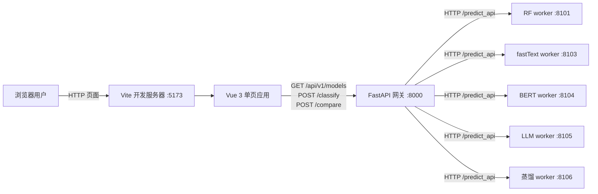

# TMF 前端开发全过程技术归档

## 0. 文档信息

| 项目 | 内容 |
|---|---|
| 文档目的 | 归档 TMF 从前端规划到首次可运行验证的实现过程、技术决策、问题和复现方法 |
| 归档范围 | 用户提出前端开发计划至 2026-10-20 局域网访问改造与两项前端排障结束 |
| 生成日期 | 2026-10-20（Asia/Shanghai） |
| 最近更新 | 2026-10-20（局域网访问改造；启动 BAT 幂等修复；`crypto.randomUUID` 非安全上下文修复）；2026-10-20 晚状态回填（构建时间、`/compare` 网关日志、后端 stop 日志） |
| 项目路径 | `E:\AIModels\test\TouManFen\TouManFenClassifier` |
| 文档状态 | 持续增量更新；基于当前会话可见记录与当前文件、命令输出核验 |
| 证据标签 | 【已验证事实】、【历史记录】、【技术分析】、【待确认】 |
| 相关档案 | [PROJECT_LEARNING_GUIDE.md](PROJECT_LEARNING_GUIDE.md) 记录较早的 Streamlit/模型工程；[PROJECT_LEARNING_GUIDE_v2_工程化改造与集成验证.md](PROJECT_LEARNING_GUIDE_v2_工程化改造与集成验证.md) 记录后端工程化与前端对接准备 |

本档案只记录本轮 Vue 前端相关工作，不替代既有学习指南。按用户要求，以上两份学习指南均未修改。本轮新建本文档；前端代码、启动脚本和后端网关启动路径的修改均发生在本档案写作之前。

### 证据限制

- 当前可见会话提供了“准备开展前端计划”“参考 vivo 首页”“实现页面”“如何启动”“合并启动脚本”“无法使用并要求实测”等关键消息，也保留了本轮实际执行命令及输出。
- “前端开发计划”问题之后的部分早期助手答复没有完整出现在当前可读记录中，因此本文不逐字复述未能核验的规划内容；具体需求仅按可见消息与当前代码交叉确认。
- 当前项目目录没有可用 Git 元数据（执行 `git status` 返回“fatal: not a git repository”），因此不能提供可靠的提交差异或提交历史。当前文件内容、启动日志和本会话命令输出作为主要证据。
- 未读取或记录任何密钥值；没有调用真实 LLM Provider，也没有验证其凭据。
- 浏览器 HTTP 响应已验证，但本轮没有取得可复核的页面截图或逐项人工视觉验收结果。

## 1. 阅读指南

建议按以下顺序阅读：项目目标与边界（第 2–3 节）→ 架构和实现（第 5–6、9 节）→ 时间线和决策（第 7–8 节）→ 问题案例（第 10–11 节）→ 验证、复现与遗留事项（第 12、14、16 节）。

本文的“已实现”不自动等同于“已验收”。例如，页面源码和响应式样式已经实现，开发服务器返回 HTTP 200；但本轮没有完整的浏览器视觉验收。对照第 12 节查看每项证据状态。

## 2. 项目概述

TMF（投满分）是一个中文新闻标题分类工程。既有后端由统一 FastAPI 网关协调 5 个模型 worker：随机森林、fastText、BERT、大语言模型和蒸馏 BiLSTM。此次前端工作为后端模型验证提供浏览器操作界面，支持单模型分类和多模型比较。

目标使用场景是本地开发与验证：用户输入新闻标题、选择一个模型或多个模型，查看类别、模型耗时和失败状态。它不是已经完成的生产产品；当前没有登录、持久化历史、用户管理、部署流水线或热搜采集业务。

### 用户明确提出的边界

- 参考 vivo 官网风格完成 TMF 页面设计。
- 热搜业务暂缓，待需求确认后再实现。
- LLM Provider 尚未确认；真实调用可能产生费用，联调不应默认触发。
- 后端已经有网关和分类/比较接口，前端应对接既有服务契约。
- 通过一个 BAT 启动前后端、另一个 BAT 停止前后端。

### 本轮交付目标

1. 新建 Vue 前端骨架及单页新闻分类实验台。
2. 对接 `GET /api/v1/models`、`POST /api/v1/classify` 和 `POST /api/v1/compare`。
3. 提供 Windows 一键启动和停止入口。
4. 实际构建并联调，定位“无法使用”的原因。

## 3. 原始需求与最终需求

| 需求 | 最终实现/状态 | 证据与边界 |
|---|---|---|
| 前端开发方向建议 | 历史阶段讨论过前端开发计划；完整早期答复在当前记录中不可核验 | 不补写未见到的详细建议 |
| 参考 vivo 官网 | 页面采用简洁导航、留白、大标题和蓝色科技感方向，使用 TMF 自有标识与 CSS 几何图形 | `frontend/README.md`、`frontend/src/App.vue`、`frontend/src/style.css`；不是逐像素复刻，也未使用 vivo 品牌资产 |
| 单模型分类 | 已实现 | 单页工作台调用 `/classify` |
| 多模型对比 | 已实现 | 显式传模型 ID 调用 `/compare`，展示逐模型状态和汇总 |
| 热搜话题采集/分类 | 本阶段不做 | 用户明确延期，等待需求确认 |
| LLM 调用控制 | 默认关闭；UI 有主动启用开关和费用/Provider 提示 | 默认 opt-in 已实现；真实 Provider 有少量成功调用记录（2026-10-20 16:22–18:06 共 16 次网关 ok，见第 12 节），未做系统评估 |
| 一键启动/停止 | 两个 BAT 已创建；启动成功。2026-10-20 起前端启动增加 5173 端口探测，可重复执行。后端 stop 已由 18:17 日志确认全部停止；前端窗口关闭仍待普通桌面复测 | 见第 10、12 节 |

## 4. 工程环境与项目结构

### 4.1 本轮核验的环境

| 项目 | 观测结果 |
|---|---|
| 操作系统 | Windows 11（版本信息来自阶段 0 基线报告；本轮未重新读取 OS build） |
| Node.js | `v24.19.0`（历史工具检查结果） |
| pnpm | `11.25.0`（安装输出） |
| 前端框架 | Vue `3.5.44`（依赖安装输出；`package.json` 使用 `^3.5.0`） |
| 构建工具 | Vite `8.3.4`（构建输出；`package.json` 使用 `^8.0.0`） |
| TypeScript | `5.9.3`（依赖安装输出；`package.json` 使用 `^5.9.0`） |
| 网关 | Python 3.10；当前启动路径采用 py3109 与 `venv-gateway` 包目录 |
| 前端开发地址 | `http://192.168.12.54:5173`（2026-10-20 局域网改造后；改前为 `http://127.0.0.1:5173`） |
| 后端网关地址 | `http://192.168.12.54:8000`（2026-10-20 局域网改造后；改前为 `http://127.0.0.1:8000`） |

版本号是本次安装/检查的观测值，不代表所有依赖已精确锁定。`pnpm-lock.yaml` 在本轮依赖安装时生成，用于记录解析结果。2026-10-20 起网关、5 个 worker 与 Vite 均绑定 `192.168.12.54`；地址来源为 `serving/config/processes.yaml`、`serving/config/workers.yaml`、`frontend/vite.config.ts` 与各模块 `api_flask_server.py`。

### 4.2 关键目录

```text
TouManFenClassifier/
├─ frontend/
│  ├─ src/App.vue          # 单页交互、模式状态、结果展示
│  ├─ src/api.ts           # HTTP 客户端与错误归一化
│  ├─ src/types.ts         # 后端响应类型
│  ├─ src/style.css        # 响应式页面样式
│  ├─ package.json         # Vue/Vite/TypeScript 命令和依赖
│  ├─ pnpm-lock.yaml       # 本轮安装生成的依赖锁定文件
│  └─ README.md            # 前端启动与 LLM 使用边界
├─ serving/
│  ├─ scripts/stage2.ps1   # 网关和 5 个 worker 的本地进程管理
│  ├─ gateway/             # FastAPI 网关
│  └─ README.md            # 服务能力、启动和已知边界
├─ docs/
│  └─ 前端对接说明.md       # API 契约、CORS、启停说明
├─ 启动TMF.bat
└─ 停止TMF.bat
```

## 5. 最终实现成果总览

### 已交付

- Vue 3 + TypeScript + Vite 前端工程。
- 单模型分类与多模型比较模式。
- 动态读取模型清单、启用状态和展示名；默认模型由后端响应提供。
- 标题输入、200 字前端限制、示例标题、请求加载状态、错误提示和请求编号展示。
- 分类结果类别、模型名称、后端耗时；比较模式展示成功/失败汇总和逐模型结果。
- LLM 默认不选用；单模型与对比请求均需要前端显式开启才可以选择 LLM。
- 两个 BAT 文件作为前后端启停入口。
- 网关启动器绕过当前虚拟环境的 `_ssl` DLL 加载故障，使用已验证可运行的 Python 与依赖目录组合。
- 局域网访问支持（2026-10-20）：网关与 5 个 worker 绑定 `192.168.12.54`（8000/8101/8103/8104/8105/8106），Vite 开发服务器绑定 `192.168.12.54:5173`，同网段成员可直接访问。

### 未包含

热搜抓取、语义聚类、新闻持久化、用户登录、权限、批量分类、置信度展示、模型文件管理界面、生产构建部署、Docker 和 CI。

## 6. 项目整体架构与核心业务流程



前端只依赖网关，不直接访问每个 Flask worker。这样模型地址、请求编排、错误归一化和 worker 变化由后端统一管理。2026-10-20 起页面来源为 `http://192.168.12.54:5173`，已在网关 CORS 白名单内；前端 API 默认基址是 `http://192.168.12.54:8000`，可以通过 `VITE_API_BASE_URL` 覆盖。

### 单模型数据流

1. 页面加载后请求模型清单。
2. 用户输入标题、选择模型并提交。
3. 前端生成 `X-Request-ID`，发出 JSON `POST /api/v1/classify`。
4. 网关转发给所选 worker 并返回分类、版本与耗时。
5. 页面根据 `pred_class` 映射中文类别名并呈现结果。

### 多模型比较数据流

前端把所选模型 ID 显式传到 `POST /api/v1/compare`，消费 `summary` 与逐模型 `results`。后端允许部分模型失败仍返回汇总，因此 UI 分开呈现整体成功比例和单模型错误，不把部分失败误显示成全局失败。

## 7. 项目完整实施时间线

下表按当前可访问记录的先后顺序整理；日期与精确时刻只在本轮命令日志可证实时使用。

| 序号 | 阶段 | 目标与实际操作 | 问题/决策 | 结果及影响 |
|---|---|---|---|---|
| 1 | 前端规划 | 用户提出开始制定前端开发计划 | 早期完整方案答复不在当前可核验记录中 | 后续开始以浏览器页面和现有后端为目标推进；不推测此前详细阶段划分 |
| 2 | 视觉方向 | 用户询问 vivo 官网能否打开，随后提出参考该网页设计 TMF | 视觉参考与品牌复用区分；页面采用 TMF 自有标识 | 形成留白、简洁导航、大标题、蓝色科技氛围的设计方向 |
| 3 | 前端初稿 | 新建 `frontend/`，实现 Vue 单页工作台、API 客户端、类型、样式、配置与 README | 选择现有网关 API；热搜延期；LLM 默认关闭 | 形成可构建的前端源代码 |
| 4 | 手工启动说明 | 用户询问浏览器打开方式、后端启动方式 | 前端需要安装 Node 依赖；后端用 `stage2.ps1` 启动网关和 worker | 给出分别启动前后端的方法 |
| 5 | 一键脚本 | 用户要求用两个 BAT 管理启停 | 创建 `启动TMF.bat` 和 `停止TMF.bat` | 首次 BAT 在当前命令环境下出现解析/启动问题，随后改成 ASCII、CRLF，并调整启动顺序 |
| 6 | 复现无法使用 | 用户要求实际尝试；初检发现 5173 与 8000 拒绝连接，`frontend/node_modules` 不存在 | 先安装依赖；需访问 npm registry，沙箱内请求返回 `EACCES`，随后获准沙箱外安装 | pnpm 安装 45 个包并生成锁文件 |
| 7 | 构建排错 | 执行 `pnpm build` | `App.vue` 有未使用的 `apiBase`，触发 TS6133；移除无用导入/变量 | 二次构建成功，生成 Vite 生产构建产物 |
| 8 | 后端排错 | 首次启动 worker 后网关在 60 秒内未就绪 | `venv-gateway` Python 导入 `ssl` 时 `_ssl` DLL 加载失败；以 py3109 加载网关包目录进行隔离验证 | 调整 `stage2.ps1` 的网关启动解释器和子进程 `PYTHONPATH`；同一路径下网关健康检查成功 |
| 9 | 集成验证与留机 | 使用启动 BAT，确认前端、网关、worker 和分类请求 | 停止验证受当前执行环境进程信息权限限制；前端窗口筛选改为标题通配匹配 | 前端 HTTP 200、网关 `healthz=ok`、`readyz` 5 worker up、fastText 预测 `realty`；最终再次启动并保留页面可访问 |
| 10 | 字体可读性调整 | 用户反馈页面字体偏小；统一放大 `frontend/src/style.css` 中的字号 | 对 `font-size` 中的 px 数值按约 1.12 倍调整，包含响应式 `clamp()` 字号 | CSS 已更新；本次未重新构建，也未完成浏览器视觉验收 |
| 11 | 局域网访问改造 | 用户要求把网关与 worker 的 `127.0.0.1` 全部改为 `192.168.12.54`，供同网段成员访问 | 绑定具体网卡地址（非 `0.0.0.0`）；网关、5 个 worker、CORS、Vite、验证脚本需同步 | 7 个端口全部监听 `192.168.12.54`；`stage2.ps1` 与 `verify_*.py` 改为从配置推导地址；局域网实测通过 |
| 12 | 启动 BAT 幂等修复 | 用户双击 `启动TMF.bat` 报 `Error: Port 5173 is already in use` | 前端已在运行时 BAT 仍无条件再起 Vite，`strictPort` 固定端口必然失败 | 增加 5173 探测：TMF 页面 200 时跳过启动并退出 0；被其他进程占用时给出明确错误；连续执行两次均成功 |
| 13 | 局域网 HTTP 非安全上下文修复 | 页面能打开，但一直提示“暂时无法连接 TMF 后端。请先启动后端服务，再重新加载。” | `http://192.168.12.54:5173` 属于非安全上下文，`crypto.randomUUID()` 为 `undefined`，请求在 `fetch` 之前就抛 `TypeError` | `api.ts` 的 `requestId()` 改为 `randomUUID → getRandomValues → 时间戳` 三级回退；无头 Edge 实测模型列表恢复加载 |

## 8. 核心技术决策档案

### 决策 1：采用独立 Vue SPA，而不是继续扩展旧 Streamlit 页面

- **背景**：本轮目标是为已经工程化的后端网关准备浏览器端产品页面；既有学习档案记录的是旧 Streamlit 验证界面。
- **方案**：在 `frontend/` 建立 Vue 3 + TypeScript + Vite 项目，前后端通过 HTTP API 解耦。
- **选择主体**：用户表达前端开发计划；当前会话中的实际实现选择采用 Vue SPA。当前可见消息没有用户指定必须使用 Vue，故记录为实现采用，而非声称用户明确指定。
- **影响**：UI 可独立开发和构建；需要 Node/pnpm、CORS 配置及 API 契约维护。
- **事后分析**：对已有 FastAPI API 和未来可迭代 UI 来说，这种边界清晰；是否长期继续 Vue，仍取决于团队技能与部署需求。

### 决策 2：用 vivo 的视觉方向作参考，不复制其品牌资产

- **背景**：用户提出参考 vivo 官网完成 TMF 设计。
- **实现**：自有 TMF 标识、CSS 几何视觉、留白、简洁导航与蓝色科技感；README 明确记录不复用 vivo 商标或素材。
- **证据边界**：前序浏览页面实际可读到首页标题与导航；自动化截图尝试超时。不能将本页称为逐像素复刻或经截图精确比对的设计。

### 决策 3：前端只访问统一网关，并遵循已存在的 API 契约

- **实现契约**：`GET /api/v1/models`、`POST /api/v1/classify`、`POST /api/v1/compare`；标题字段为 `title`，模型标识从服务端响应读取。
- **依据**：后端对接说明已有明确 schema、CORS 来源和部分失败语义。
- **取舍**：前端不直接拼接 8101–8106 worker URL，不自行猜测模型版本或置信度。

### 决策 4：LLM opt-in，默认不进入模型列表选择

- **背景**：后端此前的验证脚本只用 mock、真实 Provider 不在系统评估范围内（2026-10-20 晚间有少量真实调用日志，见第 12 节），真实请求可能计费。
- **实现**：`includeLlm` 初始为 `false`；需要用户勾选后才可以选择 LLM；比较列表默认排除 LLM。
- **范围限制**：本轮启动后端仍会启动 LLM worker，但没有请求 LLM 分类接口。前端开关仅控制本次前端是否把 LLM 纳入请求；不能替代后端 Provider 成本控制。

### 决策 5：热搜先不开发

- **选择主体**：用户明确表示热搜闭环等待需求确认后再开发。
- **结果**：本次 UI 只围绕手工输入标题、单模型分类和对比，未引入平台采集、存储、分类规则或 ToS 决策。
- **影响**：未来添加热搜时应新增独立数据源/业务模块和 API，而不把抓取逻辑塞进当前浏览器页面。

### 决策 6：针对网关 Python 的 `_ssl` 故障调整启动方式

- **事实**：`venv-gateway\Scripts\python.exe` 在当前执行环境导入 `ssl` 时失败；同一工程中的 `py3109` 可导入 SSL。使用 py3109 并将 gateway `Lib\site-packages` 放入该网关进程的 `PYTHONPATH`，可导入 FastAPI/Uvicorn 并启动应用。
- **采用**：`stage2.ps1` 用 py3109 执行网关，网关子进程加载既有 gateway 包目录；worker 启动方式未变。
- **权衡**：绕过当前环境 venv DLL 问题，不重建 venv；代价是网关不再由 venv Python 可执行文件解释执行，依赖目录通过 `PYTHONPATH` 注入，隔离程度下降。
- **验证**：调整后 stage2 全部启动成功，网关健康检查 200，5 个 worker ready，分类接口成功。

### 决策 7：启动流程等待后端 ready 后再打开前端

- **背景**：前端页面加载即请求模型清单；如果页面先打开而网关未 ready，首屏会显示后端连接失败。
- **方案**：由 `启动TMF.bat` 同步等待 `stage2.ps1 -Action start` 完成后，再启动 Vite。
- **取舍**：启动窗口会先等待模型 worker 加载，用户需要等更久才能看到前端；换取第一次进入页面时后端通常已准备好，并能在启动窗口直接看到失败输出。
- **状态**：当前 BAT 按此顺序运行成功；页面没有自动轮询，如果服务之后停止，需手动重新连接或重启服务。

### 决策 8：启动脚本按“可重复执行”设计

- **背景**：Vite 固定 `host: 192.168.12.54` 且 `strictPort: true`，第二次启动必然因端口被占用失败；用户会反复双击 `启动TMF.bat`。
- **方案**：启动前端前探测 `http://192.168.12.54:5173/`：返回 200（TMF 页面）则跳过并正常退出；被其他进程占用则给出明确错误；仅端口空闲时拉起 Vite。后端侧沿用 `stage2.ps1` 已有的“已在运行则复用”逻辑。
- **取舍**：BAT 多一次约 1 秒的探测，换来可重复执行；探测地址与监听地址一样是硬编码，IP 变更时需同步修改。
- **验证**：连续两次执行 `启动TMF.bat`，第一次启动前端，第二次输出 `TMF frontend is already running. Skipping a second Vite instance.` 并返回 0。

## 9. 核心模块逐步实现教程

### 9.1 Vite 前端工程

`package.json` 提供 `dev`、`type-check`、`build`、`preview` 命令。2026-10-20 起 Vite 固定监听 `192.168.12.54:5173`（`vite.config.ts` 与 `package.json` 的 `--host` 参数一致），局域网成员用同一地址访问。由于设置了 `strictPort: true`，端口冲突时 Vite 直接失败而不是悄悄切换端口；因此 `启动TMF.bat` 增加了端口占用探测（见 9.7），避免重复启动报错。

### 9.2 API 客户端

`frontend/src/api.ts` 将网关基址、API 前缀、请求 ID、JSON 序列化、超时与错误映射集中管理。单个请求默认 45 秒超时；网络异常转成 `ApiClientError`，保留 HTTP 状态、业务错误码和 request ID。调用点不需要重复实现 fetch 细节。

2026-10-20 修复：局域网 HTTP 地址不是安全上下文，`crypto.randomUUID()` 不存在，请求会在 `fetch` 之前抛异常。`requestId()` 现按 `crypto.randomUUID()` → `crypto.getRandomValues()` 自造 UUID v4 → 时间戳兜底三级回退，输出仍满足网关 `^[A-Za-z0-9._-]{1,64}$` 校验。

### 9.3 类型和接口契约

`frontend/src/types.ts` 描述模型清单、单模型响应、比较汇总、逐模型失败和错误响应。比较返回的类别字段可缺省（模型失败时），UI 用 `status` 和 `pred_class` 判断展示成功卡片还是错误信息。

### 9.4 单页状态

`frontend/src/App.vue` 维护标题、模式、模型选择、模型清单、请求状态、结果和错误。页面加载调用 `getModels()`；提交按模式分发到 `classify()` 或 `compare()`。模式切换会清除旧结果，避免把前一次结果误认为新模式的结果。

### 9.5 页面结构和反馈

主页面由 hero、分类工作台、结果区、模型状态区和关于区组成。设计稿没有使用 vivo 图片资产，主视觉由 CSS 轨道、渐变与几何形状构成。窄屏样式在 `style.css` 中处理，但本轮未进行完整设备矩阵视觉验收。

### 9.6 字体可读性调整

用户反馈前端页面文字偏小后，对 `frontend/src/style.css` 中各处 `font-size` 的 px 数值统一按约 1.12 倍放大，包括标题、正文、导航、卡片状态和窄屏 `clamp()` 字号。使用统一比例保留页面原有的字号层级；本次只修改 CSS，没有调整字体、字重、颜色或布局间距。`frontend/dist` 已于 2026-10-20 17:19:20 重新构建（晚于 `style.css` 16:33:12 的修改），但尚未完成浏览器视觉验收，因此需在实际页面检查文字换行、卡片溢出和窄屏布局。

### 9.7 一键脚本

`启动TMF.bat` 检查后端脚本、前端目录、pnpm 和 `node_modules`，先同步等待后端管理脚本报告全部 ready，再打开前端开发服务器窗口。这个顺序避免前端首次加载模型清单时后端尚未启动。

2026-10-20 起新增前端幂等判断：启动前探测 `http://192.168.12.54:5173/`。若已是 TMF 页面（HTTP 200），打印 `TMF frontend is already running. Skipping a second Vite instance.` 并正常退出；若端口被其他进程占用，给出明确错误而不是输出 Vite 堆栈；仅端口空闲时才执行 `pnpm dev`。BAT 内容保持纯 ASCII + CRLF。

`停止TMF.bat` 调用后端管理脚本的 `stop`，再用窗口标题筛选关闭前端窗口树。前端窗口在运行 pnpm 后标题可能变成 `TMF Frontend - pnpm dev`，所以筛选改为 `TMF Frontend*`。由于当前执行环境访问进程信息/终止权限受限，停止逻辑未在此环境完成端到端验证。

## 10. 关键问题与踩坑案例库

### 案例 1：初次启动时前端依赖不存在

- **背景**：BAT 设计为依赖已安装的 `frontend/node_modules`。
- **症状**：初检确认目录不存在；5173 无监听，浏览器连接被拒绝。启动脚本按预检查退出。
- **排查**：查询 `frontend/node_modules`、Vite 可执行文件、Node/pnpm，以及 5173/8000 端口。
- **修复**：执行 `pnpm install`。沙箱访问 npm registry 返回 `EACCES`，获准以沙箱外命令安装；共安装 45 个包并生成 `pnpm-lock.yaml`。
- **原理**：源代码与包管理器声明不包含运行所需的实际依赖文件；首次运行需从锁文件/清单安装依赖。
- **复用经验**：启动脚本应明确提示先安装依赖；项目应保留 lockfile 以便复现依赖解析。

### 案例 2：TypeScript 检查阻止生产构建

- **症状**：第一次 `pnpm build` 报 `src/App.vue(27,7): error TS6133: 'apiBase' is declared but its value is never read.`，构建退出码非 0。
- **原因**：`api.ts` 的 `getApiBase` 被导入并赋给 `apiBase`，页面没有使用它；当前 TypeScript 配置把未使用局部变量当作错误。
- **修复**：移除 App.vue 中无用的导入和变量。API 基址仍由 `api.ts` 内部使用，不影响请求。
- **证据**：修复后 `vue-tsc --noEmit && vite build` 通过；构建产物包含 `dist/index.html`、CSS 与 JS bundle。
- **经验**：构建检查不只是打包；它会发现开发模式未阻止的静态问题。提交前应运行 package scripts 中定义的 build。

### 案例 3：BAT 在当前终端环境出现乱码和命令解析错误

- **症状**：第一次 `cmd.exe /c` 调用 BAT 后出现多条乱码/命令未识别信息，以及 `Input redirection is not supported`；后端/前端均未正确监听。
- **排查**：检查 BAT 文件字节，发现文件为 UTF-8 无 BOM 且仅 LF 换行。执行环境的非交互 `timeout` 也无法使用。
- **修复**：脚本正文改为 ASCII、统一 CRLF；去掉 `timeout`，将启动流程改为前端检查→同步启动后端并等待 ready→打开前端。停止脚本保持独立。
- **因果判断**：【技术分析】这组改动后批处理可正常执行，且乱码/解析错误不再出现；但单凭一次现象无法把每条乱码严格归因于某一个字符编码机制。确定的事实是文件初始换行/编码形态与改写后运行成功之间存在对应关系。
- **经验**：Windows `.bat` 应用目标系统可稳定解析的编码与 CRLF；非交互任务不要依赖会等待键盘输入的 `timeout`。

### 案例 4：网关 Python 无法加载 `_ssl`

- **症状**：旧启动流程启动 worker 后，网关 60 秒未 ready，8000 拒绝连接。直接执行 venv Python 的 `import ssl` 报 `ImportError: DLL load failed while importing _ssl`。
- **对照证据**：py3109 Python 可正常打印 `OpenSSL 3.6.5`；用 py3109 并显式把 `venv-gateway\Lib\site-packages` 加到 Python 路径后，FastAPI/Uvicorn 可导入，网关启动且 `/api/v1/healthz`、`/api/v1/models` 返回 200。
- **根因状态**：已证实的直接故障是 venv 解释器在当前运行环境无法导入 `_ssl`；其更底层 DLL 装载原因未在本轮定位，因此不要将某个特定 DLL 缺失写成最终根因。
- **修复**：改 `serving/scripts/stage2.ps1`，以 py3109 启动 gateway，并只对子进程注入 `venv-gateway\Lib\site-packages`。worker 仍按原配置启动。
- **验证**：更新后实际 `stage2.ps1 -Action start` 报告“阶段 2 本地服务已全部就绪”；`/healthz` 正常，`/readyz` 显示 5 个 worker ready，分类成功。
- **风险**：该解决方案弱化隔离环境边界；长期应修复或重建 gateway venv，并在恢复独立 venv 后移除此兼容路径。

### 案例 5：停止脚本在沙箱里不能确认进程归属

- **症状**：执行停止 BAT 后，stage2 日志出现“进程不存在或归属不匹配”；`Get-CimInstance Win32_Process` 返回“拒绝访问”，taskkill 对前端窗口也曾返回“Access denied”。
- **前端修正**：观察到真实窗口标题变化为 `TMF Frontend - pnpm dev`，将过滤器改为 `TMF Frontend*`，用 `/T` 处理进程树。
- **后端边界**：stage2 依据 PID 和命令行 marker 确认进程归属；当前受限执行环境无法读取命令行，脚本按安全原则拒绝停止无法确认归属的进程。这是本轮验证环境的限制，不证明在用户普通桌面会话中必然失败。
- **最终状态**：停止脚本的前端通配筛选已改，后端 stop 逻辑在当前沙箱里未通过端到端验证。执行本归档前，前端和后端再次启动并通过请求验证，保持可用。
- **经验**：进程管理需要同时做到“能停止”和“不误杀”。不要为绕过访问限制而退化成 `taskkill /IM python.exe`；应在有正常进程查询权限的桌面环境复测。

### 案例 6：重复双击启动 BAT 报 `Port 5173 is already in use`

- **背景**：前端已在运行时再次双击 `启动TMF.bat`；此前还有一个隐藏的 Vite 进程占着 5173。
- **症状**：后端输出“已在运行/全部就绪”，但前端窗口报 `Error: Port 5173 is already in use`，Vite 退出码 1。
- **原因**：后端启动脚本是幂等的（`stage2.ps1` 检测到进程已在运行就复用），而 BAT 对前端是无条件 `pnpm dev`；Vite 配置 `strictPort: true` 且端口固定，第二次启动必然失败。
- **排查**：`Get-NetTCPConnection -State Listen -LocalPort 5173` 确认端口被占；读取 Vite 错误可知是端口冲突，不是依赖或命令错误。
- **修复**：启动前端前用 PowerShell 探测 `http://192.168.12.54:5173/`：TMF 页面 200 → 跳过；端口被其他进程占用 → 报错并提示关闭占用进程或运行停止脚本；端口空闲 → 启动。
- **验证**：连续两次执行 `启动TMF.bat`，第二次输出跳过提示、退出码 0，且没有新增窗口；5173 仍返回 200。
- **经验**：一键脚本应对“已在运行”状态幂等；“启动成功”不等于“可重复启动”。

### 案例 7：局域网访问时页面提示“暂时无法连接 TMF 后端”

- **背景**：服务改为监听 `192.168.12.54` 后，页面可打开，但首屏一直显示“暂时无法连接 TMF 后端。请先启动后端服务，再重新加载。”
- **症状与误判**：页面 HTTP 200、网关/worker 端口正常、`curl` 与 PowerShell 请求网关均 200，看起来像后端启动失败；但网关访问日志里没有任何来自浏览器的 `/api/v1/models` 请求。
- **排查**：用无头 Edge 打开页面并抓取浏览器控制台，得到 `Uncaught TypeError: crypto.randomUUID is not a function`；直接导航到 `http://192.168.12.54:8000/api/v1/healthz` 返回 200，证明网络、防火墙与 CORS 正常。
- **根因**：浏览器只把 HTTPS 和 localhost/127.0.0.1 视为安全上下文；`http://192.168.12.54:5173` 不是安全上下文，`crypto.randomUUID()`（`[SecureContext]` API）为 `undefined`。`requestId()` 在 `fetch` 之前抛出异常，请求从未发出，`getModels()` 直接 reject，页面显示固定的“无法连接后端”文案。
- **修复**：`requestId()` 三级回退：`randomUUID` → `getRandomValues` 自造 UUID v4 → 时间戳+随机数兜底；重新构建 `dist`，`vue-tsc --noEmit` 通过。
- **验证**：无头 Edge 加载页面后 DOM 出现“随机森林 / fastText / 蒸馏 BiLSTM / 服务就绪”，错误文案消失；网关日志出现 `GET /api/v1/models 200`。
- **经验**：`[SecureContext]` API 在局域网 HTTP 页面不可用（同类还有 `navigator.clipboard`、`crypto.subtle`）；前端提示“无法连接后端”也可能表示“请求根本没发出”，不要只查后端。

## 11. 重要方案变更与返工分析

1. **前后端并行启动改为先后启动**：第一次脚本直接打开两个窗口，后来改成等待后端 ready 再启前端。原因是前端加载模型列表依赖网关可用。
2. **gateway Python 运行入口变更**：从 venv 的 `Scripts/python.exe` 切换为 py3109 + venv 包目录。原因是可复现的 `_ssl` 导入失败；该调整只针对启动器，并保留 worker 解释器。
3. **BAT 文本格式变更**：由非 Windows 兼容的初始文件格式改为 ASCII/CRLF，且移除 `timeout`。触发原因是实际命令解析失败。
4. **TypeScript 未使用变量修复**：构建实际报错后删除未使用变量，不改变 API 地址行为。
5. **停止脚本匹配范围调整**：从精确标题改为前缀通配标题，适应 pnpm 修改控制台标题；后台 PID 检查仍遵守归属校验。
6. **服务地址整体切换到局域网**：绑定地址从回环地址改为 `192.168.12.54`，网关、worker、CORS、Vite、验证脚本与文档同步修改；代价是地址与网卡绑定，IP 变更需同步调整。
7. **启动脚本增加幂等探测**：前端启动前检查 5173 是否已被 TMF 页面占用，避免 `strictPort` 冲突；探测失败时区分“TMF 已在运行”和“被其他进程占用”。

## 12. 测试、验证与验收证据

| 项目 | 状态 | 本轮证据 | 限制 |
|---|---|---|---|
| 依赖安装 | 已验证 | pnpm 安装 45 个包并完成 | registry 访问需沙箱外授权 |
| TypeScript 检查 | 已验证 | `pnpm build` 的 `vue-tsc --noEmit` 通过 | 仅当前依赖版本 |
| Vite 生产构建 | 已验证 | Vite 8.3.4 构建成功，生成 3 个产物（`frontend/dist`，mtime 2026-10-20 17:19:20） | 未部署到生产静态服务器 |
| 前端开发页面 | 已验证 | 2026-10-20 改造前 `http://127.0.0.1:5173/` 返回 200；改造后 `http://192.168.12.54:5173/` 返回 200 | 未做截图和浏览器视觉验收 |
| 字体尺寸调整 | 已修改并已进入构建，待视觉验收 | `frontend/src/style.css` 字号 px 数值约放大 1.12 倍（mtime 2026-10-20 16:33:12）；`frontend/dist` 构建于 17:19:20，且 dist 的 CSS/JS 含当前源码指纹（`clamp(52px,5.2vw,85px)`、`getRandomValues`），可确认构建晚于当前源码 | 已确认构建包含当前样式/脚本，但仍需检查桌面/窄屏文字溢出和换行 |
| 网关健康 | 已验证 | `/api/v1/healthz` 返回 `status=ok` | 本地开发环境 |
| worker 就绪 | 已验证 | `/api/v1/readyz` 的 5 个 worker 均 up | 不代表真实 LLM Provider 可用 |
| 单模型分类 | 已验证 | 标题“北京二手房成交量创年内新高”，fastText 返回 `realty` | 未测边界输入矩阵/压力 |
| 多模型对比 | 部分验证（网关层已验证；UI 点击未验收） | 本归档写作时本轮没有发出 compare 请求；此后网关日志中 `/api/v1/compare` 路由命中 98 次（按 path 计 100 次，另 2 次为路由上线前 `unmatched` 的 404）；其中 77 次 200，21 次非 200（400×14、404×6、422×1，属边界/负例请求）；最近 4 次为 18:03:39–18:05:20 且均为 200 | 日志不能区分请求来自 Vue 页面还是验证脚本；未做浏览器点击验收 |
| LLM Provider | 部分验证（有成功调用，无系统评估） | 归档写作时称本轮未调用 LLM；但网关日志记录了 2026-10-20 16:22–18:06 共 16 次经真实 8105 的 `model_call=ok`（0.5–4.0 s，含 17:20–17:22 的 compare），无法区分是否由本页面发起 | 密钥/网络/计费/延迟未做统计评估；前端 LLM 点击路径仍未验收 |
| 热搜业务 | 未实现 | 用户已延期 | 待需求确认 |
| 启动 BAT | 已验证 | 使用该脚本启动后端和前端，检查前端 HTTP 200 与后端分类接口 | 2026-10-20 18:17 已停止；"当前服务保持运行"仅指当轮 |
| 停止 BAT | 后端已验证；前端待复测 | 2026-10-20 18:17:02–18:17:15 `serving/logs/stage2-script.log` 记录逐个停止 gateway 与 5 个 worker，输出“全部已停止，状态文件已清理”；前端窗口按标题 `TMF Frontend*` 关闭 | 日志证明 stage2 管理的后端进程全部停止；前端窗口关闭与端口释放仍建议在普通桌面复测 |
| 局域网监听 | 已验证 | 7 个端口（5173/8000/8101/8103/8104/8105/8106）全部监听 `192.168.12.54`；`/readyz` 5 worker up；局域网地址请求分类成功 | 同网段其他机器未人工验收 |
| 启动 BAT 幂等 | 已验证 | 连续两次执行 `启动TMF.bat`，第二次跳过前端启动并退出 0 | 端口被非 TMF 进程占用时的错误分支只做静态检查 |
| 浏览器端 CORS/预检 | 已验证 | 无头 Edge 从 `http://192.168.12.54:5173` 成功请求 `/api/v1/models`（含 `X-Request-ID` 预检） | 未做真实浏览器人工点击验收 |
| 非安全上下文下 `crypto.randomUUID` | 已验证修复 | 页面恢复加载模型列表；控制台无 `randomUUID` 异常 | 其他 `[SecureContext]` API 未使用 |

## 13. 从本项目中学习到的核心技术原理

### 13.1 前后端分离不是“把代码放两个目录”

解耦的核心是稳定的 HTTP 契约：前端消费网关的 JSON 请求/响应，后端负责 worker 路由、模型健康和错误归一化。目录分离、不同语言并不自动带来解耦；接口字段和错误语义才是双方的边界。

### 13.2 开发服务器、网关、模型 worker 是三个独立进程层

浏览器访问 Vite 的 5173 端口，Vite 返回页面；页面发 API 请求到网关 8000；网关再调用各 worker 8101/8103/8104/8105/8106。只看到页面 HTTP 200，不能证明分类 API 正常；需要分别验证每一层。

### 13.3 CORS 是浏览器安全策略，不是后端可达性的替代证明

本地前端与后端端口不同属于跨源访问。后端允许具体 localhost 来源，浏览器才会放行响应。PowerShell 直接请求 HTTP 不受浏览器 CORS 限制，因此命令行 200 只能验证服务可达，不能单独验证浏览器跨域配置正确。

### 13.4 `PYTHONPATH` 选择依赖目录，解释器仍决定 ABI 和原生 DLL 环境

本轮通过 py3109 运行 Python 代码，并从另一个环境的 `site-packages` 加载纯 Python/兼容扩展包，解决了 venv Python 的 `_ssl` 加载问题。此方式仍依赖 Python 次版本、平台和原生扩展 ABI 兼容，不能把它当作普遍的 venv 替代方案。需要记录来源并持续验证依赖兼容。

### 13.5 启动顺序是系统状态的一部分

并发打开两个窗口会产生 ready 时序问题。通过后端启动脚本的 readiness 检查，再启动前端，构成简单依赖编排。更复杂部署应由 Docker Compose、进程监督器或服务编排系统显式管理依赖与重启策略；当前本地验证不需要引入这些组件。

### 13.6 安全上下文决定了部分 Web API 是否可用

浏览器把 HTTPS 和 localhost/127.0.0.1 认定为安全上下文，普通 HTTP + 局域网 IP 不是。带 `[SecureContext]` 标记的 API（`crypto.randomUUID`、`crypto.subtle`、`navigator.clipboard` 等）在非安全上下文中直接不存在。前端若在开发时用 localhost、验证时用局域网 IP，就可能出现“本机正常、别人打开报错”的差异；这类 API 必须提供降级实现，或用 HTTPS 部署。

## 14. 可复现的实施与调试指南

### 14.1 当前推荐启动方式

前端依赖已经安装。双击项目根目录的 `启动TMF.bat`，等待后端输出全部就绪，再访问 `http://192.168.12.54:5173`（同网段其他成员使用同一地址）。`启动TMF.bat` 可重复执行：前端已在运行时自动跳过，不会因 5173 被占用报错。本轮命令行实际验证过同一 BAT 流程。

若首次运行或 `frontend/node_modules` 被清理，先在项目根目录运行：

```powershell
cd E:\AIModels\test\TouManFen\TouManFenClassifier\frontend
pnpm install
```

首次安装命令本轮执行成功，但当前工具沙箱访问 npm registry 首次返回 `EACCES`，需要允许网络访问。

### 14.2 单独启动

后端（项目根目录）：

```powershell
powershell -NoProfile -ExecutionPolicy Bypass -File serving\scripts\stage2.ps1 -Action start
```

前端（另一个 PowerShell 窗口）：

```powershell
cd frontend
pnpm dev
```

结束时：

```powershell
powershell -NoProfile -ExecutionPolicy Bypass -File serving\scripts\stage2.ps1 -Action stop
```

这条后端 stop 命令在本轮执行过；2026-10-20 18:17 的 `serving/logs/stage2-script.log` 已记录网关与 5 个 worker 全部停止、状态文件清理（此前因进程命令行访问限制未能在当轮确认）。不要用 `taskkill /IM python.exe` 替代归属检查。

### 14.3 本轮已执行的验证命令

```powershell
cd frontend
pnpm install
pnpm build
```

`pnpm install` 与修正后的 `pnpm build` 已执行成功；第一次 build 曾因 TS6133 失败，修复后重跑通过。

PowerShell 联调（本轮实际执行过同等请求）：

```powershell
Invoke-RestMethod http://192.168.12.54:8000/api/v1/healthz
Invoke-RestMethod http://192.168.12.54:8000/api/v1/readyz
```

分类验证请求体：

```json
{"title":"北京二手房成交量创年内新高","model":"fasttext"}
```

返回类别为 `realty`。未对真实 LLM 发请求。

2026-10-20 追加验证：

```powershell
# 确认监听地址与 worker 状态
Get-NetTCPConnection -State Listen -LocalPort 5173,8000,8101,8103,8104,8105,8106 | Select LocalAddress,LocalPort
Invoke-RestMethod http://192.168.12.54:8000/api/v1/readyz

# 重复执行启动脚本，确认幂等
cmd.exe /c "启动TMF.bat < nul"
```

并额外用无头 Edge 加载 `http://192.168.12.54:5173/`，确认页面渲染出模型列表、网关日志出现 `GET /api/v1/models 200`。

### 14.4 常见问题定位顺序

1. `5173` 拒绝连接：确认启动脚本是否通过依赖检查、`pnpm dev` 窗口是否仍在、端口是否冲突；若端口已被 TMF 前端占用，重新执行 `启动TMF.bat` 会自动跳过而不是报错。
2. 页面能开但模型列表显示离线：检查 `8000/api/v1/healthz`，再检查 `8000/api/v1/readyz` 和 `serving/logs/`；注意用局域网地址访问时网关只监听 `192.168.12.54`，`127.0.0.1:8000` 会连接失败。
3. 浏览器报 CORS：确认页面来源是 `http://192.168.12.54:5173`（`TMF_CORS_ORIGINS` 可追加其他来源），并查看 `docs/前端对接说明.md` 中白名单。
4. 网关启动失败：查看 `serving/logs/gateway.err.log`；检查 py3109 路径、gateway site-packages、`_ssl` 导入和网关 PID 状态。
5. 前端构建失败：先处理 `vue-tsc` 报错，再查看 Vite 构建错误；不要只看 dev 页面能否打开。
6. 页面提示“无法连接后端”但网关日志里没有请求：先看浏览器控制台是否有 `TypeError`（例如非安全上下文下调用 `crypto.randomUUID`），再检查 `api.ts` 的 request ID 生成逻辑；这类问题请求不会到达后端。

## 15. 工程避坑清单与最佳实践

- 前端 API 只走统一网关，避免把 worker 端口散落在 UI 组件中。
- 模型清单以服务端返回为准；不要硬编码 `model_version` 或未提供的置信度。
- 明确区分模型状态与供应商状态；`llm.status=up` 不表示真实 LLM 可用。
- 外部计费服务默认 opt-in，mock 与真实 Provider 应区分环境。
- 让启动脚本等待依赖 ready 后再打开前端，减少首次请求竞态。
- lockfile 应随依赖清单维护；构建前保证 install 已完成。
- Windows BAT 使用稳定换行/编码，并测试实际 cmd.exe 解释结果。
- 一键启动脚本应对“服务已在运行”幂等；固定端口的开发服务器（`strictPort`）重复启动必然失败。
- 局域网 HTTP 不是安全上下文：`crypto.randomUUID`、`crypto.subtle`、`navigator.clipboard` 等 `[SecureContext]` API 不可用，必须降级或改用 HTTPS。
- stop 流程只关闭可确认归属的 PID/窗口；不要按进程映像名批量杀 Python 或 Node。
- 构建成功、页面 200、API 健康和模型推理成功是不同层次的验收证据，逐项记录。
- 生产部署前补充错误边界、请求取消、自动重试策略、浏览器兼容、静态托管、HTTPS、鉴权和可观测性方案；当前都不属于已交付能力。

## 16. 未解决的问题、技术债务与后续路线

### P0：现有验证阶段应确认

- 在普通用户 Windows 桌面环境执行 `停止TMF.bat`，验证**前端窗口**退出与端口释放。**后端已部分闭环**：2026-10-20 18:17 `serving/logs/stage2-script.log` 显示由 stage2 管理的网关与 5 个 worker 全部停止且状态文件已清理；前端窗口关闭仍受当时沙箱进程权限限制，未端到端确认。
- 对页面进行真实浏览器视觉验收：桌面/窄屏布局、菜单、分类表单、结果卡片、断网恢复、键盘可达性。

### P1：开发迭代

- 端到端验证 compare 的全成功、部分失败、全失败三种返回。**网关层已有记录**：日志累计 98 次 `/api/v1/compare`（77 次 200；21 次为边界/负例），最近 4 次在 2026-10-20 18:03–18:05 且均为 200；但无法区分调用来源，也未做 Vue 页面点击验收。
- 补充前端自动化交互测试和 API mock；当前 package scripts 没有 test 命令，本轮没有新增/运行测试套件。
- 优化模型列表失败后的重试体验；当前提供手动“重新连接”，没有定时轮询。
- 评估 request cancellation：客户端设置了 45 秒 fetch timeout，但没有在页面卸载/切换时主动 abort。
- 通过用户确认后规划热搜模块的来源合规、抓取频率、历史存储和分类流程。

### P2：环境与运维

- 调查 `venv-gateway` Python `_ssl` DLL 故障的底层原因；若修复 venv，可考虑恢复隔离执行并简化 PYTHONPATH 注入。
- 在具备进程查询权限的终端验证 stop 脚本的进程归属检测、窗口通配匹配及重复启停。
- 真实 LLM Provider 的费用、密钥有效性、超时与错误只在明确授权后验证。

## 17. 项目文件与关键实现索引

| 文件 | 作用 | 当前关注点 |
|---|---|---|
| `frontend/src/App.vue` | 页面、交互状态、结果展示 | 单模型/比较模式、LLM opt-in、结果与错误 |
| `frontend/src/api.ts` | HTTP 请求层 | 默认基址、request ID（安全上下文三级回退）、45 秒超时、错误映射 |
| `frontend/src/types.ts` | API TypeScript 类型 | models/classify/compare/error 响应 |
| `frontend/src/style.css` | 页面样式 | 桌面与窄屏布局、颜色、几何视觉 |
| `frontend/src/main.ts` | Vue 入口 | 创建应用并挂载 `#app` |
| `frontend/vite.config.ts` | Vite 配置 | 192.168.12.54、5173、strictPort |
| `frontend/package.json` | 脚本和依赖声明 | dev/type-check/build/preview |
| `frontend/pnpm-lock.yaml` | 依赖解析锁定 | 本轮 `pnpm install` 生成 |
| `frontend/.env.example` | API 基址示例配置 | 不含 LLM 密钥 |
| `frontend/README.md` | 前端运行说明 | LLM 安全边界、局域网 HTTP 安全上下文约束、视觉方向 |
| `serving/scripts/stage2.ps1` | 管理网关与 worker | 当前 gateway Python 路径 workaround |
| `serving/README.md` | 服务层说明 | 网关能力与运行方式 |
| `docs/前端对接说明.md` | API/CORS 契约 | 前后端接口事实来源 |
| `启动TMF.bat` | 一键启动 | 后端 ready 后启动前端；5173 探测实现幂等 |
| `停止TMF.bat` | 一键停止 | stage2 stop + 前端窗口树 |
| `docs/PROJECT_LEARNING_GUIDE.md` | 旧 Streamlit/模型全流程归档 | 本轮未改动 |
| `docs/PROJECT_LEARNING_GUIDE_v2_工程化改造与集成验证.md` | 后端工程化与对接准备归档 | 本轮未改动 |

## 18. 关键操作与命令索引

| 命令/操作 | 用途 | 本轮状态 |
|---|---|---|
| `pnpm install`（frontend） | 安装 Vue/Vite/TS 依赖 | 已执行成功；首次沙箱网络请求被拒后获授权重试 |
| `pnpm build`（frontend） | 类型检查并进行 Vite 生产构建 | 一次失败、修复后成功 |
| `启动TMF.bat` | 启动五个 worker、网关与前端 | 已执行成功 |
| `启动TMF.bat`（连续执行两次） | 验证重复启动幂等 | 已验证：第二次输出跳过提示并返回 0 |
| `GET http://192.168.12.54:8000/api/v1/models`（浏览器） | 验证非安全上下文修复后的首屏请求 | 已验证：无头 Edge 成功加载模型列表 |
| `停止TMF.bat` | 停止后端与前端 | 已执行；因沙箱权限无法完全确认清理效果 |
| `GET /api/v1/healthz` | 检查网关进程 | 已验证 200/ok |
| `GET /api/v1/readyz` | 检查 worker 就绪 | 已验证 5 个 worker up |
| `POST /api/v1/classify` + fastText | 验证单模型闭环 | 已验证返回 `realty` |
| `POST /api/v1/compare` | 验证比较闭环 | 网关层：累计 98 次（77 次 200；21 次边界/负例），最近 4 次 2026-10-20 18:03–18:05 均 200；Vue 页面点击未验收 |

## 19. 技术术语表

| 术语 | 含义 |
|---|---|
| SPA | Single Page Application，单页应用；页面主体由浏览器端路由/状态驱动 |
| Vite | 前端开发服务器与构建工具 |
| worker | 单个模型的 HTTP 推理服务；本项目由 Flask worker 提供 |
| gateway | 统一 API 网关，负责模型登记、请求分发与错误/观测处理 |
| CORS | 浏览器跨源资源共享控制；决定不同端口的页面是否能读取 API 响应 |
| `PYTHONPATH` | Python 启动时额外加入模块搜索路径的环境变量 |
| ABI | 应用二进制接口；原生扩展需与 Python 版本、架构和运行时兼容 |
| opt-in | 默认不启用，用户明确选择后才执行 |
| readiness | 服务就绪检查；比“进程存在”更能证明服务已可以接收请求 |
| request ID | 请求关联编号，用于前后端日志/错误追踪，不是用户身份凭据 |
| 安全上下文（secure context） | 浏览器认定的可信来源（HTTPS 或 localhost/127.0.0.1）；普通 HTTP + 局域网 IP 不属于，`[SecureContext]` API 不可用 |
| strictPort | Vite 配置项；端口被占用时直接失败，不会自动切换端口 |
| 幂等（idempotent） | 同一操作重复执行不改变系统状态；本项目的启停脚本按此目标设计 |

## 20. 最终复盘与知识迁移

1. **核心挑战**：不只是搭建 Vue 页面，而是让前端依赖、Windows 启停脚本、Python 网关环境和 5 个模型 worker 在真实本机环境中按顺序协作。
2. **影响最大的决策**：沿用统一网关 API、默认排除 LLM、等待后端 ready 再启动前端，以及针对 `_ssl` 故障选择可实测的网关解释器路径。
3. **最有代表性的故障**：开发依赖缺失、静态类型检查失败、Windows BAT 格式兼容、venv 原生 DLL 装载错误、stop 脚本在受限环境无法读取进程命令行。
4. **可提前避免的返工**：写 BAT 前检查目标 shell 与编码；首次交付前运行 install/build；启动前后端时显式做 readiness；将“进程活着、端口监听、API health、模型 ready、推理成功”分层验收。
5. **可迁移经验**：保留真实错误输出；每次修复只改变一个可解释因素；使用对照实验确认运行时问题；对外部计费 API 用 opt-in/mock；将停止权限受限标记为验证限制，而不是误判为服务已停止。
6. **仍待确认**：停止 BAT 在普通桌面会话的完整行为、浏览器视觉验收、比较模式端到端测试、真实 Provider 能力，以及热搜子模块需求。
7. **本轮新增的两项修复**：启动 BAT 前端幂等探测（避免 `strictPort` 重复启动失败）、`requestId()` 安全上下文三级回退（修复局域网 HTTP 下 `crypto.randomUUID` 不可用导致的“无法连接后端”）。两者都不是后端故障，说明排障必须区分“浏览器是否真的发出了请求”。

## 附录 A：本轮验收快照

最后一次重新启动后实测：

```text
FrontendHttp : 200   (http://192.168.12.54:5173)
Gateway      : ok    (http://192.168.12.54:8000/api/v1/healthz)
ReadyModels  : 5     (/api/v1/readyz 全部 up)
Prediction   : realty (fastText；经网关 /api/v1/classify)
BrowserCheck : pass  (无头 Edge 渲染出模型列表，/api/v1/models 200)
StartBat     : idempotent (连续两次执行，第二次跳过前端启动)
```

该快照证明页面可访问、网关可用、worker 就绪及单模型请求成功；不能证明比较模式、真实 LLM、热搜或生产部署完成。2026-10-20 快照在局域网地址下取得；同网段其他机器的人工验收仍未进行。

补充证据（不改变上述快照）：2026-10-20 18:17 后端 stop 日志确认全部停止并清理状态文件；18:03–18:05 网关日志有 4 次 `/api/v1/compare` 200（日志累计 98 次 compare，其中 77 次 200、21 次边界/负例），但仍未做 Vue 页面点击验收。

## 附录 B：文档更新约定

后续发生前端开发时，可在本文的时间线、决策、问题案例、验证矩阵和遗留项中增量追加。每次更新都应记录新日期、实际执行结果和证据边界；不要将建议操作混写成已经完成的实施。既有两份 `PROJECT_LEARNING_GUIDE` 应继续作为独立历史档案维护。
